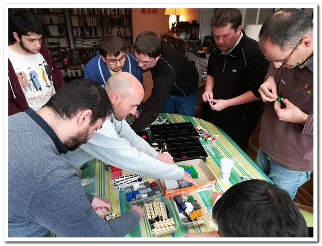
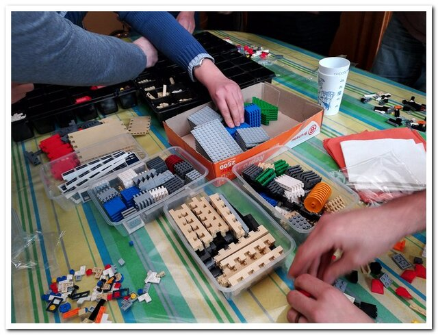
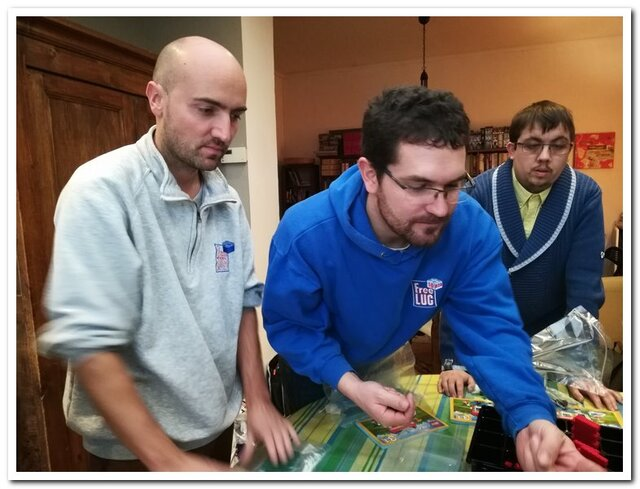
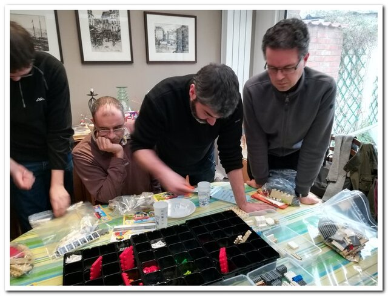
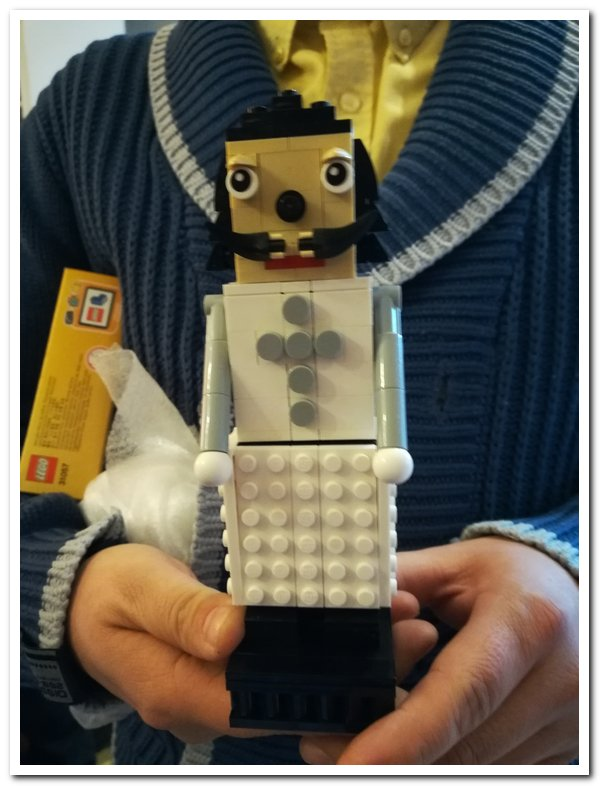
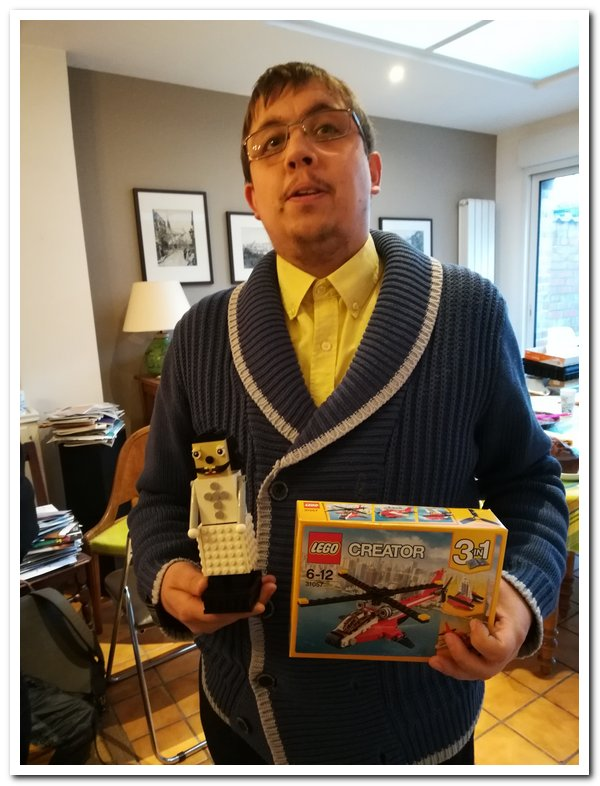

La fin de l’année est généralement l’occasion pour les gens de se retrouver pour un moment festif pour célébrer cette période. Le COR Nord avait donc lancé une invitation pour une auberge espagnole dans la métropole lilloise.

Après une période de sondage, la date du 16 décembre a donc été validée pour cette rencontre. Il faut dire que des informations en provenance de la Présidence indiquant que le tri du Bulk aurait lieu le week-end précédent ont certainement participé à faire pencher la balance vers ce samedi, avec l’espoir que le tri serait terminé et qu’il pourrait être transporté vers les contrées nordistes à cette occasion.

Le principe était simple, chacun apportait un plat salé ou sucré et une boisson à partager en toute convivialité.

Nous nous sommes donc retrouvés à 12 :  
\- Erik A., Pierre L., Arnaud M., Arnaud G., Mickaël G., Richard L., La famille Z. (Marie, Nathan, Simon et Philippe), ainsi que les frères V.D. (William, Floyd et Kevin), ces derniers étant organisateurs de l’expo de Chaulnes à laquelle Mika a eu l’occasion de participer en 2017, et d’où il est revenu enthousiaste.

Un draft était proposé aux participants autour du set Creator 31067, ainsi qu’un concours de création de figurine à l’échelle miniland, dans l’esprit du set "Casse Noisette" offert par TLC ces dernières semaines.  
Et puis comme c’est aussi la période des cadeaux, un peu de vrac a été distribué aux présents en fin d’après-midi.

Une séance de draft animée...

Kevin, seul participant au concours. Tant mieux pour lui, il a pu choisir son lot ;)

En plus de ces animations autour de la brique, nous avons évoqué la possibilité d’organiser une nouvelle Briqu’Expo dans la région, des constructions communes, et pourquoi pas l’organisation d’une REF (peut-être pas en 2018, mais pourquoi pas 2019).

Un chouette moment, auquel nous avons juste regretté qu’il n’y ait pas plus de membres extérieurs au COR Nord. COR Nord auquel il manquait un nom, et c’est chose faite depuis le 16 décembre, puisqu’il porte officiellement le nom de :

**COR NORD MACLEOD !**

Et encore un grand merci à Erik et Pierre qui ont transporté le Bulk.

Mika et Philippe
