Pour le moment 7 sets sont prévus dans la nouvelle gamme de la police des montagnes : 60170 à 60176 Penchons nous ici sur le deuxième set en terme de taille. Cette fois ci, les bandits qui se sont échappés de la prison partent dans les montagnes à le recherche du(des) trésor(s) qu’il y ont cachés. La brigade de la police des montagnes arrivera t’elle à les rattraper avant qu’ils ne s’enfuient ?

Le thème de la police est, avec celui des pompiers, le thème récurent chez la firme danoise. On ne compte plus les commissariats, hélicoptères, camions d’intervention déclinés en diverses versions. Après quelques sets en 2016 autour d’une prison située sur une île, et une police des marais auparavant, c’est dans la montagne que LEGO® envoie les policiers cette année.

-   Set N° : 60171 - L’évasion des bandits en montagne
-   Nombre de pièces : 88
-   Prix : 9,99€
-   Rapport prix/pièce : 11 cents/pièce
-   Nombre de figs : 4

La première chose que l’on remarque sur cette nouvelle gamme CITY, c’est le relooking de l’emballage. Le bandeau bleu est toujours présent, mais il est travaillé de manière à donner un effet de texture, pas seulement sur la face avant, mais sur 5 des côtés de la boîte (seule la face avec le code barre ne change pas).

[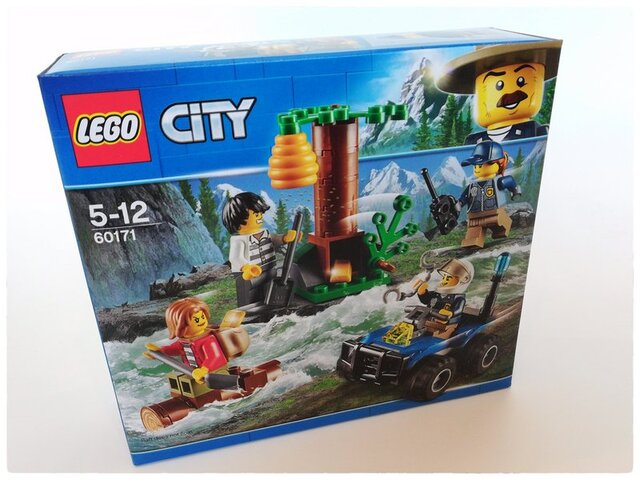](https://www.freelug.org/IMG/jpg/2017-12-28_-_60171_L_evasion_des_bandits_en_montagne_003.jpg)

La partie droite du bandeau propose toujours une tête de minifig, mais un élément de décor travaillé est placé en arrière plan. Pour cette thématique police de la montagne, il s’agit d’un beau sommet enneigé duquel dépasse un soleil couchant (ou levant). Le contenu de la boîte est également mis en valeur sur un beau décor, dépassant du cadre. L’ensemble est vraiment dynamique.

[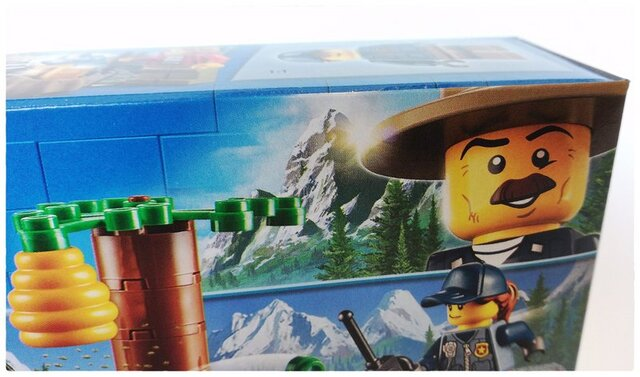](https://www.freelug.org/IMG/jpg/2017-12-28_-_60171_L_evasion_des_bandits_en_montagne_004.jpg)

La face arrière, à son habitude, propose les différents éléments de jouabilité dans 4 vignettes mises en relief. Là encore, le contenu dépasse des bords, dynamisant l’ensemble.

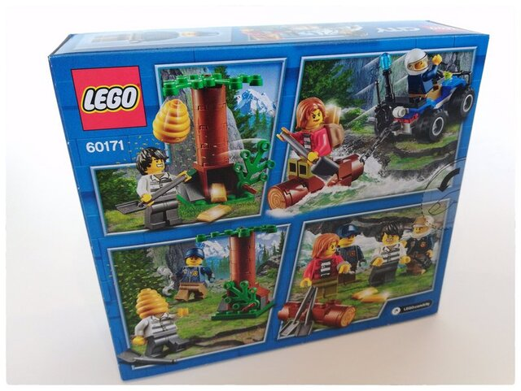

[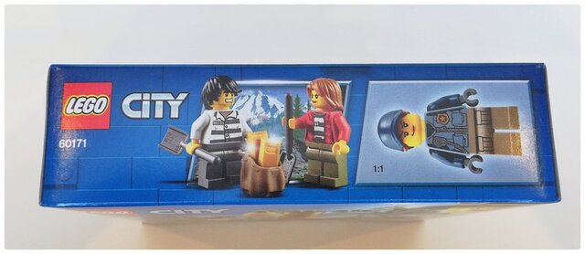](https://www.freelug.org/IMG/jpg/2017-12-28_-_60171_L_evasion_des_bandits_en_montagne_006.jpg)

Il n’y a pas à dire, avec ce nouveau relooking de la gamme les boites gagnent vraiment en attrait. Ça fait vraiment envie.

Deux sachets et une notice, le contenu habituel des boites dans cette catégorie de prix.

[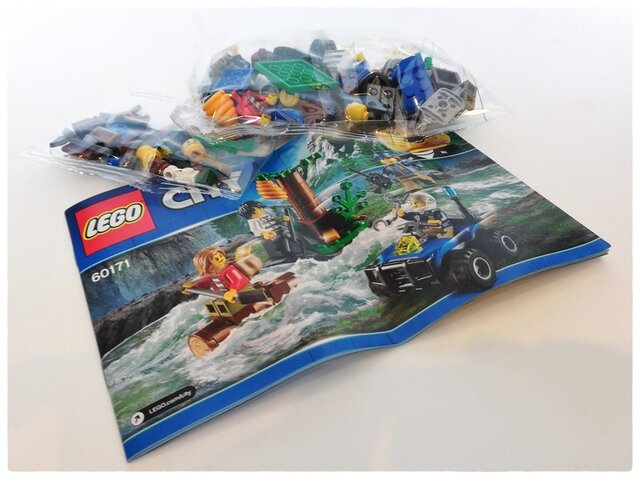](https://www.freelug.org/IMG/jpg/2017-12-28_-_60171_L_evasion_des_bandits_en_montagne_007.jpg)

Contrairement au set similaire de la série mineurs, le 60184, les figurines sont montées dès le début de la notice. deux bandits et deux policiers, c’est équitable, un homme et une femme dans chaque camp, la parité est respectée.

On construit ensuite les éléments de jouabilité de chacun.

Le tronc d’arbre sur laquelle madame bandit s’enfuit avec ses lingots d’or sur le dos.

[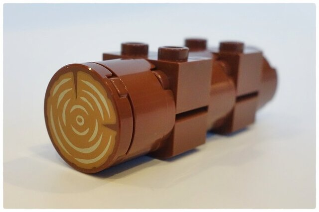](https://www.freelug.org/IMG/jpg/2017-12-28_-_60171_L_evasion_des_bandits_en_montagne_001.jpg)

[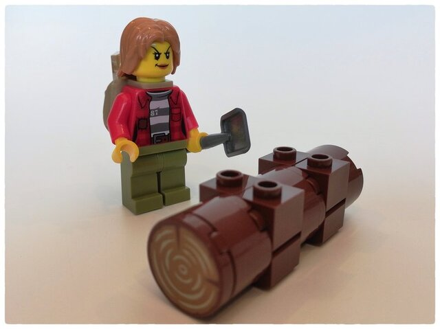](https://www.freelug.org/IMG/jpg/2017-12-28_-_60171_L_evasion_des_bandits_en_montagne_011.jpg)

On notera la tile round 2x2 reddish brown sérigraphiée pour faire le tronc d’arbre, qui n’apparaissait auparavant que dans le set Disney Princess : Snow White Cottage.

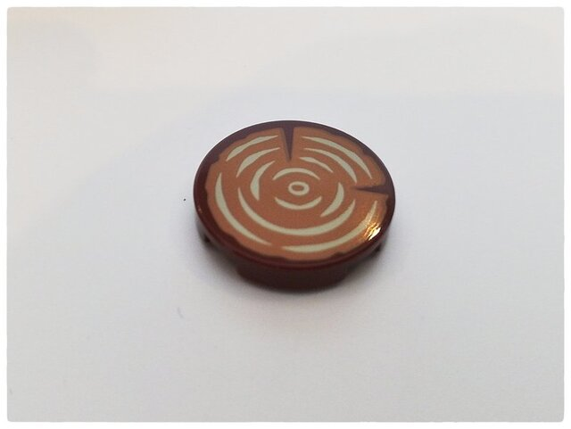

On équipe ensuite le policier de son quad afin qu’il se lance à la poursuite du tronc d’arbre, le long des rives de la rivière déchaînée.

[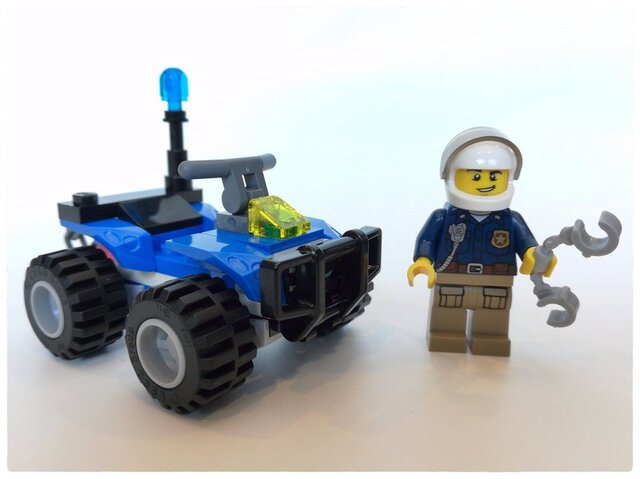](https://www.freelug.org/IMG/jpg/2017-12-28_-_60171_L_evasion_des_bandits_en_montagne_012.jpg)

Nouvelle pièce à l’inventaire : le garde boue. N’ayez crainte, il ne restera pas longtemps inédit à cette boite...

[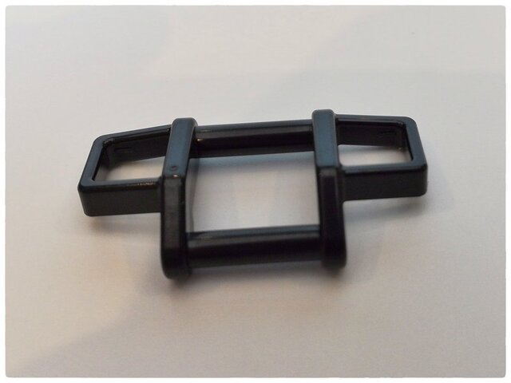](https://www.freelug.org/IMG/jpg/2017-12-28_-_60171_L_evasion_des_bandits_en_montagne_010.jpg)

Vient le temps de monter l’arbre creux, autour duquel se retrouvent la policière et le bandit armé d’une pelle. Un peu de branchage vient habilement dissimuler la cachette (hu hu hu). C’est ici qu’intervient LA nouvelle pièce qui a été largement commentée dans les différents forums lorsque les premiers visuels ont fuité : l’essaim d’abeille.  
C’est sympa, elle s’emboite sur la tête de la fig. Je suis très curieux et impatient de voir comment cette pièce va être détournée dans de futurs sets ou par les MOCeurs sur la toile.

[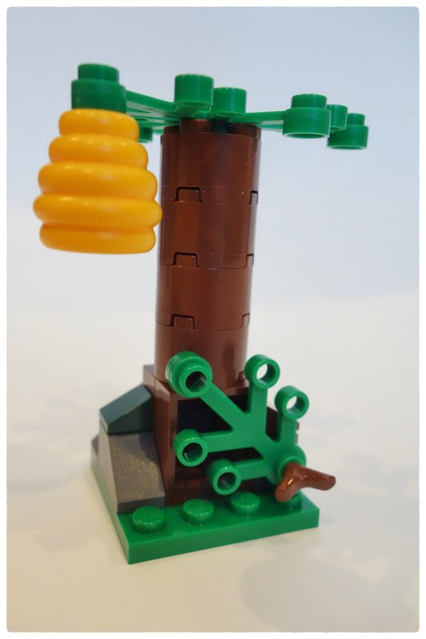](https://www.freelug.org/IMG/jpg/2017-12-28_-_60171_L_evasion_des_bandits_en_montagne_002.jpg)

[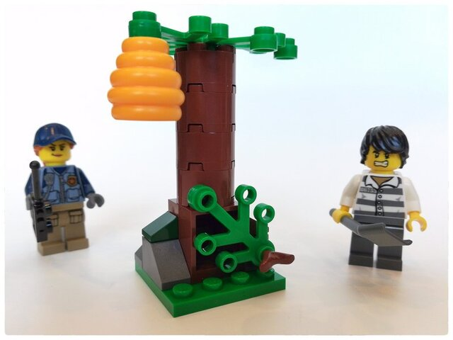](https://www.freelug.org/IMG/jpg/2017-12-28_-_60171_L_evasion_des_bandits_en_montagne_013.jpg)

Du côté des figs :

_Madame bandit :_

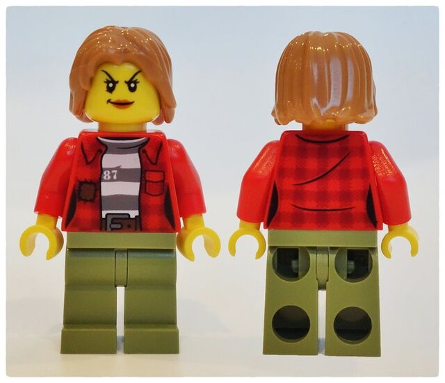

Elle a camouflé son uniforme rayé de prisonnière sous une chemise à carreau style trappeur. Le design est simple, le designer a même pensé à une pièce raccord sur le devant, mais le travail sur l’impression des carreaux est vraiment réussi. Sourcils froncés sur la tête, pour bien indiquer que c’est une personne pas commode.

_Monsieur bandit :_

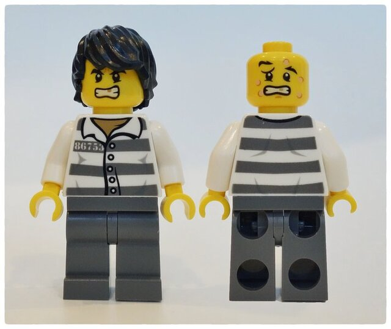

Pourquoi TLC se sent obligé de coller systématiquement une dent en or ou manquante aux bad guys ??? Rien d’exceptionnel sur la sérigraphie du torse, avec les traditionnelles rayures grises et blanches et le numéro d’identification. Par contre la tête bénéficie d’une double face, dont une assez drôle qui présente des boursouflures de piqûre de guêpes.

_La policière :_

[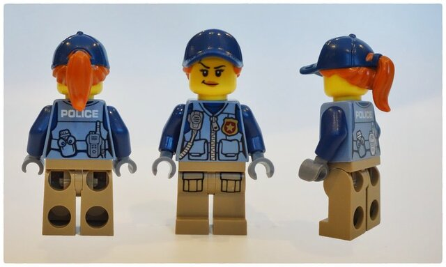](https://www.freelug.org/IMG/jpg/2017-12-28_-_60171_L_evasion_des_bandits_en_montagne_017.jpg)

Il n’est jamais évident de faire du neuf lorsqu’on doit évoquer un uniforme de policier. LEGO® réutilise les jambes en dark tan qui figurent également dans le thème mineurs, et équipe sa policière d’un gilet tactique avec talkie-walkie, gourde, micro, et badge. Le travail est propre, fin et fait parfaitement le job !

_Le policier pilote de quad :_

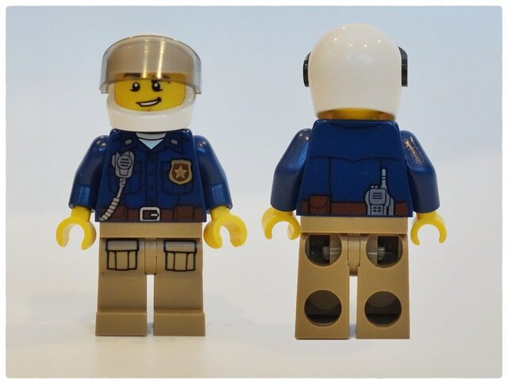

On notera les deux petites décorations sur les pointes du col de chemise. Pour le reste, même si la sérigraphie est propre, rien de vraiment original.

[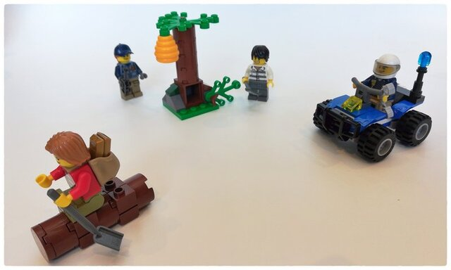](https://www.freelug.org/IMG/jpg/2017-12-28_-_60171_L_evasion_des_bandits_en_montagne_014.jpg)

**Conclusion :**  
Malgré ses 6 pièces de plus, je suis moins emballé par ce set que par le [60184 : l’équipe minière](/articles/2807/). Il faut reconnaître que les sets police ont du mal à se renouveler malgré l’environnement dans lequel les personnages évoluent. On tourne en rond entre les différentes évasions et poursuites. Ce ne sont pas les deux pièces inédites du set, ni les nouveaux vêtements qui feront la différence. J’attends avec impatience que le motif chemise à carreaux trappeur soit utilisé sans un uniforme de prisonnier en dessous.

Et voilà un arbre alternatif...

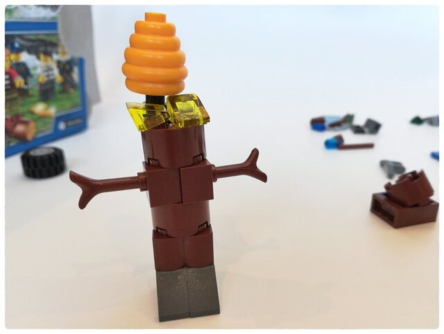
