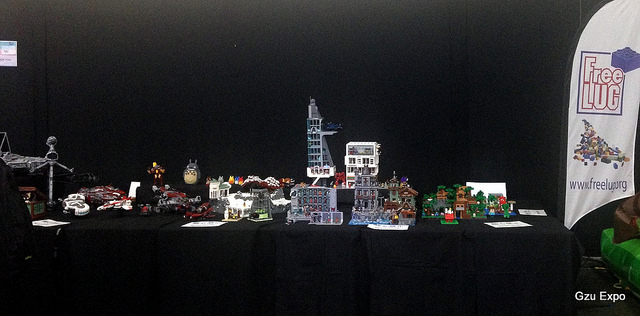
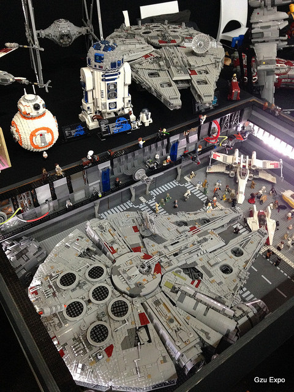
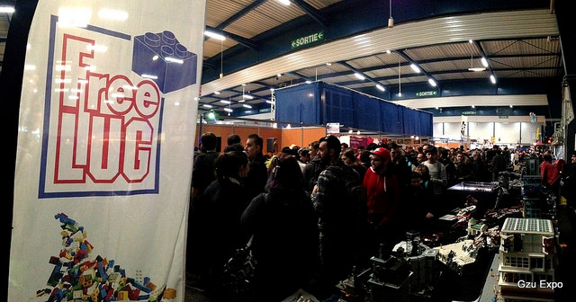
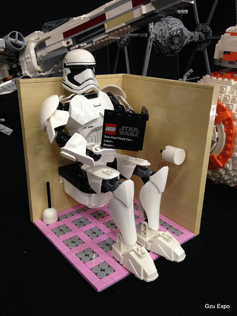

Les 2 et 3 décembre 2017 nous avons eu le plaisir d’exposer au TGS [Toulouse Game Show](https://toulouse-game-show.fr/) avec plus de 60.000 visiteurs !

Nous avons pu avoir un superbe stand sur fond noir, idéal pour les photos !

Quelle est votre version de L’UCS Millennium falcon préférée ? Celle de 2018 ou 2008 ? ;)

Il y avait du monde, beaucoup de monde !

Et un stormpooper ;)

Vous pouvez retrouver [plus de photos dans cet album](https://flic.kr/s/aHsma9YLq5)

Et d’autres créations des exposants :

-   Gzu : [https://www.flickr.com/people/gzubricks/](https://www.flickr.com/people/gzubricks/)
-   John\_Toulouse : [https://www.flickr.com/people/brick...](https://www.flickr.com/people/brickstoulouse/)
-   Bobdequatre : [https://www.flickr.com/people/bobde...](https://www.flickr.com/people/bobdequatre/)

Nous espérons pouvoir y retourner lors de l’édition d’avril 2018 !
