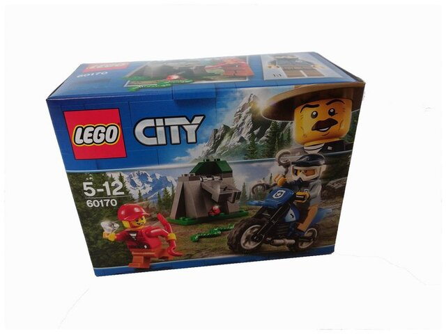
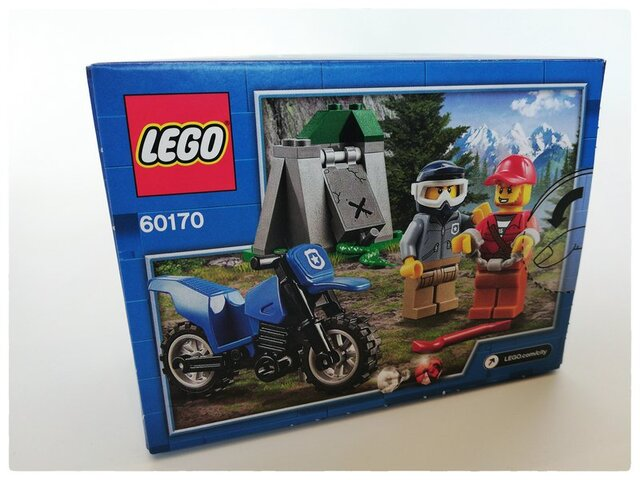
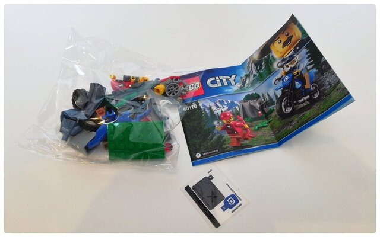
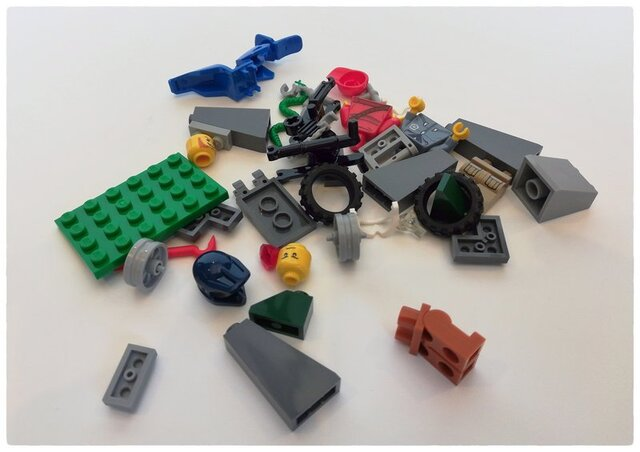
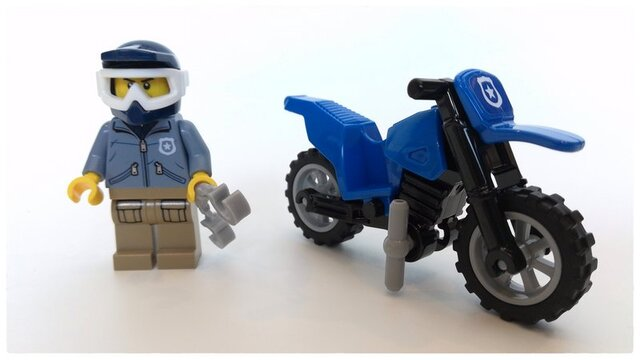
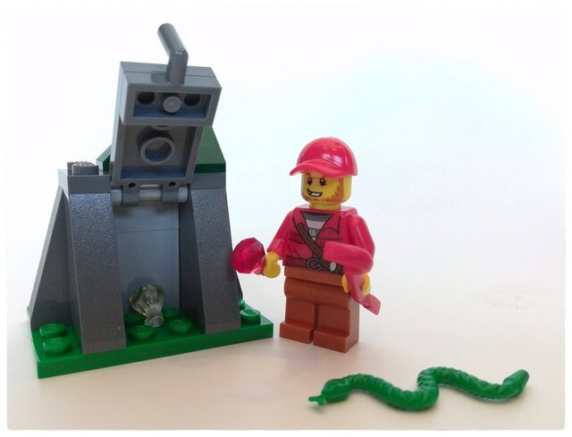
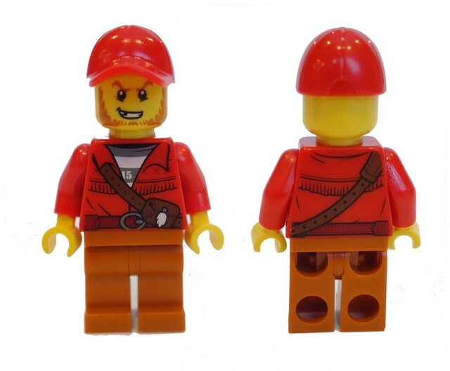
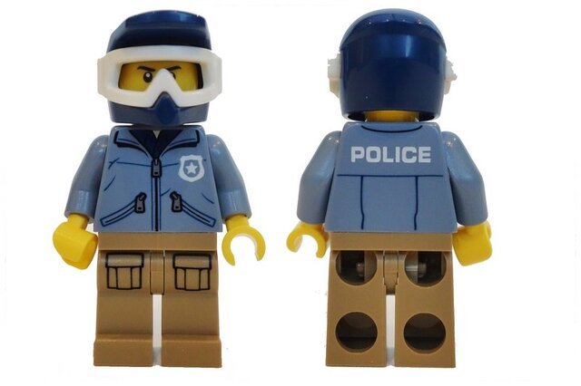
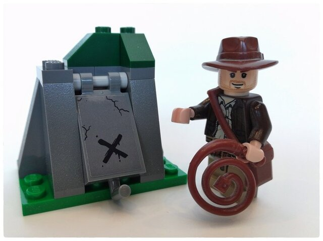

Que peut-on avoir aujourd’hui pour 5,99€ dans un LEGO® Store ou sur le Shop ?

Autopsions rapidement ce petit set pour nous faire une idée...

-   Set N° : 60170 - La poursuite en moto tout-terrain
-   Nombre de pièces : 37
-   Prix : 5,99€
-   Rapport prix/pièce : 16,2 cents/pièce
-   Nombre de figs : 2

Le relooking des boîtes City est toujours aussi plaisant et dynamique avec sa mise en relief.

Un bandit poursuivi par un policier en moto, voici la promesse de la face avant.

La face arrière spoile un peu l’histoire ;), mais rien ne vous empêche d’imaginer une fin alternative.

1 sachet de pièces, une notice et une planche de stickers...

C’est certain, 37 pièces (planche de sticker incluse) et un livret, ça ne fait pas grand-chose une fois étalés sur la table.

Une fois montés les deux personnages et la moto, il ne reste qu’une quinzaine de pièces pour monter le petit bout de rocher dans lequel l’affreux avait caché son magot.

Du côté des figs :  
_Le bandit_

Une casquette (mais ça peut aussi être un bonnet), mal rasé et avec une dentition mal entretenue, voilà à quoi on reconnait un méchant au Danemark semble t-il ;)  
Par contre, à l’instar de la chemise à carreau de Madame Bandit dans le [set 60171](/articles/2809/), j’aime beaucoup le design de veste trappeur à franges que je trouve vraiment réussi. Comme pour l’autre j’attends une version sans uniforme de prisonnier caché en dessous pour pouvoir en affubler certains personnages.

_Le motard de la police_

Ce policier de la brigade des montagnes arbore le nouveau casque Dirt Bike en Dark-Blue (attention, il est référencé en bleu sur Bricklink), avec une visière allongée.  
Jolie sérigraphie pour le blouson, les jambes en dark tan sont celles que l’on retrouve également dans certains sets du thème des mineurs.

**Conclusion :**

Il est certain que nous avons affaire là à un set d’entrée de gamme, le type de set que l’on achètera pour faire un cadeau à un enfant pour un anniversaire ou une autre occasion. Après 3 minutes de montage, l’enfant s’amusera à ouvrir la cache au diamant, et à mimer une poursuite entre le bandit et la moto (à moins que le bandit ne se fasse piquer par le serpent et trépasse dans d’atroces souffrances.... euhh... je m’égare là, mais les enfants peuvent être cruels parfois).

Pour les adultes, ce set n’apportera pas grand chose, surtout avec son ratio prix-pièce assez élevé, et terminera sans doute dans le panier sous le coup d’un achat impulsif, "pour compléter la série, parce que bon 5,99€, ça va pas faire exploser le budget".

Et rappelez-vous ce que disait ce bon Dr Jones : "Un X n’a jamais marqué l’emplacement d’un trésor."

Faudra revoir vos fiches professeur ;)
