Bonjour à tous, aujourd’hui je vous propose une review du set 21036 dans la gamme _Architecture_ : **Arc de Triomphe**.

Ce set sorti en 2017 est composé de 386 pièces et coûte 34,99 euros, soit un ratio prix/pièce de 9 centimes d’euros.

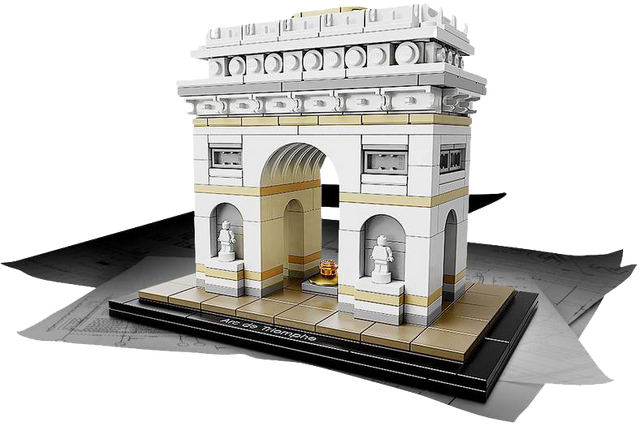

Au recto, on retrouve la signature de la gamme _Architecture_, boite totalement noire avec le set mis en avant sur des plans de construction.

[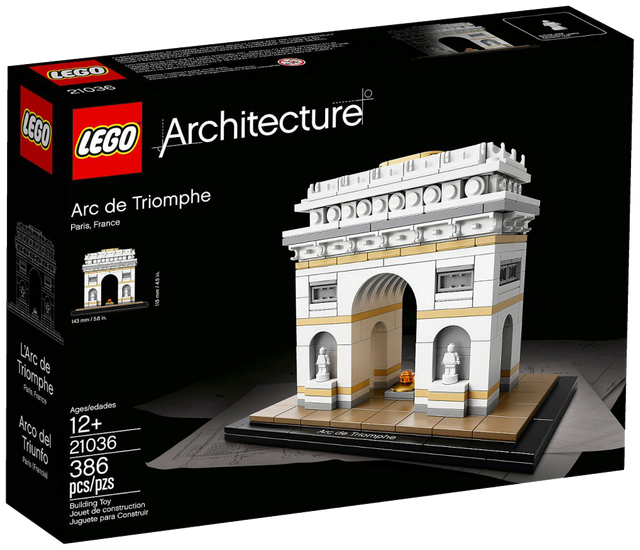](https://www.freelug.org/IMG/png/arctriomphebox_recto.png)

Au verso, des photos de l’édifice, la taille du modèle _LEGO_ et des informations.

[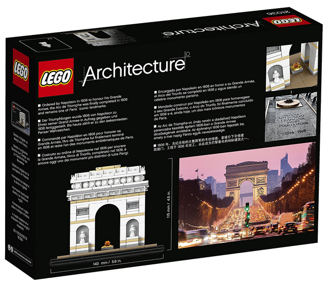](https://www.freelug.org/IMG/png/arctriomphebox_verso.png)

La boite contient quatre sachets et une notice.

[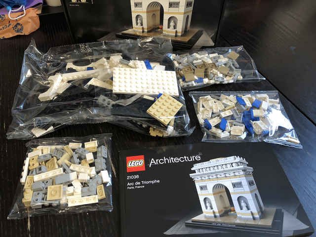](https://www.freelug.org/IMG/png/arctriomphe_02.png)

* * *

On commence la construction par le socle qui portera l’édifice.  
Vous apercevez aussi une des technique de montage, un sachet par boite. D’autres préfèrent mélanger toutes les pièces.

[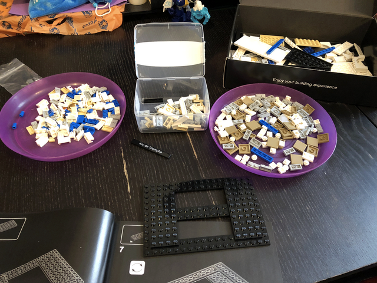](https://www.freelug.org/IMG/png/arctriomphe_03.png)

Le socle de base avec sa tile sérigraphiée "**Arc de Triomphe**".

[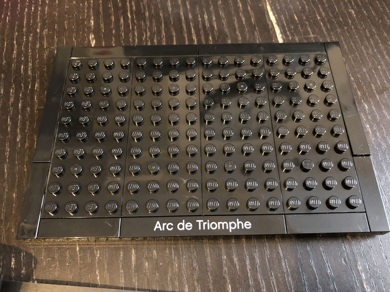](https://www.freelug.org/IMG/png/arctriomphe_04.png)

Le socle décoré avec des _tile tan_ et des _plates_ grises, on voit distinctement où vont venir les pieds de l’Arc et la flamme du soldat inconnu.

[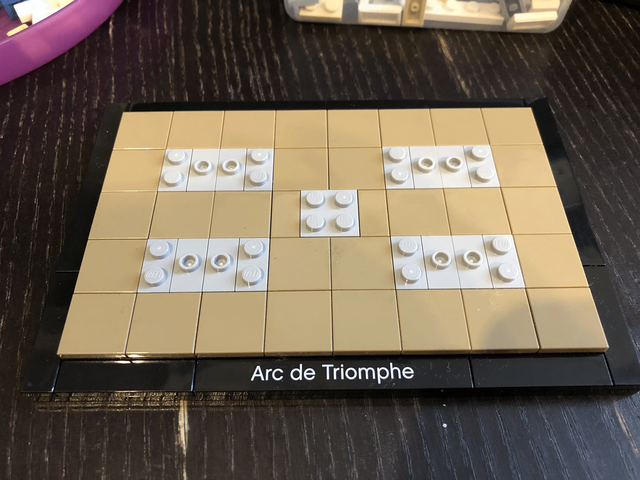](https://www.freelug.org/IMG/png/arctriomphe_05.png)

La flamme est en place, ainsi que les quatre pieds reliés par des arches, notez l’utilisation des microfigs pour les statues.

[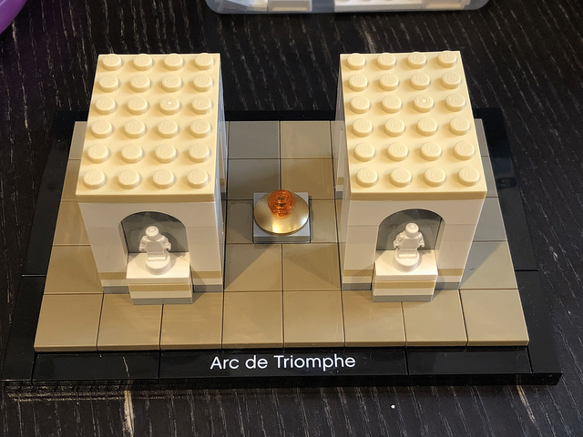](https://www.freelug.org/IMG/png/arctriomphe_06.png)

Nous sommes presque à la fin, manque plus que le haut de l’Arc.

[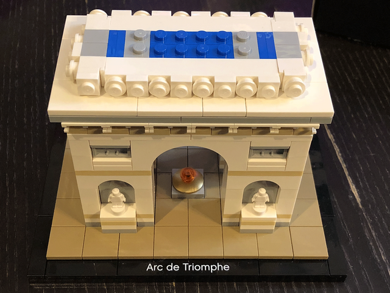](https://www.freelug.org/IMG/png/arctriomphe_07.png)

Et voici l’Arc de Triomphe terminé.

[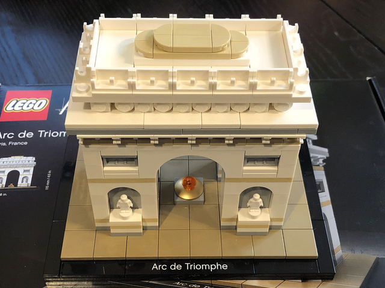](https://www.freelug.org/IMG/png/arctriomphe_08.png)

Vue de trois-quart.

[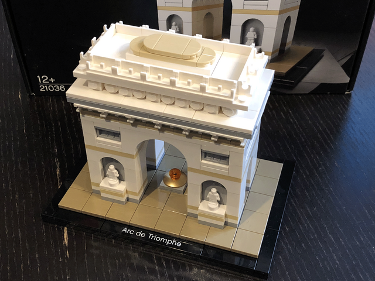](https://www.freelug.org/IMG/png/arctriomphe_09.png)

* * *

**AVIS :**

Un des sets _Architecture_ que j’ai eu le plus de plaisir à monter malgré les répétitions et la rapidité (40 minutes). Des technique sympa et une belle reproduction de ce monument Parisien, bref avec un brin de chauvinisme je vous conseille vivement ce set.
