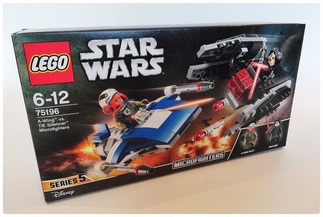
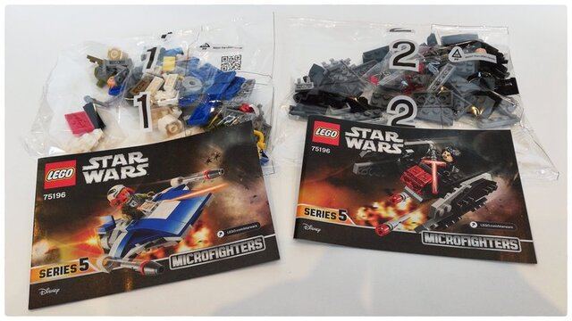
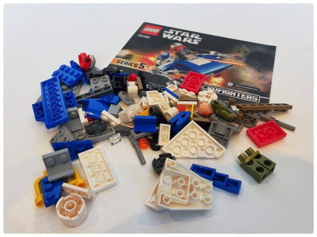
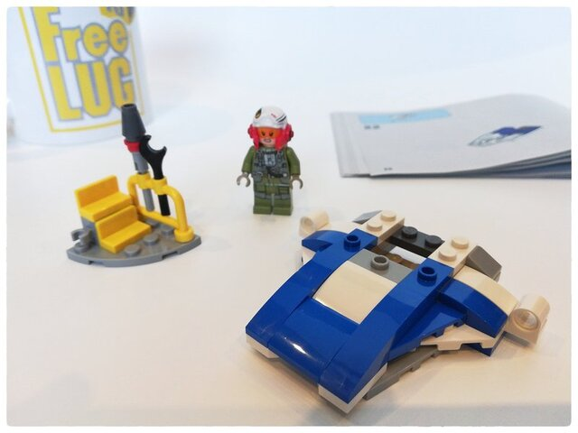
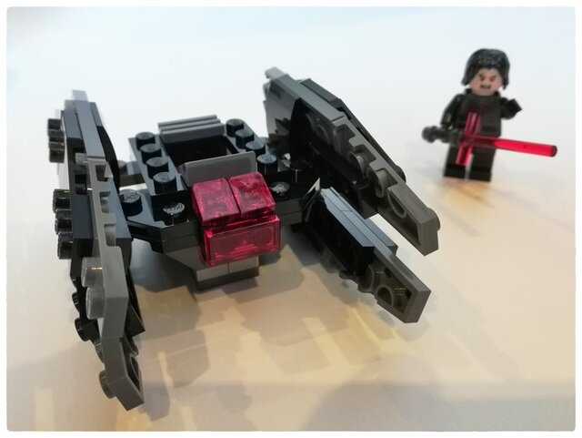
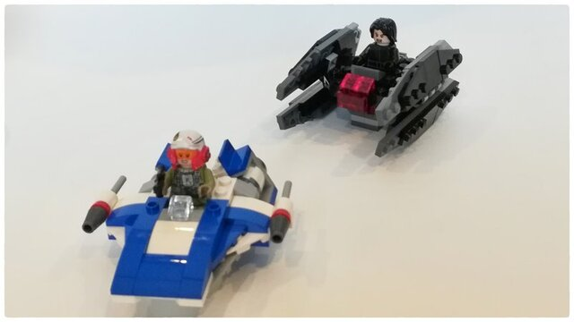
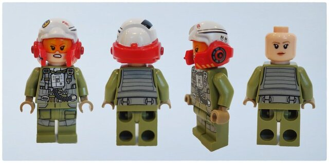
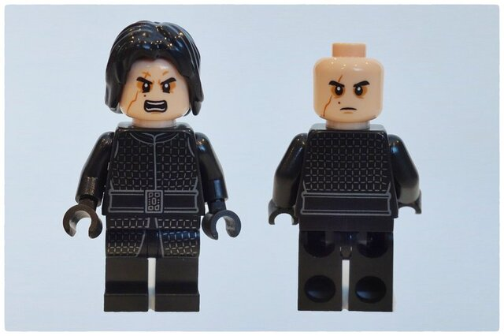

Dans ce set 75196, le double programme se compose d’un A-Wing de la Résistance et d’un TIE Silencer.

-   Set N° : 75196 - A-Wing vs TIE Silencer
-   Nombre de pièces : 180
-   Prix : 19,99€
-   Rapport prix/pièce : 11,10 cents/pièce
-   Nombre de figs : 2

Cette revue est en quelque sorte une suite à [celle du set 75195](/articles/2823/), je vous laisse donc vous y référer.

Dans la lignée du set 75195, cette boite nous présente les deux vaisseaux dans une mise en scène dynamique, un duel spatial entre le A-Wing de la Résistance et Kylo Ren aux commandes d’un TIE Silencer, le tout sur fond d’explosions dans le vide intersidéral. Kylo Ren tient son lightsaber à la main, se préparant à dévier les flick missiles lancés par son adversaire.

Car OUI !!! Après quelques années de stud shooters, le flick missile fait son come-back dans ce set.

Là encore, les vaisseaux semblent vraiment de belle taille, et les deux minifigs contenues dans le set sont également présentées sur la face avant.

Du coup, la face arrière — que j’ai oublié de photographier tellement elle m’inspirait peu — peine un peu à être plus intéressante que l’avant, pas vraiment de jouabilité, elle nous propose les deux personnages bondissants l’un vers l’autre, et dans un coin, le toujours ridicule élément de décor, représentant cette fois ci l’échelle qui permet au pilote d’accéder au cockpit du A-Wing.  
En partie basse, les 4 sets de cette série 5 sont présentés, avec une incitation à les collectionner tous « COLLECT THEM ALL ».

A l’intérieur, toujours deux notices et deux sachets.

La construction est rapide et on obtient sans difficultés les vaisseaux promis.

Le A-Wing, à l’instar du Snowspeeder, est un vaisseau que j’aime particulièrement dans l’univers Star Wars, et pourtant, je le trouve ici particulièrement raté, ce microfighter peinant, à mon avis, à retranscrire ces lignes. Il est accompagné d’une micro échelle et d’un rack à flick-missile.

Rien de spécial pour le TIE Silencer. C’est un TIE, reconnaissable à ses ailes particulières.

Attention, si je t’attrape je te vaporise avec mes flick missiles…

_La pilote de la Résistance_

C’est un pilote féminin qui est aux commande ce A-Wing. Il faut reconnaître que les pays nordiques ont toujours été en avance sur la parité homme/femme ;)  
Les designers auraient pu recycler la combinaison de pilote du set 75195, l’imprimer dans une couleur différente, et l’affaire serait passée comme une lettre à la poste. Et pourtant non, malgré une base commune, autant le torse que le dos ou les jambes bénéficient d’un traitement graphique inédit, avec luxe de détails (pochettes, sangles, mousquetons, etc.) Et pour ne pas changer, je suis vraiment emballé par le casque et sa superbe tampographie, là encore très détaillée.  
Avec un double visage, nous avons droit encore une fois à une très jolie figurine.

_Kylo Ren_

Jolie sérigraphie également, moins détaillée, mais non moins jolie avec un effet damassé sur la tunique du petit-fils de Darth Vader, qui se raccorde avec les hanches et les jambes. La tête n’est pas en reste avec deux expressions colériques, reprenant la cicatrice qui lui a été infligée dans l’épisode VII.

**Conclusion.**  
Autant cette gamme m’avait convaincue sur les premières séries, autant je la trouve moins inspirée en 2018. Et ce ne sont pas les sets 75193 -Millenium Falcon et 75194 TIE Fighter du 1er Ordre qui risquent de changer mon point de vue. Mais il est vrai que la firme de Billund a régulièrement l’habitude de remaker/rebooter certains de ces sets, pourquoi pas continuer avec les microfighters.
