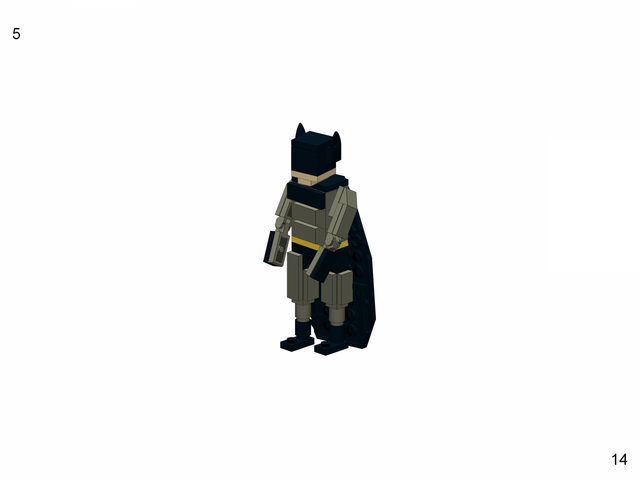
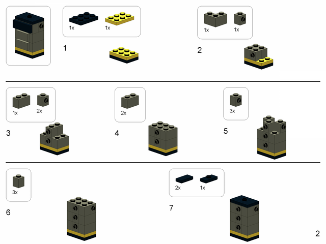
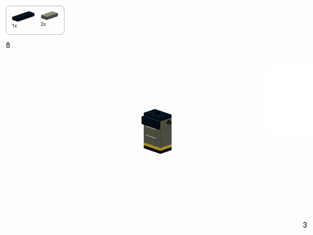
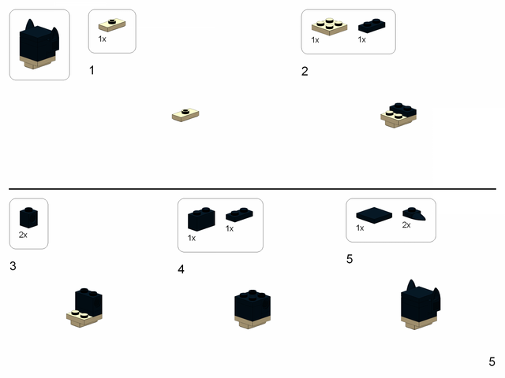
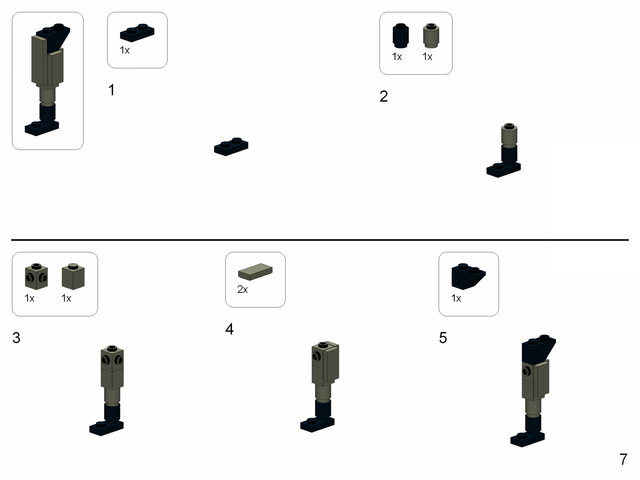
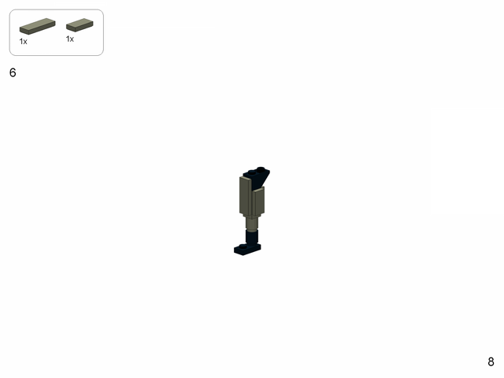
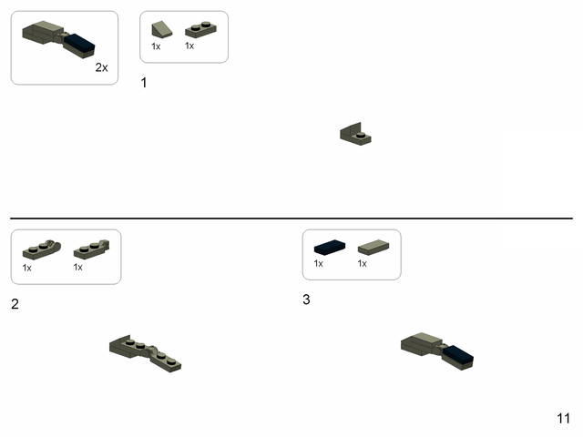
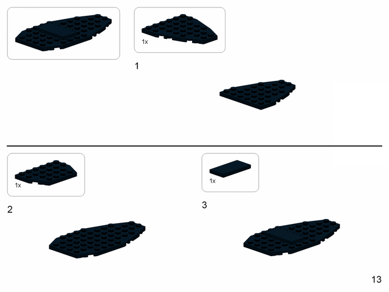
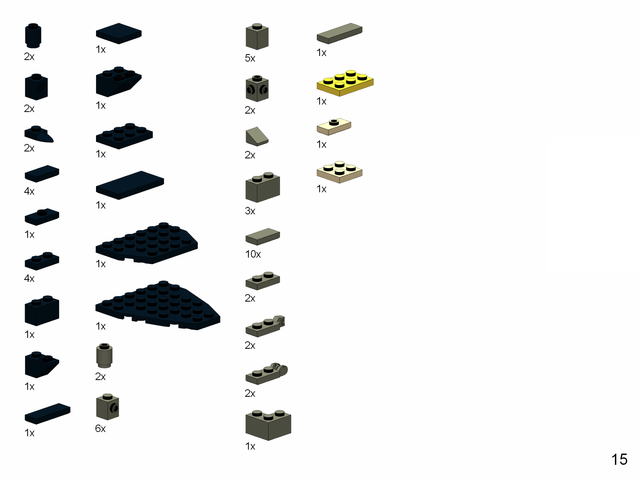

Après une série consacrée aux personnages de l’Univers Star Wars ([1](/articles/2001/),[2](/articles/2005/),[3](/articles/2015/),[4](/articles/2017/),[5](/articles/2105/),[6](/articles/2107/)) nous vous proposons de construire des personnages issus du monde de Batman. A tout seigneur, tout honneur, commençons avec l’homme chauve-souris lui-même.

**Page 14**

Avant de commencer la construction, une rapide recherche d’image a permis de définir les couleurs à employer pour ce personnage. Le noir a été retenu avec le gris foncé mais des teintes plus claires ou des bleus auraient aussi été adaptés. Le noir et le gris foncé ont l’avantage d’être très courants et la disponibilité des pièces dans ces couleurs ne pose aucun souci.

**Page 2**

**Page 3**

**Page 5**

La cagoule avec les oreilles de chauve-souris qui recouvre la tête et une partie du visage est un accessoire indissociable de Batman. Ici les oreilles sont représentées par des plaques 1x1 modifiées avec une dent, solidement emboîtées dans les trous de chevilles de briques Technic 1x1.

**Page 7**

**Page 8**

**Page 9**

Des plaques lisses (tiles) placées en SNOT sur les jambes et le torse permettent de représenter la musculature hypertrophiée (pectoraux, abdominaux, quadriceps) du super-héros.

**Page 11**

Un accessoire primordial de Batman est sa cape. Celle-ci est fixée en biais pour donner un effet de mouvement. Les 2 points de fixations sont distants de 3,62cm (cape) et 3,61cm (jambe et dos). Cela représente un écart d’environ 0,3% et donc bien que cela ne soit pas un montage "légal", cela ne contraint pas non plus les pièces.

**Page 13**

**Page 14**

Le personnage est pour le moins imposant. Au final la figurine mesure 35 plaques de hauteur (hors oreilles) soit 11,2cm ce qui, à l’échelle retenue (1:18) dans des articles précédents ([1](/articles/2001/),[2](/articles/2017/)) sur les personnages MINILAND, représente une personne de 2m02.

**Page 15**

Au final, le personnage de Batman est composé de 65 pièces pour 34.9g. En attendant le prochain article qui vous proposera de construire Robin, vous pouvez télécharger ci-après la notice de Batman générée à l’aide des outils [LDraw](http://www.ldraw.org/) .

**Notice de montage Batman MINILAND**
