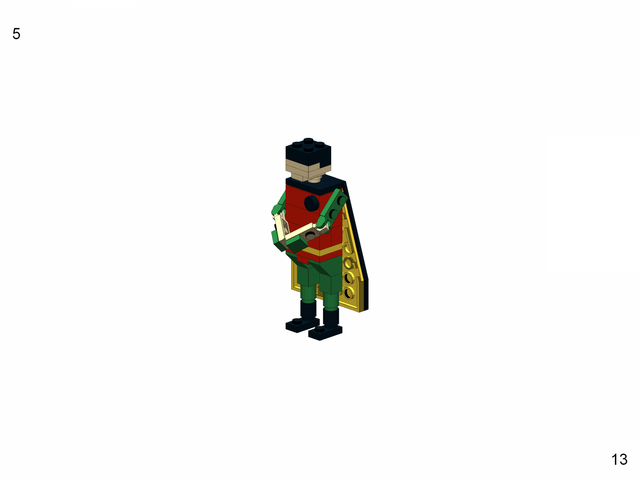
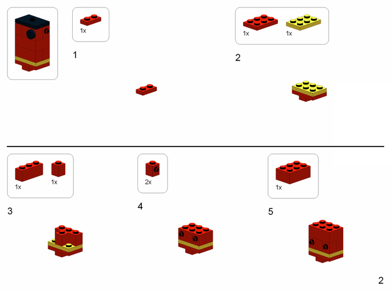
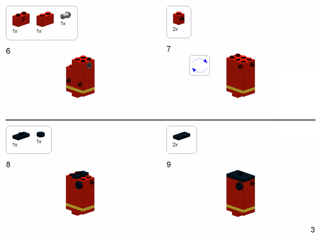
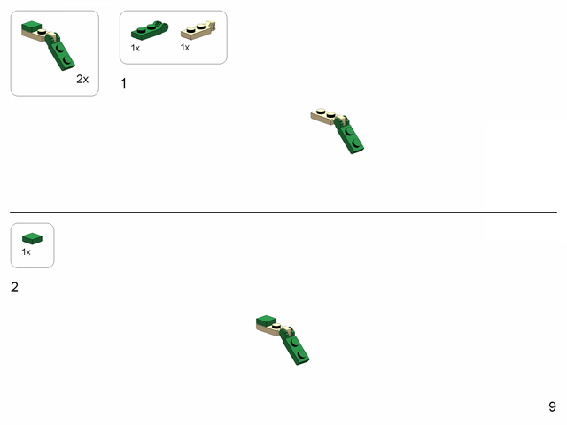
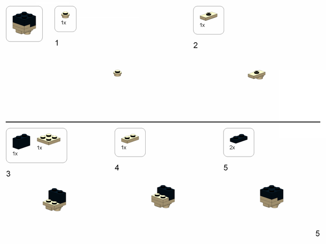
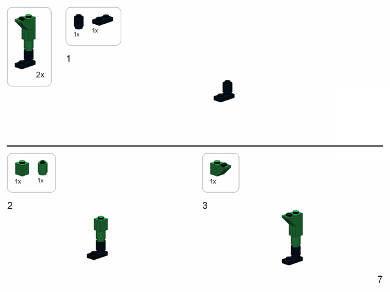
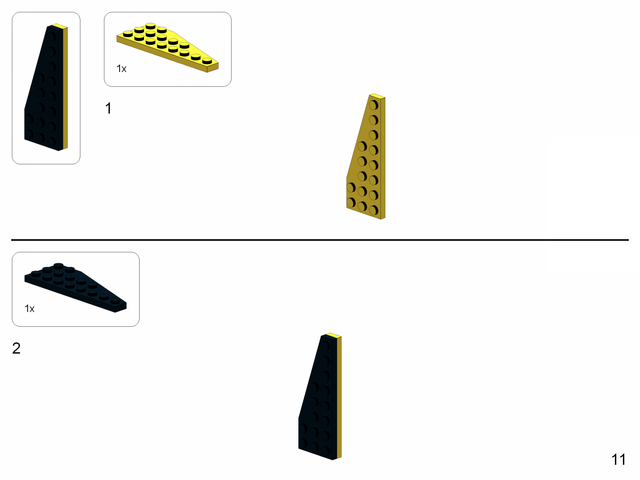

Après une série consacrée aux personnages de l’Univers Star Wars, nous vous proposons de construire des personnages issus du monde de Batman. Après Batman, nous construisons aujourd’hui son fidèle compagnon : Robin.

En comparaison du [Batman](/articles/2836/) que nous avons précédemment construit, Robin est beaucoup plus coloré. On y retrouve du jaune et du rouge, qui sont des couleurs extrêmement classiques, mais aussi du vert, couleur presque rare en LEGO.

Le montage du torse fait appel à des briques 1x1 modifiées avec un tenon sur le côté pour fixer la cape, le bras gauche et une plaque lisse ronde 1x1 noire (que vous pourriez aussi choisir jaune) pour l’écusson de poitrine.

Le bras gauche lui sera fixé sur le tenon d’une demi-cheville placée dans une brique Technic 1x2.

Les bras, comme vous en avez maintenant l’habitude, sont constitués de charnières à crans (plaques modifiées 1x2). Ces pièces sont, malheureusement, peu courantes en vert et surtout en tan (beige clair). En faisant varier l’angle du coude, vous donnerez une posture qui sera propre à votre personnage.

Le montage de la tête est assez classique avec la brique ronde 1x1 pour représenter le cou, la plaque 1x2 avec un seul tenon (jumper plate) pour le menton et les plates 2x2 pour le crâne. On peut lui ajouter une plaque lisse 2x2 au risque de lui faire un front un peu bas.

Les jambes sont ici présentées identiques mais il est possible d’inverser la position d’une des deux en tournant la brique pentue pour présenter un personnage en mouvement.

La cape, noire, avec son doublage jaune, se présente en deux sous-ensembles symétriques. Ils se fixent sur les deux tenons du dos de façon très solide (montage tenon-tube).

Au final la figurine mesure 31 plaques de hauteur (environ 10 cm) soit 1m80 à l’échelle MINILAND pour 28,8g et 44 pièces. Comme d’habitude vous retrouverez la notice de montage ci-après.

Les personnages MINILAND ne sont pas toujours très stables, pensez à leur construire un petit socle.

**Notice de Robin**
