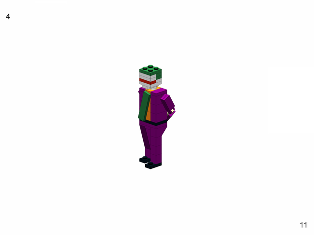
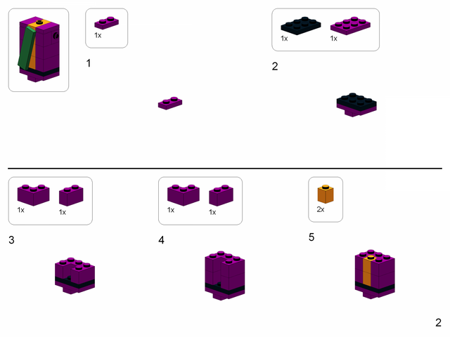
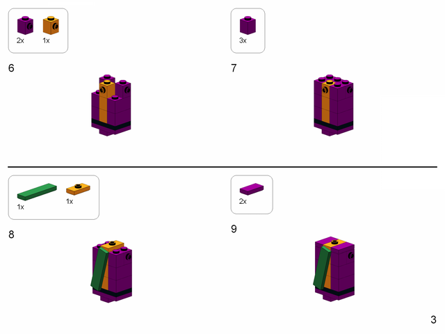
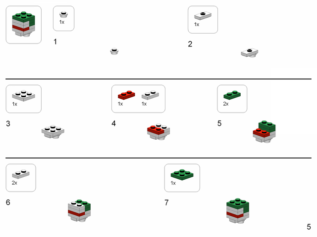
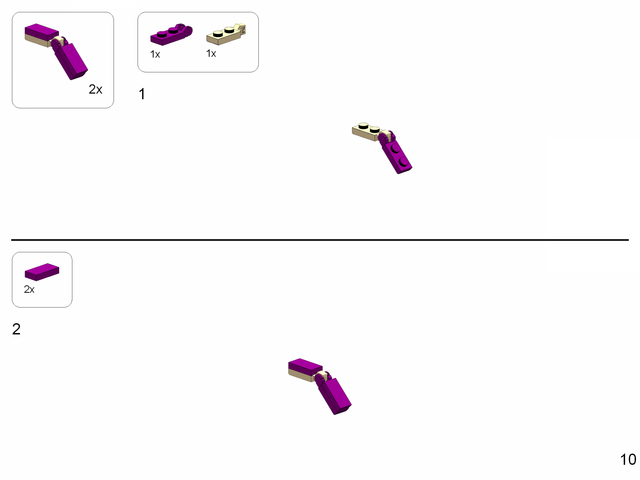
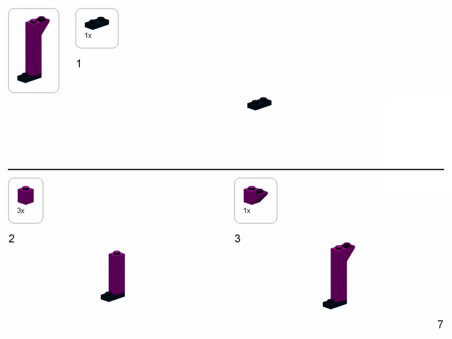
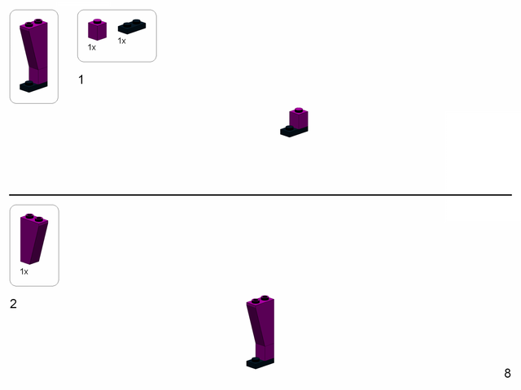

Après une série consacrée aux personnages de l’Univers Star Wars, nous vous proposons de construire des personnages issus du monde de Batman. Après [l’homme chauve-souris](/articles/2836/) et son fidèle compagnon [Robin](/articles/2837/), place au méchant avec Le Joker.

Le Joker est un personnage facilement reconnaissable. Ses tenues violettes avec des touches d’orange et de vert sont extrêmement voyantes.

Le Joker est aussi élégant. Une plaque lisse 1x4 verte, une fois montée en SNOT, a la taille parfaite pour représenter une cravate.

Mais le costume ne fait pas le Joker. Les cheveux teints de vert et le teint blanchi contrastant avec une bouche toute entière rouge sont aussi la marque du Joker.

Les bras sont identiques et se rejoignent dans le dos dans une posture d’attente. Le violet encore une fois est rare, mais la charnière à deux doigts, disponible dans un seul set, n’est pas difficile à trouver sur BrickLink.

Deux jambes différentes permettent de donner un peu de vie au Joker. La brique pentue inversée 75° 2x1x3 est présente dans des sets en violet (dark purple) chaque année depuis 2013.

Au final, avec ses 45 pièces, le Joker mesure 32 plaques (environ 10,3 cm et 22,6g) soit 1m84 à l’échelle. Comme d’habitude, la notice de montage est disponible ci-dessous.

**Notice du Joker**
