Aujourd’hui je vous propose la review du set 71233 dans la gamme _Dimensions_ : **Fun pack : Stay Puft**.

Ce set sorti en 2016 au prix de 14,99 € est composé de 65 pièces, soit un ratio prix/pièce de 23 centimes d’euro.

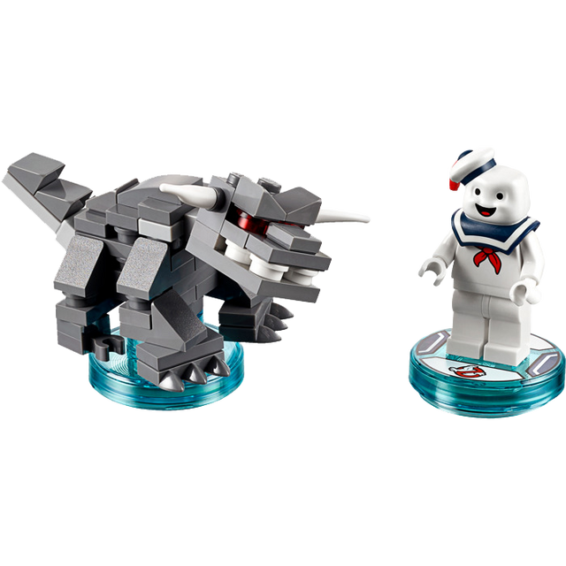

Ce set est un Fun Pack (ou Level Pack) du jeu _[LEGO Dimensions](http://www.lego.com/fr-fr/dimensions)_ sorti en 2015.

* * *

Avant de commencer, il faut savoir qu’il n’y a pas de notice de construction dans les _Level/Fun Pack_, le livret fourni ne donne que les instructions rudimentaires du fonctionnement des socles à puce RFID. Vous pouvez vous rendre sur le site _LEGO_ à _[cette adresse](https://wwwsecure.us.lego.com/fr-fr/service/buildinginstructions/search#?search&theme=10000-20229)_, avec le numéro du set (ici 71233) afin de récupérer les instructions de montage. Enfin sachez que le modèle de ce _Level/Fun Pack_ a trois versions de construction différente.

J’ai choisi pour cette review de construire la version classique du _Terror Dog_ (le modèle que l’on voit sur la boite).

L’achat de ce pack est du à la présence du _Stay Puft_ (_Bibendum Chamallow_ en VF). De plus, en octobre 2017, _Warner Bros Games_ annonce dans une déclaration à _IGN_ l’arrêt du développement de nouveaux packs, faisant de la vague 9 la dernière.

* * *

On retrouve le packaging des _Fun Pack_ en forme de "X". Sont représentés sur la boite la minifig du _Stay Puft_ et le _Terror Dog_ dans sa forme "classique"

[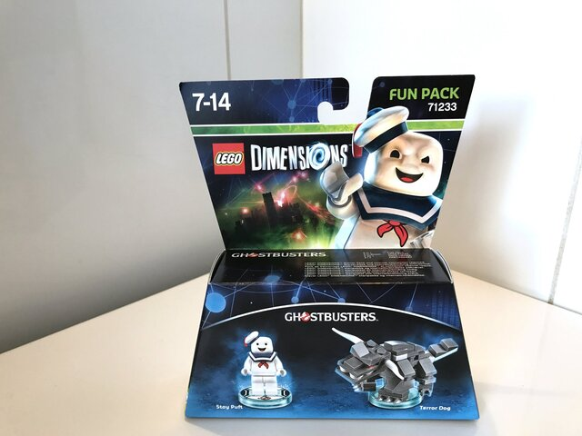](https://www.freelug.org/IMG/jpg/dimensionsstaypuft_01.jpg)

Au dos on peut voir les trois modèles qu’il est possible de monter.

[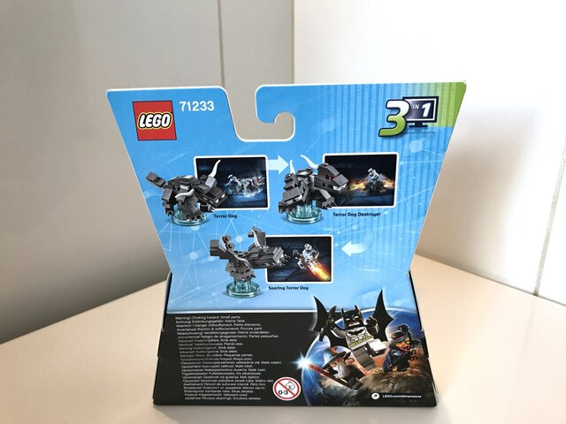](https://www.freelug.org/IMG/jpg/dimensionsstaypuft_02.jpg)

Ce _Fun Pack_ contient deux sachets de briques et une notice d’instruction pour le jeu _LEGO Dimensions_.

[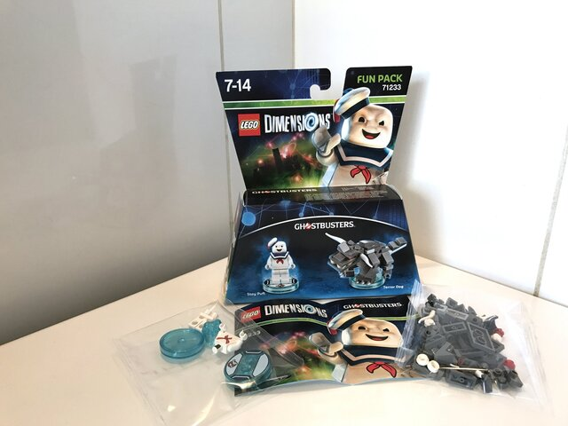](https://www.freelug.org/IMG/jpg/dimensionsstaypuft_03.jpg)

* * *

Sur la minifig du _[Stay Puft](https://brickset.com/minifigs/dim018/stay-puft-bibendum-chamallow-dimensions-fun-pack)_, la sérigraphie est réduite au minimum sur le torse avec le foulard rouge. La tête spéciale incorpore le béret et le col marin.

[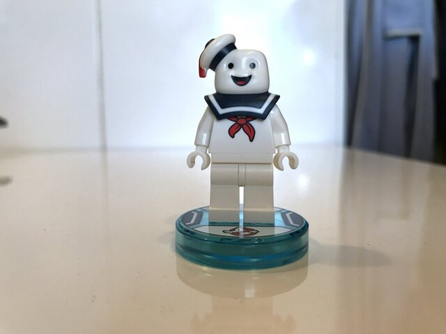](https://www.freelug.org/IMG/jpg/dimensionsstaypuft_04.jpg)

Le dos du torso est dépourvu de sérigraphie.

[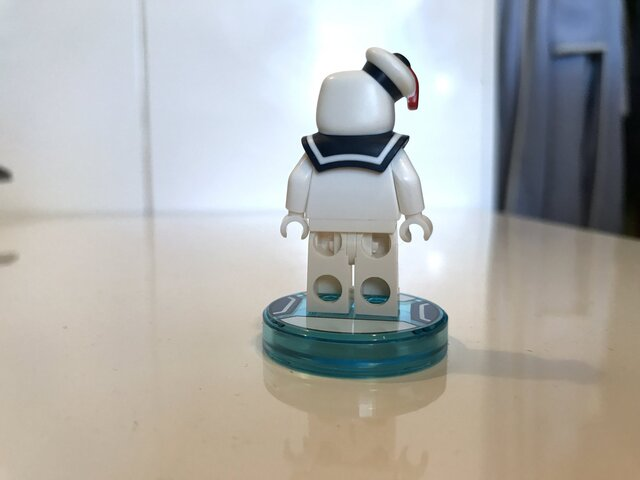](https://www.freelug.org/IMG/jpg/dimensionsstaypuft_05.jpg)

* * *

Je vous épargne la construction du _Terror Dog_ pour vous le montrer fini. Rassurez-vous, le GIF animé en fin de review vous permettra de vous faire une idée des étapes de montage.

[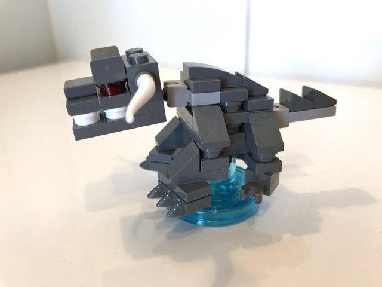](https://www.freelug.org/IMG/jpg/dimensionsstaypuft_06.jpg)

Le _Terror Dog_ sous toutes les coutures.

[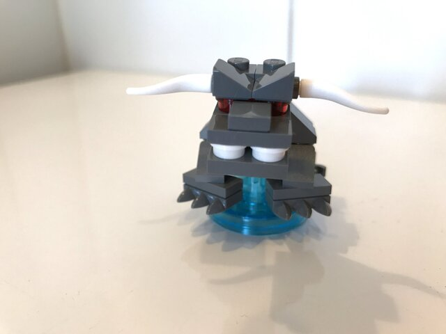](https://www.freelug.org/IMG/jpg/dimensionsstaypuft_07.jpg)

[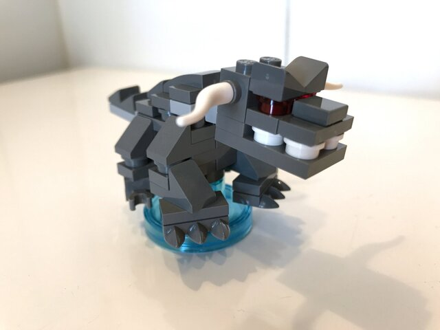](https://www.freelug.org/IMG/jpg/dimensionsstaypuft_08.jpg)

[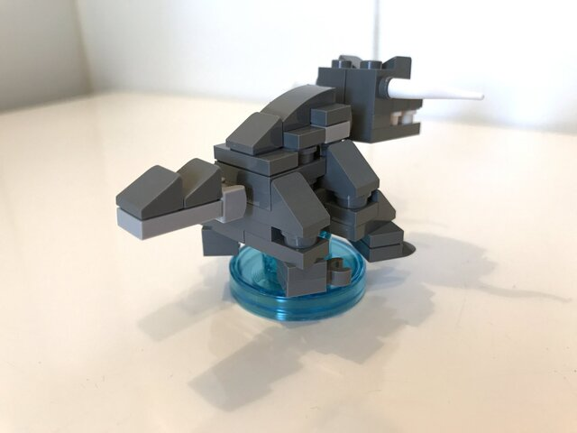](https://www.freelug.org/IMG/jpg/dimensionsstaypuft_09.jpg)

[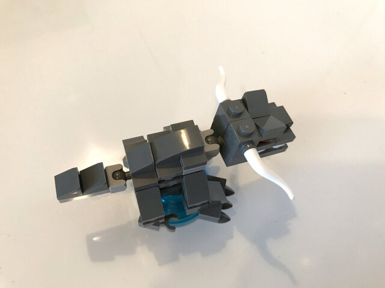](https://www.freelug.org/IMG/jpg/dimensionsstaypuft_10.jpg)

Photo de famille.

[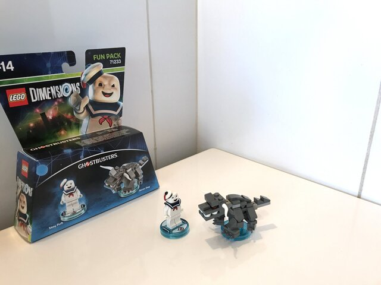](https://www.freelug.org/IMG/jpg/dimensionsstaypuft_11.jpg)

* * *

**AVIS :**

Encore un _Fun Pack_ acheté uniquement pour une fig. Il faut avouer que _LEGO_ avait réussi le pari de vendre des packs même aux gens qui ne jouaient pas au jeu en incorporant pas mal de minifigs exclusives.

Malheureusement l’arrêt du jeu fin 2017 a sonné le glas de ces boites permettant aux collectionneurs d’acquérir des héros n’apparaissant pas dans les sets classiques.

**BONUS :**

Voici un GIF animé réalisé avec les nombreuses photos prises pour cette review (cliquez sur l’image pour lancer l’animation).

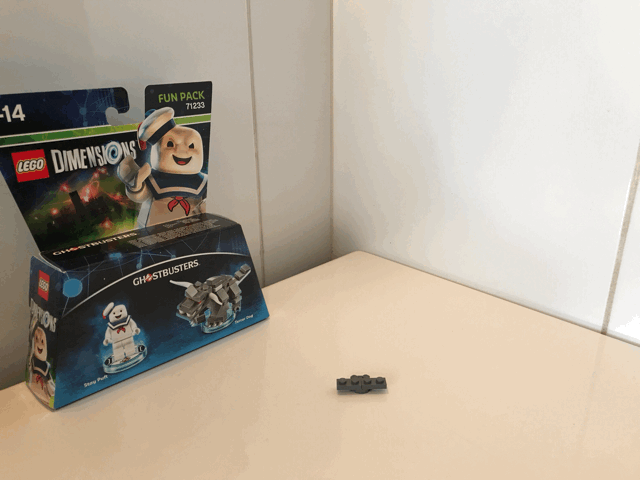
