Aujourd’hui, je vous propose la review du set 75182 dans la gamme _Star Wars_ : **Republic Fighter Tank**.  
Ce set, sorti en 2017 au prix de 29,99 €, est composé de 305 pièces, soit un ratio prix/pièce de 10 centimes d’euro.

[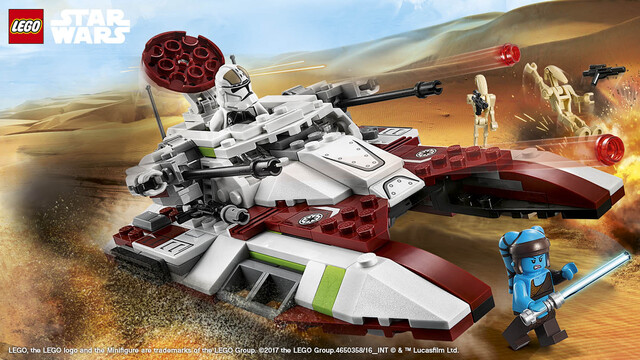](https://www.freelug.org/IMG/jpg/republicfightertank.jpg)

Cette réédition du set 7679 de 2008 est-elle à la hauteur ?

* * *

Le contenu du set est intégré dans le décor désertique ressemblant à _Tatooine_. Le bandeau du haut est constitué des logos _LEGO_ et _Star Wars_ et du casque de _Deathtrooper_ (comme tous les sets Star Wars fournée 2017).

Au verso, plusieurs vignettes avec les quelques éléments de jouabilités du set.

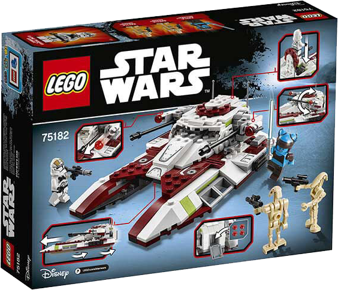

Une fois ouvert, le set contient deux sachets numérotés, une planche de stickers et deux notices de construction (une par sachet).

[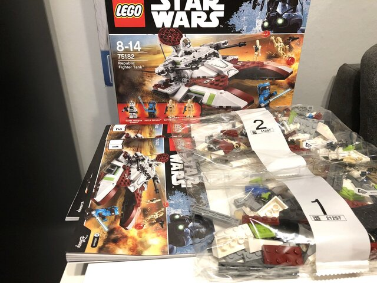](https://www.freelug.org/IMG/jpg/republicfightertank_01.jpg)

* * *

_[Aayla Secura](https://brickset.com/minifigs/sw833/aayla-secura-\(75182\))_ est bien réalisée même si les sérigraphies ne sont pas les plus originales vues sur une minifig, néanmoins il y a des détails sur le tissu et les jambes. Le visage bien que simple est lui aussi réussi.

Il est à noter que cette fig est exclusive à ce set.

[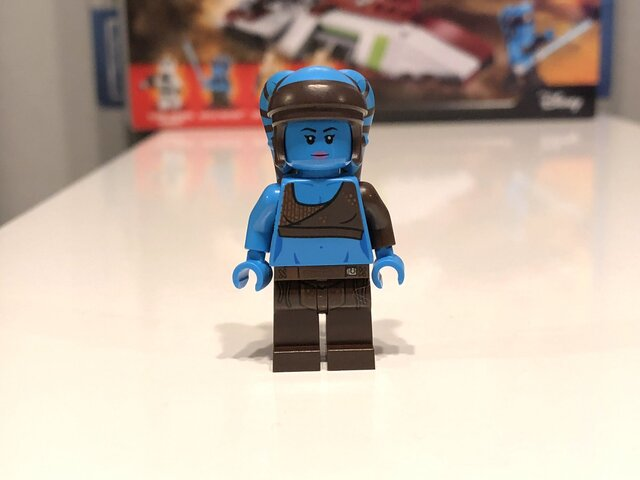](https://www.freelug.org/IMG/jpg/republicfightertank_02.jpg)

Au verso, on retrouve les détails des tissus. Le visage alternatif énervé a une moue très réussie.

[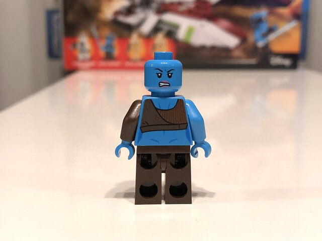](https://www.freelug.org/IMG/jpg/republicfightertank_03.jpg)

Le _[Clone Trooper Gunner](https://brickset.com/minifigs/sw837/clone-trooper-gunner-\(75182\))_ est vraiment une magnifique fig. Les sérigraphies sont nombreuses et totalement réussies. Plus le temps passe et plus _LEGO_ bonifie la réalisation des _Stormtrooper_ et _Clone Trooper_ pour notre plus grand plaisir de collectionneur. Pas de photo sans casque vu que _LEGO_ n’a pas changé son fusil d’épaule de ce côté-là.

Il est à noter que cette fig est, elle aussi, exclusive à ce set.

Le dos est lui aussi superbe, les sérigraphies sont fines et précises avec de nombreux détails sur l’armure.

[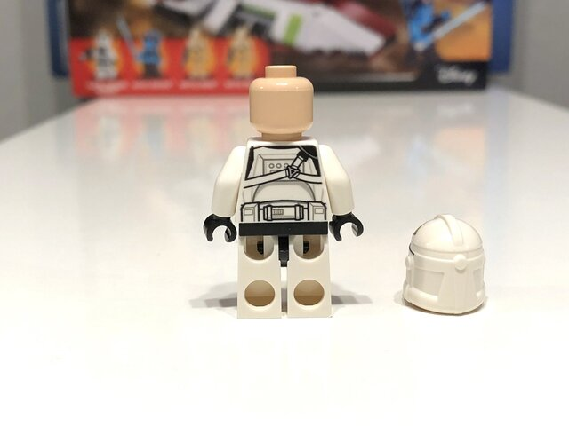](https://www.freelug.org/IMG/jpg/republicfightertank_05.jpg)

Les deux _[Battle Droid](https://brickset.com/minifigs/sw001c/battle-droid-with-1-straight-arm)_, que dire à part que je n’aime pas du tout ces minifigs...

[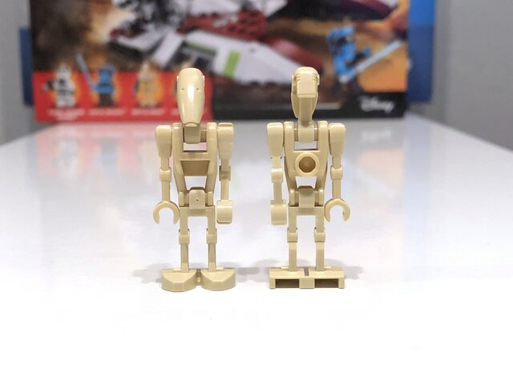](https://www.freelug.org/IMG/jpg/republicfightertank_06.jpg)

* * *

On commence la construction par la base du tank.

[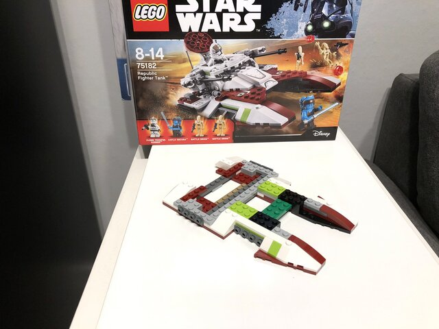](https://www.freelug.org/IMG/jpg/republicfightertank_08.jpg)

La construction n’est pas des plus intéressantes.

[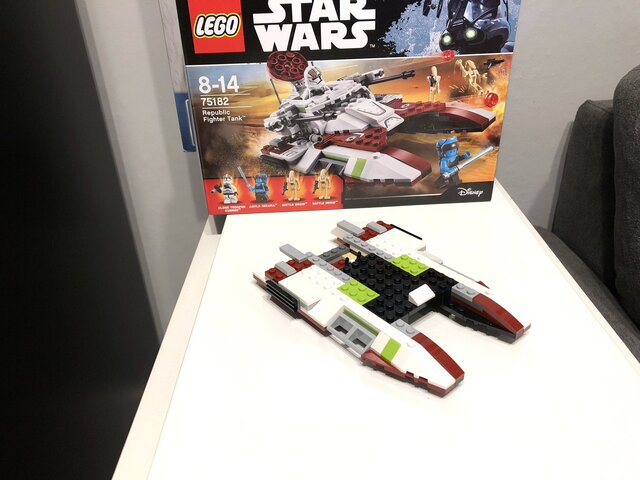](https://www.freelug.org/IMG/jpg/republicfightertank_09.jpg)

Montage de l’arrière du poste de pilotage.

[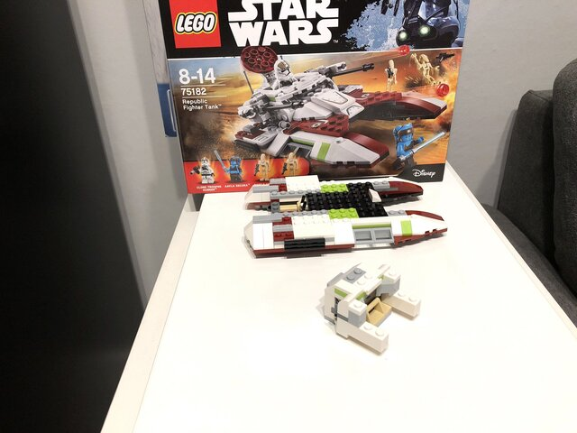](https://www.freelug.org/IMG/jpg/republicfightertank_10.jpg)

Quatre petites roues qui permettront de faire avancer le tank.

[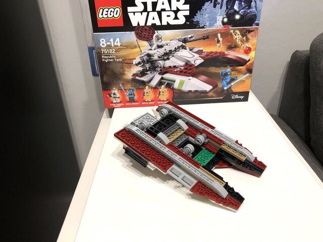](https://www.freelug.org/IMG/jpg/republicfightertank_11.jpg)

Malgré sa petite taille, l’engin fait bien massif.

[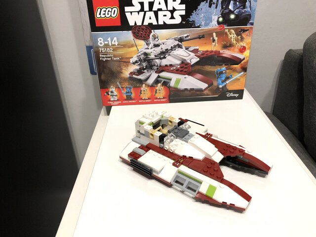](https://www.freelug.org/IMG/jpg/republicfightertank_12.jpg)

Une fois l’écoutille posée sur le tank, le côté blindé ressort bien.

Le tank terminé (sans les stickers) avec son aspect massif et trapu.

[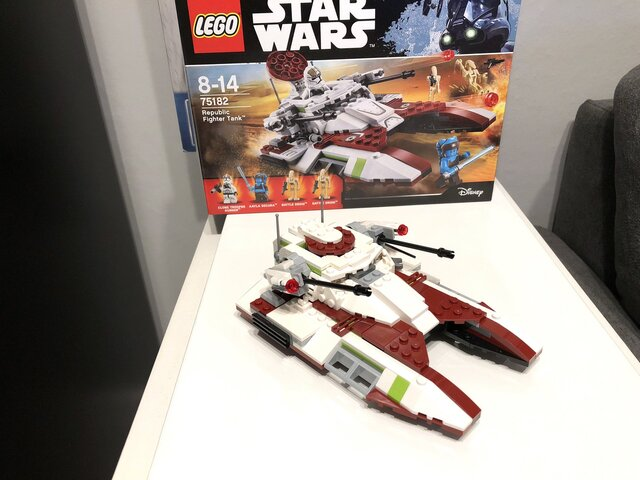](https://www.freelug.org/IMG/jpg/republicfightertank_14.jpg)

Mis en situation avec les minifigs du set.

[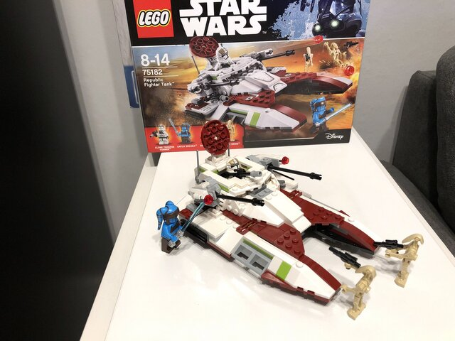](https://www.freelug.org/IMG/jpg/republicfightertank_15.jpg)

* * *

Comparaison avec le set _[7679](https://brickset.com/sets/7679-1/Republic-Fighter-Tank)_ (image _[YouTube](https://www.youtube.com/watch?v=MkgqyAwjh1o)_). La différence de taille est flagrante, _LEGO_ continue donc ces rééditions bien souvent en augmentant les prix et en diminuant la taille des sets.

[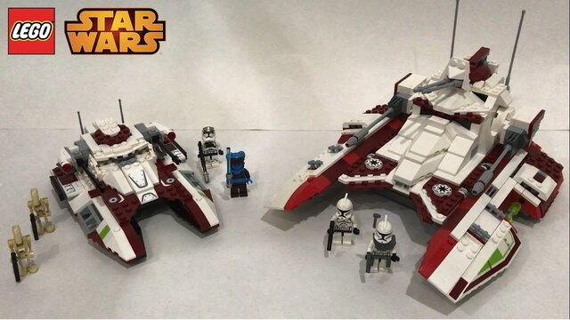](https://www.freelug.org/IMG/jpg/comparatif.jpg)

* * *

**AVIS :**

Set sympathique une fois terminé, les enfants adoreront. Le montage, sans être inintéressant, ne m’a pas laissé plus de souvenirs que ça. Hormis les droïds, les deux fig sont vraiment belles et raviront là encore enfants et collectionneurs.

Soyons honnête, le plus gros défaut de ce set est sa taille quand on le compare avec son grand frère, c’est vraiment dommage que _LEGO_ persiste dans cette manie de pondre des rééditions toujours plus petites.

Encore une fois il est urgent d’attendre les soldes si vraiment vous voulez ces deux superbes figurines et ce tank qui est plutôt bien fini.

**BONUS :**

Voici un GIF animé réalisé avec la totalité des photos prises pour cette review (cliquez sur l’image pour lancer l’animation).

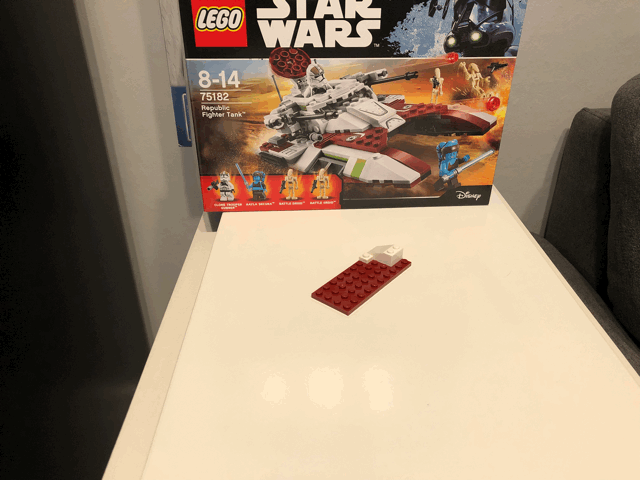
