Pour ne pas oublier l’été et les joies des vacances, je vous propose aujourd’hui une revue de l’ensemble 10244 de la gamme _Creator_, à savoir _La fête foraine_.

Sorti en 2014, ce modèle contient 1746 pièces et était à 129,99 €, soit un ratio de 7 centimes environ.

L’avant présente tous les éléments mis en scène. Une grande partie est occupée par le manège autour duquel tourne la fête. Il comporte trois branches, chacune sa couleur (rouge, jaune, bleu). Des barrières de protection empêchent les visiteurs de passer sous le manège et un escalier permet de monter et descendre. À gauche la caisse, à droite deux attractions supplémentaires. Au fond à gauche s’aperçoivent deux camions. De nombreuses minifigurines sont présentes.

[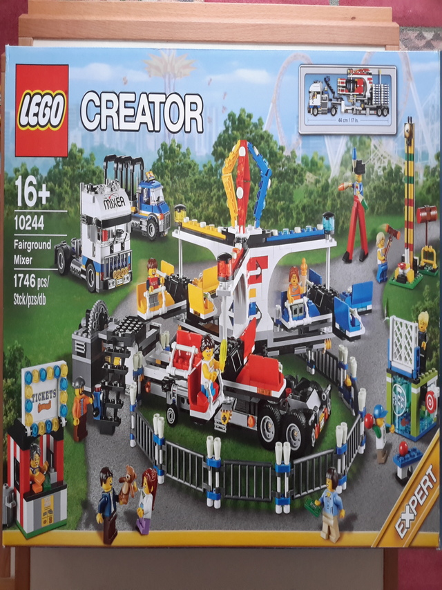](https://www.freelug.org/IMG/jpg/20180218_110706.jpg)

L’arrière se compose de vignettes montrant chacune un aspect de la fête. L’on voit le manège tourner très vite, donnant mal au cœur à un visiteur. Un stand de lancé de balles permet de tester sa précision — et de faire tomber une employée dans un bassin d’eau —, un autre permet de voir sa force en faisant bondir un repère. On aperçoit également la caisse, et un personnage se reposant dans l’un des camions, dont un toit s’ouvre.

Un encart indique que la fête peut se motoriser avec les éléments Power Functions. Sur la droite il est montré que le manège peut se ranger et être transporté en camion, ce qui est illustré sur le bas de la boîte, avec deux camions. Un dernier encart montre que certaines pièces du manège brillent dans le noir, à savoir les hauts des barrières, les barres des sièges, des pièces sur le sommet du manège.

[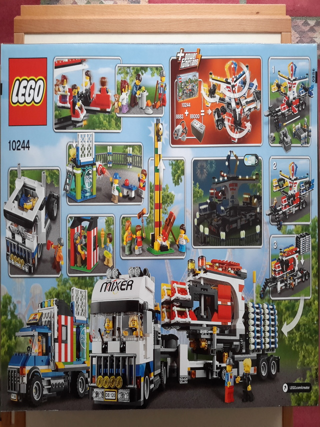](https://www.freelug.org/IMG/jpg/20180218_110736.jpg)

La boîte contient, outre de nombreux sachets numérotés de 1 à 3, trois notices et une planche d’autocollants — ici utilisés, sauf un que j’avais oublié de coller, cela a été corrigé durant la séance de photos. La première notice est plus petite que les autres, pour une raison mystérieuse.

[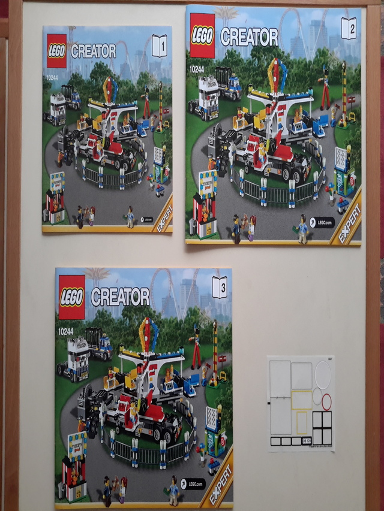](https://www.freelug.org/IMG/jpg/20180218_110615.jpg)

* * *

C’est un gros modèle, je ne vais donc pas présenter les étapes de construction, cela serait laborieux.

Pour commencer, voici une vue d’ensemble de la fête foraine.

[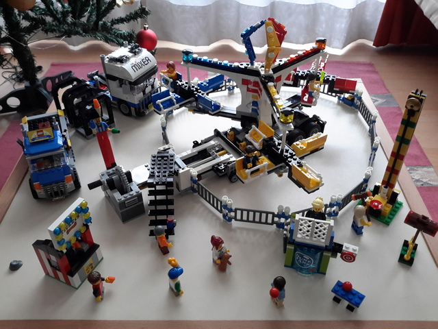](https://www.freelug.org/IMG/jpg/20180218_113237.jpg)

Voici les figurines présentes dans la boîte. Une belle collection, 12, dont 4 enfants — après tout, les fêtes foraines sont aussi pour les enfants ! Les sérigraphies des torses sont jolies, avec : un personnage en combinaison spatiale et logo _Space Classic_, un t-shirt orange du plus bel effet, une combinaison de plongée, une chemise de surfeur, une veste rayée, un t-shirt à col à fermeture éclair et poche pour les mains, un t-shirt à fleurs. Les coiffures sont variées, avec queues de cheval, coupes au carré, casquettes ou bérets. Les accessoires incluent deux glaces et des billets (simplement représentés par des tiles 1x1 orange). Les visages enfin affichent de nombreuses expressions, mais toutes très souriantes sauf le personnage en veste qui a mal au cœur. En revanche bras et jambes sont unis.

[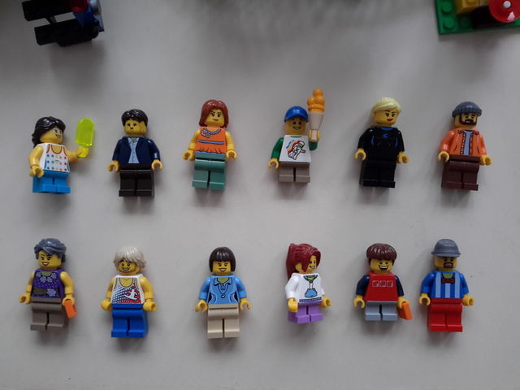](https://www.freelug.org/IMG/jpg/20180218_114046.jpg)

De dos, plusieurs torses sont unis, mais 7 reprennent le motif de l’avant. Deux capuches, une fermeture éclair pour la combinaison de plongée, le nœud de ceinture pour le t-shirt à fleurs, des pointillés pour la veste de surfeur, un nœud pour le t-shirt orange.

Bref de belles figurines !

[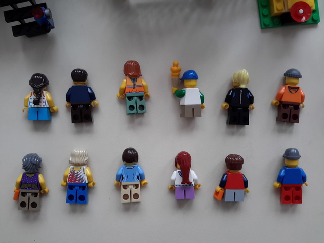](https://www.freelug.org/IMG/jpg/20180218_114139.jpg)

Trois visages alternatifs : un visage souriant pour la figurine ayant mal au cœur (avant le manège j’imagine), un visage triste pour le petit garçon au t-shirt rouge — d’après le verso de la boîte, il est triste de n’avoir pas été brillant au test de force —, et un visage un peu renfrogné pour la femme à combinaison de plongée, vous comprendrez pourquoi plus bas — ou regardez le dos de la boîte.

[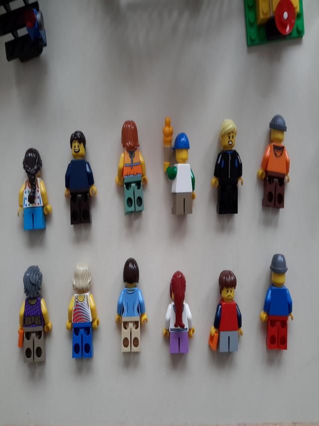](https://www.freelug.org/IMG/jpg/20180218_114251.jpg)

L’attraction principale est évidemment le manège lui-même. Il est construit de façon symétrique, en trois branches, rouge, bleue et jaune. Chaque branche contient quatre sièges, en croix. Bien évidemment quand le manège tourne les sièges tournent aussi. Une barrière entoure le manège pour prévenir tout accident. Sur la droite une poubelle est judicieusement placée. À gauche un escalier permet de monter et descendre des sièges, et un poste de contrôle permet de lancer et arrêter le manège. La commande manuelle est de ce côté-ci également.

[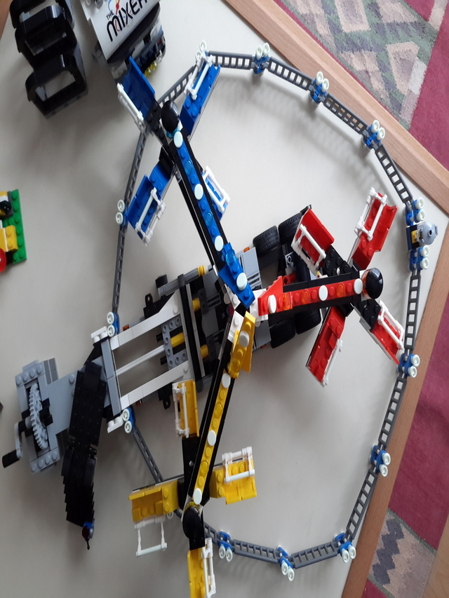](https://www.freelug.org/IMG/jpg/20180218_114508.jpg)

Le manège sous une autre perspective. Au centre trois bras se rassemblent dans un bel effet symétrique. Les pièces suivantes sont phosphorescentes : les barres horizontales de protection des sièges, les pièces 1x1 rondes sur les trois branches du manège, et les cônes des barrières.

[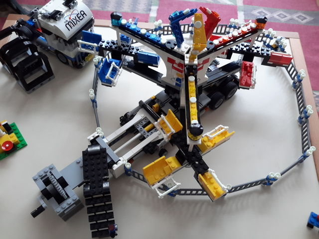](https://www.freelug.org/IMG/jpg/20180218_114529.jpg)

L’un des passagers a d’ailleurs mal au cœur à cause de tous ces mouvements.

[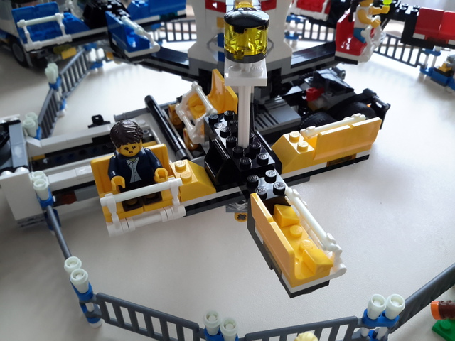](https://www.freelug.org/IMG/jpg/20180218_113253.jpg)

Une autre attraction est le lancer de balle, auquel s’essaye l’un des enfants. Si on atteint la cible, la jeune femme tombe à l’eau — d’où sa combinaison de plongée et son visage alternatif renfrogné. Les balles rouge sont simples, en revanche la cible est sérigraphiée, et il y a un autocollant sur la vitre du réservoir d’eau.

[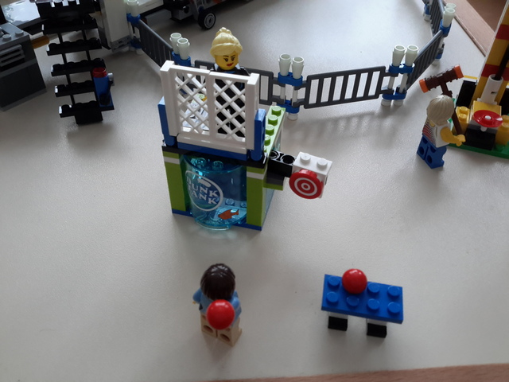](https://www.freelug.org/IMG/jpg/20180218_113351.jpg)

[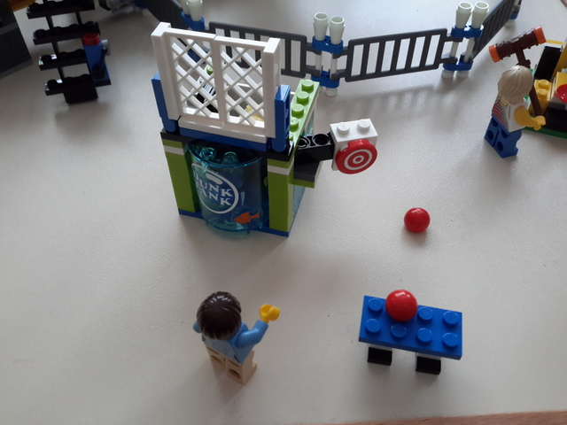](https://www.freelug.org/IMG/jpg/20180218_113420.jpg)

Le mécanisme, vu de haut, est assez simple. Une pièce Technic est fixée à un axe vertical et retient une autre barre fixée à un axe horizontal. Quand la cible est touchée, le support tourne et le sol s’effondre. À noter les deux portes à l’arrière, sans doute pour vider l’eau.

[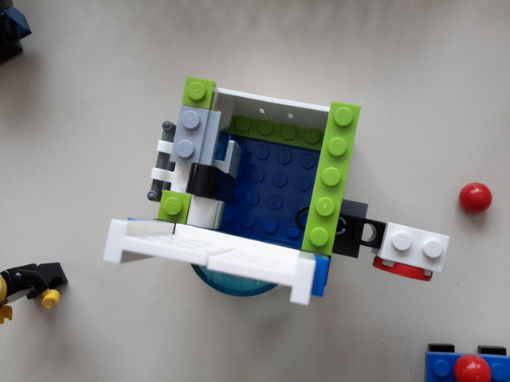](https://www.freelug.org/IMG/jpg/20180218_113442.jpg)

[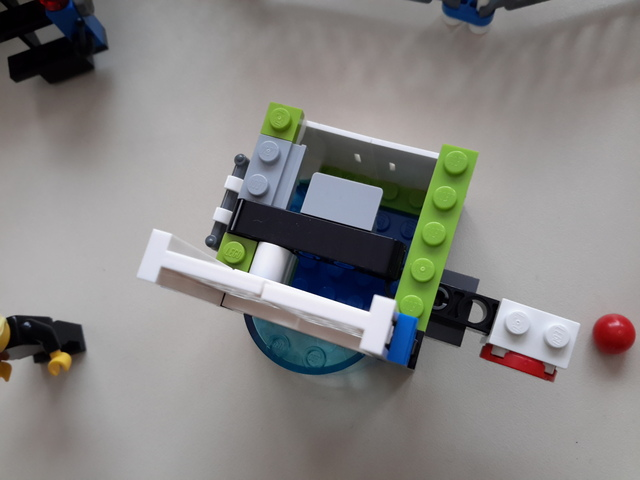](https://www.freelug.org/IMG/jpg/20180218_113451.jpg)

Troisième attraction, le test de force, il est accompagné de deux marteaux, un gros et un petit. Un gong doré au sommet permet de prévenir que quelqu’un a été vraiment violent sur la pièce rouge. La zone où frapper est articulée, ce qui permet d’envoyer la pièce blanche en hauteur en frappant sur le disque rouge. Le clip en haut permet, quand on range le manège, d’arrimer cette attraction sous le camion de transport.

[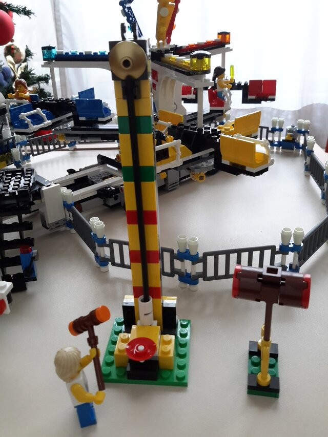](https://www.freelug.org/IMG/jpg/20180218_113719-r90.jpg)

Rien n’étant gratuit en ce monde, il y a évidemment une caisse où acheter des billets. Deux autocollants sont dessus, le « tickets » et les prix en bas. Le panneau supérieur est articulé et peut se rabattre lors du rangement du manège.

[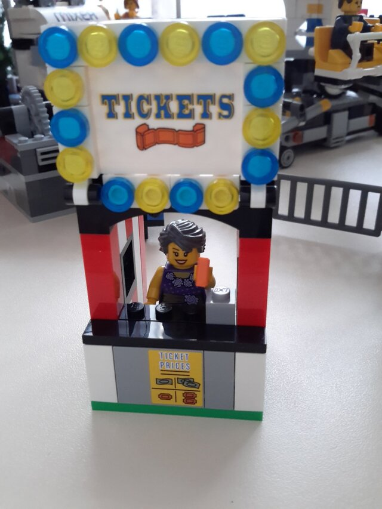](https://www.freelug.org/IMG/jpg/20180218_113514-r90.jpg)

À l’intérieur, une caisse, deux tiroirs avec billets de banque dans l’un et tickets dans l’autre, de simples tile 1x1 orange donc.

[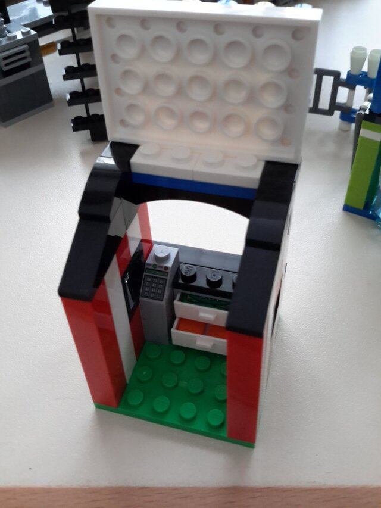](https://www.freelug.org/IMG/jpg/20180218_113605-r90.jpg)

Pour mettre un peu d’animation, l’une des figurines jongle en étant sur des échasses. Celles-ci sont deux pièces 1x1 de 5 de hauteur rouge, avec des chaussures noires. Les torches ont trois couleurs, et l’une est attachée au chapeau par un clip, simulant qu’elle flotte durant le jonglage — une idée amusante.

[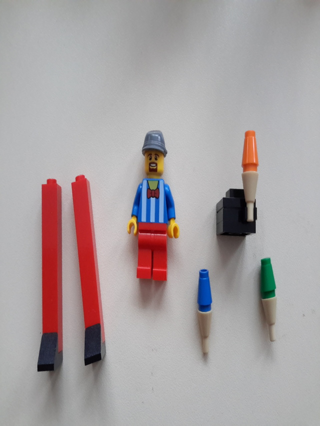](https://www.freelug.org/IMG/jpg/20180218_114333.jpg)

[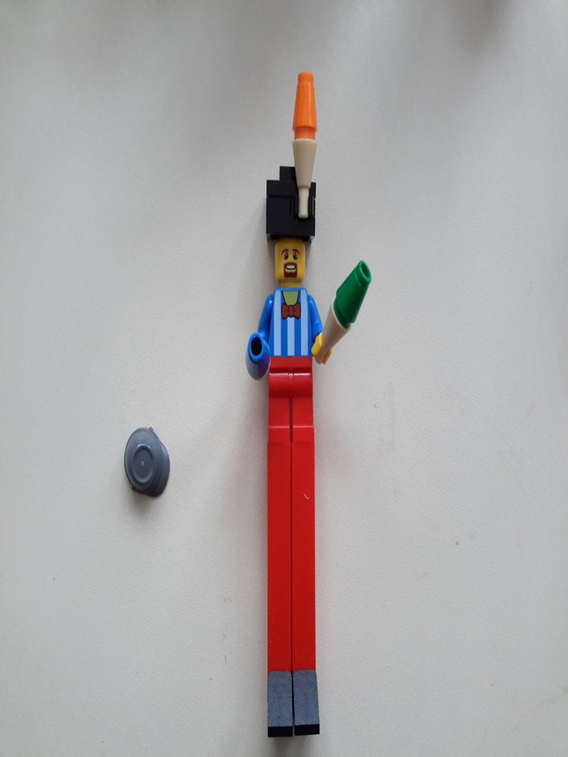](https://www.freelug.org/IMG/jpg/20180218_114406.jpg)

Le jongleur au milieu de la fête.

[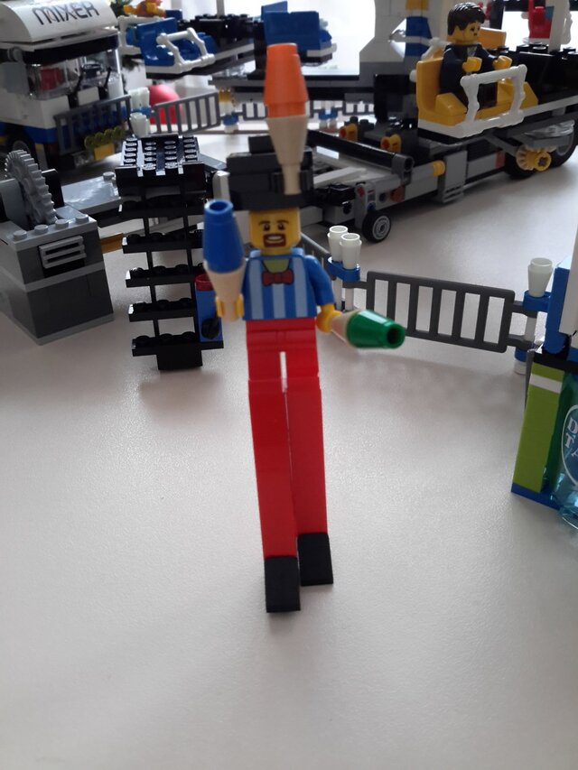](https://www.freelug.org/IMG/jpg/20180218_113637-r90.jpg)

[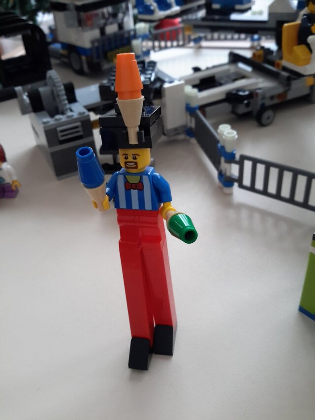](https://www.freelug.org/IMG/jpg/20180218_113651-r90.jpg)

Comme spécifié sur la boîte, la fête peut se ranger. Il y a deux camions de transport. Voici le premier, qui embarquera la caisse, le stand de lancé de balles et le test de force. Sur le toit un magnifique panneau « Lego amusements », un autocollant. Les deux tiles 2x2 marron à tenon permettent d’accrocher la caisse et le stand de balles, le test de force se rangeant sous le socle camion, entre les deux barres bleues que l’on aperçoit. Sur les côtés une pioche et une lampe de poche, au cas où.

[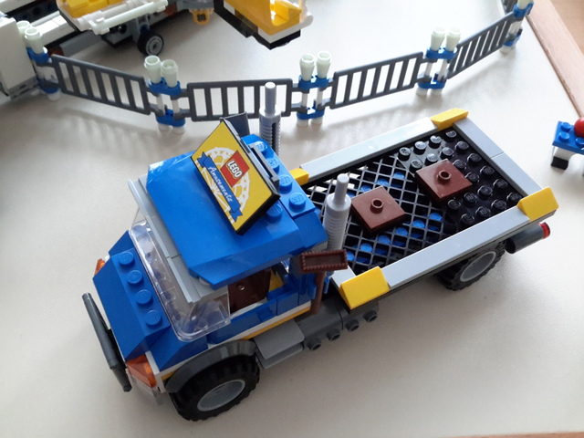](https://www.freelug.org/IMG/jpg/20180218_114539.jpg)

[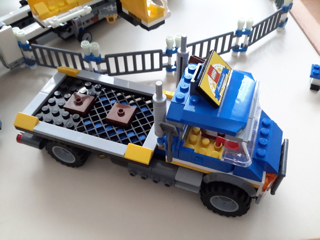](https://www.freelug.org/IMG/jpg/20180218_114552.jpg)

[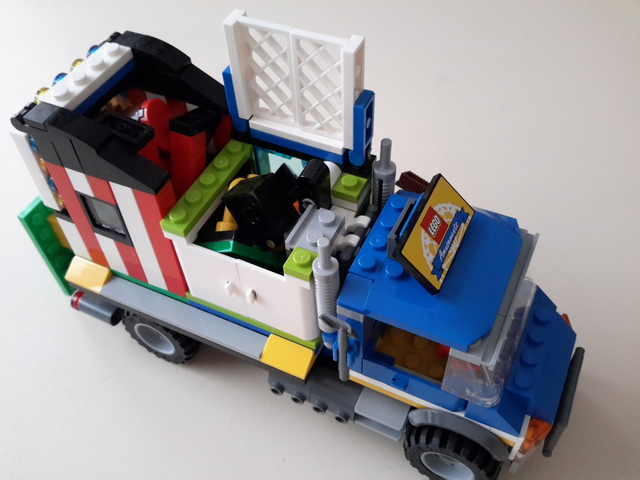](https://www.freelug.org/IMG/jpg/20180304_115245.jpg)

[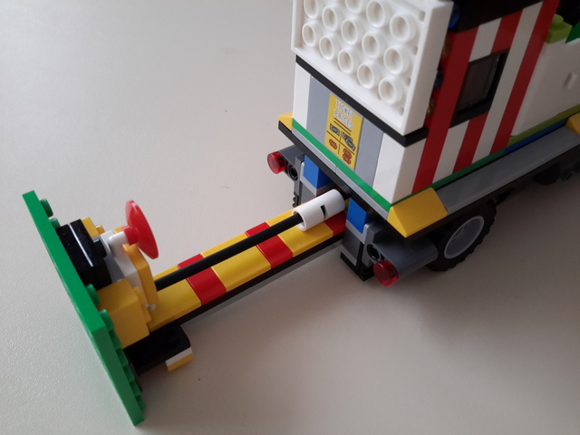](https://www.freelug.org/IMG/jpg/20180304_115300.jpg)

[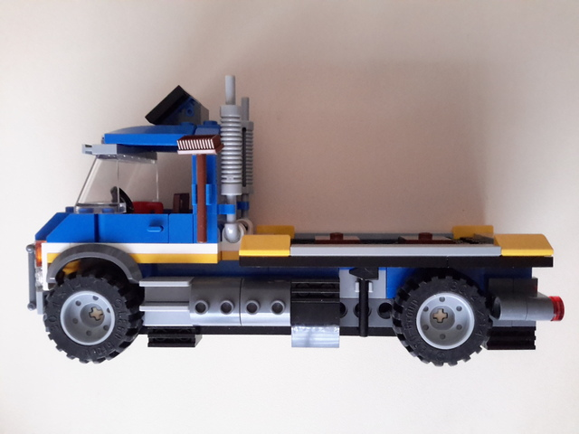](https://www.freelug.org/IMG/jpg/20180304_115351.jpg)

[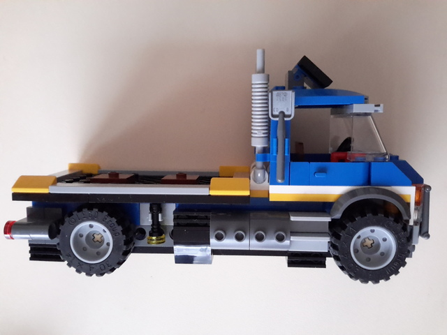](https://www.freelug.org/IMG/jpg/20180304_115422.jpg)

L’avant du camion, avec une belle plaque d’immatriculation (autocollant).

[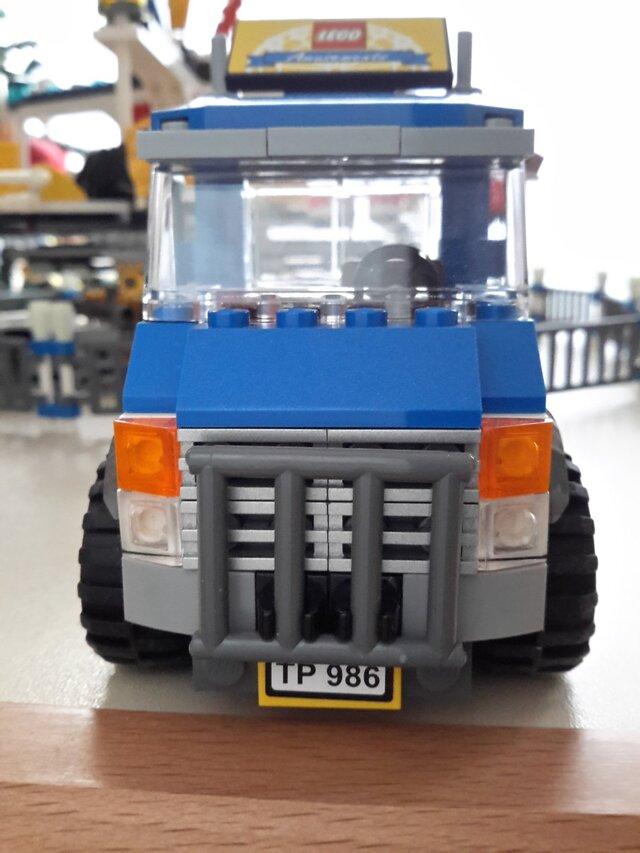](https://www.freelug.org/IMG/jpg/20180218_114614-r90.jpg)

Le second camion transporte le manège lui-même, le boîtier avec engrenage et les barrières. Il a deux autocollants sur l’avant, deux sur l’arrière, plus les plaques d’immatriculation. Le toit s’ouvre pour révéler une petite zone de couchage, avec lit et télévision. L’avant comporte de nombreuses lumières, pour bien éclairer la route et se faire voir.

[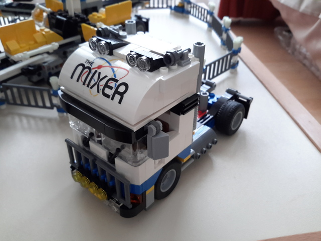](https://www.freelug.org/IMG/jpg/20180218_114642.jpg)

[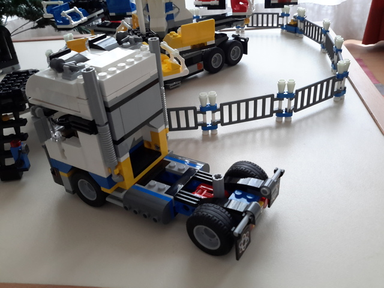](https://www.freelug.org/IMG/jpg/20180218_114657.jpg)

[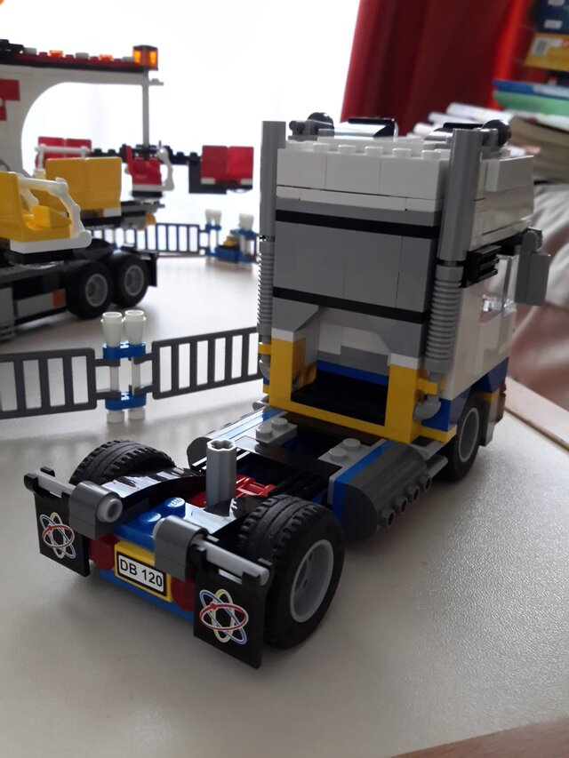](https://www.freelug.org/IMG/jpg/20180218_114711-r90.jpg)

[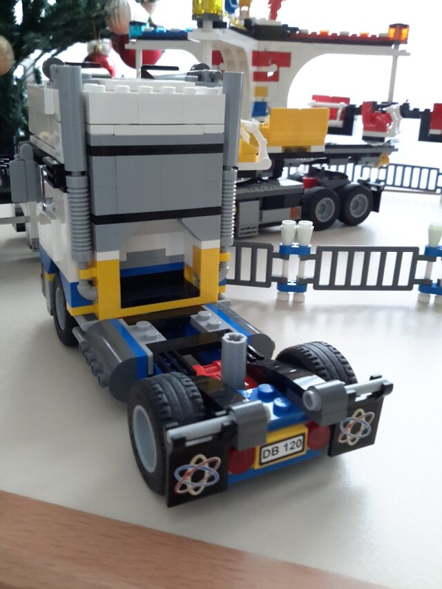](https://www.freelug.org/IMG/jpg/20180218_114719-r90.jpg)

[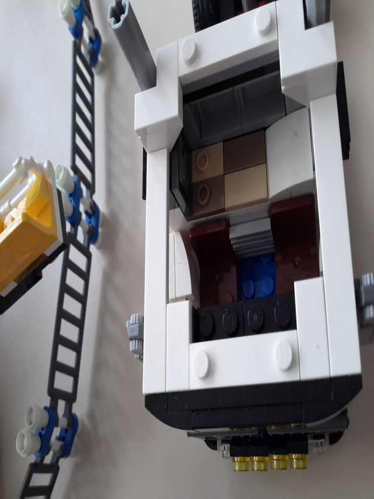](https://www.freelug.org/IMG/jpg/20180218_114741.jpg)

[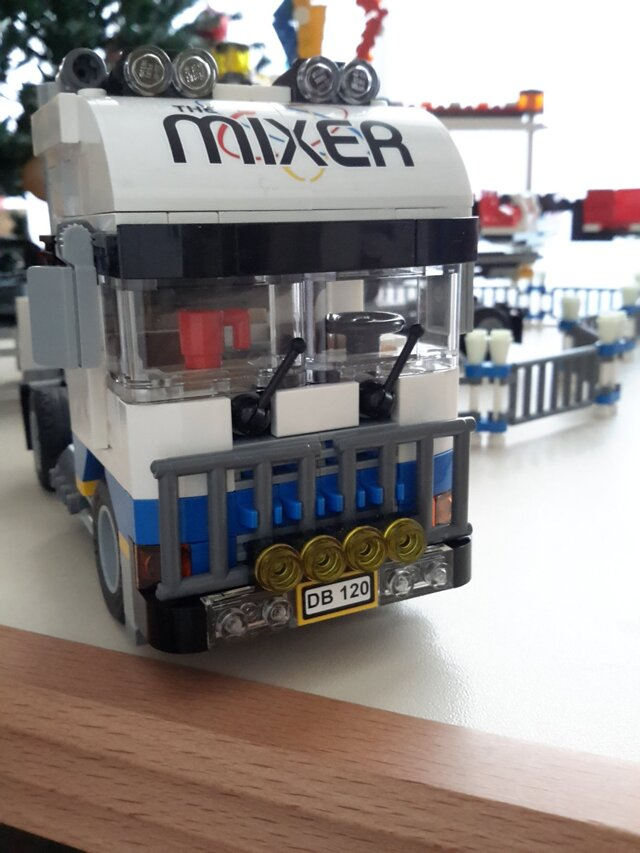](https://www.freelug.org/IMG/jpg/20180218_115109-r90.jpg)

* * *

Sans montrer les étapes de montage, voici ce que permettaient de monter les sachets 1...

[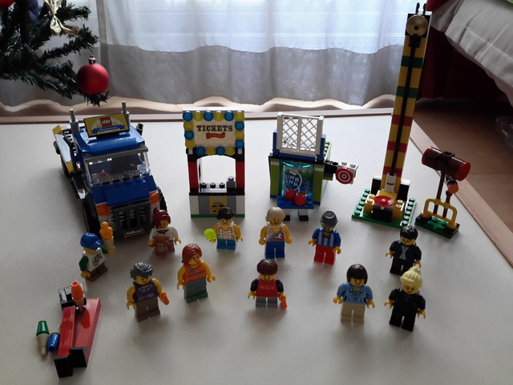](https://www.freelug.org/IMG/jpg/20180218_115416.jpg)

... les sachets 2...

[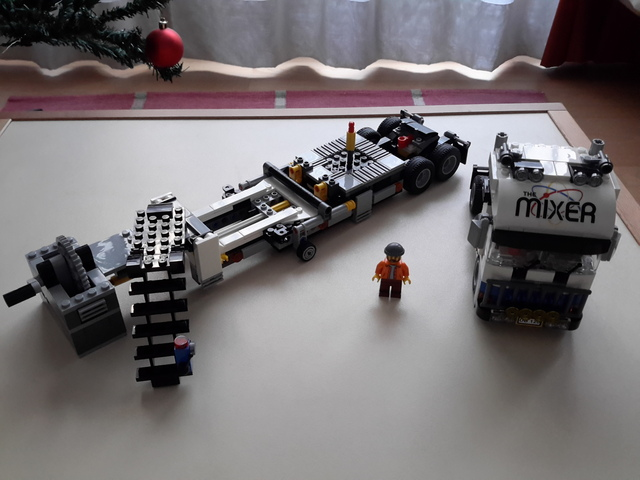](https://www.freelug.org/IMG/jpg/20180218_115808.jpg)

... et les sachets 3.

[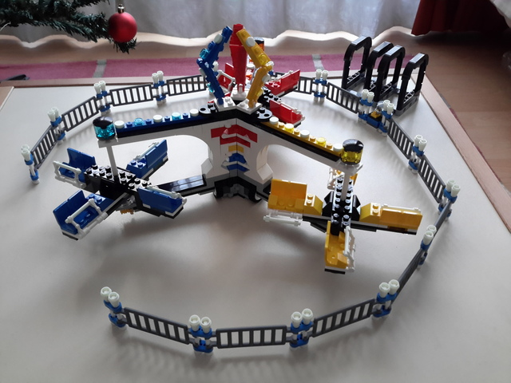](https://www.freelug.org/IMG/jpg/20180218_115944.jpg)

Voici comment se fait le rangement du manège. Tout d’abord les trois branches sont rassemblées et les sièges repliés...

[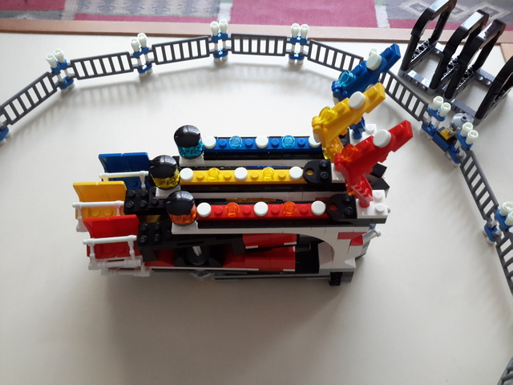](https://www.freelug.org/IMG/jpg/20180218_120055.jpg)

... puis on rabat la décoration centrale, ...

[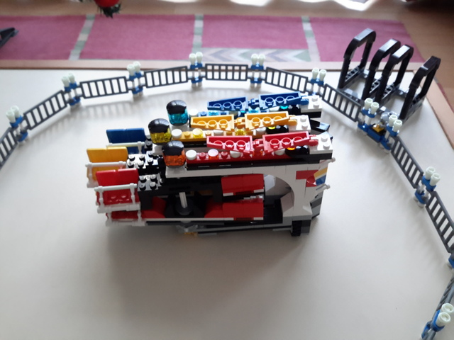](https://www.freelug.org/IMG/jpg/20180218_120105.jpg)

... on replie les barrières en quinconce, ...

[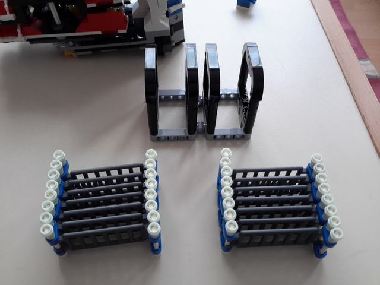](https://www.freelug.org/IMG/jpg/20180218_120231.jpg)

... et on les met sur les supports. L’escalier est redressé et tourné, la poubelle se fixe sur le bloc moteur. La tige blanche en bas à droite de la photo est l’axe reliant engrenages et axe de rotation du manège, il sert aussi à fixer le bloc des barrières sur l’arrière du camion. Ici les branches du manège sont démontées (pour les besoins des photos de présentation des sachets), mais en usage habituel elles seront bien sûr accrochées sur l’axe vertical rouge.

[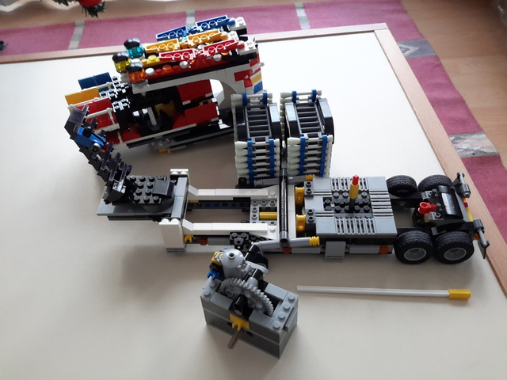](https://www.freelug.org/IMG/jpg/20180218_120336.jpg)

Et voici la fête entièrement montée sur ses camions, avec les figurines alignées.

[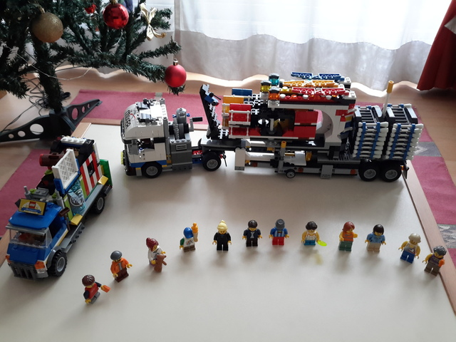](https://www.freelug.org/IMG/jpg/20180218_111039.jpg)

* * *

**Avis :** je trouve cette fête foraine extraordinaire, avec plein de détails sympathiques. Le montage était agréable (juste quelques répétitions pour les barrières et les sièges), et le rendu final est vraiment impressionnant.

Je vais juste mettre deux bémols, pour chipoter. D’abord il y a un peu trop d’autocollants, des pièces sérigraphiées auraient été un bon plus. Ensuite les jambes des personnages méritaient elles aussi des sérigraphies, et pas d’être uniformes. En petit inconvénient mineur, je rajouterai que plusieurs têtes se ressemblent dans les onze personnages des sachets 1 et que si on ne fait pas attention au visage alternatif on peut chercher un peu la tête manquante — mais là ce n’est vraiment pas grave.

Au final, je suis totalement satisfait de cette boîte, qui viendra agrémenter avec panache un grand parc ou une zone dédiée dans une ville !

**Bonus 1 :** les pièces bonus, par groupe de sachets (gauche, droite, milieu bas respectivement). Un tuyau rigide, un gong doré, une pièce 1x1 ronde phosphorescente et deux accroches également phosphorescentes utilisées sur les sièges, quelques clips Technic, et plein d’autre pièces, une bonne récolte donc.

[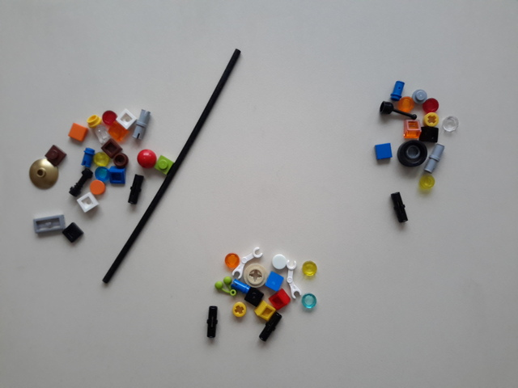](https://www.freelug.org/IMG/jpg/20180218_121122.jpg)

**Bonus 2 :** sur la notice, il y a une image avec une impossibilité physique de construction. Regardez la barre pivotante juste au-dessus de la petite fille au nounours, elle s’incruste dans le bas du camion !

[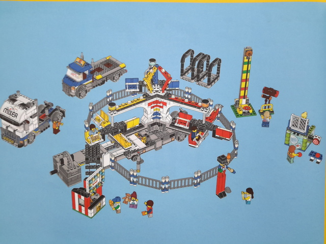](https://www.freelug.org/IMG/jpg/20180218_120654.jpg)
