Bonjour à tous, aujourd’hui je vous propose la review du polybag 40268 dans la gamme _Star Wars_ : **DJ**.  
Ce polybag, sorti en 2018, est composé de 22 pièces. Il sera offert début 2018 dans les _LEGO Store_ physique et le _S@H_ pour tout achat dans la gamme _LEGO Star Wars_.

[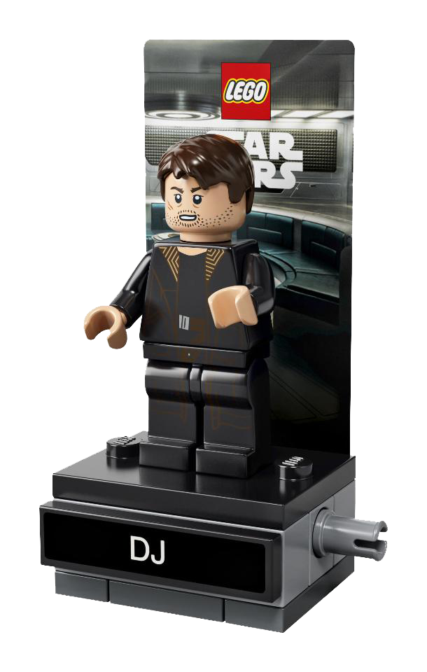](https://www.freelug.org/IMG/png/dj.png)

* * *

-   **DJ**

> Humain entre deux âges, il cultivait un air négligé de voyageur galactique blasé. Vêtu simplement, comme l’attestait son col détendu, il aimait porter de vieilles bottes très fonctionnelles et un long pardessus usé, l’ensemble étant de couleur sombre, probablement pour mieux se fondre dans la masse. Il semblait toutefois cacher son jeu. En effet, il arborait à l’annulaire droit une bague d’ambre provenant de Trammis III, dont on ignore s’il l’avait obtenu sur la planète ou s’il avait eu autrement. Et, en tant que droitier, il portait un holster à la cuisse droite, habilement dissimulé par son manteau, bien qu’il ne s’en serve que très rarement. Même son bégaiement occasionnel ressemblait davantage à un tic qu’à un défaut de prononciation.  
> Peu de choses étaient connues à son sujet à l’exception du fait que DJ n’était pas son véritable prénom. En effet, il tirait ce pseudonyme de la plaque métallique qu’il arborait sur son chapeau de baroudeur, portant l’écriture "DON’T JOIN". Ces deux seuls mots résumaient parfaitement sa philosophie, au point que les initiales le définissent, car DJ refusait de s’affilier à quelque camp que ce soit. À ses yeux, Résistance ou Premier Ordre ne valaient pas mieux l’un que l’autre, les concepts de gentils ou de méchants ne faisaient que l’amuser.  
> Voleur et hacker expert, il ne se formalisait même pas à l’idée d’accumuler ou perdre de grandes sommes d’argent, pas davantage que lorsqu’il se faisait incarcérer. Cynique, DJ prétendait simplement que la chance était du côté des riches, dont il faisait presque ironiquement partie en raison de ses talents. Avec ses clés squelettes et ses cartes de piratage, il était en mesure de s’évader et de s’infiltrer n’importe où et n’hésitait pas à s’en vanter. Il put en faire la démonstration peu après la bataille de D’Qar alors que deux Résistants, Rose Tico et Finn, furent envoyés dans la cellule de Canto Bight où il dormait.

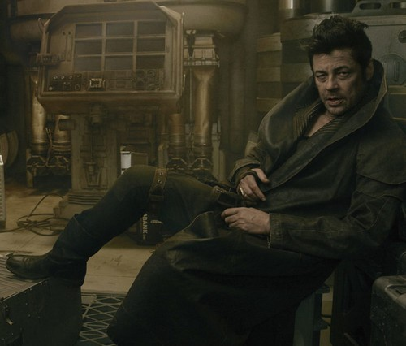

* * *

Sur le polybag, _DJ_ est mis en situation sur son socle et un fond rouge, on a connu mieux comme décor.  
Les logos _LEGO_ et _Star Wars_ sont présents sur le bandeau en haut du polybag, ainsi que les les trois héros de la nouvelle trilogie.

[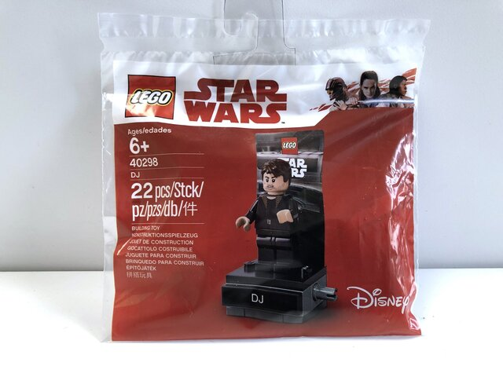](https://www.freelug.org/IMG/jpg/polydj_01.jpg)

A l’intérieur, on trouve un sachet de pièces, un sticker avec le nom de la figurine, un décor de fond et une notice de montage.

[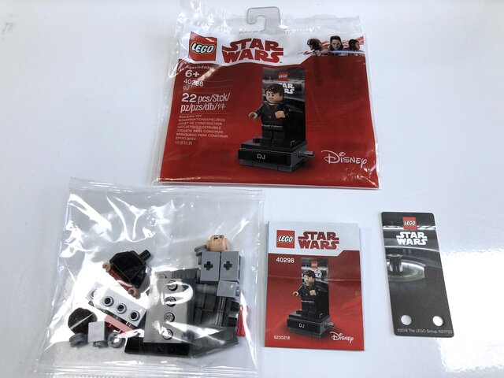](https://www.freelug.org/IMG/jpg/polydj_2.jpg)

[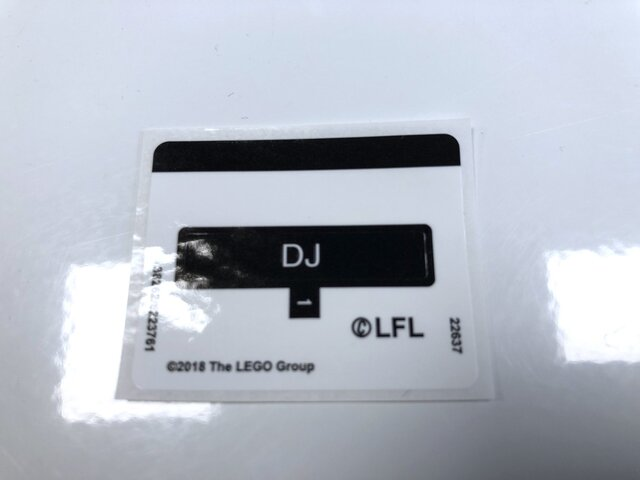](https://www.freelug.org/IMG/jpg/polydj_03.jpg)

* * *

La minifig de _[DJ Code Breaker](https://brickset.com/minifigs/sw903/dj-code-breaker-\(40298\))_ est joliment réalisée, les sérigraphies sont nettes et précises. Par contre le visage n’a rien de ressemblant avec _Benicio Del Toro_.

[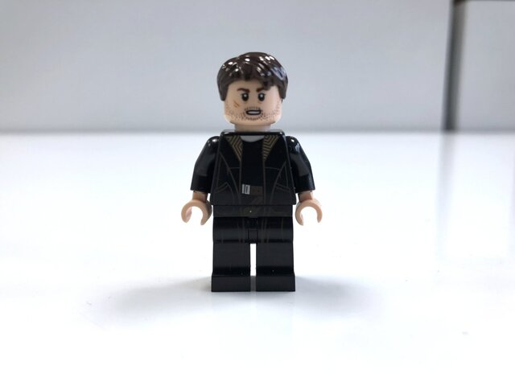](https://www.freelug.org/IMG/jpg/polydj_04.jpg)

De dos, peu de détails même si on retrouve le motif du col de la veste.

[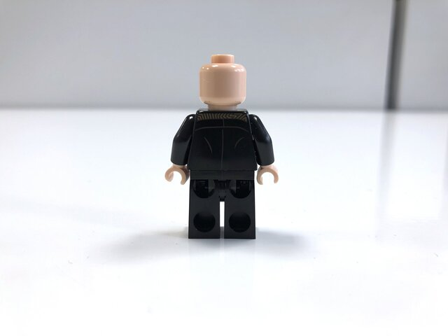](https://www.freelug.org/IMG/jpg/polydj_05.jpg)

* * *

_DJ_ sur son stand de présentation.

[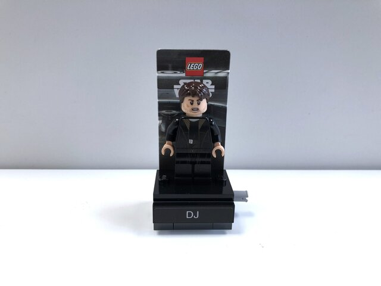](https://www.freelug.org/IMG/jpg/polydj_06.jpg)

[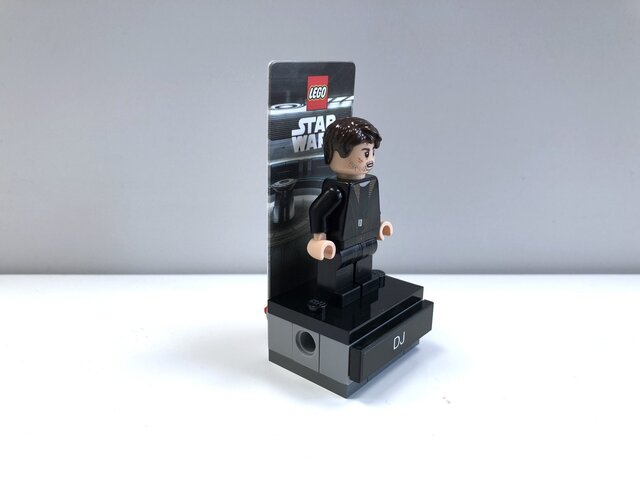](https://www.freelug.org/IMG/jpg/polydj_07.jpg)

[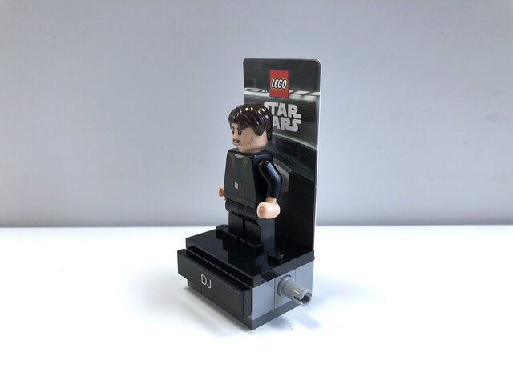](https://www.freelug.org/IMG/jpg/polydj_08.jpg)

* * *

_R3-M2_, le _Scarif Stormtrooper_ et _DJ_ avec leurs stands accolés (image issue d’internet).

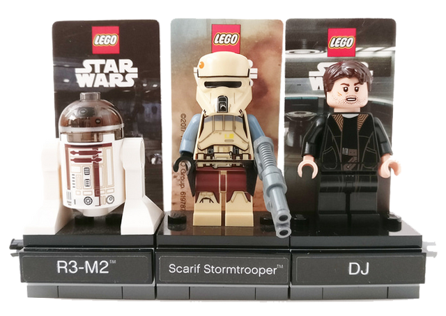

* * *

**AVIS :**

_LEGO_ persiste et signe avec la série ouverte par _R3-M2_ et le _Scarif Stormtrooper_. Néanmoins cette figurine exclusive n’a rien de transcendant et ravira uniquement les collectionneurs et/ou fans complétistes. Pour les autres le corps de cette Minifig pourra servir très facilement pour faire des personnages customs.

Encore une fois, dommage que _LEGO_ n’ait pas sérigraphié la _Tile_ noire comme sur les sets _Architecture_.
