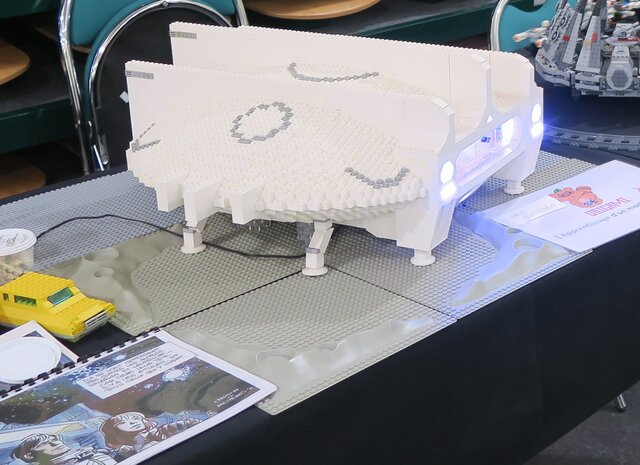
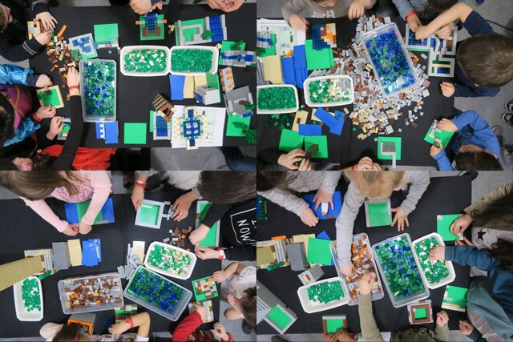
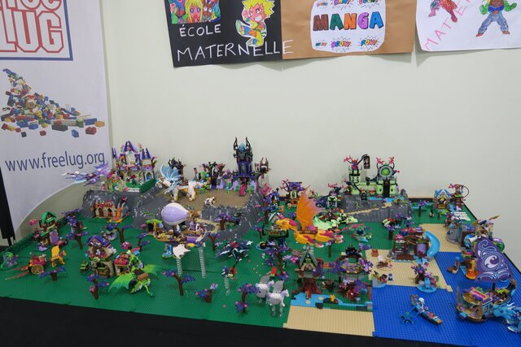
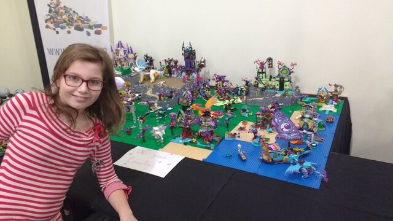
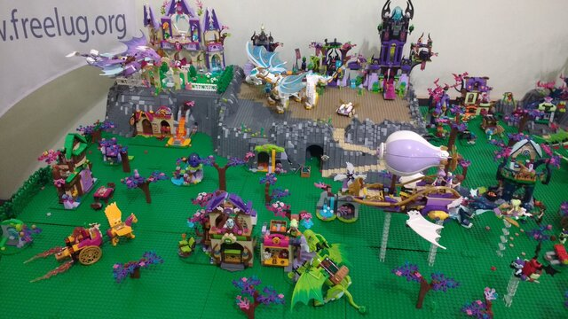
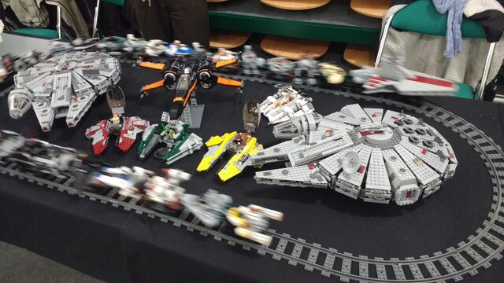
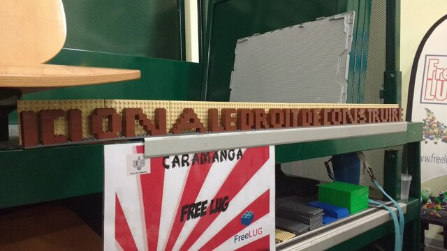
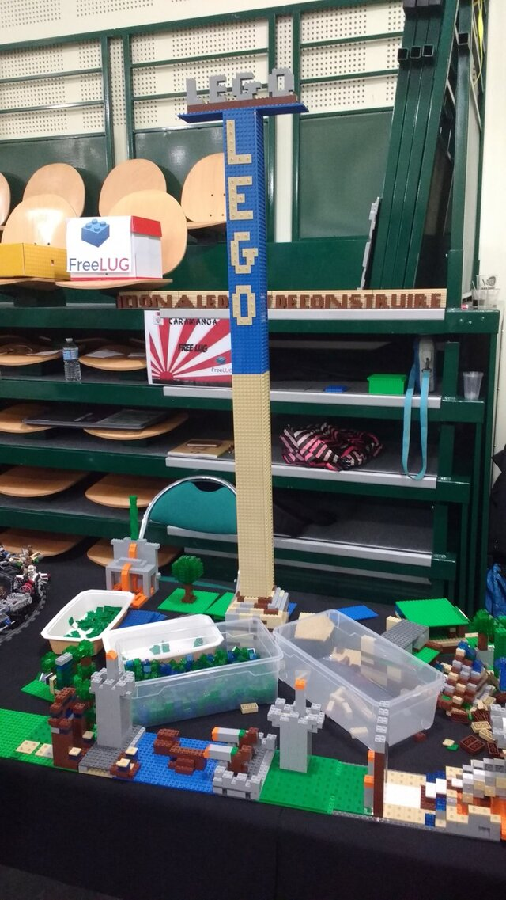

Chaque année la ville de Caraman organise un salon qui regroupe associations et fans autour des mangas et de la science-fiction à travers jeux vidéo, cosplay et LEGO.

Les 10 et 11 mars 2018, FreeLUG a participé au salon CARAMANGA, à Caraman, ville proche de Toulouse.

Ce salon regroupe des associations et fans autour des mangas et de la science-fiction à travers jeux vidéo, cosplay et … LEGO. Plus de 1500 visiteurs ont été accueillis dans un espace de 500 m². Sur le stand FreeLUG, nous avons présenté plusieurs thèmes : Elves, Star Wars, Valérian et Laureline.

**Le vaisseau de Valérian et Laureline (d’après la BD)**

Nous avons animé un atelier construction avec des briques Minecraft. Les enfants ont été nombreux à y participer. Certains, enthousiastes, ont même motivé leurs parents à ressortir les LEGO de leurs placards.

**Quelques instantanés**

**L’univers des Elves**

Pour cette expo je suis venu avec mes deux enfants.  
Ma fille a réalisé son premier décor dédié exclusivement aux Elves, je l’ai juste aidée pour les montagnes.

Mon fils a présenté ses vaisseaux Star Wars.

Et j’ai fait un petit train qui tourne autour avec des Micro Fighters.

Video Player

[Vidéo de la publication d’origine](https://www.freelug.org/IMG/mp4/vid_20180310_115144883.mp4)

Pour l’animation MineCraft, nous nous sommes lancés le dimanche matin dans quelques petits défis :

Mon fils a écrit en LEGO

Et je me suis mis à faire une tour pour être sûr qu’on nous voit !

Ce fût une bien belle expo et nous avons déjà repris rendez-vous pour l’année prochaine.

Voir en ligne : [Caramanga](https://www.facebook.com/saloncaramanga/)
