Aujourd’hui, je vous propose la review du set 75167 dans la gamme _Star Wars_ : **Bounty Hunter Speeder Bike Battle Pack**.

Ce set, sorti en 2017 au prix de 14,99 €, est composé de 122 pièces, soit un ratio prix/pièce de 12 centimes d’euro.

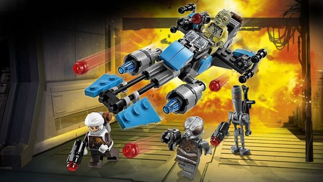

* * *

Le contenu du set est intégré dans le décor désertique ressemblant à un couloir de vaisseau. Le bandeau du haut est constitué des logos _LEGO_ et _Star Wars_ et du casque de _Deathtrooper_ (comme tous les sets _Star Wars_ fournée 2017).

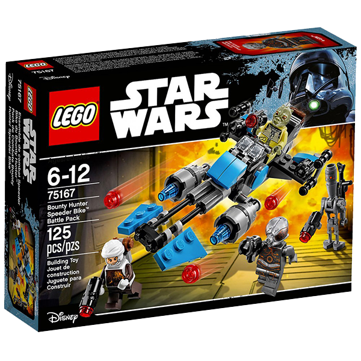

Au verso, plusieurs vignettes avec les rares éléments de jouabilité du set.

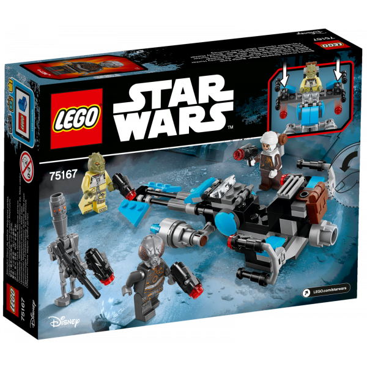

Une fois ouvert, le set contient trois sachets et une notice de construction.

[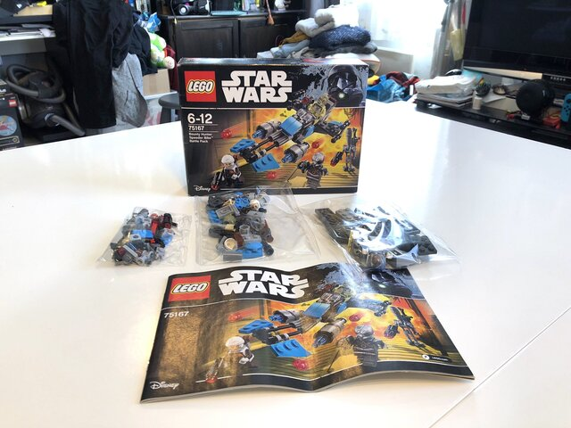](https://www.freelug.org/IMG/jpg/bountyhunterbp_03.jpg)

* * *

_[Dengar](https://brickset.com/minifigs/sw751/dengar-\(white-torso\))_ est une très belle figurine. Les sérigraphies du visage et du torso sont précises et détaillées. Le turban achève le côté Touareg du désert.

**Il est à noter que toutes les figs sont exclusives à ce set**.

[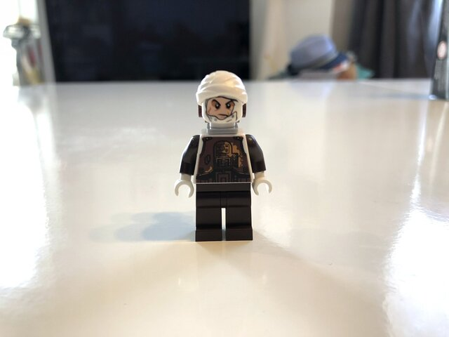](https://www.freelug.org/IMG/jpg/bountyhunterbp_04.jpg)

Le dos fourmille de détails, c’est une bonne surprise.

[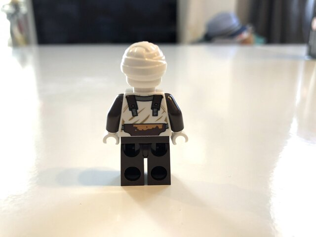](https://www.freelug.org/IMG/jpg/bountyhunterbp_05.jpg)

[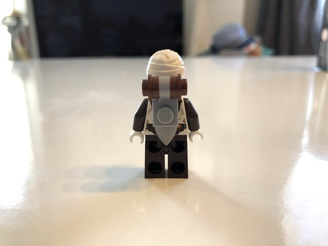](https://www.freelug.org/IMG/jpg/bountyhunterbp_06.jpg)

_[Bossk](https://brickset.com/minifigs/sw828/bossk-olive-green-\(75167\))_ est vraiment réussi, tant au niveau de la tête que de la couleur de la combinaison. Les sérigraphies sont fidèles à l’original et comprennent une foule de détails.

[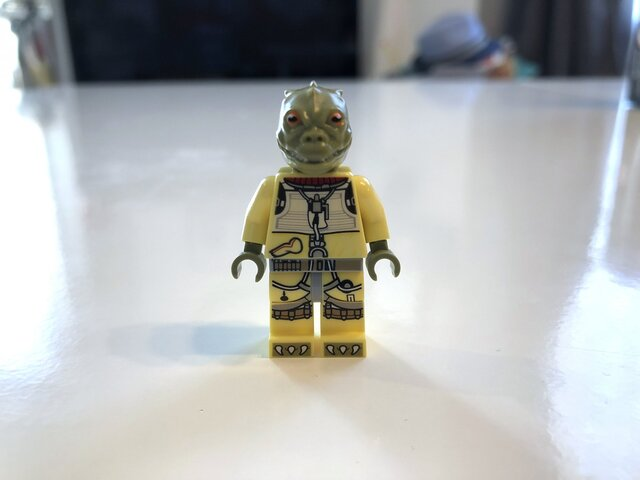](https://www.freelug.org/IMG/jpg/bountyhunterbp_07.jpg)

Au verso, encore une fois les détails sont nombreux.

[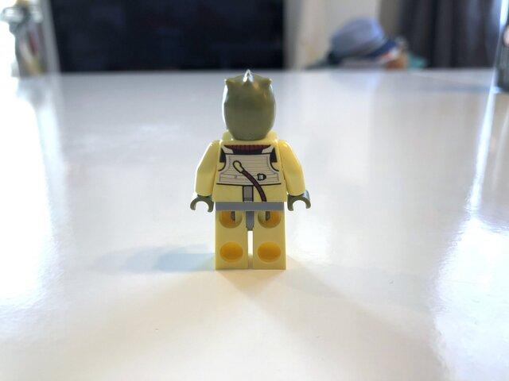](https://www.freelug.org/IMG/jpg/bountyhunterbp_08.jpg)

_[4-LOM](https://brickset.com/minifigs/sw830/4-lom-\(75167\))_, ancien droïd protocolaire, est lui aussi une franche réussite. La tête aux yeux insectoïde et le corps ressemblant à _C-3PO_ font bon ménage, surtout dans cette couleur.

[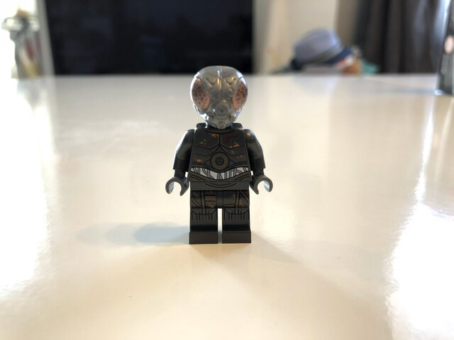](https://www.freelug.org/IMG/jpg/bountyhunterbp_09.jpg)

Le dos est lui aussi richement décoré.

[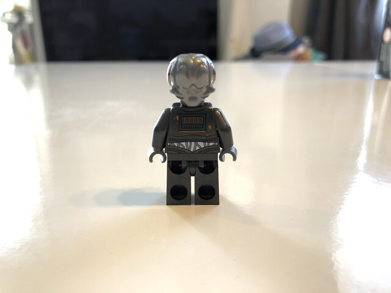](https://www.freelug.org/IMG/jpg/bountyhunterbp_10.jpg)

_[IG-88](https://brickset.com/minifigs/sw831a/ig-88-\(75167\))_, rien de particulier à dire sur cette minifig quand on connait mon aversion pour ces corps _LEGO_. Seule la brique ronde 1x1 sérigraphiée trouve grâce à mes yeux.

[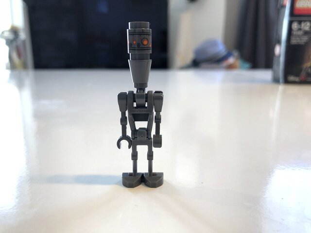](https://www.freelug.org/IMG/jpg/bountyhunterbp_11.jpg)

Faut-il vraiment commenter le dos ?

[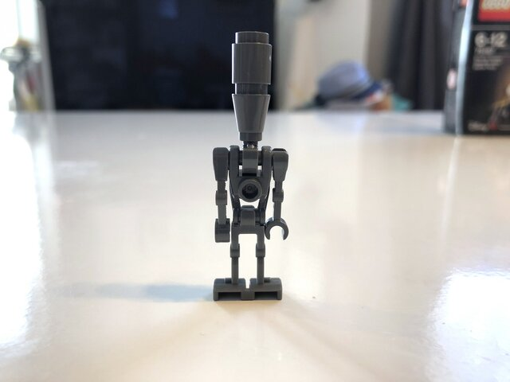](https://www.freelug.org/IMG/jpg/bountyhunterbp_12.jpg)

* * *

On commence la construction du _Speeder Bike_.

[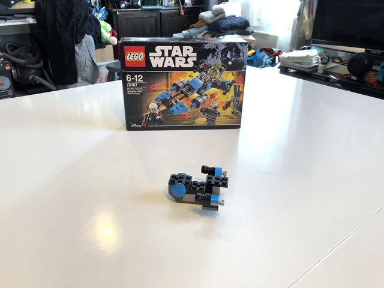](https://www.freelug.org/IMG/jpg/bountyhunterbp_14.jpg)

Comme tout les _Battle Pack_, la construction n’est pas le point fort du modèle.

[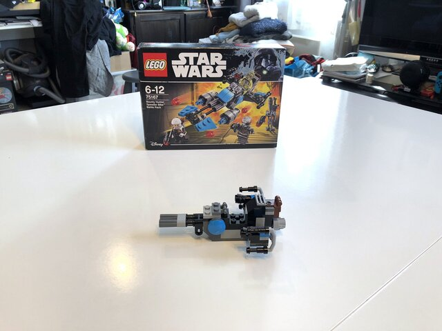](https://www.freelug.org/IMG/jpg/bountyhunterbp_15.jpg)

Le montage est rapide.

[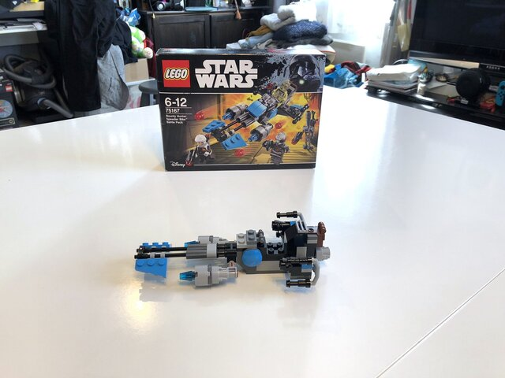](https://www.freelug.org/IMG/jpg/bountyhunterbp_16.jpg)

C’est déjà quasiment fini.

[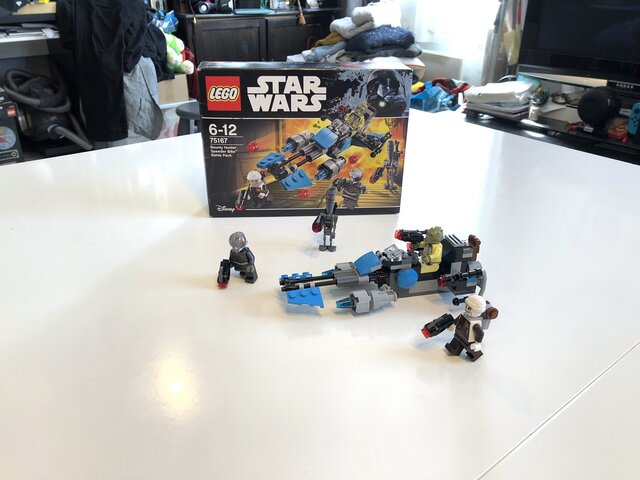](https://www.freelug.org/IMG/jpg/bountyhunterbp_17.jpg)

Mis en situation avec les minifigs du set. Il faut avouer que ce n’est pas le pire des véhicules proposés dans un _Battle Pack_.

[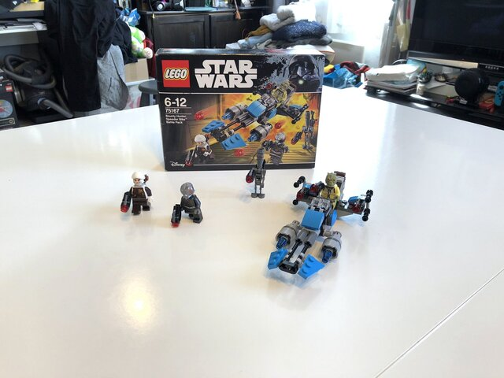](https://www.freelug.org/IMG/jpg/bountyhunterbp_18.jpg)

Photos du set sous plusieurs angles de vue.

[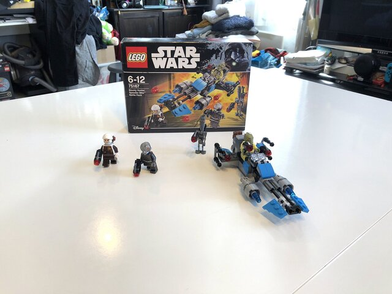](https://www.freelug.org/IMG/jpg/bountyhunterbp_19.jpg)

[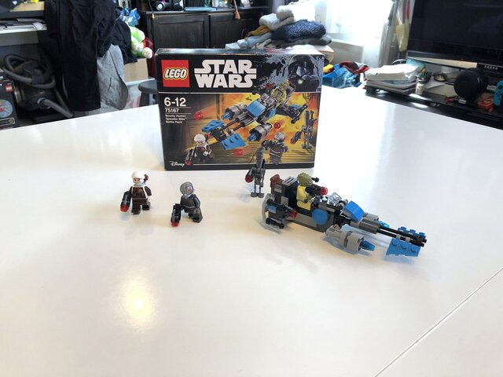](https://www.freelug.org/IMG/jpg/bountyhunterbp_20.jpg)

[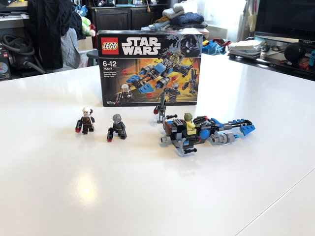](https://www.freelug.org/IMG/jpg/bountyhunterbp_21.jpg)

[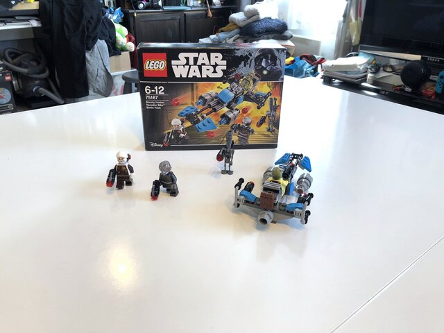](https://www.freelug.org/IMG/jpg/bountyhunterbp_22.jpg)

[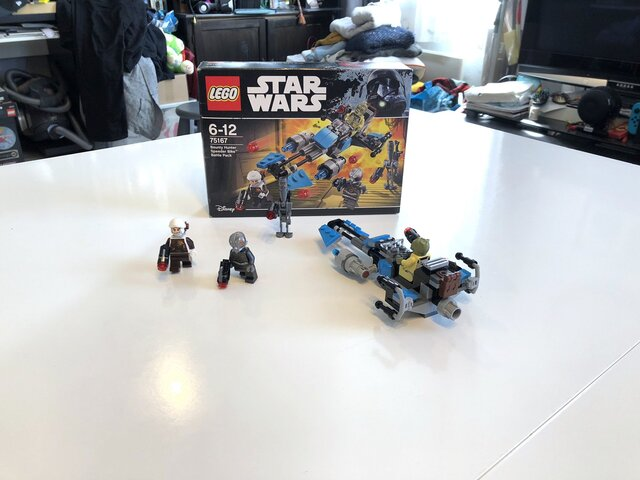](https://www.freelug.org/IMG/jpg/bountyhunterbp_23.jpg)

[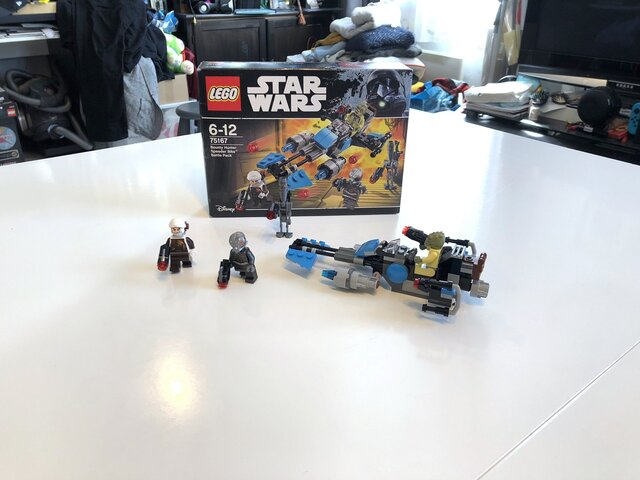](https://www.freelug.org/IMG/jpg/bountyhunterbp_24.jpg)

[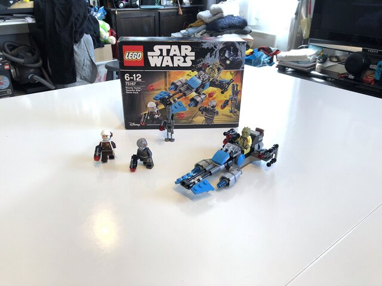](https://www.freelug.org/IMG/jpg/bountyhunterbp_25.jpg)

* * *

**AVIS :**

Montage anecdotique pour ce _Speeder Bike_, mais comme dit plus haut, on a déjà vu bien pire dans un _Battle Pack_. Par contre c’est un presque carton plein sur les figurines, trois sur quatre sont vraiment magnifiques et méritent d’être possédées. Et même si je n’aime pas la quatrième, _LEGO_ a au moins le mérite d’avoir réalisé un personnage que l’on voit dans une scène importante de la _Trilogie Originale_.

Encore une fois, il est urgent d’attendre les soldes si vraiment vous voulez ces quatre figurines.

**BONUS :**

Voici un GIF animé réalisé avec la totalité des photos prises pour cette review (cliquez sur l’image pour lancer l’animation).

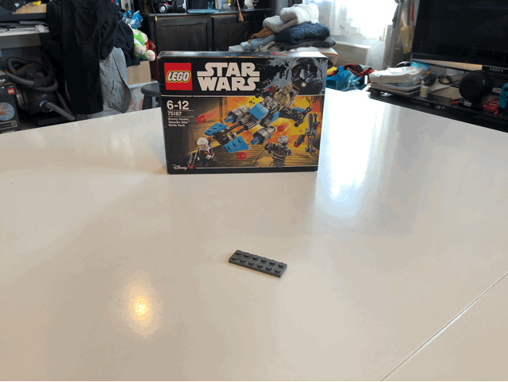
