Bonjour à tous, aujourd’hui je vous propose une review du set 21314 dans la gamme _Ideas_ : **Tron Legacy**.  
Ce set, sorti en 2018, est composé de 230 pièces et coûte 34,99 euros, soit un ratio prix/pièce d’environ 15 centimes d’euros.

[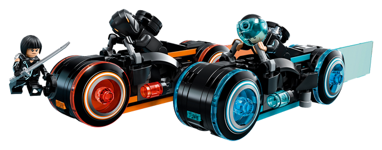](https://www.freelug.org/IMG/png/tronlegacy_00.png)

> _LEGO Cusoo_ renommé le 30 avril 2015 en _LEGO Ideas_ est un projet de _The LEGO Group_ créé en 2008.
> 
> Le projet consiste en ce qu’un joueur/créateur de _LEGO_ propose une de ses créations sur le site de _[LEGO Ideas](https://ideas.lego.com/dashboard)_. Si la boîte obtient 10 000 votes et qu’elle est accepté par des créateurs _LEGO_, elle est alors mise en vente.  
> Le constructeur de la boîte reçoit 1% de l’argent gagné par la vente du produit.
> 
> Source : _[Wikipedia](https://fr.wikipedia.org/wiki/Lego_Ideas)_.

* * *

Au recto, on retrouve le logo _Ideas_ en bas à droite. Le set est présenté sur un fond bleu/noir représentant le _Grid_ (la _Grille_). Cette décoration nous plonge littéralement dans l’ambiance du film.

[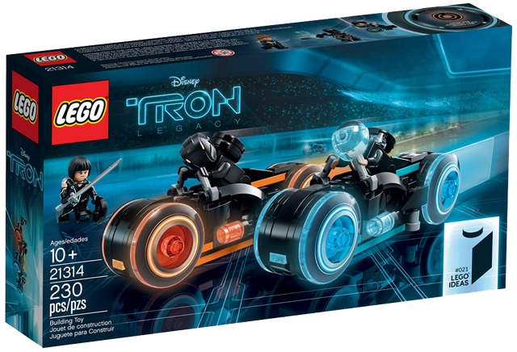](https://www.freelug.org/IMG/png/tronlegacy_01.png)

Au verso, sont présentés les personnages présents dans le set, ainsi que les rares éléments de jouabilités.

[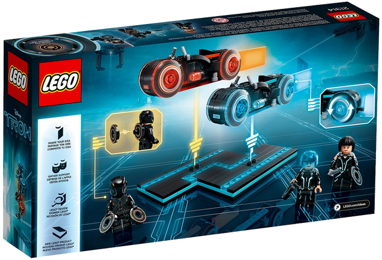](https://www.freelug.org/IMG/png/tronlegacy_02.png)

La boite contient deux sachets et une notice. Cette dernière contient moult photos, explications et anecdotes. Malheureusement, comme à chaque fois, le texte n’est pas pas traduit. Il est vraiment dommage que _LEGO_ ne fasse pas l’effort pour régionaliser ses sets "_premium_".

[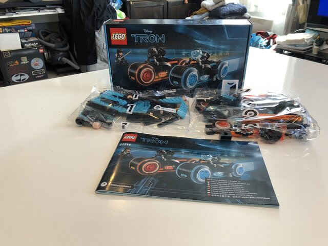](https://www.freelug.org/IMG/jpg/tronlegacy_03.jpg)

* * *

-   **Tron Legacy :**

**Tron : L’Héritage** (_Tron : Legacy_) est un film de science-fiction américain réalisé par Joseph Kosinski et sorti en 2010.  
Produit par Walt Disney Pictures, c’est la suite du film _Tron_ de 1982. Les acteur Jeff Bridges (Kevin Flynn/Clu) et Bruce Boxleitner (Alan Bradley/Tron) y reprennent leurs rôles respectifs.  
C’est le duo Français _Daft Punk_ qui a composé la bande originale.

[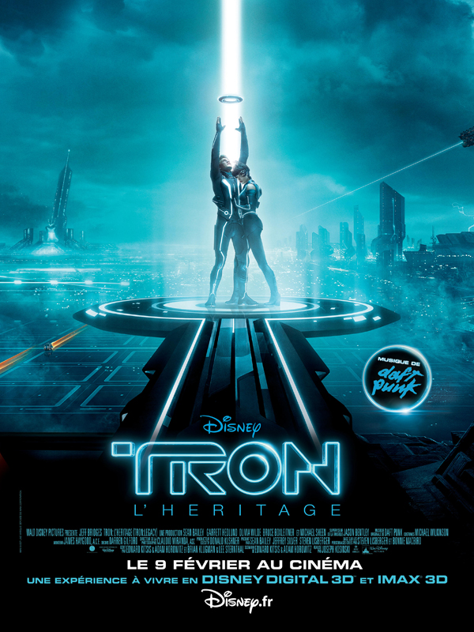](https://www.freelug.org/IMG/jpg/tronlegacy_affiche.jpg)

* * *

-   **[Rinzler](https://brickset.com/minifigs/idea040/rinzler) :**

**Rinzler** n’est autre que _Tron_ reprogrammé par _CLU_ (programme ayant l’apparence de _Kevin Flynn_ et contrôleur de la _Grille_ (the _Grid_)).

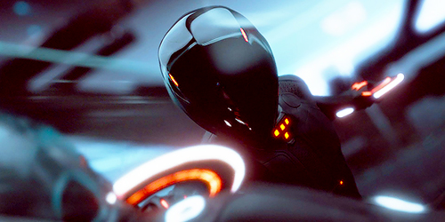

Très belle réalisation pour cette figurine, les sérigraphies sont magnifiques (on notera la réutilisation du casque du _Vautour_ du set 76083). Les sérigraphies sont accurate avec le film ce qui est assez rare chez _LEGO_ pour le signaler.

[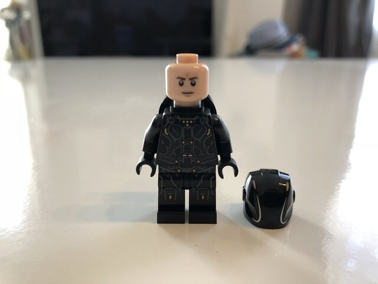](https://www.freelug.org/IMG/jpg/tronlegacy_05.jpg)

[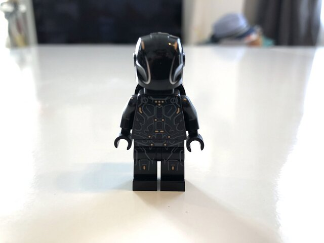](https://www.freelug.org/IMG/jpg/tronlegacy_04.jpg)

Le dos est lui aussi magnifique et un bracket avec pin Technic permet de positionner les deux disques de _Rinzler_. Il est à noter que c’est la seule figurine du set qui ne possède pas de double visage.

[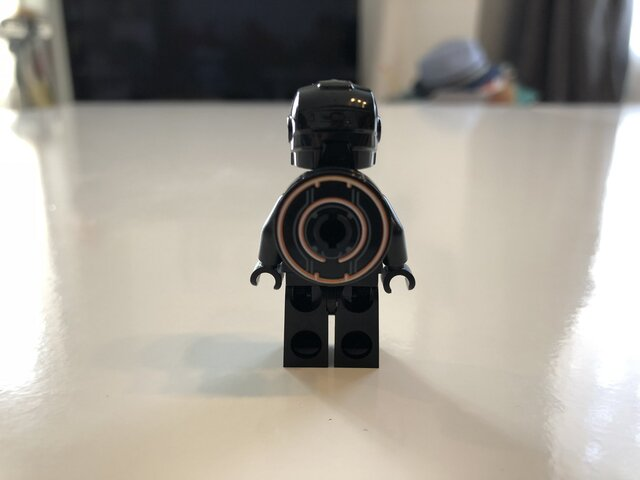](https://www.freelug.org/IMG/jpg/tronlegacy_06.jpg)

[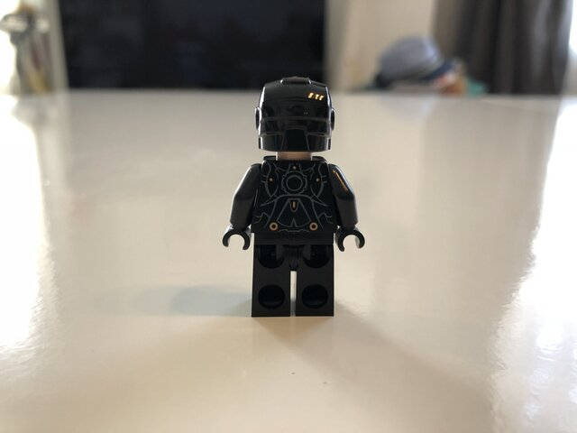](https://www.freelug.org/IMG/jpg/tronlegacy_07.jpg)

-   **[Sam FLYNN](https://brickset.com/minifigs/idea039/sam-flynn) :**

**Sam FLYNN** (le héros du film), est le fil de Kevin Flynn, il est lui aussi projeté accidentellement dans la grille (un monde virtuel créé par Kevin) depuis un bureau caché dans l’ancienne salle d’arcade de son père.

[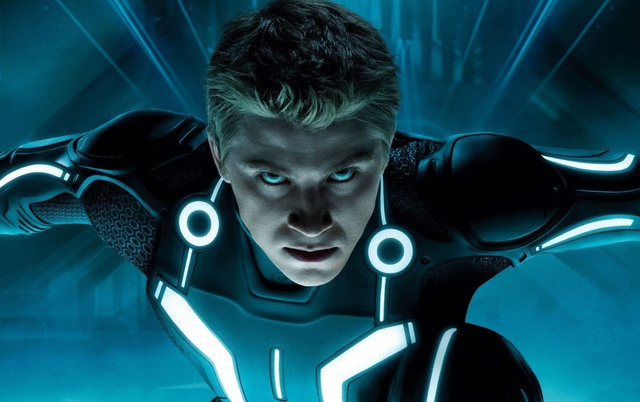](https://www.freelug.org/IMG/jpg/tronlegacy_samflynn.jpg)

La encore la fig est vraiment réussie par sa ressemblance avec l’originale. Ici aussi les sérigraphies sont d’une rare précision et totalement accurate. Les bras sont eux aussi sérigraphiés.

[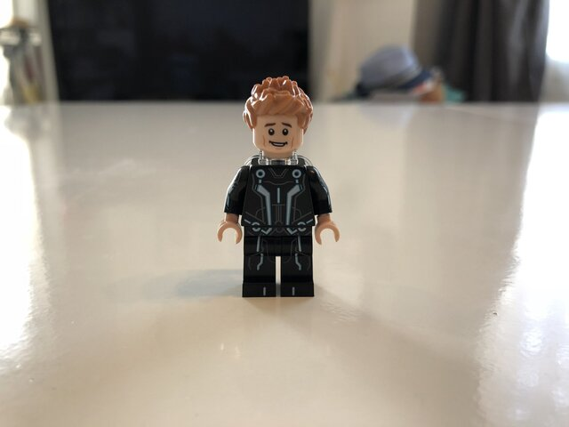](https://www.freelug.org/IMG/jpg/tronlegacy_12.jpg)

[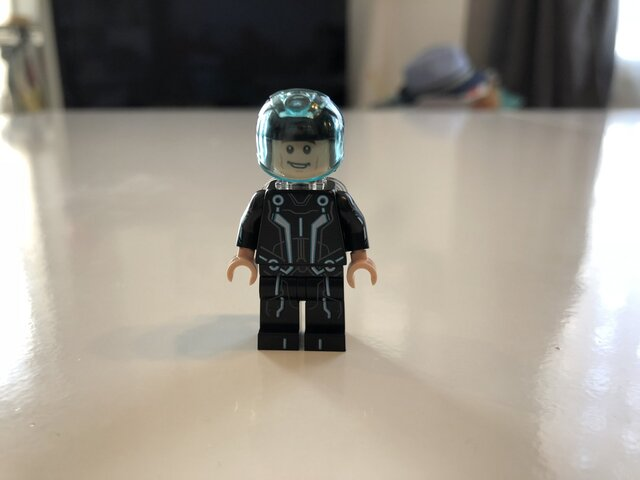](https://www.freelug.org/IMG/jpg/tronlegacy_11.jpg)

Comme pour _Rinzler_, le dos est une réussite. Pour tenir le disque _Flynn_ à droit a un bracket transparent avec tenons.

[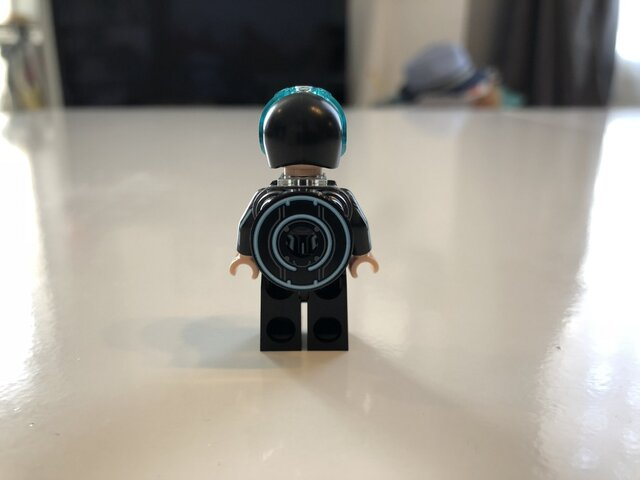](https://www.freelug.org/IMG/jpg/tronlegacy_13.jpg)

[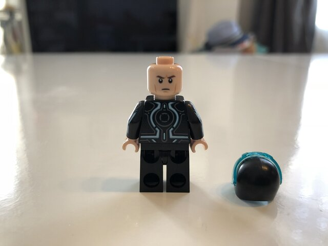](https://www.freelug.org/IMG/jpg/tronlegacy_14.jpg)

-   **[Quorra](https://brickset.com/minifigs/idea038/quorra) :**

**Quorra** est un programme, ami de Kévin Flynn, qui sauve Sam et qui l’amène loin du contrôle de CLU. Cette action permet les retrouvailles en Sam et son père.  
_Quorra_ aidera Sam tout au long du film.

[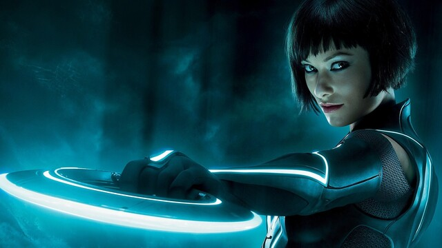](https://www.freelug.org/IMG/jpg/tronlegacy_quorra.jpg)

Ici encore belle réalisation, les cheveux sont totalement en adéquation avec le personnage du film. De nouveau les sérigraphies sont magnifiques et pour une fois la couleur Flesh est superbement rendue.

[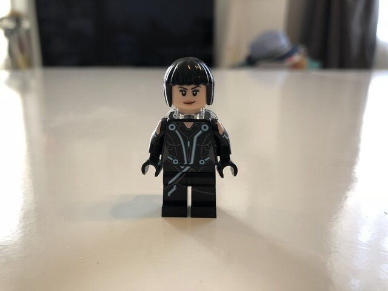](https://www.freelug.org/IMG/jpg/tronlegacy_08.jpg)

Comme pour _Flynn_, _Quorra_ à droit a un bracket transparent avec tenons pour tenir son disque dans le dos. Là encore les sérigraphies sont de toute beauté.

[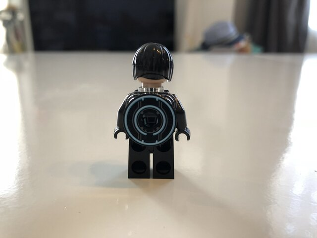](https://www.freelug.org/IMG/jpg/tronlegacy_09.jpg)

[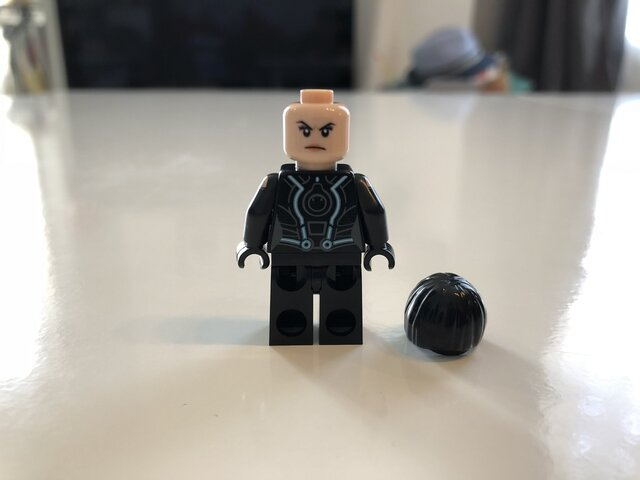](https://www.freelug.org/IMG/jpg/tronlegacy_10.jpg)

* * *

On commence la construction par le socle représentant le _Grid_. L’agencement est ingénieux et permettra d’avoir une scène très dynamique au final.

[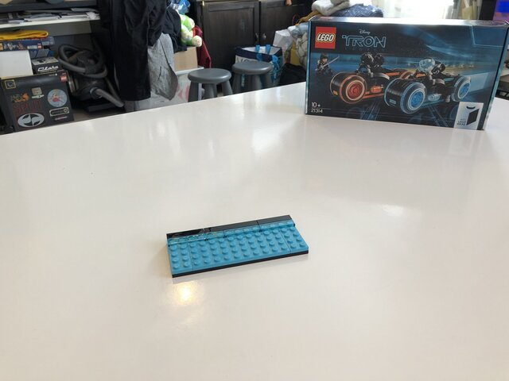](https://www.freelug.org/IMG/jpg/tronlegacy_15.jpg)

[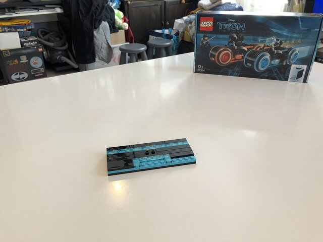](https://www.freelug.org/IMG/jpg/tronlegacy_16.jpg)

[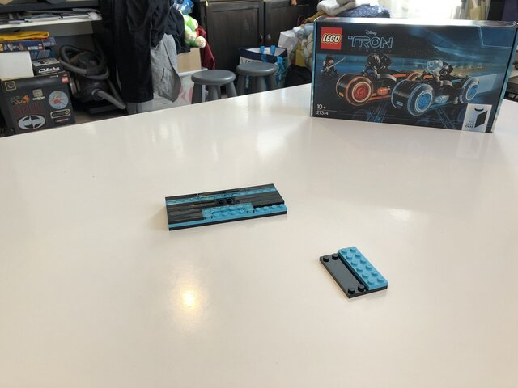](https://www.freelug.org/IMG/jpg/tronlegacy_17.jpg)

[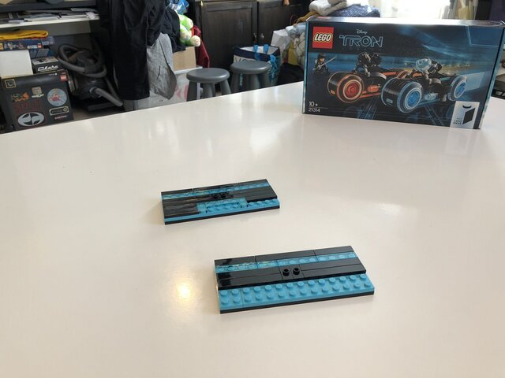](https://www.freelug.org/IMG/jpg/tronlegacy_18.jpg)

[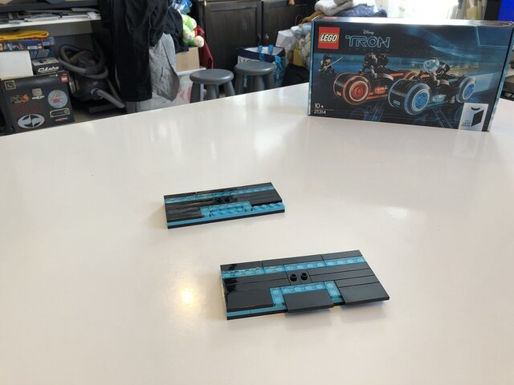](https://www.freelug.org/IMG/jpg/tronlegacy_19.jpg)

[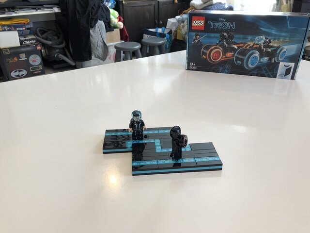](https://www.freelug.org/IMG/jpg/tronlegacy_20.jpg)

On construit maintenant la moto de _Rinzler_, le montage sans être inintéressant, n’est pas des plus passionnant.

[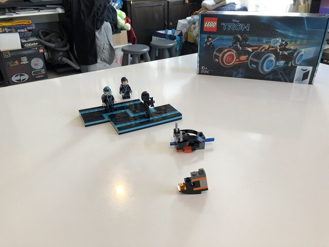](https://www.freelug.org/IMG/jpg/tronlegacy_21.jpg)

[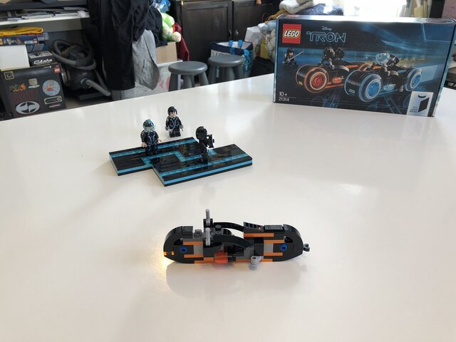](https://www.freelug.org/IMG/jpg/tronlegacy_22.jpg)

[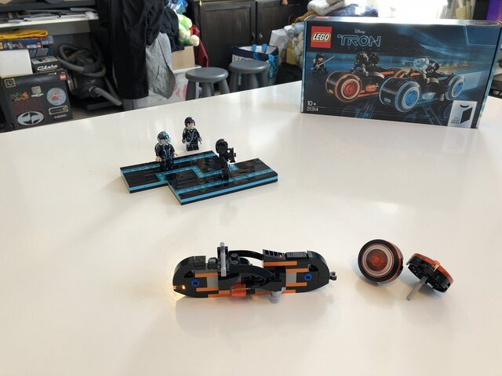](https://www.freelug.org/IMG/jpg/tronlegacy_23.jpg)

[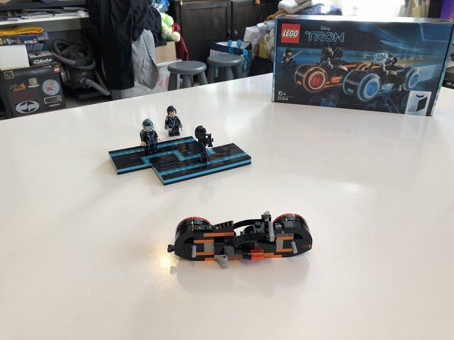](https://www.freelug.org/IMG/jpg/tronlegacy_24.jpg)

[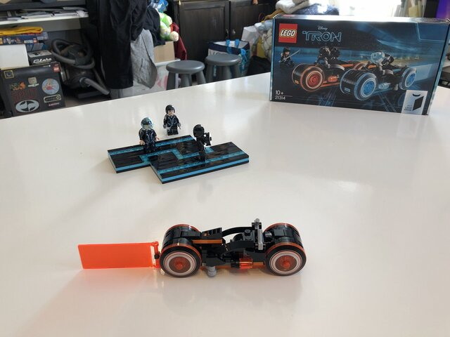](https://www.freelug.org/IMG/jpg/tronlegacy_25.jpg)

Répétition totale pour la moto de _Sam_, je vous épargnerais donc trop de photos.

[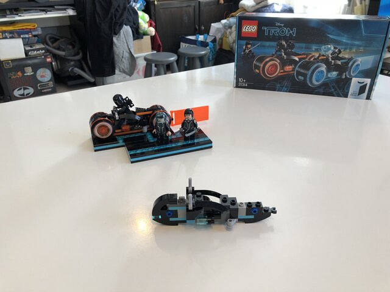](https://www.freelug.org/IMG/jpg/tronlegacy_26.jpg)

[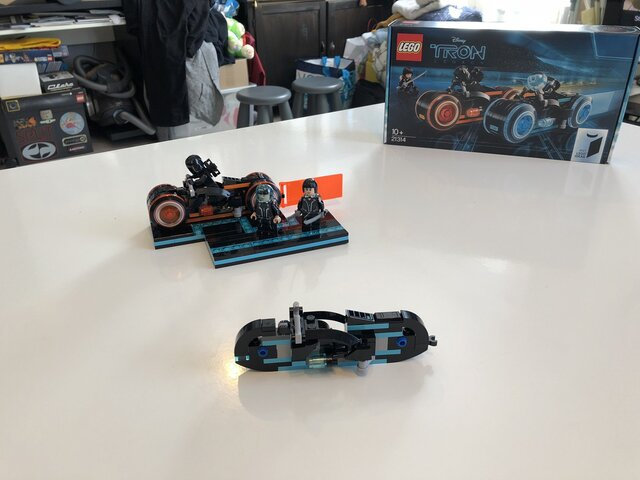](https://www.freelug.org/IMG/jpg/tronlegacy_27.jpg)

[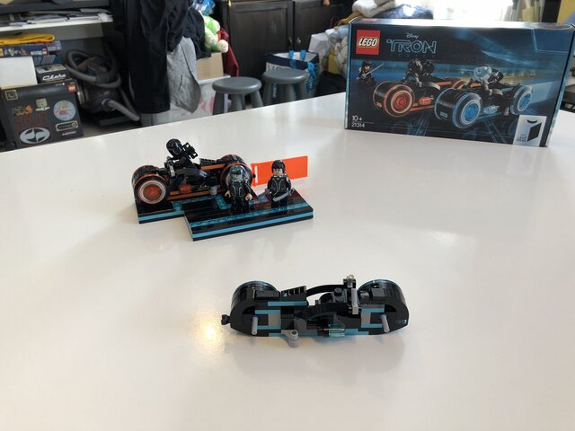](https://www.freelug.org/IMG/jpg/tronlegacy_28.jpg)

[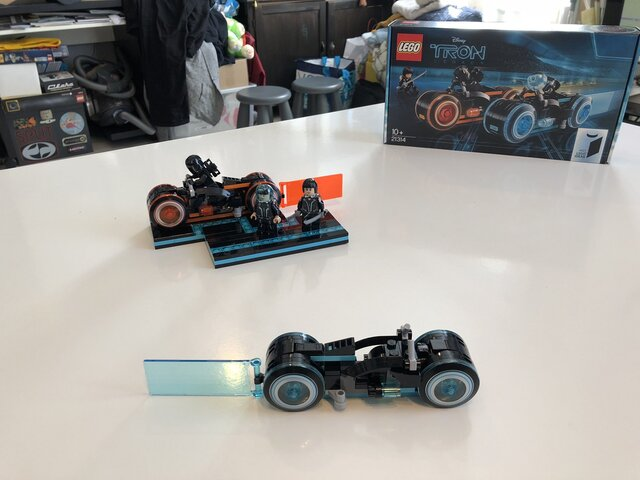](https://www.freelug.org/IMG/jpg/tronlegacy_29.jpg)

Rendu final du set mis en situation.

[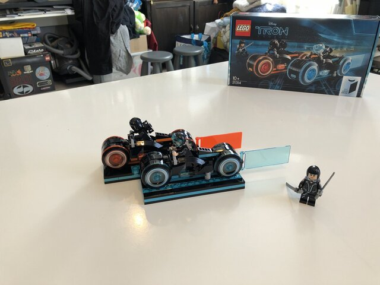](https://www.freelug.org/IMG/jpg/tronlegacy_30.jpg)

* * *

Le set sous différents angles de vue.

[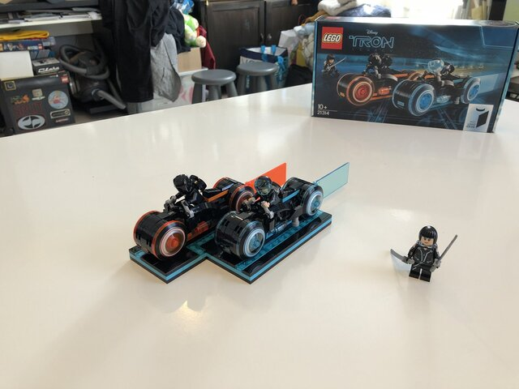](https://www.freelug.org/IMG/jpg/tronlegacy_31.jpg)

[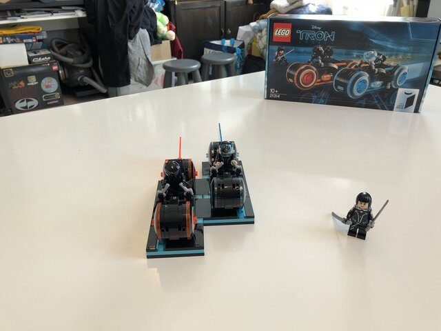](https://www.freelug.org/IMG/jpg/tronlegacy_32.jpg)

[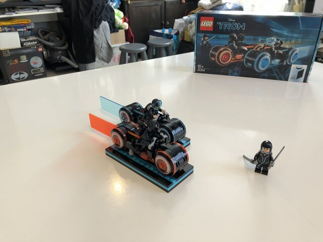](https://www.freelug.org/IMG/jpg/tronlegacy_33.jpg)

[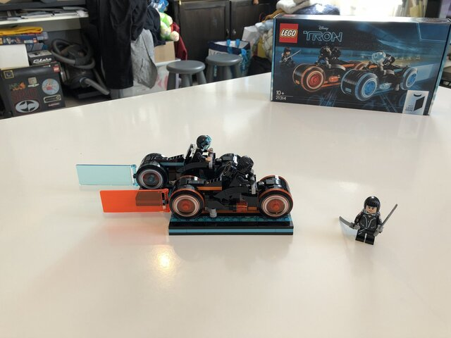](https://www.freelug.org/IMG/jpg/tronlegacy_34.jpg)

[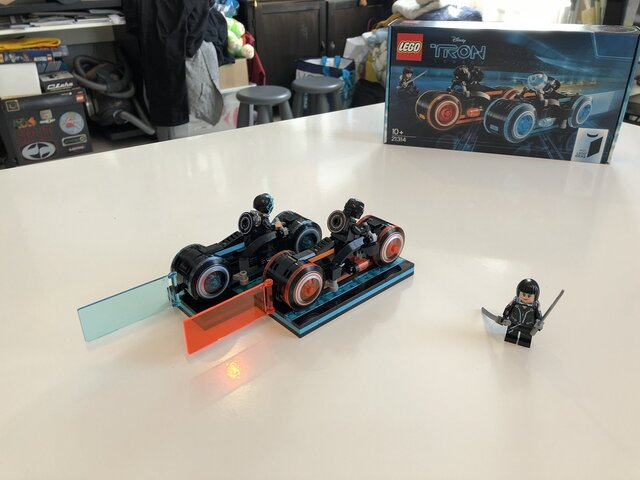](https://www.freelug.org/IMG/jpg/tronlegacy_35.jpg)

[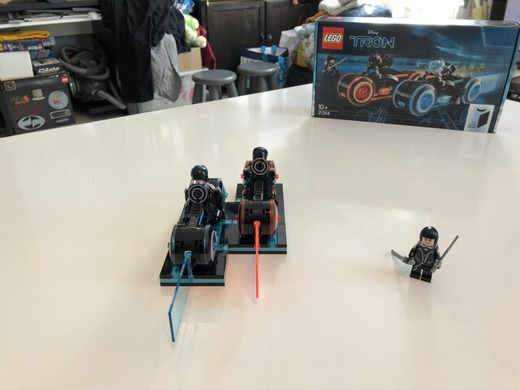](https://www.freelug.org/IMG/jpg/tronlegacy_36.jpg)

[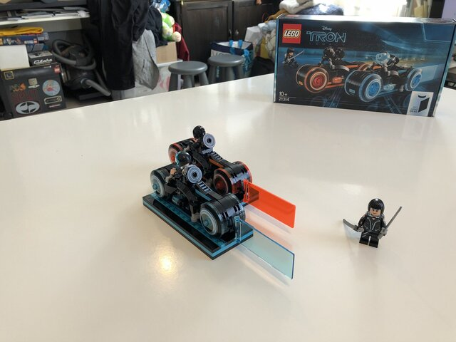](https://www.freelug.org/IMG/jpg/tronlegacy_37.jpg)

[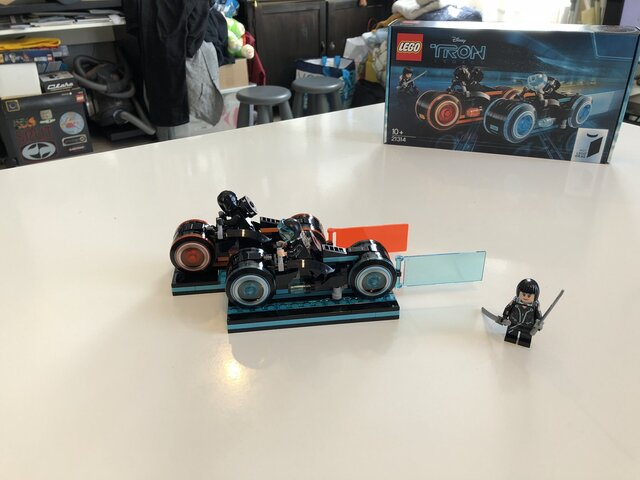](https://www.freelug.org/IMG/jpg/tronlegacy_38.jpg)

* * *

Il est à noter que la couleur _trans-neon orange_ de la moto de _Rinzler_ est fluorescente sous lumière noir, ce qui n’est pas le cas du bleu de celle de _Sam_ (crédit photo _[Will - HothBricks](https://www.hothbricks.com/vite-teste-lego-ideas-21314-tron-legacy/)_).

[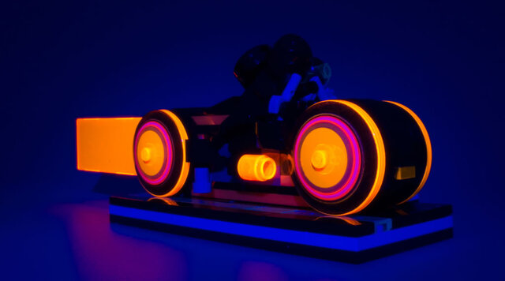](https://www.freelug.org/IMG/jpg/tronlegacy_hothbricks.jpg)

* * *

**AVIS :**

Très belle réussite pour cet _Ideas_, même si le plaisir de construction n’est pas totalement au rendez-vous, le rendu est top. _LEGO_ ayant eu bonne idée de mettre deux motos dans son set et d’ajouter un socle qui donne du dynamisme à l’ensemble de la scène. Rajoutez à ça trois minifigs magnifiques que les collectionneurs s’arracheront sans l’ombre d’un doute.

Bref un petit must have pour les collectionneurs et/ou amateurs de cette franchise.

**BONUS :**

Voici un GIF animé réalisé avec l’ensemble des photos prises pour cette review (cliquez sur l’image pour lancer l’animation).

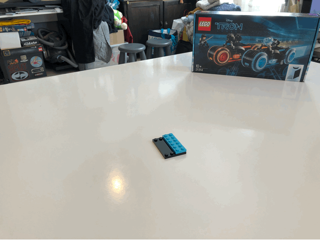
