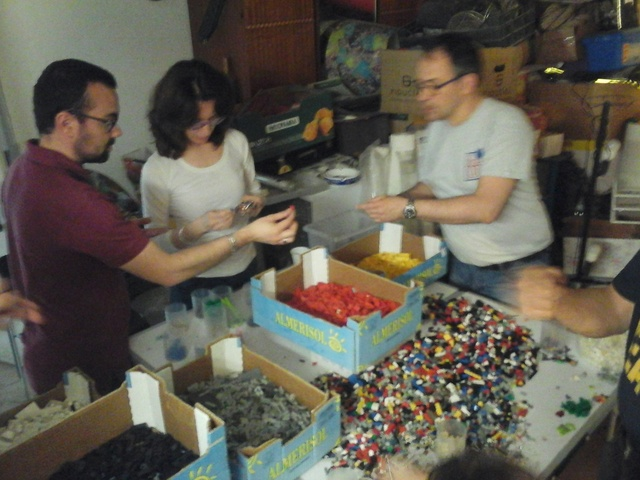
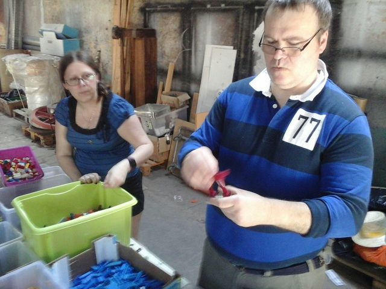
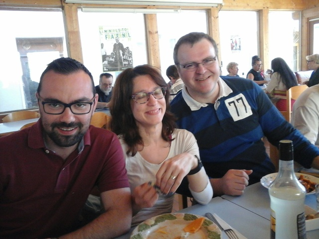

Nous poursuivons le partenariat avec Emmaüs et vous les retrouverez lors de nos différentes expositions en Rhône-Alpes.

Afin de préparer au mieux leur venue, nous avons passé une très belle journée ensoleillée avec [Emmaüs à Bourgoin-Jallieu](http://www.emmaus-bourgoin.org/) pour les aider à trier leurs caisses de vrac afin de leur permettre de reconstituer plus facilement des modèles qu’ils mettent en vente lors des expositions et ventes spéciales.

Suite à mon appel sur la liste du comité régional de Rhône-Alpes, une dizaine de membres ont répondu présent pour se joindre aux bénévoles et compagnons de la communauté Emmaüs pour une session de tri.

Pour le tri, et comme à l’habitude, les caisses pleines de vrac étaient au rendez-vous et les membres se sont répartis dans deux salles distinctes.

Sébastien, Sandra et Sylvain en plein tri

Lydie et Jérôme

A midi, nous avons pris au réfectoire un repas complet : entrée - lasagnes - fromages, dessert et café à un prix vraiment imbattable ! J’ai repris deux fois des lasagnes et d’ailleurs Sébastien, Sandra et Jérôme sont comblés. (même si Seb cherche toujours un bouddha pour sa maman).

Après le repas, les visiteurs du jour ont eu le droit à la visite de la communauté : dépôt, atelier, magasin, entrepôts... cette communauté Emmaüs est immense.

Bonne ambiance lors du repas à la communauté Emmaüs

L’après-midi, j’ai pu aider un compagnon à reconstituer un set Creator dans une nouvelle pièce dédiée au montage mais qui sert aussi d’atelier Brickfilm pour une école locale qui profite ainsi des moyens de la communauté.

Pour conclure, remercions Emmaüs pour leur accueil sensationnel et lors de cette journée pleine de convivialité.

Didier

* * *

Je veux juste ajouter que je fus particulièrement enthousiaste quant au niveau des discussions pendant le tri et le repas, ainsi que les thèmes abordés dont notamment la métaphysique de l’effort en milieu tempéré et la philosophie printanière chez les trentenaires (là, j’ai seulement écouté, hein...). C’est clair : il y a du "level"... :-D

C’est quand, la prochaine ?

Jérôme

* * *

Une bien belle journée de tri, dans la joie et la bonne humeur.  
La visite de la communauté nous a permis de découvrir tout plein de choses, et nous avons été vraiment bien reçus.

Sylvain a même pu développer de nouvelles compétences de tri sous table ^\_^  
Mais quand même, quand Laurent n’est pas là, on n’est pas trop de quatre pour savoir si une pièce est LEGO ou pas...

Sandra
