Partons à la découverte de la vision de LEGO pour fêter le 25ème anniversaire de Jurassic Park !

Aujourd’hui je vous propose une review du set 75932 : La poursuite du Vélociraptor - Jurassic Park

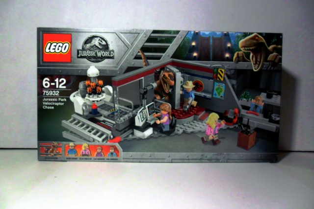

Ce set se compose de 360 pièces, un dinosaure, deux enfants et deux adultes.  
Un prix de 50€ soit environ 13,9 centimes la pièce

L’arrière de la boite et le côté latéral montrent plusieurs possibilités de jouabilité :

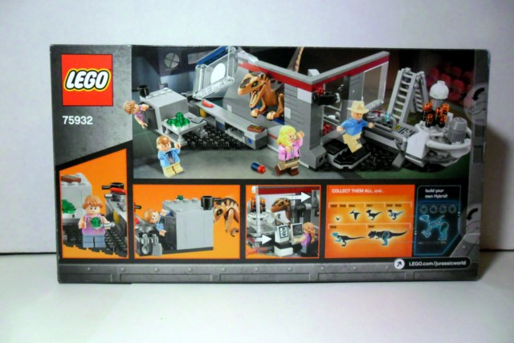

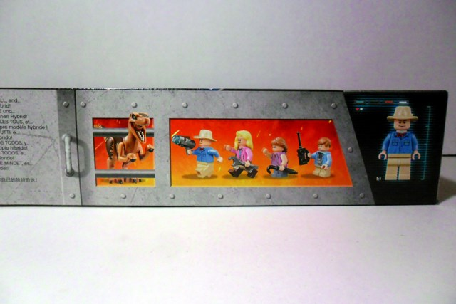

Mais c’est bien beau tout ça, mais c’est le contenu qui compte... On découvre donc un dinosaure, 3 sachets, deux notices et une planche de sticker :

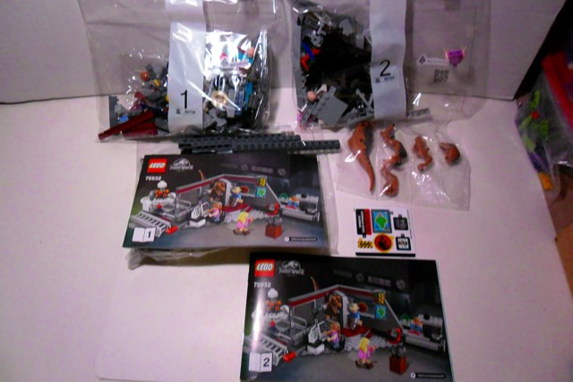

Un petit zoom sur la planche de sticker :

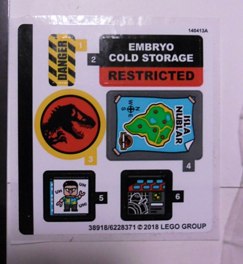

**En bref passons au sachet 1 :**  
On découvre deux figurines : Alan Grant et Tim :

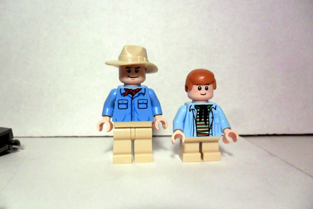

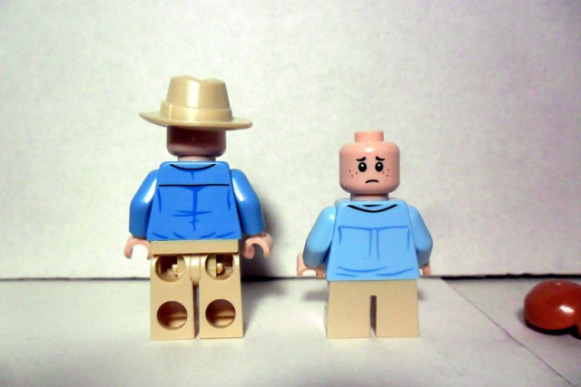

On retrouve bien le look des deux personnages tels qu’ils apparaissent dans le film.  
Passons au Raptor, inédit dans ce coloris, mais pas dans les moules qui datent de 2012

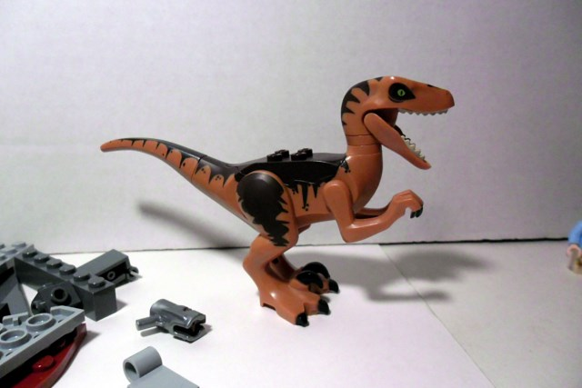

Et nous obtenons :

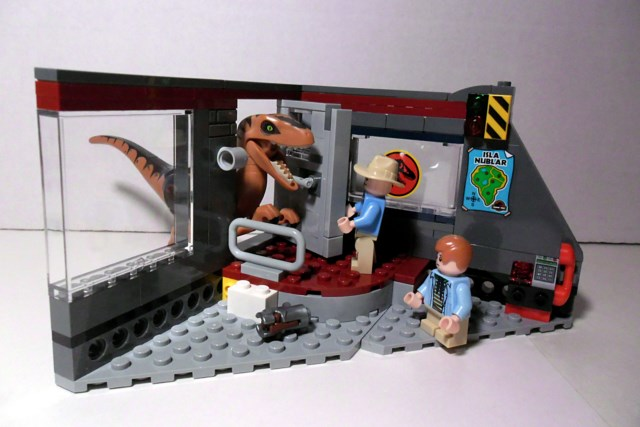

Oh mon dieu ! Le raptor tente de forcer la porte ! Mais où est le système informatique qui verrouille la porte ?

**C’est dans le sachet 2 :**  
On retrouve deux personnages : Ellie Sattler et Lex :

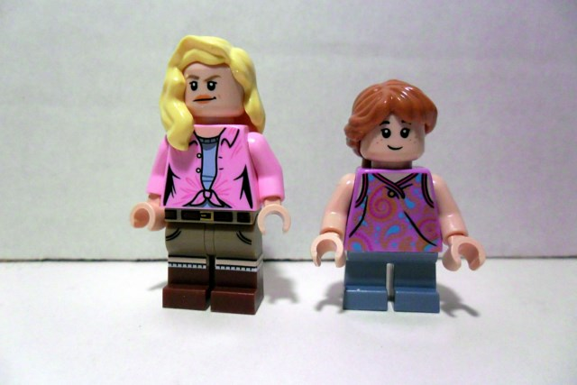

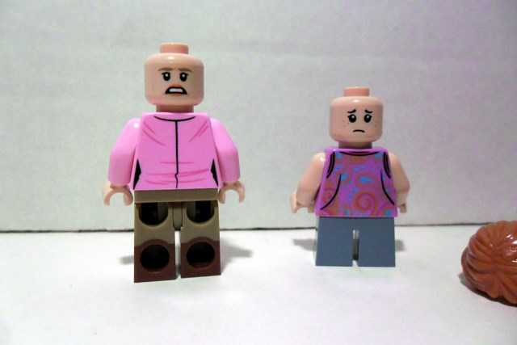

Et bingo, l’ordinateur est monté :

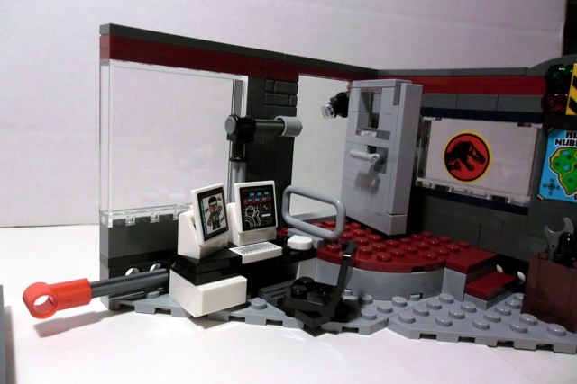

Mais le méchant Raptor tente un contournement, direction la cuisine :

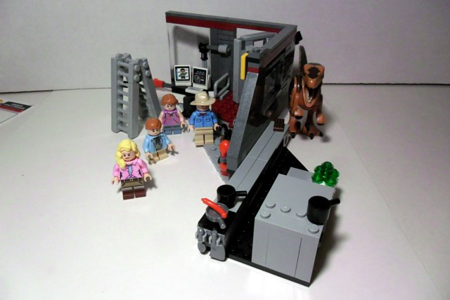

**Passons au sachet 3 :**  
On monte assez rapidement la salle avec les embryons :

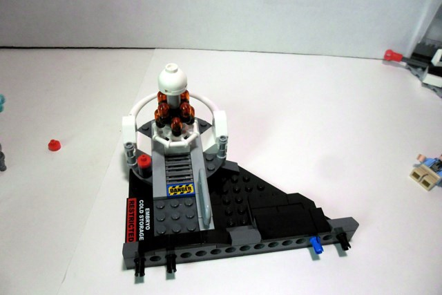

**Bonus track : les extra parts :**

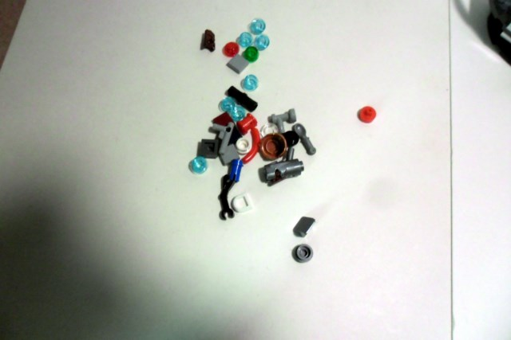

Et voilà montage fini :

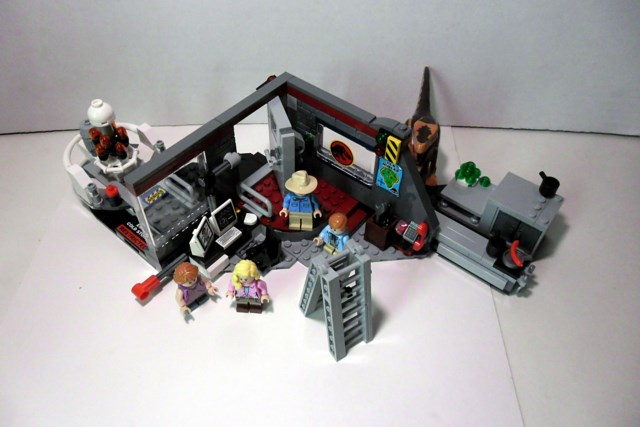

**Conclusion :**  
LEGO a cherché à faire un set hommage pour pas cher (pour eux). Donc la scène de la porte qui apparait dans la bande-annonce, la cuisine et le labo à embryon est un bon compromis...

Mais voilà, l’autre scène emblématique, la finale avec le T-Rex, c’est ça que les gens attendent... Et ben pour le moment c’est pas possible... Qui sait pour plus tard...  
En attendant, un set pour les **fans**, mais c’est cher...
