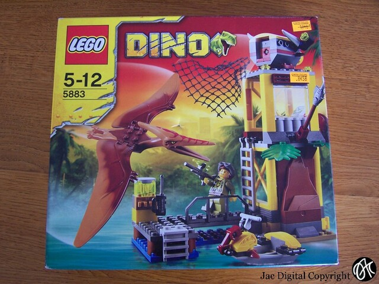
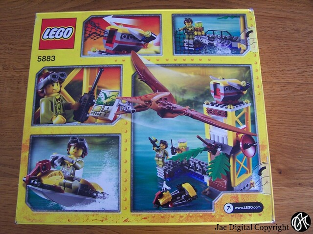
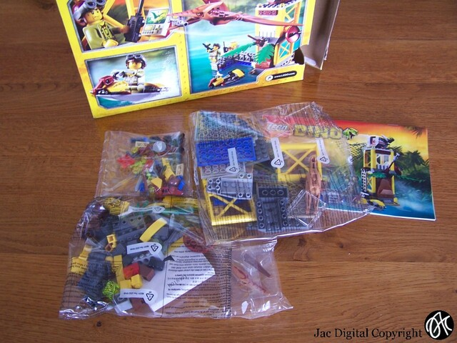
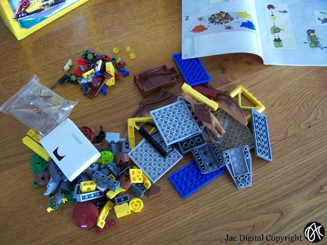
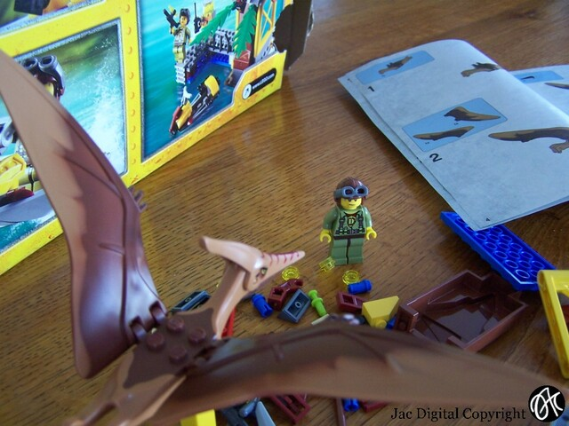
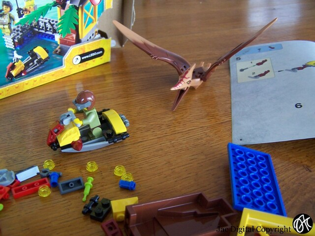
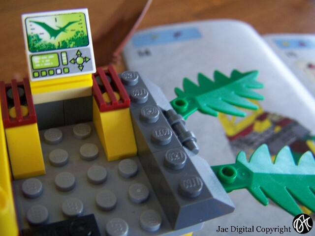
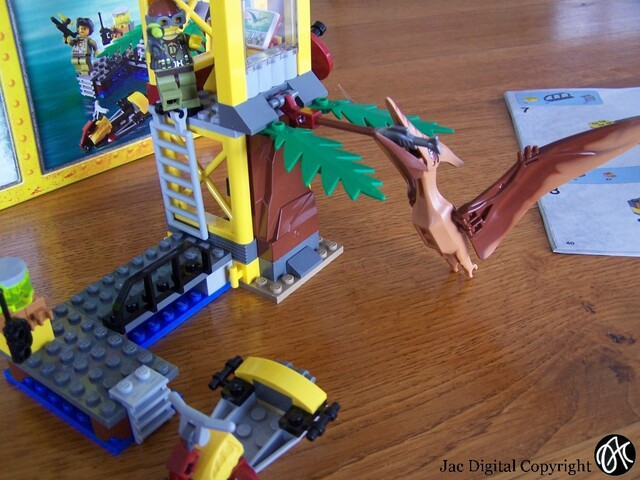
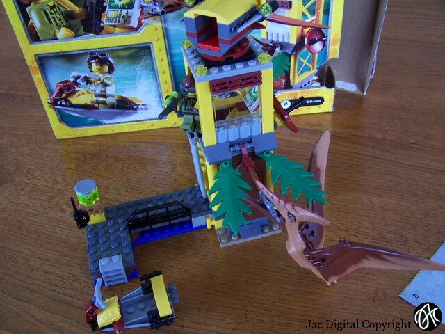
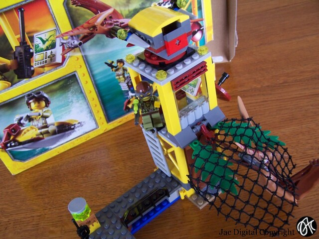

Comment capturer un ptéranodon avec le set 5883 de la gamme Dino, sortie en 2012

Ben oui, à un moment, il faut se décider à assembler les boites que l’on a en stock, ça permet de faire du rangement et parfois on découvre de belles choses. Comme cette petite référence achetée en promotion et qui contient un beau spécimen de ptéranodon.

Alors voyons voir de quoi il en retourne et si on est capable de capturer ce diapside volant.

Il y a un prix affiché sur la boite de 17,61 euros, mais je l’ai payé seulement 8,58 euros. C’est aussi ce qui avait décidé mon achat. Je vais commencer par le tableau habituel mais vous vous doutez bien que cette boite n’est plus disponible.

**–** Disponibilité très moyenne en neuf sur BL, à l’heure où je fais cet article,  
**–** prix environ 40 euros,  
**–** 127 pièces,  
**–** une minifig,  
**–** un ptéranodon (faut pas se rater ! Ben oui si on attrape pas celui-là, y’en a plus...),  
**–** temps de montage : moins d’une heure.

La boite présente la tour de guet avec son canon à filet en situation et le ptéranodon en vol. L’image est très bien faite. Comme d’habitude chez LEGO, toutes les briques présentes sur la photo sont dans la boite. C’est important de le signaler.

Au dos, quelques images présentant la jouabilité possible de cette boite. Bon, il faut arriver à faire voler le ptéranodon, mais le plus dur est sûrement de faire flotter le petit scooter des mers !

Dans la boite nous trouvons trois sachets regroupant les pièces par taille. Il n’y a aucun numéro inscrit dessus. La notice tient en un seul livret. La tête mobile du ptéranodon, reproduite en ABS souple, est emballée séparément.

Une photo avec tout les sachets ouverts, on distingue l’emballage spécial pour la tête du diapside volant et la petite boite en carton pour le filet. On commence par le montage de la minifig puis par la grosse bête !

Mince il va attaquer ma minifig et je ne lui ai pas encore construit son arme. En fait c’est un lance seringue car on ne tue pas chez LEGO, on endort c’est tout.

Les étapes s’enchaînent pour construire le scooter. Comme je vous l’ai déjà écrit, il ne flotte pas. La coque est constituée de briques. Mais au moins, avec ça, ma minifig peut vite se réfugier à l’abri des attaques du monstre !

A cette époque nous avions droit encore à des pièces sérigraphiées, comme cette très belle "tile" avec un pupitre de commande, pour une caméra non présente et pour le lance filet.

La tour prend forme avec une petite reproduction de quai sur l’eau pour recevoir le petit scooter. On peut placer le poisson sur l’appât pour attirer le ptéranodon.

Une fois que le bestiau est là on peut lancer le filet. La conception du canon est très simple. On a juste une pièce qui coulisse avec un axe. On peut se dire au premier abord que c’est léger. Mais c’est très efficace. Au bout de deux lancers, je capturais l’oiseau. Le premier lancer est parti quand même à une trentaine de centimètres.

Six années nous séparent déjà de la sortie de cette boite. Elle est bien réussie et me plait toujours. Aucun regret sur cet achat.

Nous retrouvons le ptéranodon dans des sets consacrés à "Jurassic World" cette année. C’est le même, preuve qu’il est très réussi.  
Je suis passionné par tout ce qui roule mais je fais aussi en sorte d’acheter des boites qui contiennent des animaux et pour celle-là nous sommes bien servi avec ce beau spécimen de diapside volant . La tête est magnifiquement articulée. Par contre, vous l’aurez compris, le scooter des mers va vite être démonté pour rejoindre le stock.

La galerie avec toutes les photos :  
[https://photos.freelug.org/main.php/v/JAC/review/5883/](https://photos.freelug.org/main.php/v/JAC/review/5883/)
