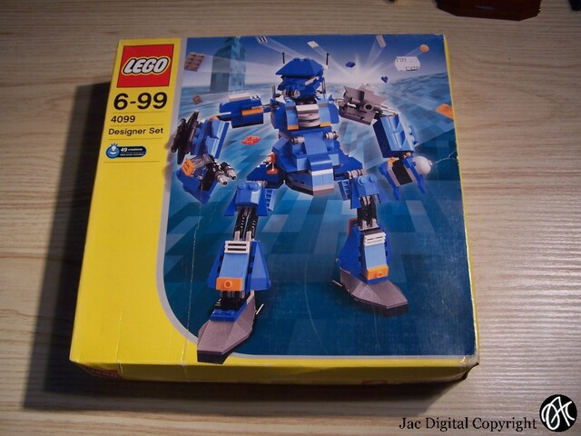
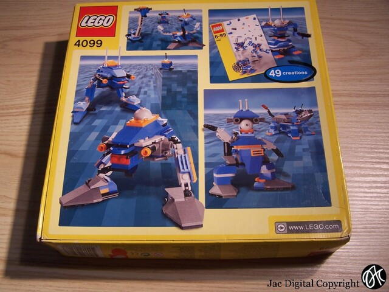
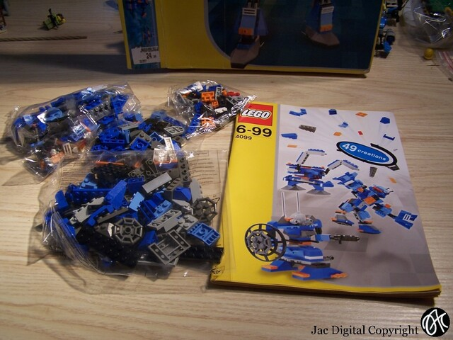
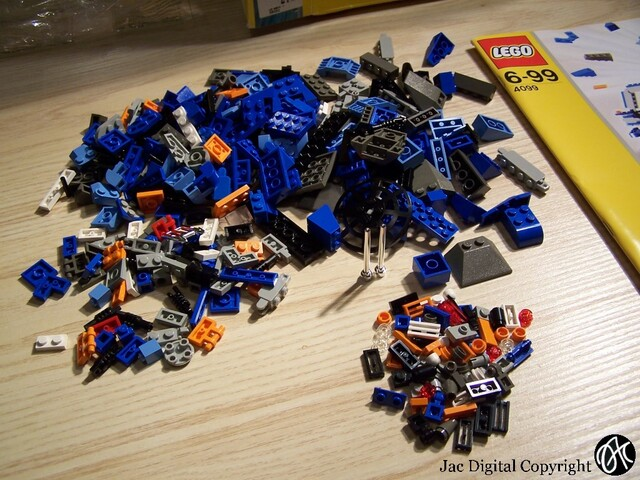
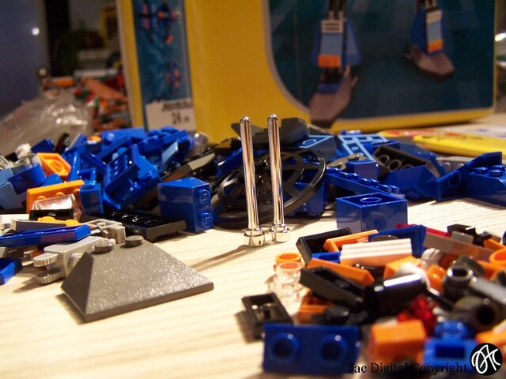
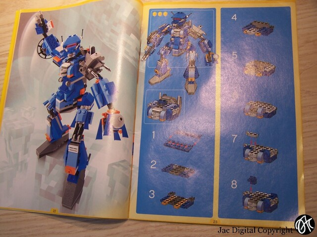
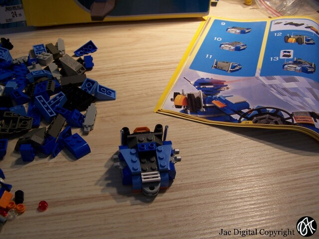
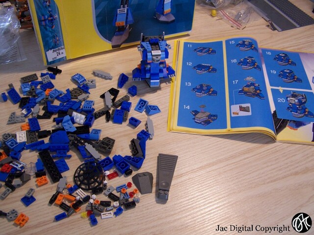
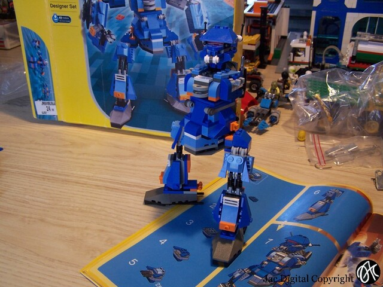
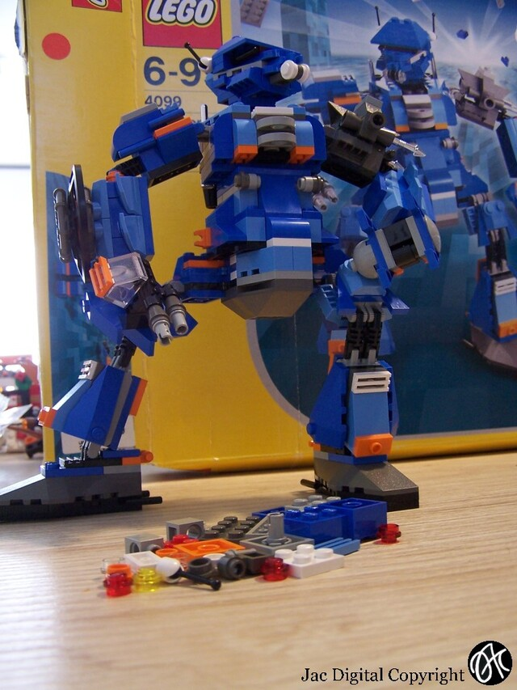

Descriptif du montage d’un des premiers set Creator contenant un livret avec 49 créations possibles.

J’ai acheté ce set en promotion, mais je ne me souviens plus où exactement. Ca fait un petit moment que je le garde dans mon stock et la boite accuse le coup des déménagements, 3 en fait !

On pourrait dire que c’est le petit frère du grand robot gris foncé sortie en 2004, le ["Titan XP" référence 4508](https://brickset.com/sets/4508-1/Titan-XP).

Il y a un prix affiché sur la boite de 17,61 euros, mais je l’ai payée seulement 8,58 euros. Ce qui avait décidé mon achat cette fois, c’est la présence des deux antennes chromées et la richesse des pièces de cette boite.

Je vais commencer par le tableau habituel mais vous vous doutez bien que cette boite n’est plus disponible.

**–** Année d’édition 2003 pour environ 24 Euros  
**–** Disponibilité normale en neuf sur Bricklink, à l’heure où je fais cet article  
**–** prix environ 49 euros  
**–** 324 pièces  
**–** Aucune minifig dans cette boite  
**–** temps de montage pour le robot : une heure.

La boite présente le robot qui est la pièce principale de ce set. Vous pouvez constater par vous même l’état un peu aplati du carton.

Au dos, des photos de quelques modèles figurants sur la notice. Heureusement que ce n’est pas ceux là qui font vendre. C’est peu quand même par rapport à ce que propose la notice, 49 créations. Je vous rassure, ou pas, je ne vais pas toutes les faire, mais au moins les principales, car à chaque fois il faut tout démonter ! A moins que je fasse avec mon stock.

A l’ouverture, on découvre un livret de notice bien épais et 5 sachets de pièces non numérotés dont un contenant les plus petites.

Du coup j’ouvre tous les sachets. Je fais quand même un tas un peu à part pour les petites pièces.

Je découvre les belles antennes chromées, non en fait c’est la couleur argent chez LEGO. Par contre, je retrouve, avec peut-être un peu de nostalgie quand même, des anciennes couleurs. J’ai mis en évidence le gris foncé. Il y a dans cette boite du vieux gris clair aussi. Les "turntable" 2x2 sont assemblées.

Il faut aller à la page 22 pour commencer la construction du plus gros robot de la boite. Avant on trouve quelques constructions diverses toutes en rapport avec les robots bleu et gris, tout de même.

On commence par le montage du thorax. Il faut faire très attention au type de pièces utilisés et surtout à leurs couleurs pour ne pas avoir de surprise plus loin. La notice n’est pas très claire à certains endroits et on peut confondre le noir avec le gris foncé, de même pour le blanc avec le gris clair.

Voilà ensuite le bassin terminé. Il y a une articulation entre les deux parties.

On passe ensuite aux jambes identiques toutes les deux. On est obligé de mettre un peu d’angle entre elles sinon le robot ne tient pas debout. Ca changera peut-être quand il sera fini.

Les deux bras sont bien différents et ils s’assemblent facilement au reste du corps. Dans certaines positions le robot ne tient pas mieux debout. Le choix des articulations limite certains mouvements et du coup le modèle ne tient pas. Les bras ne restent pas comme on les place non plus. C’est dommage.

Oui c’est dommage parce que je trouve l’allure sympa, mais le choix des pièces qui servent d’articulation ne permettent pas de faire tout ce que l’on voudrait avec ce robot. Du coup il ne tient pas bien debout, seulement dans quelques positions commune. On peut le mettre à plat comme sur la notice et là évidement, pas de soucis.

J’étais parti pour monter pratiquement toutes les créations possibles de la boite. Mais 49 ça fait beaucoup, je n’aurais pas été de si tôt à la fin de mon article ! Alors j’ai feuilleté la notice en me disant que j’allais en choisir quelques uns à faire et finalement, à part celui que j’ai monté les autres ne m’emballent pas plus que ça. Ils utilisent bien les couleurs sympa de cette boite mais sans faire des choses impressionnantes. Je m’en tiendrais donc à cette construction unique.

Comme je l’ai dit, ce robot est sympa à première vue mais je suis déçu par les positions que l’on peut lui donner. Reste que cette boite permet d’avoir un beau stock de pièces en complément. Je lui préfère sans hésiter le titan XP.

Vous trouverez toutes les photos dans la galerie dédiée à cette construction : \[[https://photos.freelug.org/main.php/v/JAC/review/Creator/4099/](https://photos.freelug.org/main.php/v/JAC/review/Creator/4099/)\]
