Aujourd’hui, je change de thématique pour vous proposer le set _70606_, _L’entraînement au Spinjitzu_, de la gamme Ninjago.

Sorti en 2017, ce set comporte 109 pièces, dont deux figurines, pour un prix de vente de 9,99 €.

* * *

Sans surprise, la face avant présente le contenu du set, avec Kai et Zane en pleine action. Le logo LEGO se situe en haut à gauche, « The Ninjago Movie » est au centre, et la tête de Llyod à droite.

[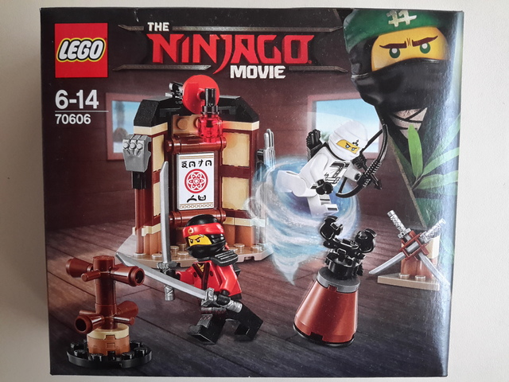](https://www.freelug.org/IMG/jpg/20180617_134917.jpg)

L’arrière présente des alternatives au combat, avec Zane et Kai utilisant les armes accrochées au mur. En bas sont présentés, de gauche à droite, les visages alternatifs des personnages (Kai jouant avec le mannequin et son casque), une autre scène d’entraînement, et un aperçu des éléments mobiles du set.

[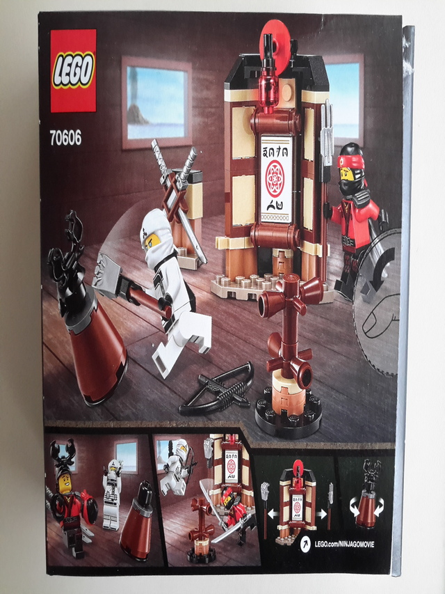](https://www.freelug.org/IMG/jpg/20180617_134942.jpg)

La boîte ouverte révèle une notice, deux sachets, pour un joli petit tas de pièces.

[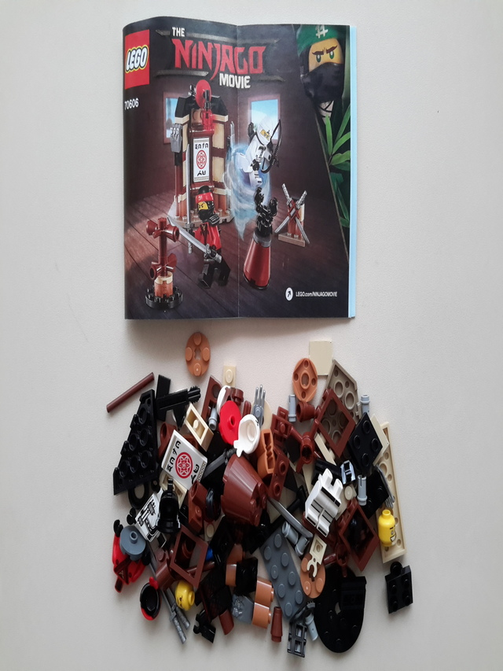](https://www.freelug.org/IMG/jpg/20180617_134746.jpg)

Le tas comprend une tile sérigraphiée, avec une inscription en langue Ninjago. Dans les premiers sets c’était du japonais, maintenant ce sont des caractères inventés, même s’ils ont une allure asiatique. Si j’en crois une recherche rapide, l’inscription signifie en réalité « Dojo Wu ».

[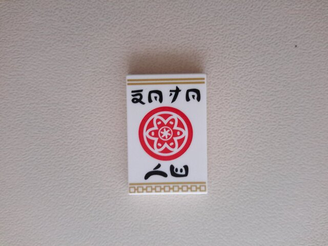](https://www.freelug.org/IMG/jpg/20180617_134838-r180.jpg)

* * *

La boîte contient deux personnages, Kai et Zane.

Kai affiche un visage sérieux, résolu, et porte une épée dans chaque main. Son kimono est rouge, entrouvert au cou, avec une ceinture. Belle sérigraphie du torse, qui se prolonge sur les jambes, et jusqu’à son bandeau autour de la tête. Sur l’épaule gauche, une protection, liée à son harnais dans le dos. Le bandeau et le foulard se rejoignent, cachant presque complètement son visage, comme il se doit pour un ninja. À l’œil droit il a une jolie cicatrice verticale, et un pansement au-dessus de l’œil gauche.

[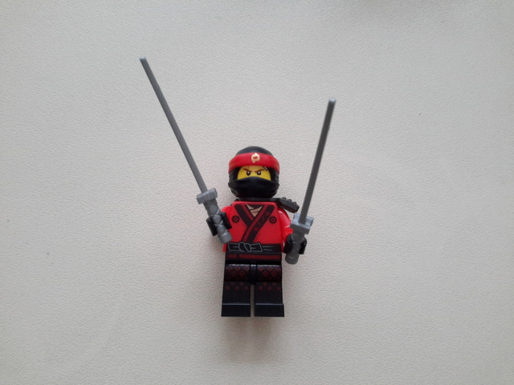](https://www.freelug.org/IMG/jpg/20180617_133646.jpg)

De dos, le bandeau se prolonge avec un joli nœud. Kai porte un fourreau permettant de ranger les deux épées qu’il tient en main. Pas de sérigraphie sur les jambes en revanche.

[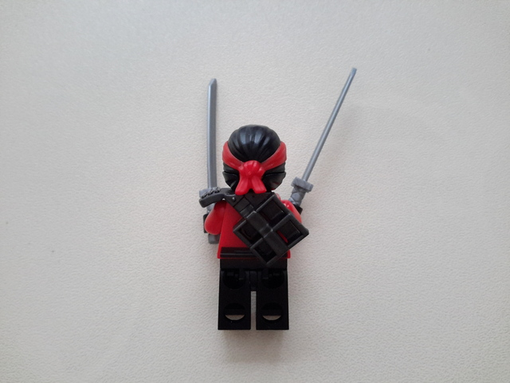](https://www.freelug.org/IMG/jpg/20180617_133658.jpg)

Sous son masque, Kai affiche un air très déterminé, il est bien décidé à gagner !

[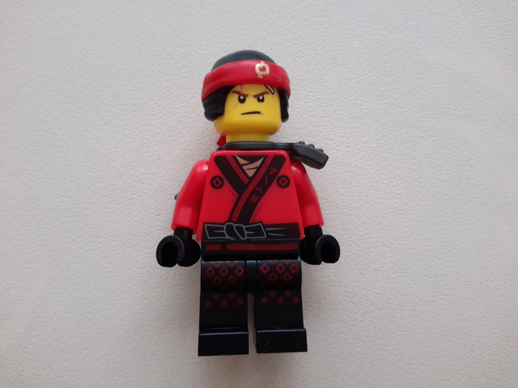](https://www.freelug.org/IMG/jpg/20180617_133904.jpg)

Et voici son visage alternatif, avec un air un peu gêné. Au centre du torse un logo et la prolongation de sa ceinture.

[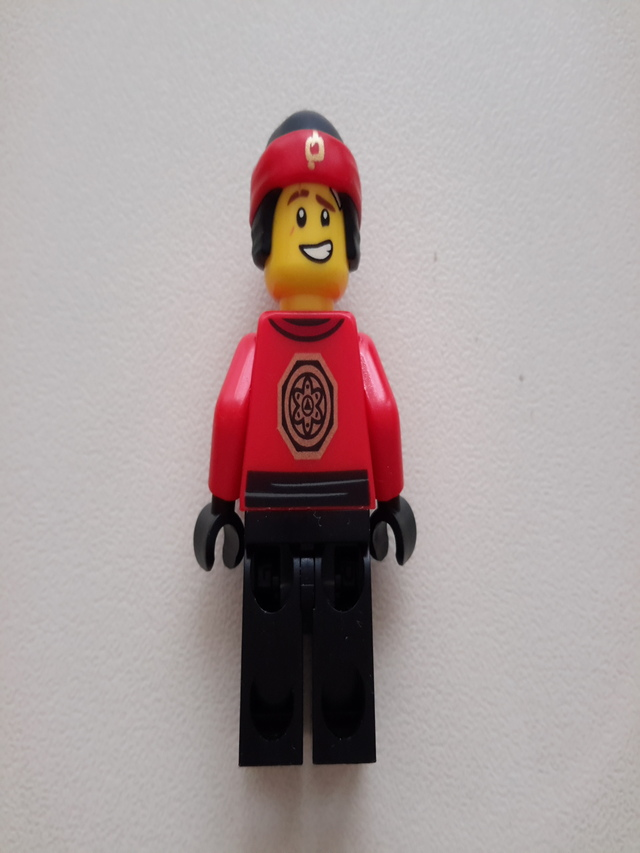](https://www.freelug.org/IMG/jpg/20180617_134001.jpg)

Zane pour sa part utilise un arc. Tout comme Kai il a bandeau et foulard, un emblème sur le front, un kimono, blanc ici, avec une ceinture à laquelle sont accrochés quelques accessoires. Les jambes sont également sérigraphiées. Il a les sourcils froncés au-dessus de ses yeux bleus. À noter que l’attache du carquois, noire, est bien plus visible sur son blanc que dans le cas de Kai.

[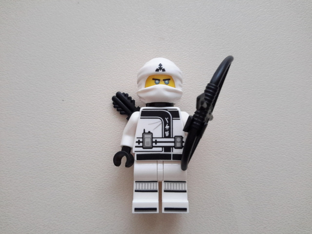](https://www.freelug.org/IMG/jpg/20180617_133736.jpg)

Dans le dos un carquois pour ses flèches, le nœud du foulard, et un logo au centre.

[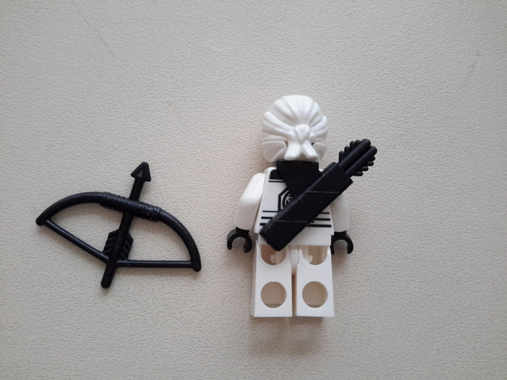](https://www.freelug.org/IMG/jpg/20180617_133817.jpg)

Sous son masque il fait une grimace menaçante.

[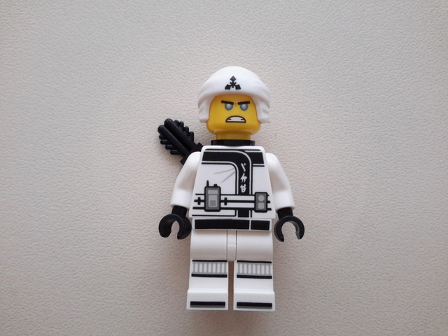](https://www.freelug.org/IMG/jpg/20180617_133913.jpg)

Enfin son visage alternatif est souriant, mais d’une façon mécanique. Au centre du dos le même logo que Kai, d’une couleur différente.

[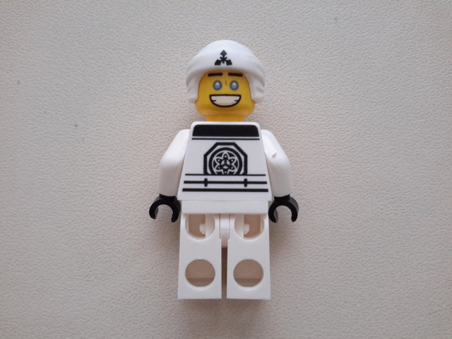](https://www.freelug.org/IMG/jpg/20180617_133939.jpg)

Voici une présentation rapide des armes du set : tout d’abord une pièce que je ne connaissais pas, le harnais de Kai avec ses deux épées ...

[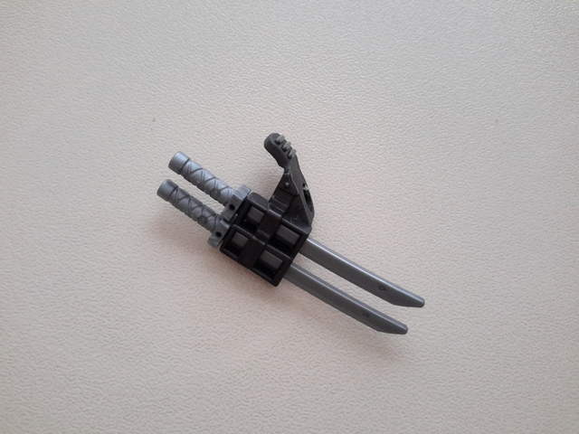](https://www.freelug.org/IMG/jpg/20180617_134116.jpg)

... et sans, ainsi que le présentoir à épées qui apparaît dans la scène, ...

[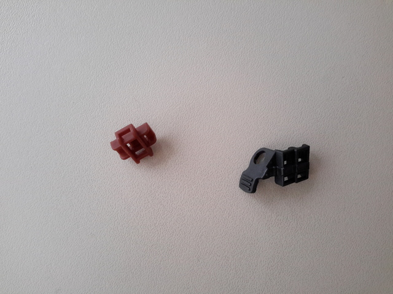](https://www.freelug.org/IMG/jpg/20180617_134824.jpg)

... et enfin toutes les armes : 4 épées, deux griffes, un arc et son carquois, une sorte de poing américain, et un casque noir.

[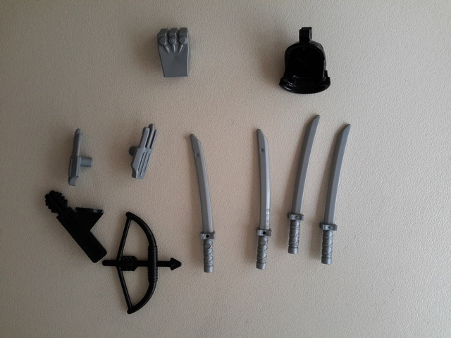](https://www.freelug.org/IMG/jpg/20180617_135043.jpg)

* * *

Passons maintenant à la construction proprement dite, qui se compose de quatre éléments.

Tout d’abord un punching ball à forme de Garmadon, si j’en crois la fiche officielle de la boutique LEGO — un mannequin, quoi ! Il se compose de 4 pièces plus une tête uniformément noire, et le casque (non assemblé sur la photo). La pièce de support assure une instabilité à la construction, qui peut donc être malmenée durant l’entraînement.

[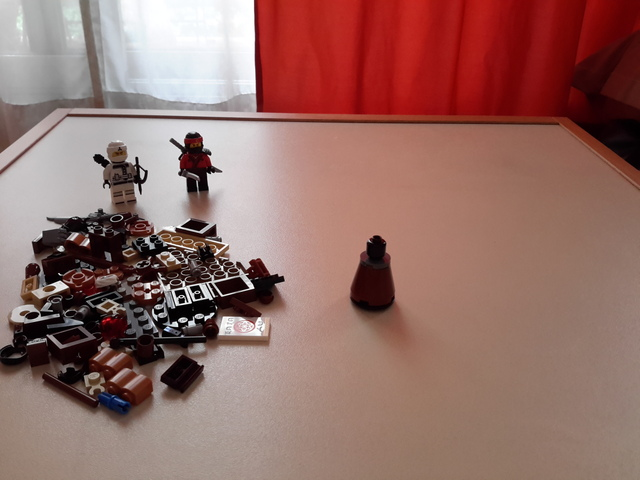](https://www.freelug.org/IMG/jpg/20180617_144422.jpg)

Le second élément est un râtelier d’armes, juste quelques briques avec deux épées. La pièce permettant d’accrocher les armes est accrochée via un connecteur Technic dans une brique trouée.

[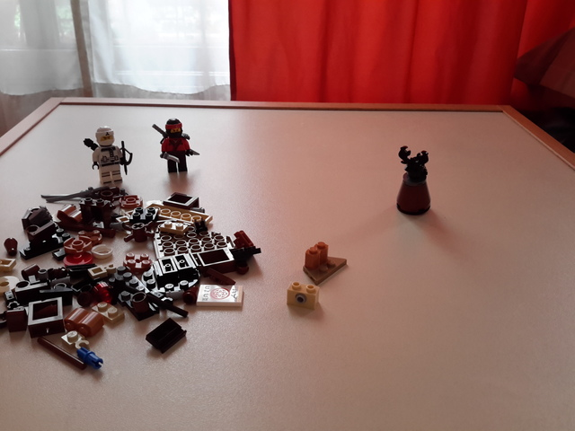](https://www.freelug.org/IMG/jpg/20180617_144516.jpg)

Troisième élément, une « station de combat », avec 2 fois quatre tiges, la moitié terminée de cônes (ici non encore assemblés).

[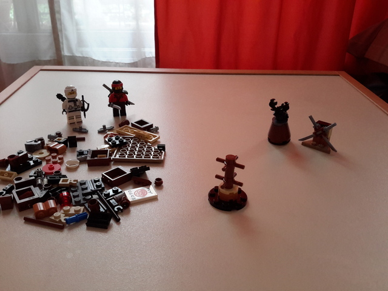](https://www.freelug.org/IMG/jpg/20180617_144743.jpg)

Enfin on attaque le reste de la construction, un coin de mur. Il est basé sur une plaque diagonale de 6x6 marron clair. Chose qui me semble rare, le coin proprement dit, que l’on voit ici de dos presque terminé, est tourné à 45°, via un connecteur Technic (bleu).

[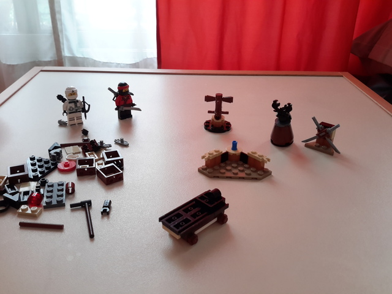](https://www.freelug.org/IMG/jpg/20180617_145203.jpg)

Le mur avec la tile sérigraphiée monté, on ajoute quelques fenêtres pour simuler des shôji. Le toit du coin est une plaque 4x4 diagonale noire, sur laquelle on fixe deux crochets qui serviront à fixer une lanterne.

[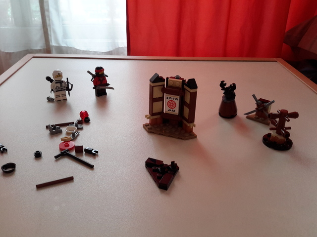](https://www.freelug.org/IMG/jpg/20180617_145445.jpg)

On fixe le toit, et on construit la lanterne, qui est une magnifique tête rouge transparente — une pièce que je ne connaissais pas, j’admets !

[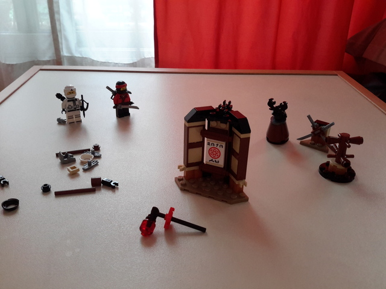](https://www.freelug.org/IMG/jpg/20180617_145526.jpg)

Enfin on termine la construction avec les deux armes détachables, accrochées aux deux clips qui dépassent.

[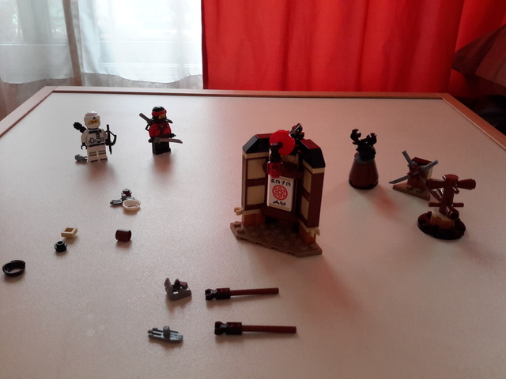](https://www.freelug.org/IMG/jpg/20180617_145610.jpg)

Et voici la scène complète.

[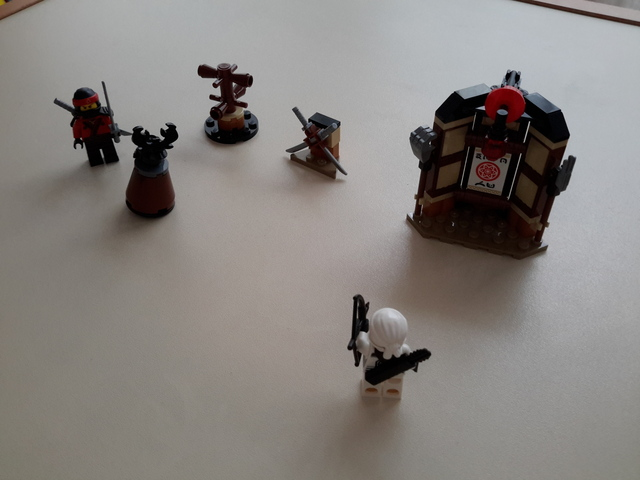](https://www.freelug.org/IMG/jpg/20180617_115811.jpg)

**20180617 115811**

[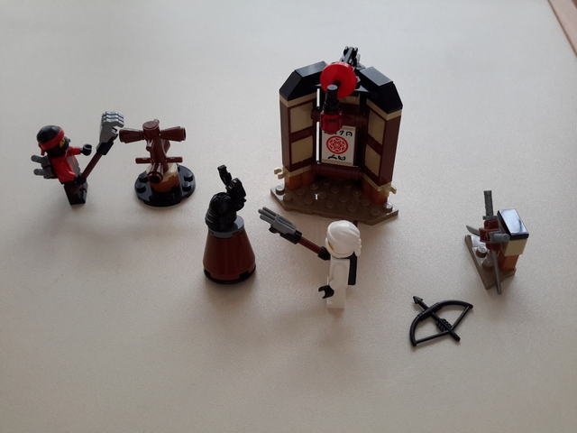](https://www.freelug.org/IMG/jpg/20180617_133607.jpg)

Kai et Zane défendent avec ardeur les pièces bonus. Il y a notamment un foulard de chaque couleur, une griffe grise, et quelques autres pièces.

[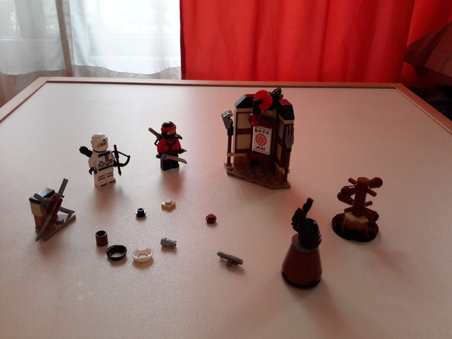](https://www.freelug.org/IMG/jpg/20180617_145658.jpg)

[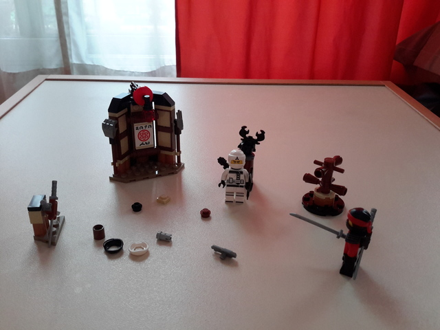](https://www.freelug.org/IMG/jpg/20180617_145731.jpg)

* * *

**Avis :** franchement, ce petit set est très sympathique pour moi. Il est clairement orienté ninja (on est quand même dans la gamme Ninjago !), mais je le vois bien inséré dans un diorama de ville, avec deux ninja faisant une démonstration de leur art dans la rue !

Je trouve les deux figurines vraiment réussies, avec de belles sérigraphies, et des visages sympathiques.

Bref, une réussite à mon goût.

**Bonus :** animation de toutes les étapes de construction (cliquer pour lancer).

[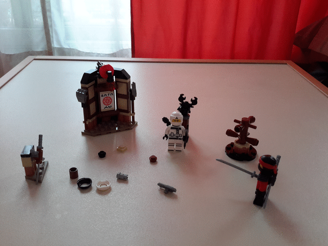](https://www.freelug.org/IMG/gif/70606.gif)
