Aujourd’hui, j’ai envie de vous présenter un set de mon enfance. Je ne l’ai vraisemblablement pas eu au moment de sa sortie (j’étais trop jeune), mais quelques années plus tard.

Il s’agit du set _856_, _Le bulldozer_, sorti en 1979, et contenant 368 pièces d’après les sites de référence.

Le prix sur la boîte était 169 F (nouveaux, quand même !), ce qui donnerait un ratio de 46 centimes de franc par pièce.

Actualisé en tenant compte de l’inflation, le prix serait apparemment de 91 €, soit un ratio de 28 centimes d’euros par pièce. L’inflation, c’est vraiment méchant !

* * *

Je peux même vous présenter la boîte (un peu usée), l’une des rares que j’ai encore !

Déjà à cette époque le logo" LEGO" était présent, c’est le minimum ! Pas de gamme « Technic » indiquée, mais un médaillon affirme « Technique comme en réalité », donnant une idée de la classification. La partie gauche présente deux des mécanismes à base d’engrenages, ainsi qu’un modèle alternatif.

[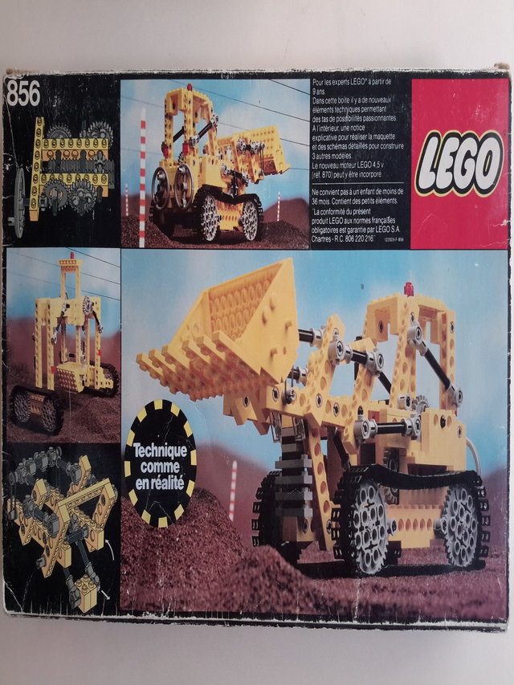](https://www.freelug.org/IMG/jpg/20180722_112450.jpg)

**L’avant de la boîte**

L’arrière de la boîte présente deux modèles alternatifs ainsi que le modèle principal. Cependant il n’a pas la même pelle, on dirait que quelques erreurs s’étaient glissées, peut-être que le modèle a évolué au cours du temps.

[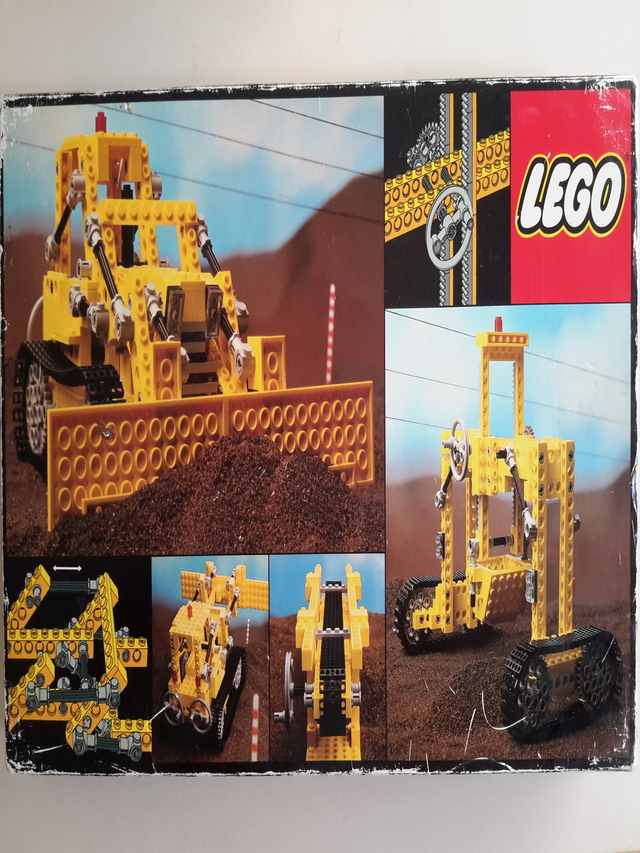](https://www.freelug.org/IMG/jpg/20180722_112507.jpg)

**L’arrière de la boîte**

La boîte s’ouvre sans se déchirer, permettant de la conserver en bon état. La notice se glisse dans le rabat supérieur, avec un autocollant (déchiré ici bien sûr) scellant le tout. Le dos du couvercle met en scène un enfant jouant avec le bulldozer.

[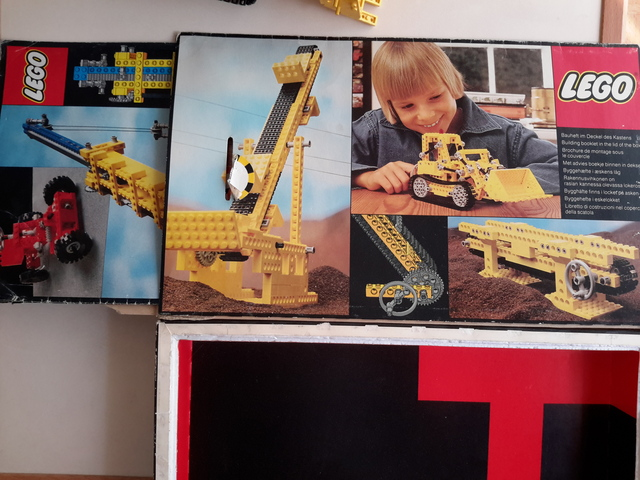](https://www.freelug.org/IMG/jpg/20180722_112558.jpg)

**La notice glissée**

La notice se présente plutôt comme un catalogue, montrant des véhicules qui n’ont aucun rapport avec le set lui-même. Un coin est coupé pour afficher le numéro « 856 », mais il est tellement bien caché qu’il m’a fallu du temps pour retrouver cette notice dans ma pile ! Ses premières pages, avant le bulldozer lui-même, sont consacrées à quelques modèles et techniques de construction, l’arrière de la couverture expliquant le contenu en différentes langues.

[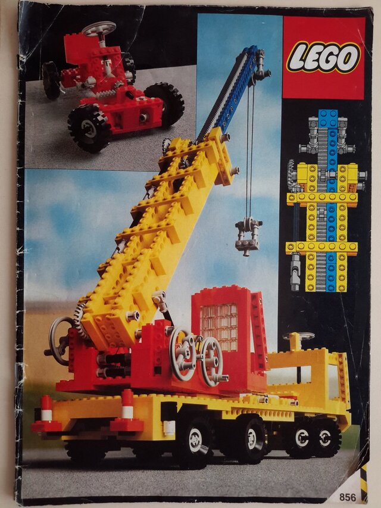](https://www.freelug.org/IMG/jpg/20180722_114939-r90.jpg)

**La notice**

Voici le contenu de la boîte, qui est un joli petit tas de pièces. Je n’ai pas poussé le vice jusqu’à séparer les chenilles "Technic", c’est trop long et pas envie d’en casser, oui, cela m’est souvent arrivé. Peu de pièces « System », principalement des plaques. Presque tout est jaune, avec des engrenages gris, le vieux gris qui ne se fait plus, ha, nostalgie ! Bon, ok, certaines pièces ont souffert du passage du temps et leur couleur a changé... Il me manque les élastiques, je m’en passerai.

[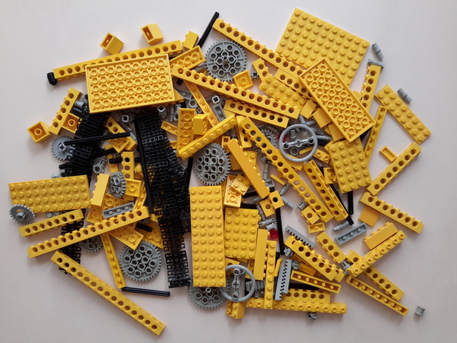](https://www.freelug.org/IMG/jpg/20180722_114907.jpg)

**Petit tas de pièces**

Voici la première page de la notice concernant la construction, et l’on y retrouve la pelle alternative, une petite erreur, sans doute. Une image montre différentes barres "Technic" en taille réelle avec leur indication de longueur, afin de simplifier la recherche de pièces.

[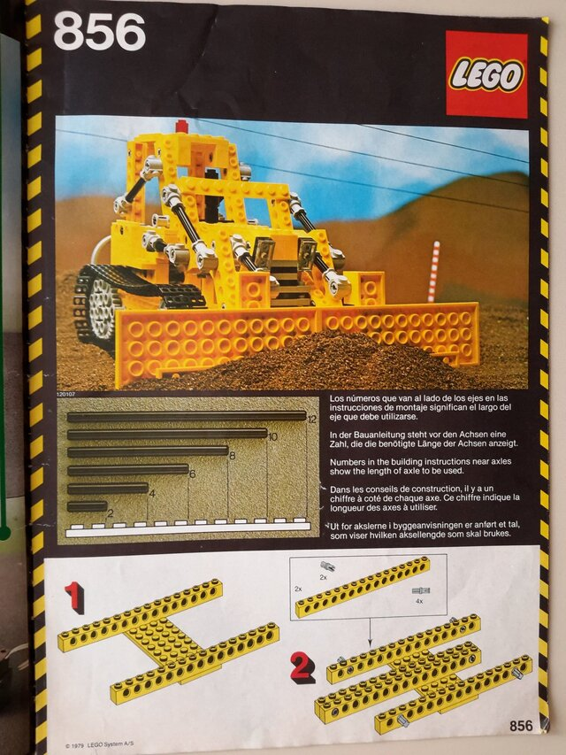](https://www.freelug.org/IMG/jpg/20180722_115003-r270.jpg)

**Première page de la construction**

La construction commence avec le dessous du châssis, sur lequel viendront se greffer les gros engrenages pour les chenilles.

[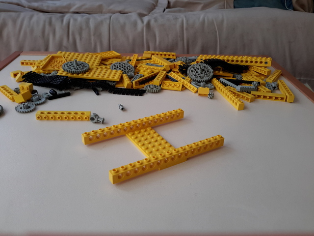](https://www.freelug.org/IMG/jpg/20180722_115848.jpg)

Quelques étapes plus loin, on a les roues (sans les chenilles), et la base bien avancée. Au premier plan, la partie mobile qui sert à lever ou baisser la pelle. Les barres juste à côté des roues ne sont pas simples à mettre en place, surtout les pièces permettant de les caler. Il faut les tourner pile au bon angle pour qu’elles passent à côté des gros engrenages.

[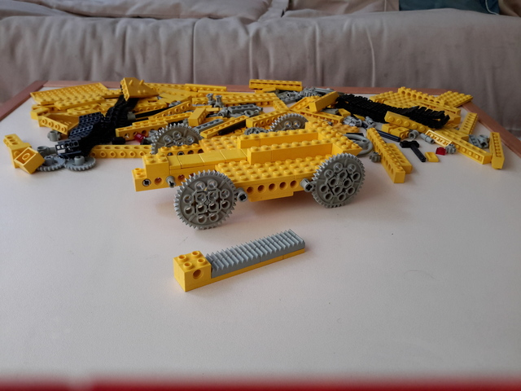](https://www.freelug.org/IMG/jpg/20180722_120605.jpg)

Le corps de l’engin prend forme. À l’arrière les deux manivelles permettant de lever/baisser et incliner la pelle. On voit sur le côté un emplacement avec des plates jaune qui accueilleront une partie mobile permettant justement d’incliner la pelle. Les différents engrenages et barres ne sont pas faciles à placer, il faut souvent tenir ces derniers en place pendant qu’on les embroche avec une barre "Technic".

[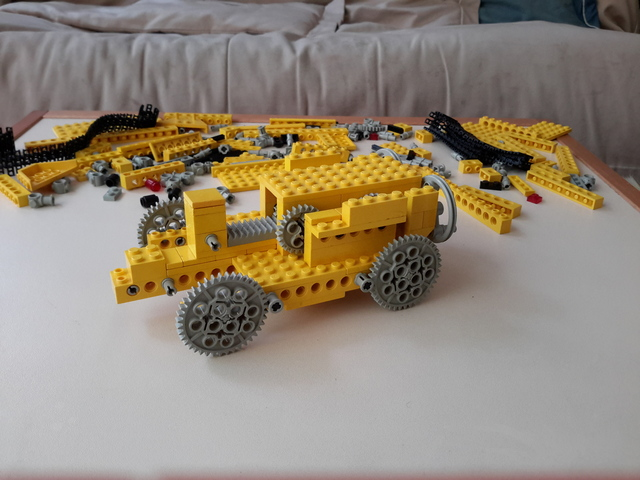](https://www.freelug.org/IMG/jpg/20180722_121648.jpg)

On construit l’avant, qui ressemble à une grille d’aération grise et noire. Il manque les feux avant, il n’y a pour l’instant que les deux briques plates 1x2 noires, on rajoutera plus tard des transparentes. Les quatre briques Technic de 8 à l’arrière servent pour la cabine de pilotage. Deux sont tenues en place par une barre qui se bloque sur d’autres tenons, les autres restent libres pour l’instant. Sur le devant les morceaux qui se glisseront sur les plates jaunes latérales (on en voit une et un petit morceau derrière une brique) serviront à incliner la pelle.

[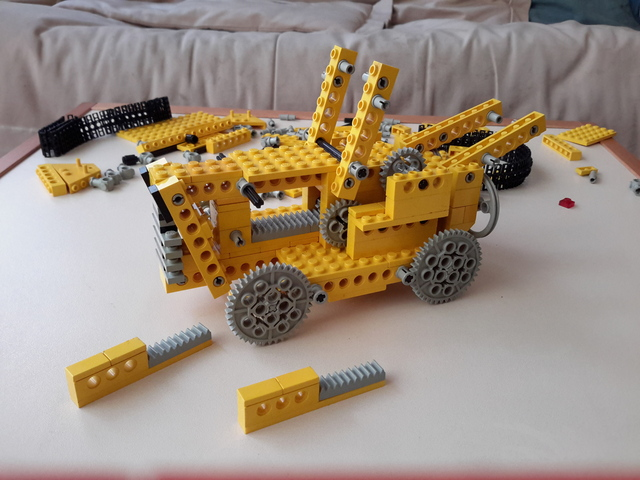](https://www.freelug.org/IMG/jpg/20180722_123024.jpg)

Voici à peu près tout le mécanisme de la pelle. Les barres et briques sur l’avant permettent d’incliner, les deux grandes briques "Technic" servent à la position verticale. La cabine est terminée, avec une petite pièce 1x1 ronde rouge transparente pour symboliser un feu d’avertissement. Trois pièces 1x1 rondes noires font office de pot d’échappement. À l’avant les phares sont juste représentés par des plates 1x2 transparentes.

[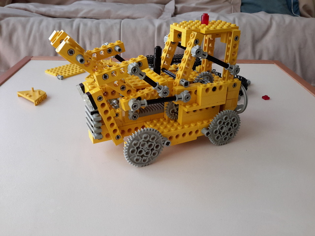](https://www.freelug.org/IMG/jpg/20180722_123953.jpg)

Et voici la dernière étape, la construction de la pelle. Elle vient se fixer sur la plaque 2x4 jaune, plus les deux espèces de joint gris qui flottent au milieu, ce sont eux qui contrôlent le basculement. À noter que j’ai fait une erreur de construction, corrigée à la photo suivante : la barre horizontale se fixe sur le trou le plus à droite de la brique 1x4 "Technic", et non sur le trou de gauche...

[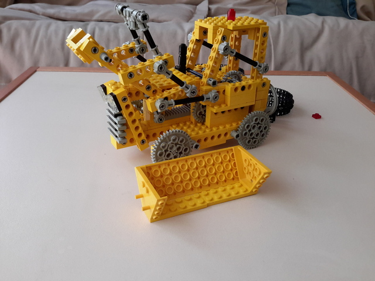](https://www.freelug.org/IMG/jpg/20180722_124159.jpg)

Le modèle est presque fini, avec la pelle inclinée au maximum vers le bas — elle peut bien bouger.

[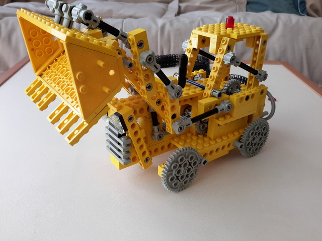](https://www.freelug.org/IMG/jpg/20180722_124602.jpg)

On ajoute les chenilles et deux pièces 1x1 rouge transparentes sur l’arrière de la cabine, pour symboliser les feux arrière et la construction est terminée. Quelques photos du modèle pour bien voir son rendu. À noter qu’il n’y a que vingt étapes de construction, avec quelques sous-étapes ! Pour 386 pièces, franchement, cela paraît court par rapport à ce qui se fait actuellement.

[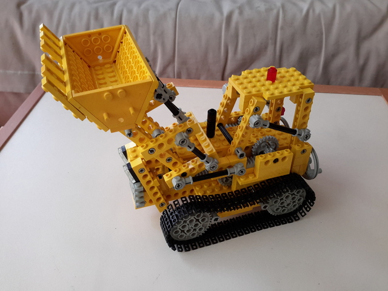](https://www.freelug.org/IMG/jpg/20180722_124711.jpg)

[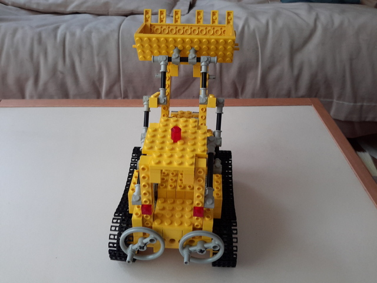](https://www.freelug.org/IMG/jpg/20180722_124717.jpg)

[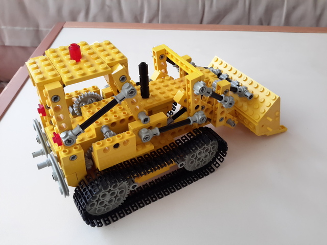](https://www.freelug.org/IMG/jpg/20180722_124748.jpg)

[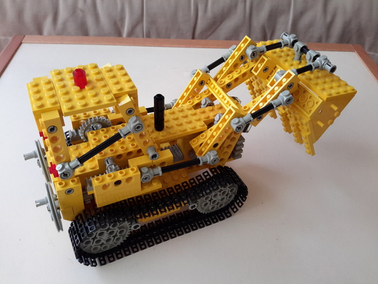](https://www.freelug.org/IMG/jpg/20180722_124811.jpg)

[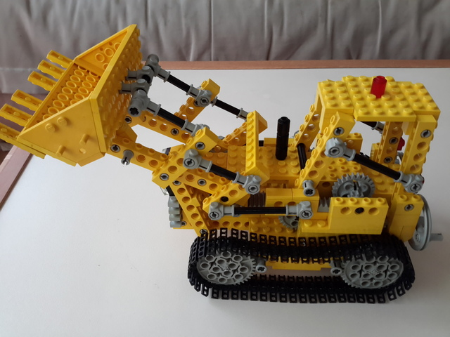](https://www.freelug.org/IMG/jpg/20180722_124829.jpg)

Après la construction, la notice présente comment mettre un moteur (9v à piles, nostalgie !) pour que le bulldozer roule tout seul, puis enchaîne sur deux autres constructions alternatives, la première pouvant également être motorisée. Ensuite sont présentées des combinaisons de sets, genre 850 + 851, etc. Ces sets n’ont pas de rapport avec le set actuel, et sont clairement publicitaires.

* * *

**Avis :** j’adore ce set ! Il présente une certaine difficulté, les engrenages sont parfois compliqués à placer avant d’être embrochés par une barre Technic, parfois on se retrouve dans l’impossibilité d’assembler comme il faut et alors on démonte autre chose pour permettre l’accès.

Il n’y a pas de gamme d’âge sur la boîte ou la notice, mais je me demande si aujourd’hui il ne serait pas sur 12+ voire 16 ans :D

Le rendu est assez brut et carré, pas de pièces rondes, mais à mon sens très efficace, sans fioritures. Si LEGO ressortait un équivalent aujourd’hui, je me demande comment il serait...

Bref, je l’ai adoré dans mon enfance, et je l’adore toujours !

**Bonus :** voici une animation des étapes de construction (cliquer pour lancer)

[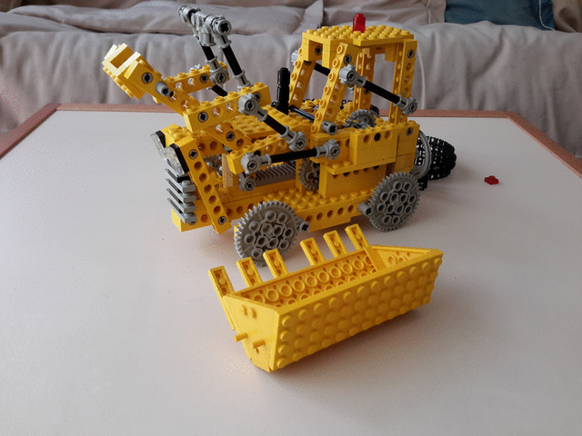](https://www.freelug.org/IMG/gif/856.gif)

**Animation de construction**
