Deuxième set contenant des avions pour faire des acrobaties en vol, dans ma collection. Voyons voir ce que contient cette version 2013.

On pourrait penser que ce set vient en complément de la boite 60103 "ballet aérien". Il n’en est rien. Ici on est dans l’acrobatie, même si dans le hangar on a un biplan. Ce thème revient souvent dans la gamme LEGO. Vous en trouverez à toutes les échelles en "city" ou en "créator".

**–** Année de sortie 2013  
**–** Bonne disponibilité sur BL, à l’heure où je fais cet article,  
**–** prix environ 25 euros boite scellée,  
**–** 130 pièces,  
**–** 2 minifigs,  
**–** temps de montage : une demi-heure.

[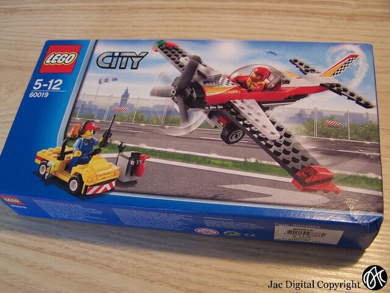](https://www.freelug.org/IMG/jpg/photo_2_-2.jpg)

Le devant de la boite présente l’avion en vol, mais c’est utopique, il ne tient pas en l’air et il faut souffler fort pour que l’hélice tourne... Les ailes sont quand même très réussies.

[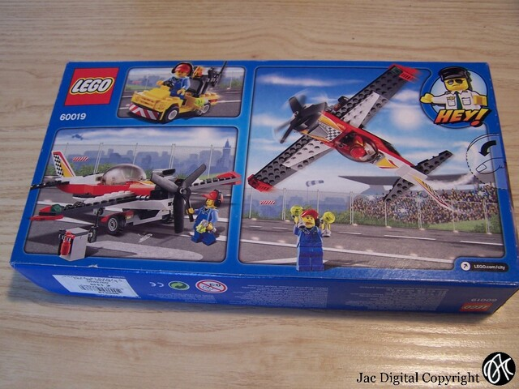](https://www.freelug.org/IMG/jpg/photo_1_-2.jpg)

Au dos nous trouvons de belles images pour donner des idées de jeux.

[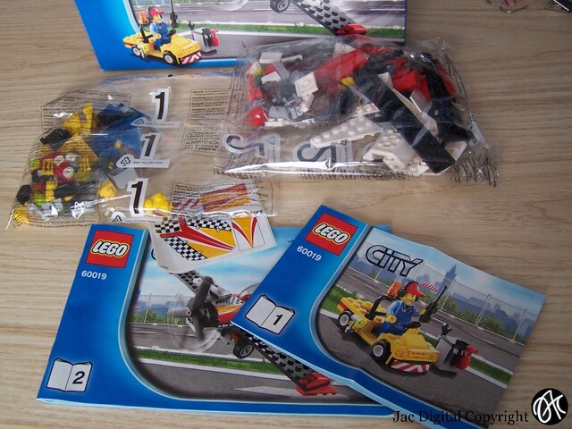](https://www.freelug.org/IMG/jpg/photo_3_-2.jpg)

Les deux sachets remplissent bien l’espace dans la boite, les dimensions de l’emballage sont bien adaptées. Nous trouvons aussi les notices et une petite planche d’autocollants. Il faudra les coller si on veut vraiment donner à ce petit avion son air acrobate comme pour les vrais.

[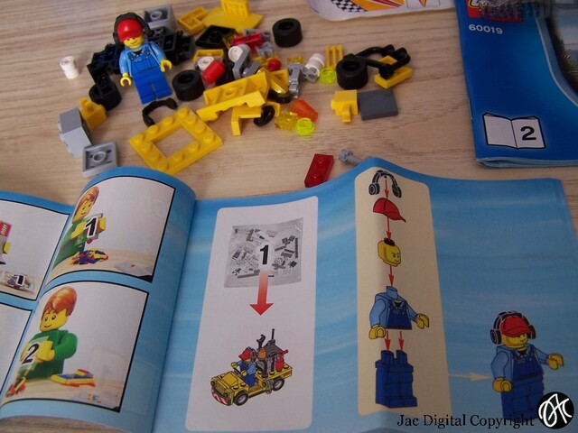](https://www.freelug.org/IMG/jpg/photo_4_-2.jpg)

On commence par construire le véhicule mais vous pouvez commencer par l’avion. Les pièces de chacun sont bien séparées dans leurs sachets et les notices sont indépendantes.

[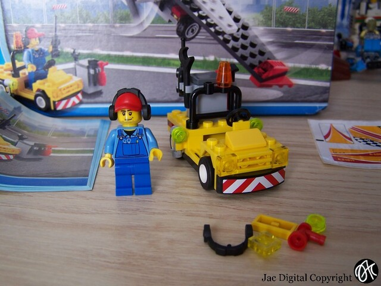](https://www.freelug.org/IMG/jpg/photo_6_-2.jpg)

Le personnage qui conduit ce véhicule et qui doit aussi guider l’avion est correct. Les écouteurs sont indépendants du casque ce qui permet de s’en servir pour autre chose. On en a même un en double puisqu’il fait partie des extra parts. Pour le véhicule il y a juste un autocollant à fixer à l’avant.

Il est construit sur la base d’un vieux châssis en métapièce qui convient très bien. Il est bien complet avec les lanternes de guidage et le plot à outil. C’est juste que j’aurai vu une caisse à cet endroit plutôt que deux briques...

[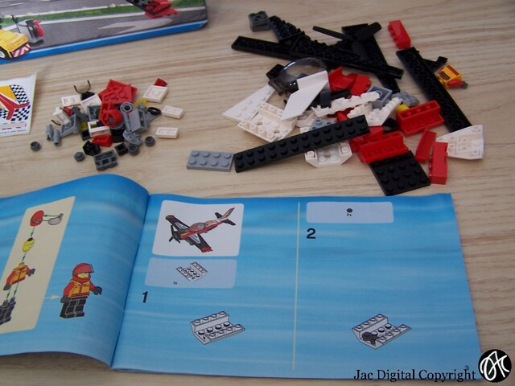](https://www.freelug.org/IMG/jpg/photo_9_-2.jpg)

Passons maintenant au montage de l’avion, puisque tout est prévu pour son décollage. Le sachet de pièces contient un deuxième sachet pour les petites pièces. Ça permet de séparer un peu.

[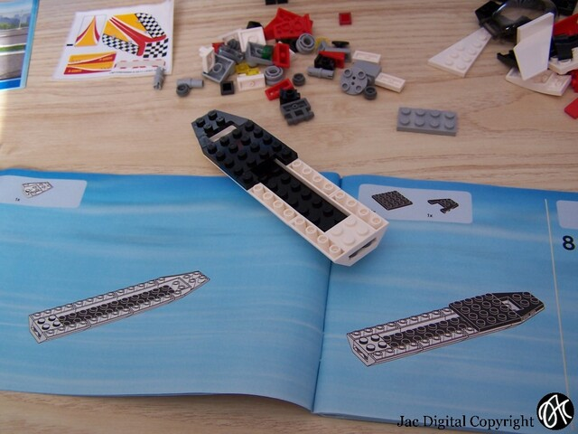](https://www.freelug.org/IMG/jpg/photo_10_-3.jpg)

A ce stade, on a fixé une pièce plate au creux des pièces penchées inversées. Mais c’est tout. J’ai eu peur à ce moment-là que le fuselage ne soit pas assez maintenu et j’ai failli puiser dans mon stock pour renforcer cela. Mais une fois l’avion assemblé plus rien ne flanche sur l’arrière.

[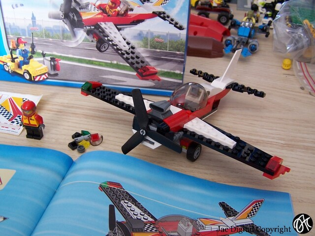](https://www.freelug.org/IMG/jpg/photo_11_.jpg)

Il a fière allure, je trouve. Il reproduit bien ces petits avions tout rondelés, assez courts et très maniables dans les airs.

[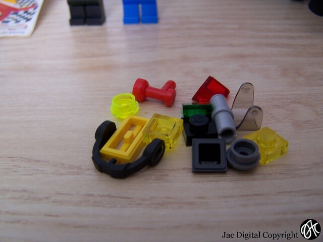](https://www.freelug.org/IMG/jpg/photo_12_.jpg)

Voilà les pièces qui restent lorsque le montage est terminé.

[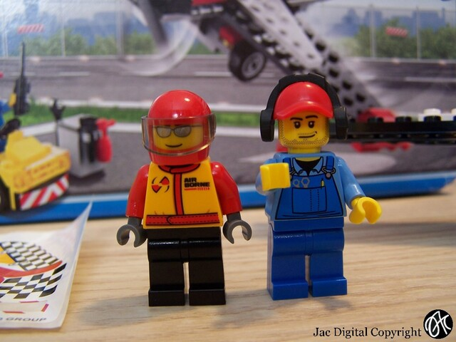](https://www.freelug.org/IMG/jpg/photo_13_-2.jpg)

[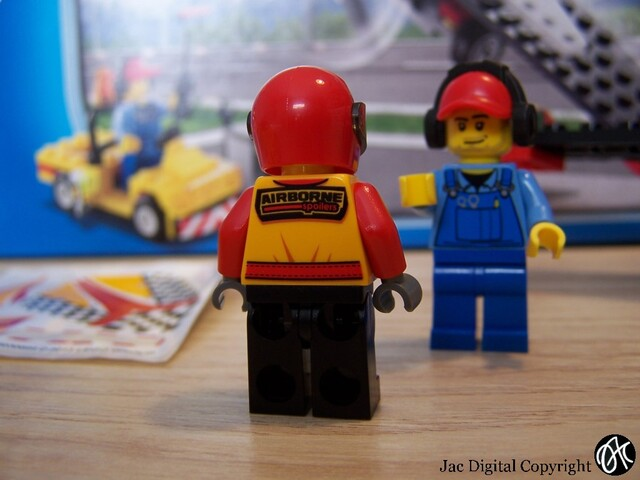](https://www.freelug.org/IMG/jpg/photo_14_.jpg)

Les personnages sont très bien faits. Le blouson du pilote rend vraiment très bien de devant comme de dos. Désolé pour le mécanicien, il n’a pas voulu se retourner. Mais peut-être qu’il n’y a rien à montrer dans son dos.

[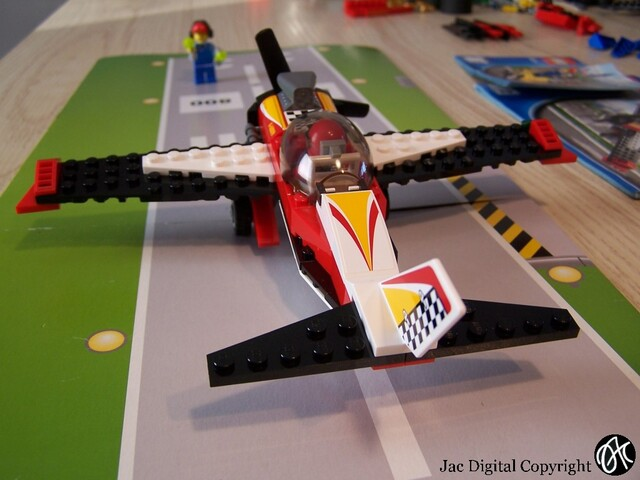](https://www.freelug.org/IMG/jpg/photo_21_.jpg)

Avec les autocollants l’avion est vraiment terminé. On est prêts pour le décollage.

C’est un petit set bien sympa que nous avons là. Il est monté assez vite et permet le jeu. J’imagine que cet avion va faire beaucoup de figures dans les airs grâce aux petites mains des enfants et aussi à leur imagination.

[Galerie photo pour plus de vue.](https://photos.freelug.org/main.php/v/JAC/review/60019/)
