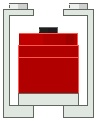
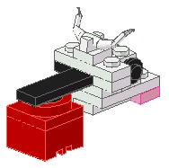

L’évènement Bric’Mania a été pour moi l’occasion de dévoiler une petite surprise : deux vaches qui regardent les trains passer fonctionnant à l’aide d’un boitier RCX.  
Vous trouvez ici la notice et le code source pour faire vous-même vos propres vaches.

**L’idée**

L’idée est toute bête, encore fallait-il y penser. C’est en cherchant une idée pour compléter un [module de train](/articles/142/) pour l’exposition d’Orléans que j’ai pensé à faire un petit prés avec des vaches. Et automatiquement, la relation entre train et vaches m’a donné l’idée de faire des vaches qui regardent passer les trains. Le principe est simple : un capteur de luminosité relié à un RCX detecte le passage du train et commande le micromoteur qui se trouve dans la vache et qui fait tourner la tête.

**La mise en oeuvre**

Le plus compliqué était de trouver un moyen de mettre le micromoteur (le plus petit des moteurs LEGO) dans la vache, ainsi que le système qui permet de transmettre le mouvement à la tête.

Je me suis imposé une largeur de 3 tenons pour le corps de la vache. C’est une taille que l’on trouve régulièrement pour des vaches ([cf l’article sur des idées de construction d’animaux](http://www.classic-castle.com/howto/articles/brickbeasts.html) sur Classic-Castle).

Ainsi, il fallait introduire un moteur de 2 tenons dans un espace de 3 tenons tout en conservant de quoi faire le corps de la vache... La solution que j’ai adaptée est l’utilisation de panels ([pièce 2362](http://www.peeron.com/inv/parts/2362)). Une autre solution aurait pu être l’utilisation de la technique SNOT.

Ces panels de 3 briques de haut permettent tout juste de placer le micromoteur et une plate électrique pour alimenter le moteur, et il reste de l’espace pour un peu plus d’un tiers de brique, espace qui sera reservé pour l’axe de transmission.

La plate est fixée grâce à des jumpers, en utilisant la technique AZMEP (décalage d’un demi tenon).

Il restait ensuite à faire le cou qui doit tourner, et sur lequel la tête doit être fixée. Il faut également penser à faire le devant de la vache (la partie qui va cacher le moteur).

La seule solution trouvée pour le cou est l’utilisation d’un tile 1x4. Toutefois, cette solution impose que les cornes de la vache ne soient pas fixées (elles coulissent sur le tile).

Le cache devant la vache est fait en SNOT et inclut les pates avant.

Ca y est, le plus dur était fait, après une demi-journée d’essais...  
J’achève l’arrière de la vache et me lance dans la programmation du RCX. Après avoir pondu quelques lignes de code et installé un oval de rails pour faire tourner un train, je lance la phase de test. Pour ceux qui étaient à Bric’Mania, vous devez imaginer ma joie en voyant cette vache tourner la tête au passage du train :-)

J’enrichit un peu le code, et je me lance dans la construction d’une seconde vache en créant en même temps la notice sous MLCad. Quel bonheur d’observer ces vaches qui regardent les trains passer :-)

La dernière étape était de réussir à conserver le secret pour Bric’Mania, quelques jours plus tard de ce que j’appelle un "gadget" (utilisation d’un RCX, d’un capteur de luminosité et de 2 micromoteurs pour un si petit MOC).

**Epilogue**

Je dois avouer que je m’attendais à un certain succès, mais pas à ce point. Toutes les personnes présentes ont été sous le charme de ces vaches, et c’est ainsi que celles-ci ont obtenu le prix de la meilleure réalisation de Bric’Mania. Meuuuhrci à tous !

En attendant leur prochaine apparition en public à l’exposition d’Orléans, je vous propose dès maintenant la notice afin de pouvoir monter vous-même votre(vos) propre(s) vache(s) ainsi que le code source en NQC.

Vidéos des vaches :

[Video 1](http://www.brickshelf.com/gallery/ea-the-smile/FreeLUG/BricMania2004/cows.mov)

[Video 2](http://www.brickshelf.com/gallery/jlb/FreeLUG/Bricmania2004/dscn1955.mov)

[Video 3](http://www.brickshelf.com/gallery/jlb/FreeLUG/Bricmania2004/dscn1956.mov)

[La notice](http://gallery.freelug.org/v/FreeLUG/MOC/Vache_motorisee/)

[Le code source NQC](http://www.brickshelf.com/gallery/ea-the-smile/ownmodels2/MotorizedCows/z_cow.nqc)
