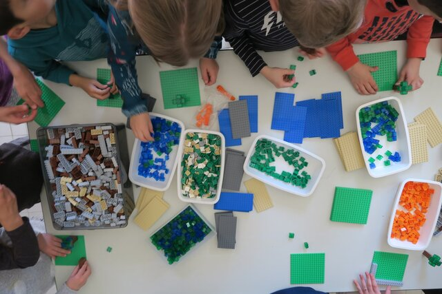
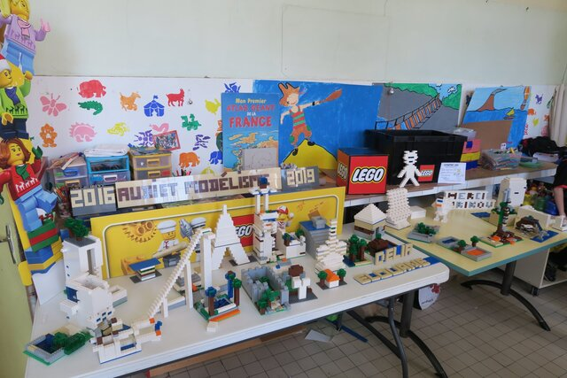

Préparation de la Briqu’Expo Aubiet des 13 et 14 avril 2019

En préparation de la [Briqu’Expo Aubiet des 13 et 14 avril 2019](https://www.freelug.org/spip.php?evenement215), nous avons programmé une animation au CLAE (Centre de Loisirs Associé à l’École) d’Aubiet le mercredi 20 mars 2019.

Notre contact est Joël, le président de l’association "Aubiet Modélisme". C’est cette association qui va gérer l’organisation matérielle de la salle pour le Briqu’Expo Aubiet.

A notre arrivée en fin de matinée, nous avons été accueilli par Joël et par l’équipe du CLAE.  
Nous avons expliqué le matériel et nous avons préparé la salle.

**Jeunes constructeurs**

Jeunes constructeurs

A 14h, nous démarrons l’atelier avec comme bâtisseurs 19 enfants entre 7 et 10 ans, 5 adultes et nous deux pour assurer l’animation.

Les briques "Minecraft" ont toujours autant de succès, en particulier les couleurs trans-blue et trans-green. (ceci est un message subliminal pour que LEGO augmente un peu la dotation de FreeLUG).

**Quelques réalisations**

Quelques réalisations

Vers 16h, après les photos des créations, l’ensemble des participants range le matériel.

Joël rappelle la Briqu’Expo et distribue des flyers.  
Premières impressions : Les enfants ont dit qu’ils avaient apprécié leur après-midi et les animatrices ont été agréablement surprises par la participation et la concentration des enfants.

Pour nous, c’est une expérience à renouveler.
