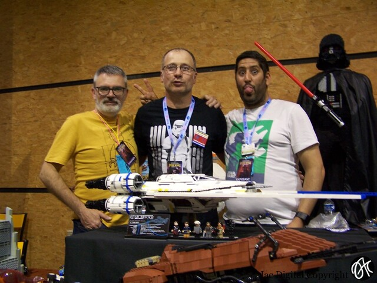
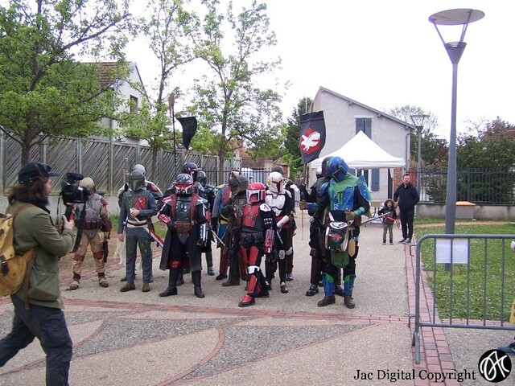
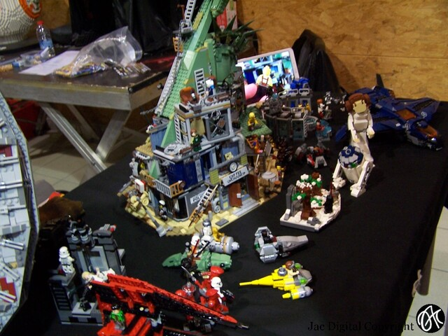
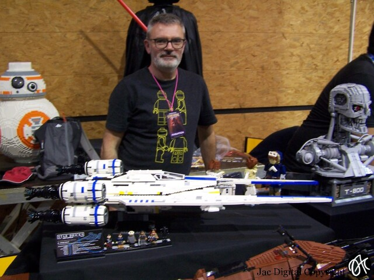
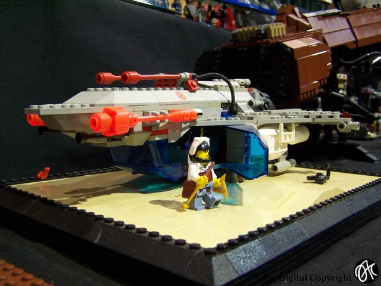

Nous étions invité à participer à la Convention Star Wars et Science Fiction, organisée pour la 21e fois par les "Héritiers de la Force".

Alors tout d’abord, une petite précision, je me suis un peu emporté et j’ai confondu les dates, cette année c’était la 21e, l’année dernière la 20e et l’année précédente, les 40 ans du nouvel espoir. L’année prochaine nous serons à 22...

Pour cette édition, nous étions 3 exposants. Dimitri, Thierry et moi-même, en tant qu’habitué du site et contact avec les "Héritiers de la force" pour la logistique. Notre emplacement n’a pas changé pour cette édition, toujours au fond à gauche et autant facile à trouver.

Du nouveau cette année avec un système de "pass" à l’entrée pour limiter le nombre de visiteurs dans la salle de l’espace Chambon. C’était très efficace, moins de chaleur, moins de monde devant les stands et des échanges avec le public plus facile. Par contre, je ne sais pas si la file d’attente à l’extérieur était plus importante. La convention a tout de même accueilli plus de 10000 visiteurs.

Depuis quelques années maintenant, l’exposition se tient aussi dans le parc et à l’espace Tabarly. Beaucoup d’animations se déroulent entre les deux salles, avec des combats aux sabres laser, des défilés de "cosplay" et beaucoup d’autres choses.

Chaque exposition est différente. La convention ne déroge pas à la règle, surtout que je m’efforce à chaque fois de renouveler les stands, même si les exposants sont les mêmes.

Pour cette année, nous avions prévu le Millenium UCS de Dimitri qui présentait aussi des sets Marvel et LEGO Movie.

Un superbe U-wing construit par Thierry d’après la notice de "Star Bricks", il présentait aussi un "speeder bike", un buste de T800 et quelques autres petites choses très belles.

Pour ma part, j’avais essayé de représenter le parc de l’indominus rex, le grand méchant du film _Jurassic World_, ainsi que vieux vaisseau spatial un peu remis au goût du jour.

Nous avions besoin des nappes Auvergne et de la flamme FreeLUG qui était stockés à Saint-Etienne. Heureusement, Pierre L a fait le trajet le samedi matin pour nous apporter tout ça. Il a beaucoup aidé pour l’installation et surtout le montage du stand. Je le remercie beaucoup ici pour sa participation à l’assemblage du parc du dinosaure. Thierry et Dimitri sont arrivés un peu plus tard avec plein de choses à installer. A l’ouverture de l’exposition, nous n’étions pas vraiment prêts, surtout moi. Mais le public apprécie aussi de nous voir construire. En fait, pour le parc, j’avais fait uniquement les murs. Les arbres étant très compliqués à transporter sans dégâts, j’avais prévu de les monter sur place. Ce qui m’a pris une bonne partie de l’après-midi. Mais le résultat en valait la peine.

Notre stand a eu beaucoup de succès. Tous ce qui était présenté a reçu les éloges du public. Autant pour les vaisseaux SW que pour ceux qui étaient moins connus ou purement inventés.

Nous sommes prêts pour une nouvelle édition, si les "Héritiers de la Force" nous accepte une fois de plus.

[Galerie photo de Jac](https://photos.freelug.org/main.php/v/JAC/Exposition/2019/GeneSW/)  
[Reportage vidéo de Dimitri (Geekme3)](https://www.youtube.com/watch?v=_y8VKKmgav4)
