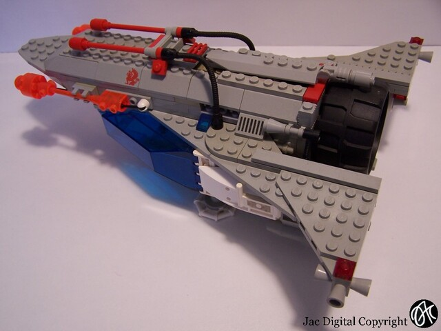
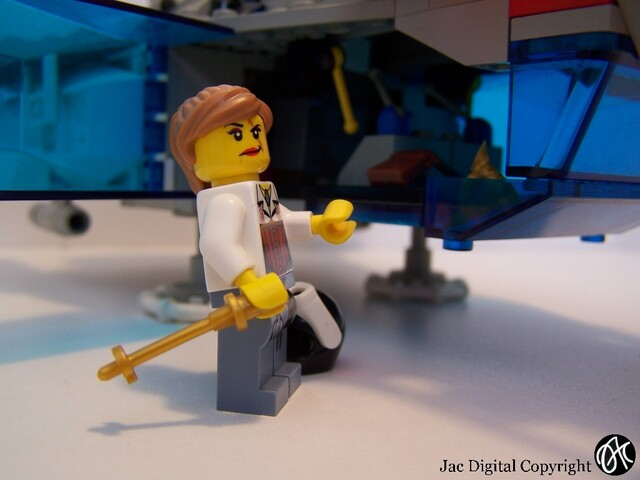
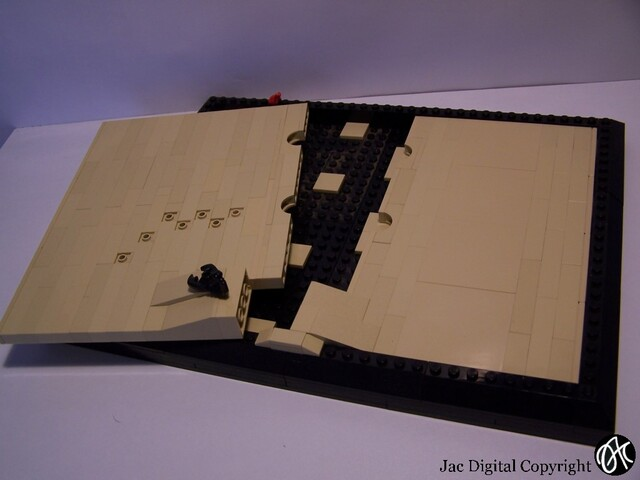
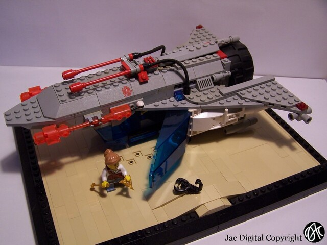

Comment mettre une petite touche de nouveauté sur un vaisseau qui n’a pas d’âge...

C’est cela, pas d’âge, car je n’ai plus sa date de construction en tête. Mais vu l’état de certaines briques et le souvenir que j’en ai, je dirais au moins une vingtaine d’années. Hou là, ça pique les yeux. On peut dire que je conserve mes constructions, enfin surtout celles dont je suis satisfait. Mais comment remettre au goût du jour un vaisseau construit il y a tant d’années ?

Et bien d’abord il faut se demander si on garde encore un peu plus sa construction. Ici oui, pour le coup. Alors c’est parti pour un bon dépoussiérage. La poussière est bien incrustée à certains endroits. Je passe le vaisseau entier sous la douche chaude. Le multi-jet puissant nettoie bien déjà. Par contre, on voit les oublis seulement quand c’est sec. Il faudra donc un deuxième passage. L’ABS ne risque rien jusqu’à 40 degrés et après on se brûle les doigts !

Une fois la poussière disparue, on peut s’occuper des pièces. Certaines couleurs ont beaucoup de mal à traverser les épreuves du temps et surtout les rayons du soleil. Le plus connu est le blanc qui devient jaune, mais il en va de même pour le gris qui devient plus foncé. Il y a d’autres couleurs comme le jaune et le bleu qui passent aussi, mais ici, le vaisseau est blanc et gris.

Certaines pièces sont bien imbriquées dans le montage. Il faut presque détruire le vaisseau entièrement pour les changer. Il ne faut pas perdre le fil pour remonter à l’origine. J’en profite tout de même pour apporter quelques légères modifications, car il y a 20 ans, je ne construisais pas de la même manière. Le siège du pilote a été revu entièrement.

Dans le concept, je me souviens des contraintes que je m’étais données. Je voulais que le cockpit soit placé sous les ailes, ainsi le vaisseau est conçu en alignement avec une variété de différents réacteurs à l’arrière et de puissantes armes de combats qui sont pointées sur l’avant du vaisseau. L’allure que j’ai obtenue m’a vraiment plu. Je ne me souviens pas avoir dû faire beaucoup de modifications pour arriver à ce résultat, un peu étrange quand même.

Il y avait un pilote avec une casquette pour la version d’origine. Je vais échanger avec une nouvelle minifigurine féminine et plus stylée.

On arrive maintenant à la phase présentation pour la convention Star Wars de Cusset (03) en 2019. Je pensais l’exposer soit en vol au-dessus de l’eau, soit posé dans le sable. C’est la deuxième option que j’ai finalement choisie en faisant en sorte que les pieds soient légèrement enfoncés comme dans du sable fin. Cela donne plus l’impression que le vaisseau a du poids. Pour simplifier les choses, ou pas, je ne l’aligne pas sur la bordure du cadre. Cela laisse plus de place pour animer la sortie de ma pilote.

Le sol du petit diorama est fait d’un assemblage de pièces couleur sable, placées à l’horizontale. Je voulais tester cette méthode car ça permet de placer du relief tout en présentant les créations sur un sol lisse. Je voulais aussi représenter les traces de pas de la pilote. Aujourd’hui, avec les pièces que l’on a à notre disposition, il est facile de placer des tenons pour accrocher un animal ou de la végétation à l’endroit de son choix.

Il se trouve que l’empilage de pièces est venu se placer pile-poil dans le cadre noir. Je me disais que si ça ne passait pas, il faudrait que je rajoute quelques rangées de plate. Eh bien là non, ça c’est assemblé du premier coup. J’ai fait deux plaques séparées pour que cela soit plus facile à placer dans le cadre. Chacune d’elles est terminée par un rangée de tuiles qui se retrouve contre la bordure noire.

Une petite vérification dans mon stock pour voir si j’ai assez d’arches couleur sable de 1x4 car je ne voulais pas oublier d’enfoncer le vaisseau dans le sable ou, tout du moins, d’en donner l’impression.

Le rendu final est magnifique, enfin à mon goût, bien sûr. Le cadre est très simple d’aspect car je n’ai pas voulu le surcharger de détails, le vaisseau ayant déjà des formes compliquées.

A voir si c’est reparti pour être exposé dans ma salle de jeux pendant 20 ans !

[Lien vers la galerie photo](https://photos.freelug.org/main.php/v/JAC/MOC/Vaisseaux/autre/westermax/)
