Montage et analyse de la boite Speed Champions F40 référence 75890

Les bolides de la gamme Speed Champions me plaisent beaucoup. Même si on pourra regretter un peu l’échelle LEGO avec juste la place pour un pilote derrière un pare-brise en 4 tenons, il faut avouer que certains sont très réussi. Voilà donc dans ces quelques lignes, le montage de la F40 référence 75890.

**–** Disponibilité : elle fait partie des nouveautés début 2019. Elle est donc encore en vente à l’heure où j’écris cet article.  
**–** Nombre de pièces : 198  
**–** Nombre de minifigs : 1  
**–** Temps de montage : environ une demi-heure.

Produite entre 1987 et 1992, la F40 a été conçus pour fêter les 40 ans de la marque et aussi pour contrer Porsche sur les circuits. Depuis la F40, nous avons eu droit à une F50 et ensuite à des évolutions de cette dernière, mais sans fêter de nouveaux anniversaires. C’était un bolide conçu pour la course avec toutes les meilleures technologies disponible à cette époque. Elle garde quand même un look particulier et très reconnaissable.

La boite présente sur sa face avant le modèle que l’on va monter avec les briques qu’elle contient.

[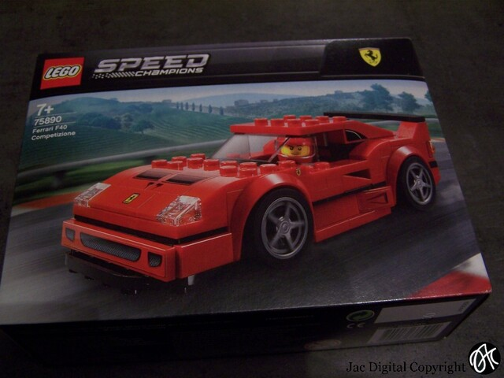](https://www.freelug.org/IMG/jpg/photo_1_-4.jpg)

Au dos nous découvrons les deux versions que l’on pourra construire au choix et surtout une photo de la vrai F40, pour rêver un peu plus.

[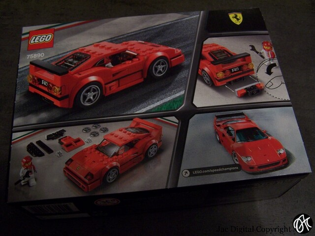](https://www.freelug.org/IMG/jpg/photo_2_-4.jpg)

En général dans cette gamme, nous avons droit à une petite construction qui permet d’exposer la voiture en action. Ici, nous aurons à choisir entre la version F40 de route et la voiture préparée pour la course sur circuit. Du coup dans la boite, on trouvera 2 sachets d’enjoliveurs de roues.

Une belle planche d’autocollants est fournie. On peu faire l’impasse sur leur mise en place. Mais sans eux, la voiture perd un peu sa ressemblance avec la vraie.

[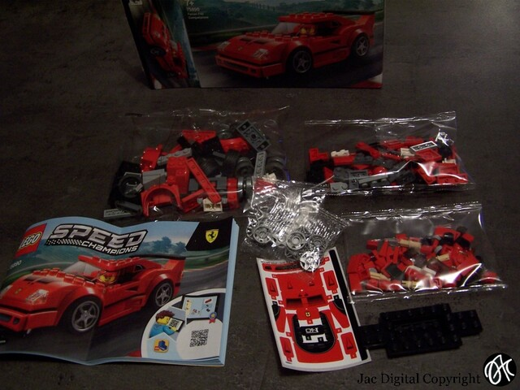](https://www.freelug.org/IMG/jpg/photo_3_-3.jpg)

On commence par l’assemblage du pilote exclusif à cette boite, enfin surtout pour le torse et qui porte une très belle combinaison Ferrari. La voiture est vraiment conçue pour la course. On poursuit avec le montage du châssis en partant toujours de la même méta pièce qui permet de placer la minifig au plus bas.

[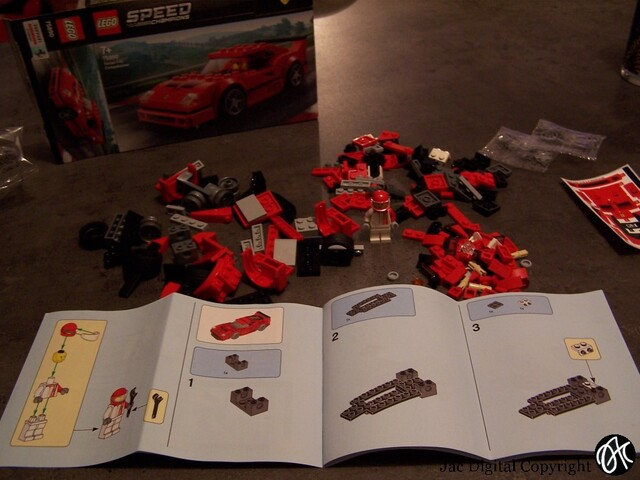](https://www.freelug.org/IMG/jpg/photo_4_-4.jpg)

Le torse du pilote est bien détaillé. Mais les jambes sont entièrement blanche. La tête est très sympa, je trouve.

[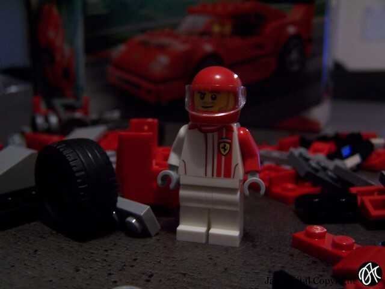](https://www.freelug.org/IMG/jpg/photo_5_.jpg)

Le dos est décoré aussi, mais succinctement.

[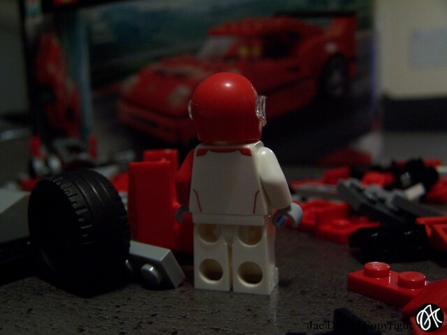](https://www.freelug.org/IMG/jpg/photo_6_-3.jpg)

Comme je l’écrivais plus haut, la pause des autocollants est indispensable si on veut que le bolide soit reconnaissable. Ici une représentation des aérations frontales.

[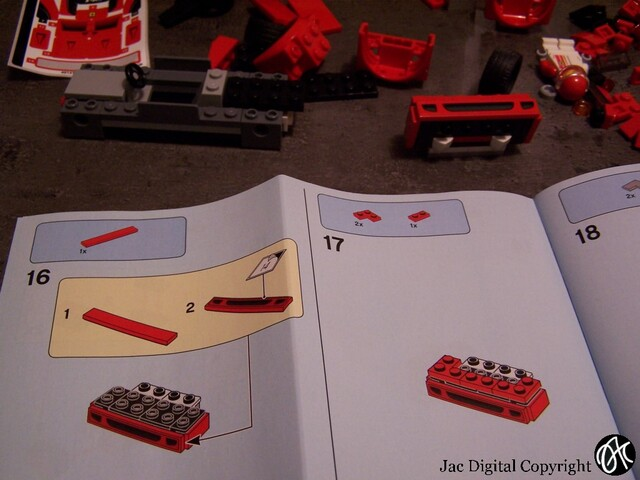](https://www.freelug.org/IMG/jpg/photo_7_-3.jpg)

On trouve tout de même des pièces sérigraphiées. Ici le logo Ferrari en tout petit et vraiment très réussi au regard de la taille qu’il fait. Ce détail est très sympa, je trouve. Il donne un plus aux ailes de la voiture et j’imagine même pas devoir coller un sticker aussi petit. Plus loin, on aura aussi une pièce noire avec un bord rouge. Mais l’application de la couleur ne correspond pas très bien. Je trouve l’effet moins réussi sur cette partie.

[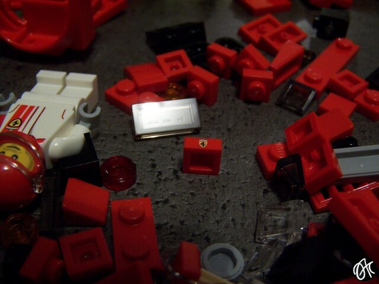](https://www.freelug.org/IMG/jpg/photo_8_-3.jpg)

On continue le montage. Les portes non-fonctionnelles sont assemblées et l’effet des prises d’air sur les côtés est très réussi, avec une grille placer en arrière. Encore une fois, la mise en place du petit autocollant pour la prise d’air inférieure renforce la ressemblance.

[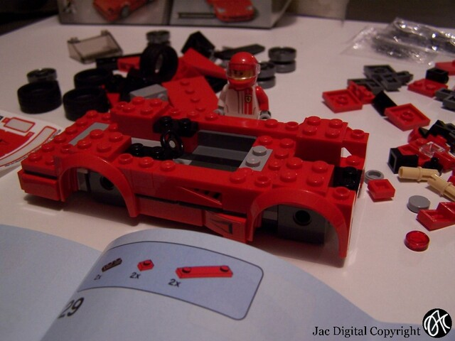](https://www.freelug.org/IMG/jpg/photo_10_-4.jpg)

Voilà le lot de pièces restantes ainsi que les parties à échanger pour passer de la F40 "de base" à la version course.  
Ici la version de base.

[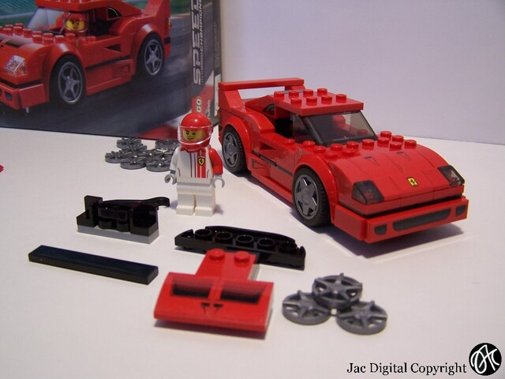](https://www.freelug.org/IMG/jpg/photo_15_-2.jpg)

Maintenant, la version course avec l’aileron noir et un spoiler avant plus bas.

[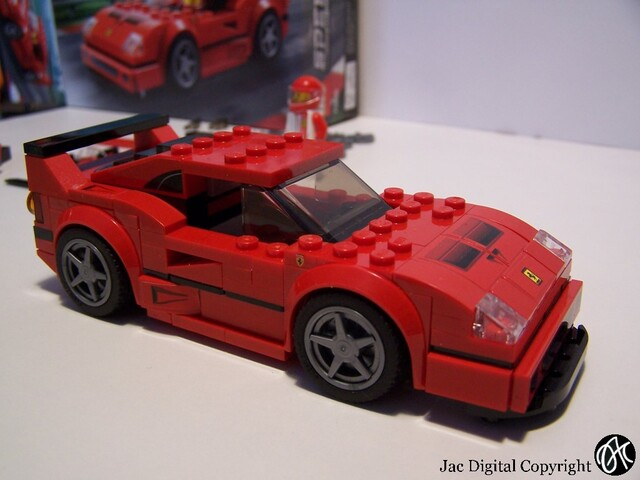](https://www.freelug.org/IMG/jpg/photo_14_-3.jpg)

Il reste aussi pas mal de pièces. Mais elles ont pour la plupart leur utilité. On a tout de même dans le lot une troisième plate 1X1 sérigraphié du logo au cheval cabré.

[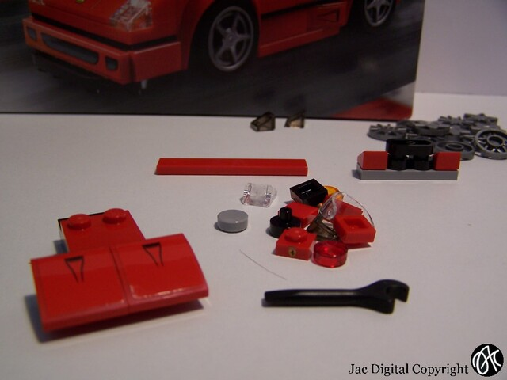](https://www.freelug.org/IMG/jpg/photo_13_-4.jpg)

Pour ma version finale, j’ai choisi le montage course, avec les phares fumés et une option train élargi. Mais ça, c’est le plus rajouté par mes soins, non prévu dans la boite.

[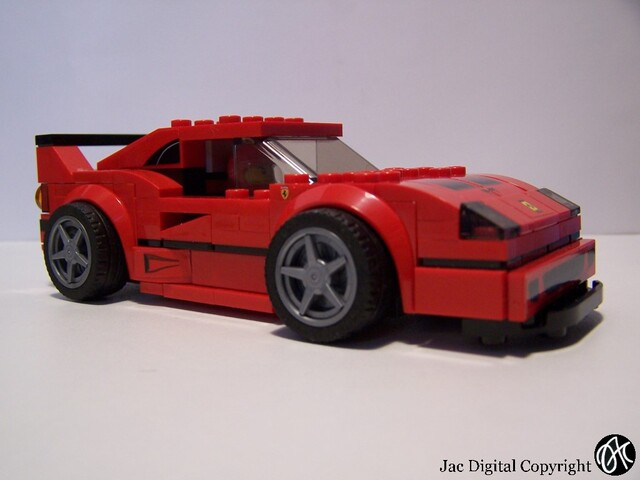](https://www.freelug.org/IMG/jpg/photo_19_.jpg)

J’aime bien cette gamme de voitures. Certes, on peut reprocher l’étroitesse du poste de conduite qui permet d’installer seulement une seule minifig, puis aussi l’empilage de pièces colorées à certains endroits et les planches d’autocollants conséquentes sur certaines références. Mais certains montages valent le détour notamment pour les avants et arrières, de plus la voiture est très reconnaissable au final.

Lien vers toutes les photos :  
[https://photos.freelug.org/main.php/v/JAC/review/SpeedChampion/75890/](https://photos.freelug.org/main.php/v/JAC/review/SpeedChampion/75890/)
