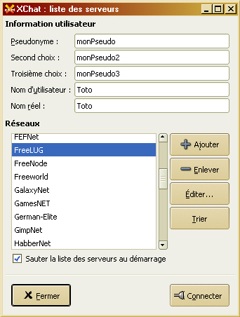
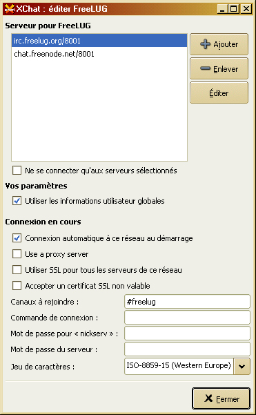

Le canal IRC de FreeLUG est un lieu où il se passe toujours quelque chose. Il permet de discuter rapidement avec quelqu’un ou tous les présents.

Il est évident que le passage par le [script CGI (page web)](http://www.freelug.info/cgi-bin/cgiirc/irc.cgi) peut suffire au début, mais plus on vient sur le chat, plus le besoin d’un logiciel adapté et dédié se fait sentir.

Nous vous proposons donc de faire le "grand" saut en passant à Xchat. Ce logiciel existe pour Linux, Mac et Windows. Il présente également l’avantage d’être libre et gratuit dans certaines versions.

## Où télécharger Xchat ?

Le site officiel propose une version payante pour Windows : [http://www.xchat.org](http://www.xchat.org/). Pour Linux ou Mac OSX, il est utilisable sans paiement. L’auteur explique que le cout de dévelopement et les outils pour le système Windows sont chers et justifie de demander une contribution financière.

Les sources étant libres, un autre site propose une version gratuite, qui vous interressera sans doute plus. Il est téléchargeable à l’adresse suivante : [http://www.silverex.org/download/](http://www.silverex.org/download/)

C’est cette version dont nous allons illustrer l’installation et l’utilisation.

## Comment installer et configurer Xchat ?

Une fois le fichier d’installation téléchargé, il suffit de le lancer, et de laisser les options par défaut (si vous ne savez pas quoi choisir).

Exécutez ensuite à partir du raccourci créé. Le plus compliqué arrive :)

**Configuration du serveur et du canal**  
**–** Remplissez les champs "Pseudonyme" avec votre pseudo préféré ;  
les deux cases suivantes sont un pseudo alternatif (en général le pseudo suivi de un ou deux \_ ). Vous pouvez mettre votre prénom dans les champs "Nom d’utilisateur" et "Nom réel". **Attention :** n’employez pas d’accent pour les pseudonymes ou noms.

**–** Cliquez sur le bouton "+Ajouter" et saisissez un nom, FreeLUG par exemple.  
**–** Cliquer ensuite sur Editer...  
**–** Dans la liste des serveurs, remplacer "newserver/6667" par "irc.freelug.org". Dans le champs "Canaux à rejoindre", ajouter #freelug. Enfin, choisir comme Jeu de caractères la valeur ISO-8859-15 (Western Europe). Ces valeurs là sont bien sûr celles à utiliser pour se connecter sur le canal de FreeLUG.

  
**–** Il ne vous reste qu’à valider, puis à cliquer sur "Connecter".

## Quelles sont les commandes IRC ?

Il existe plusieurs commandes à connaitre.

La première consiste tout d’abord à enregistrer son pseudo auprès du serveur.

Taper la commande suivante (en n’oubliant pas le / devant )

`/msg nickserv register votre_mot_de_passe`

Une fois le pseudo enregistré, vous en êtes le propriétaire. Mais à chaque connexion, il vous faudra vous identifier, pour justifier auprès du serveur que vous en êtes bien le propriétaire. La commande est la suivante :

`/msg nickserv identify votre_mot_de_passe`

Afin d’éviter de faire cette manipulation à chaque fois, Xchat peut le faire pour vous. Revenez sur l’écran avec la liste des serveurs, et éditez FreeLUG. Dans la case "Mot de passe pour Nickserv", ajoutez votre mot de passe.

Ainsi, à chaque connexion, vous serez automatiquement identifié.

Vous pourrez retrouver [d’autres commandes IRC](https://www.freelug.org/spip.php?article75) dans un précédent article ainsi que dans l’article [Xchat : en savoir plus...](https://www.freelug.org/spip.php?article40).

L’article illustrant [l’installation de Xchat 1.8](https://www.freelug.org/spip.php?article27) n’est bien sûr plus d’actualité.

Maintenant, il n’y a plus d’excuses pour ne pas venir "chatter" avec nous :) Toutefois, selon les heures, il est possible de ne pas rencontrer grand monde. Soyez patient ou repassez plus tard ! Bien sûr, les règles de la netiquette s’appliquent : langage courtois et pas de langage type sms.
