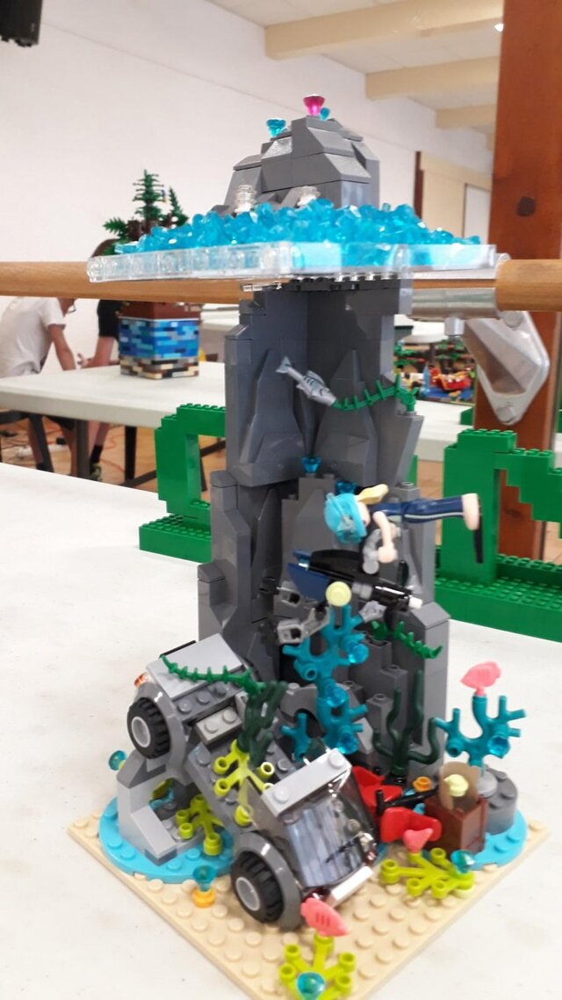
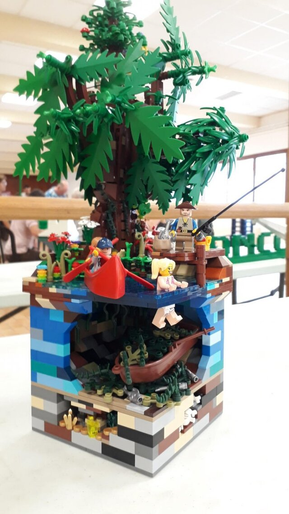
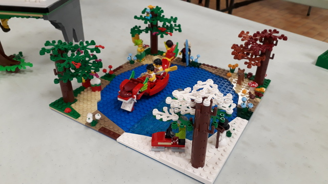

Ce sont 7 participants qui se sont défiés pour tenter de remporter le concours de la REF 2019.

Pour celles et ceux qui n’étaient pas présent-e-s à la REF 2019, voici les résultats du concours organisé pour l’occasion.  
Le thème était, rappelons-le, "Le lac dans tous ses états" et il fallait réaliser une scénette de 16x16 tenons minimum et 32x32 tenons maximum en le respectant.

Dans la catégorie enfants, la première place revient à **Emma** qui gagne le set **Friends 41097** et le set **Rainforest Animals 31031** grâce à un microscale particulièrement réussi.  
**Florian**, qui a improvisé avec ses pièces du draft (et notamment plein de tête de tortues) un petit MOC dans le thème remporte le set **Nexo Knights 70355**.  
Bravo à tous les deux :)

Dans la catégorie adultes, la troisième place revient à **Marie** qui remporte le set **60149 : 4x4 with catamaran**.

En deuxième, nous retrouvons **Edward** qui gagne donc le set **60147 : Fishing Boat**.

Et enfin, le grand gagnant est **Nicolas C.** qui remporte la **skyline de New-York 21028** grâce à son lac des quatre saisons :)

Félicitations à tous les trois !! :)

* * *

Le jury était composé de :

-   CANARD-LEPETIT Lydie (pour la FAA)
-   CLAUDEL Xavier
-   DUPUIS Sylvain
-   GIRIN Nicolas
-   RYSER Mathieu
-   VIALLEFONT Xavier

Les participants étaient :

-   Edward KELLER
-   Marie LAURENGE
-   Erik AMZALLAG
-   Nicolas CHARNAY
-   Philippe LABEL

Catégorie enfants :

-   Emma C.
-   Florian R-C

Points par création :

-   Edward : 10pts
-   Marie : 8pts
-   Erik : 3pts
-   Nicolas : 15pts
-   Philippe : 0pt

Catégorie enfants :

-   Emma : 17pts
-   Florian : 13pts
