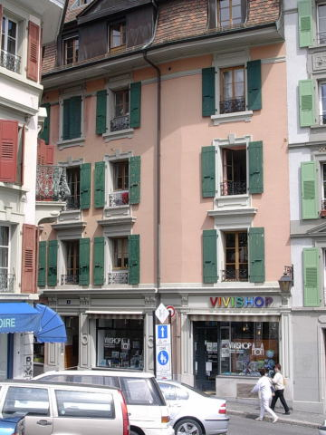
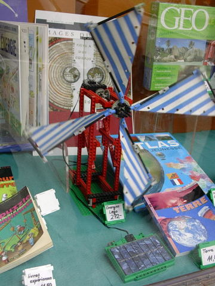
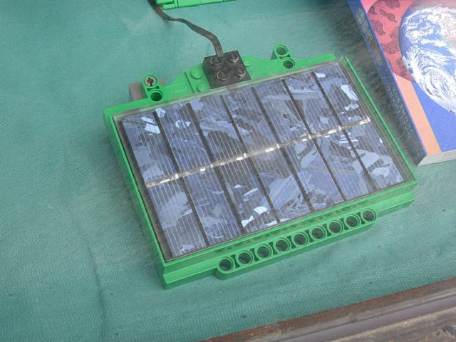
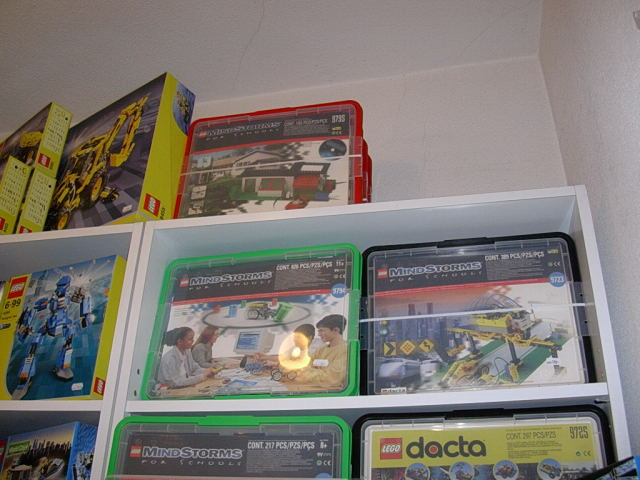
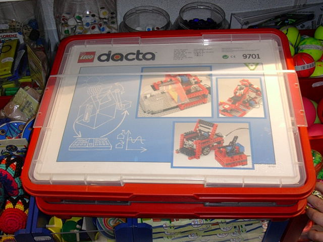

En visite pour une journée du coté de la frontière Suisse, j’ai profité d’une petite visite aux abords de la cathédrale de Lausanne pour pousser la porte d’une petite boutique comme on n’en fait plus beaucoup du coté français de la frontière.

A deux pas de la cathédrale de Lausanne, se trouve donc le magasin [Vivishop](http://www.vivishop.ch/) qui a tout de suite attiré mon attention par un petit montage en vitrine sur lequel mes yeux myopes mais néanmoins aguéris à l’identification de nos chères petites pièces d’ABS se sont arrétés.

**Vue générale**

Un ventilateur, certes l’idée est à la mode, surtout depuis la canicule de l’été 2003, mais alimenté par un capteur solaire estampillé du logo LEGO... Il n’en fallait pas plus pour me motiver à passer la porte, entrainant femme et enfants dans cette caverne aux trésors.

**Vitrine**

Et quand je dis trésors, je n’étais pas au bout de mes surprises, car si effectivement le magasin est fortement orienté sur les jouets scientifiques, je ne m’attendais pas à trouver l’origine de cette pièce dans un set Dacta, offert à la vente, quand on sait combien nous sommes frustrés nous pauvres petits français pour trouver quelques set LEGO Technic intéressants.

**Capteur solaire**

Et là le choc, car du Dacta il y a : Des sets complets présentant des montages scientifiques ouvrant sur les techniques de la production d’énergie, de la robotique, de la transformation de mouvements, en plusieurs modèles et plusieurs tailles.

**Les étagères**

Laissant le vendeur spécialisé du rayon Dacta et me présentant au nom de FreeLUG, je me retrouve vite à discuter avec le patron des lieux, un passionné comme pas deux, qui m’attire doucement vers l’arrière boutique pour me présenter les secrets de son approvisionnement.

Je me retrouve chargé de documentations et découvre avec une excitation non dissimulée des tiroirs remplis de micro moteurs, capteurs Mindstorm et pièces détachées LEGO Technics. Le temps de me pincer pour vérifier que je ne suis pas passé par la 4ème dimension pour rejoindre un bref instant l’atelier de Philo, non, je suis toujours à Lausanne et je retrouve le vendeur en pleine discussion avec un jeune garçon dont la maman semble combler le plus profond désir en se penchant sur une belle grosse boîte de Dacta.

La discussion continue et le vendeur me précise qu’il connaît FreeLUG et que nous pouvons prendre contact avec lui si nous sommes à la recherche de pièces et d’infos. Echange de cartes et discussion sur l’éventualité de passer des commandes groupées, ce que le patron ne souhaite pas développer, compte tenu des formalités administratives.

Je me fends donc pour quelques francs suisses d’un capteur solaire, d’un moteur Technics et de deux petites boîtes de Dacta, me promettant de faire l’article auprès de tous les FreeLUGiens, histoire d’augmenter le trafic transfrontalier, d’autant plus que le taux de change nous est un peu favorable.

**Dacta, dac ? t’as ?**

Voici donc un magasin comme personnellement je les aime, tenu par de vrais passionnés qui se donnent du mal pour s’approvisionner en Dacta depuis l’Allemagne et dans lequel il y a plein de choses à trouver pour développer à la fois les connaissances scientifiques de nos enfants, ainsi que leur capacités créatrices... et accessoirement les notres.
