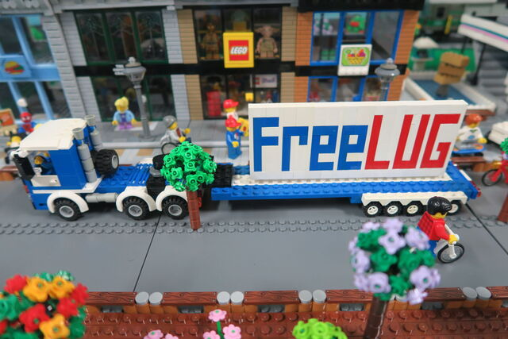
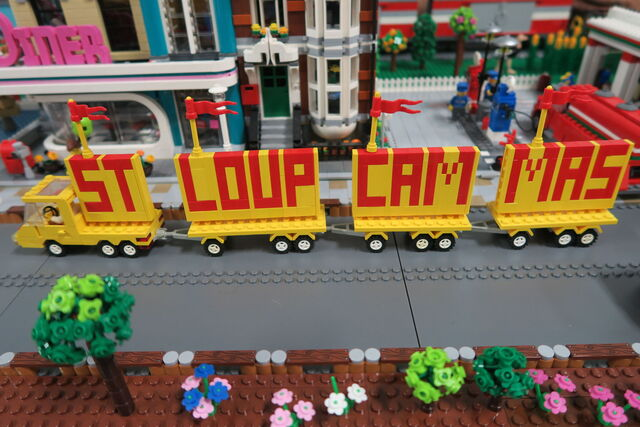
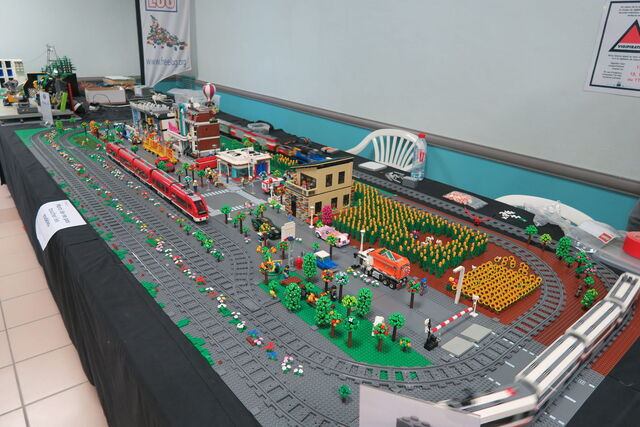
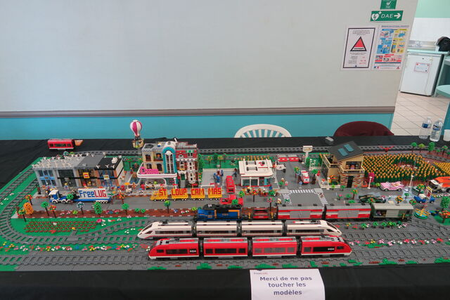
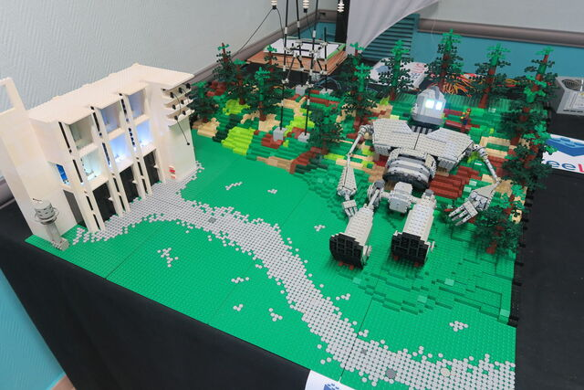
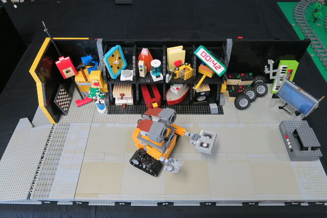
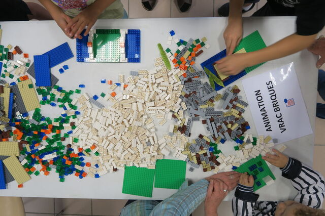
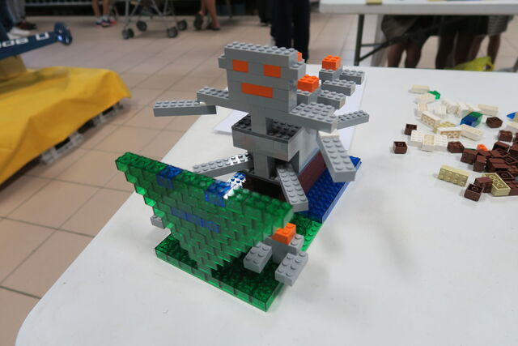

FreeLUG était présent au salon du modélisme de St-Loup Cammas.

Notre stand, 6m de long.

Une ville City (très fleurie) avec deux boucles de train, des champs, beaucoup de personnages, d’animaux et de nombreux clins d’œil, de quoi rester longtemps devant la scène.

Le "Géant de Fer" (déjà présenté à Aubiet).

Wall-e dans la reconstitution partielle de son repaire avec des objets du quotidien que le robot a ramassé.  
Pour être fidèle au film, nous avons ajouté un petit écran diffusant le même extrait de vidéo.

Et enfin, l’atelier de construction libre, seul endroit où l’on pouvait "toucher autrement qu’avec les yeux"

avec des créations de KFOL et d’AFOL.

Pour ce premier salon, les visiteurs étaient enchantés et les organisateurs nous attendent pour la prochaine édition.
