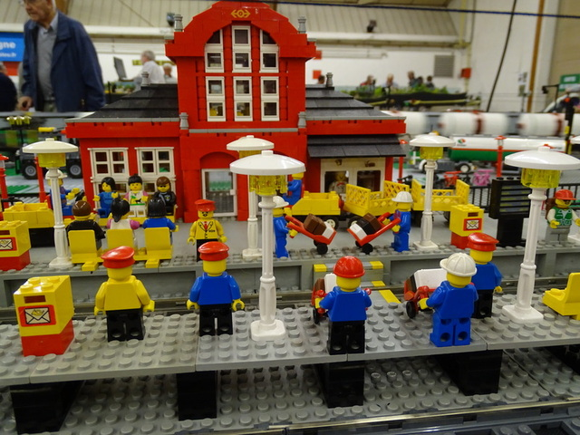
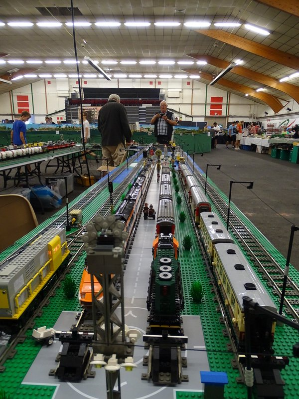
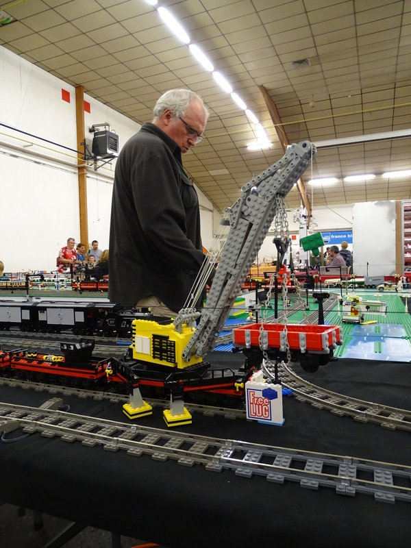

C’était donc le samedi matin qu’avaient rendez-vous deux adhérents FreeLUG (Franck et Philippe) pour participer au salon du maquettisme organisé par l’[AFMC](https://afmc63.fr/) les 28 et 29 septembre derniers à Cournon d’Auvergne.

**La gare rouge de Franck**

Un excellent prétexte pour jouer au LEGO ensemble et déballer les trains et bâtiments que le manque de place nous oblige à garder rangés à la maison.

Franck a amené deux magnifiques gares et leurs abords, tandis que Philippe apportait les trains, incluant voies et matériel roulant.

**Les rames au triage**

Nous avons vu défiler environ 900 visiteurs sur la journée et demi d’ouverture au public (samedi après-midi et dimanche). Beaucoup de questions de passionnés de modélisme, certains impressionnés par la robustesse du matériel : "ils ont tourné toute la journée sans aucune panne (sic)". Il ne manquerait plus que ça ! C’est du LEGO tout de même.

Des enfants toujours aussi ébahis et scotchés au stand, avec certains parents non moins rêveurs. Sans parler des nostalgiques qui repéraient par endroit un modèle ancien, souvenir de leur enfance.

**Une grue de levage lourd**

Encore une édition très agréable, à l’ambiance calme avec un public respectueux du matériel exposé. Merci à l’AFMC et Michel en particulier pour l’invitation. rendez-vous dans deux ans, si on veut bien encore de nous. Merci à Franck pour [ses photos de notre stand](https://photos.freelug.org/main.php/v/Frogleap/ExpositionsLego/Cournon2019/).

Voir en ligne : [Site de l’AFMC en Auvergne](https://afmc63.fr/)
