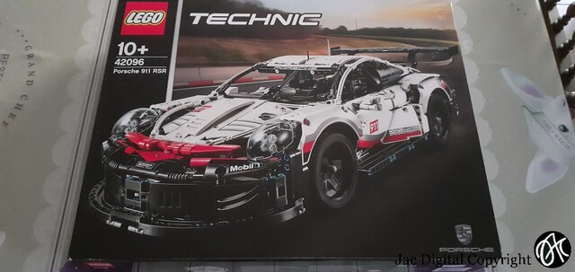
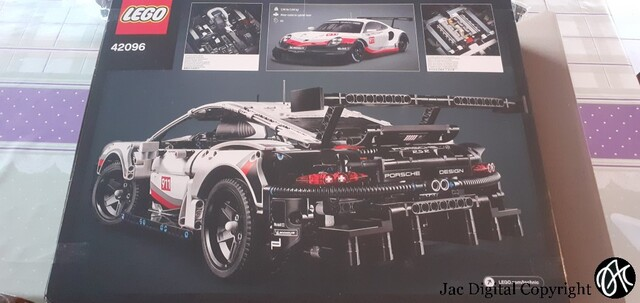
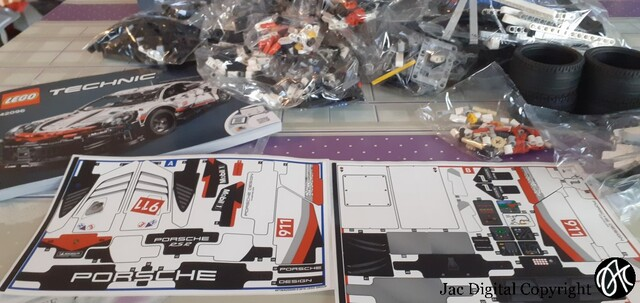
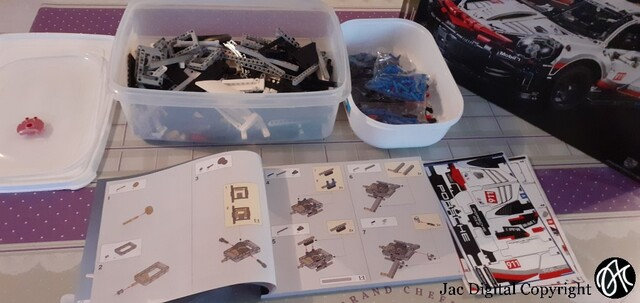
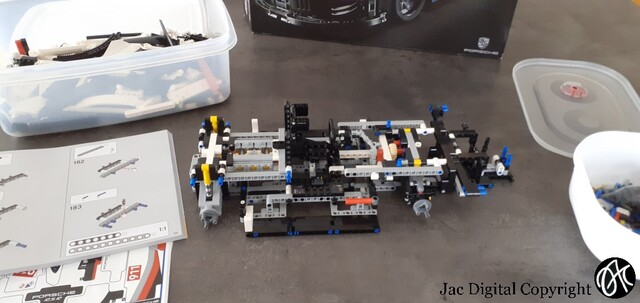
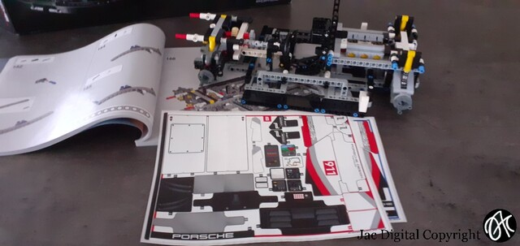
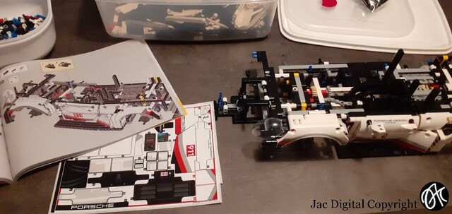
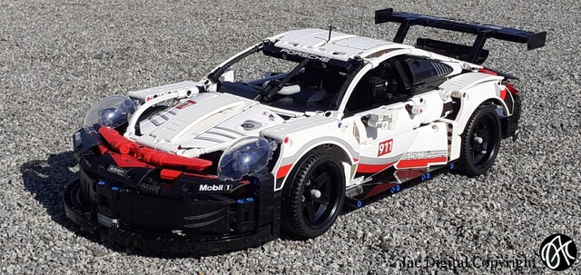

Il faudra bien 10 heures de construction pour pouvoir manipuler la reproduction de sa Porsche RSR en briques LEGO Technic.

La Porsche RSR a l’allure d’une 911. Mais ne vous y fiez pas, elle a été entièrement conçue pour la course par le constructeur allemand pour courir dans la catégorie GT2, de l’Automobile Club de l’Ouest et de la fédération Internationale de l’Automobile. Les performances sont là, environ 515ch, boîte de vitesses séquentielle à prise directe à 6 rapports. La voiture pèse 1245Kg. Le moteur à 6 cylindres opposés à plat et refroidi par eau est disposé devant l’essieu arrière. Il a une cylindrée d’environ 4200cm3. Il n’y a qu’un siège baquet et le pilote a le contrôle sur la mécanique, mais il manque malheureusement dans la boite.

-   Disponibilité : elle fait partie des nouveautés début 2019. Elle est donc encore en vente à l’heure où j’écris cet article, au prix de 149,99€.
-   Nombre de pièces : 1580
-   Temps de montage : Une bonne dizaine d’heure.

La Porsche 911 GT3 RSR (996) (de son vrai nom) a été reproduite au 1/8e environ. Ca fait gros, 50cm de long. Elle est bien solide, mais certaines pièces de décoration ont tendance à tomber, surtout celles de dessous à l’arrière.

Sur le devant de la boite on peut admirer une belle photo du modèle terminé. Ca donne envie de vite commencer.

Au dos, quelques zooms sur des détails et aussi une photo de la vraie voiture en course. Cela permet de se faire une idée de la réussite de la reproduction.

A l’ouverture on découvre 6 sachets non numérotés, une belle notice et deux planches d’autocollants. Quelques bonnes minutes de collage précis sont en vue. Heureusement les grandes pièces qui servent à représenter les garde-boues sont tampographiées.

Pour rendre moins difficile la recherche des pièces, je vide les grosses pièces dans un grand bac et les petites dans un petit. Certains sachets sont en double. J’en ouvre qu’un et je garde de côté le deuxième jusqu’à ce que le lot de pièces qu’il contient soit épuisé. Ca sera une technique bien efficace, surtout au début. Les pneus resteront eux aussi dans leur sachet. Cette fois on mettra les roues en dernier, comme sur la notice.

On commence par le châssis, le montage se fait aisément, la notice est très claire. Motivé par le rendu final de cette voiture de course, j’avance très vite et j’oublie même de prendre des photos. L’ensemble est coloré mais cela permet aussi d’établir un code couleur qui aide bien à la construction. Le moteur est en place en avant des roues arrières, contrairement à une Porsche classique. C’est pour équilibrer la voiture. Ici, le montage est simplifié, oubliez la boite de vitesses séquentielle à 6 rapports. Les roues entraînent directement le moteur via un différentiel.

Un peu plus loin dans la construction, quelques pièces de la structure ont été rajoutées. Certaines pièces du châssis semblent monter un peu haut pour soutenir les éléments de carrosserie. Mais c’est nécessaire à sa solidité.

Enfin le début des pièces de carrosserie et aussi celui des grands autocollants.

Pris dans la construction, je n’ai pas fait plus de photos. Enfin du moins aucune est présentable pour continuer correctement les explications. Je passe donc directement à la conclusion de cette revue. Le montage des éléments de carrosserie ne pose pas de problème particulier. Les éléments Technic habillent bien toutes les parties du châssis.

J’aurais voulu apporter quelques modifications, comme par exemple le fonctionnement des poignées des portes. Mais il faut tout démonter pour arriver à quelque chose de bien. C’est dommage parce qu’elles ont tendance à s’ouvrir.

Le capot qui s’ouvre à l’arrière permet d’apercevoir le moteur. C’est bien pratique. Il tient en place seul et se remet bien en position. Il est très discret une fois refermé.

Voilà enfin la voiture terminée. Comme je l’ai déjà dit, il manque un pilote et c’est dommage car j’aurais pu y mettre un peu plus d’action pour mes photos. Depuis la disparition des personnages Technic, cette gamme est vendue sans. Je trouve dommage, même si les échelles sont différents, ça apportait un plus aux constructions.

Cette voiture plait ou ne plait pas. C’est vrai que suivant l’angle de vue, ça fait un peu bizarre. Pourtant, elle a belle allure et transmet très bien la forme des 911. Ce qui m’a surtout plu, c’est d’assembler une voiture de course de super production. Car dans ces courses, les voitures se reconnaissent malgré les modifications.

J’attends avec impatience de monter la Ferrari 42125.

