Voici en exclusivité mondiale les résultats du concours de Novembre 2019 qui avait pour thème, rappelons-le, le célèbre justicier Batman (qui fête ses 80 ans cette année).

Nous tenons tout d’abord à féliciter les 4 participants qui nous ont proposé des créations toutes plus sympathiques les unes que les autres et nous tenons également à remercier les personnes qui se sont portées volontaires pour faire partie du jury.

Il est temps d’abréger le suspens et d’applaudir **Hervé S.** qui remporte le set **DC Super Hero Girls 41236 Harley Quinn Dorm**.

Voici les photos des 4 participations :

Participation 1 : Hervé S.

[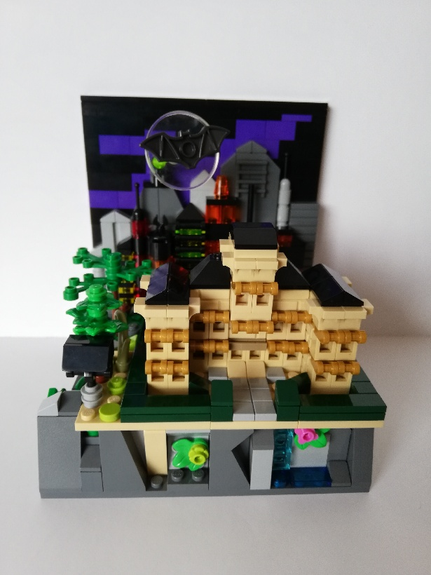](https://www.freelug.org/IMG/jpg/part1_photo1.jpg)

[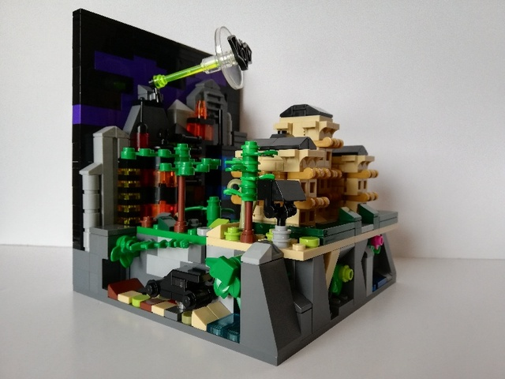](https://www.freelug.org/IMG/jpg/part1_photo2.jpg)

[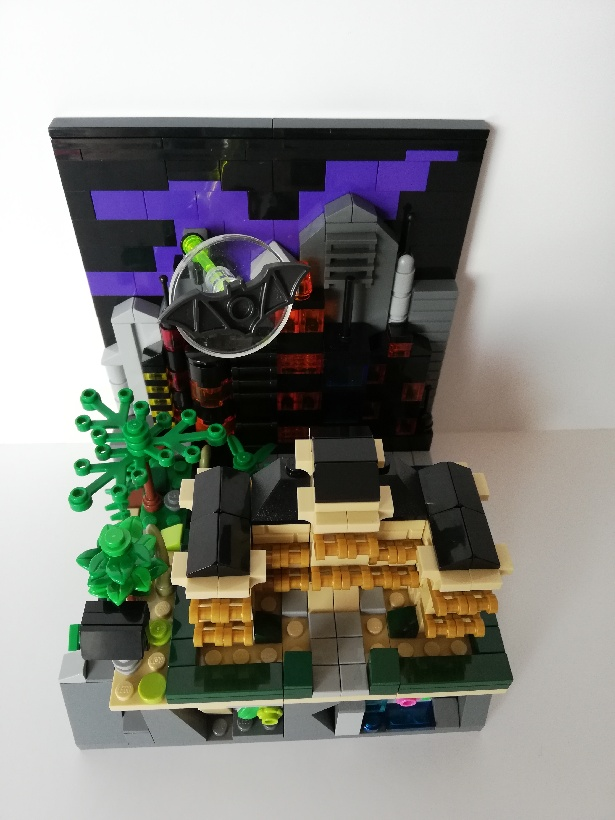](https://www.freelug.org/IMG/jpg/part1_photo3.jpg)

[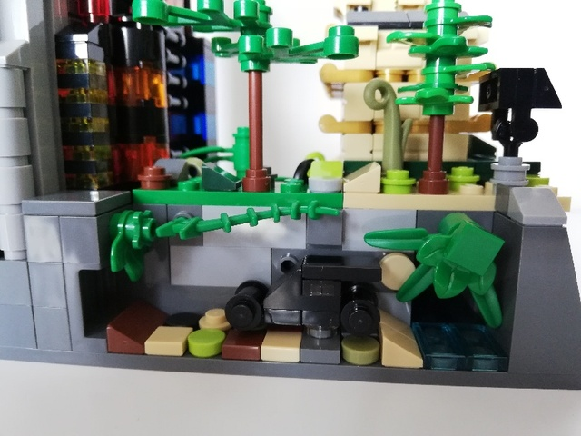](https://www.freelug.org/IMG/jpg/part1_photo4.jpg)

[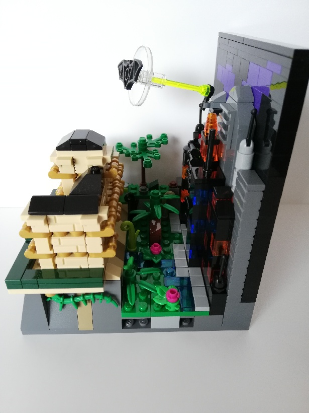](https://www.freelug.org/IMG/jpg/part1_photo5.jpg)

Participation 2 : Valentin P.

[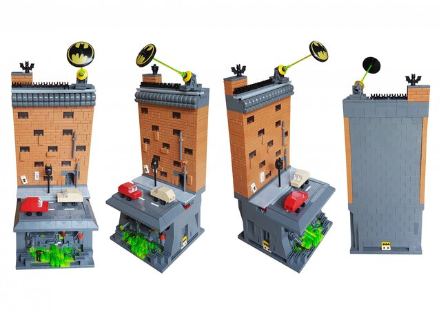](https://www.freelug.org/IMG/jpg/part2_photo.jpg)

Participation 3 : Nicolas G.

[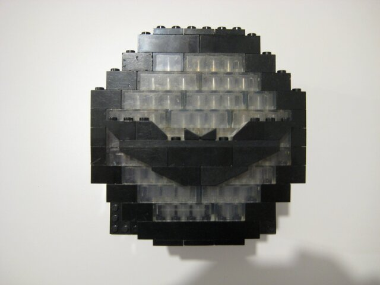](https://www.freelug.org/IMG/jpg/part3_photo1.jpg)

[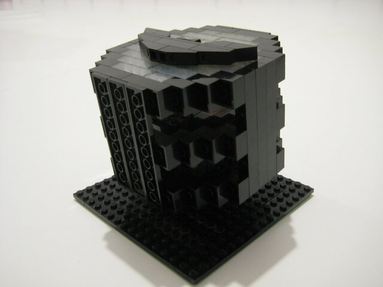](https://www.freelug.org/IMG/jpg/part3_photo2.jpg)

[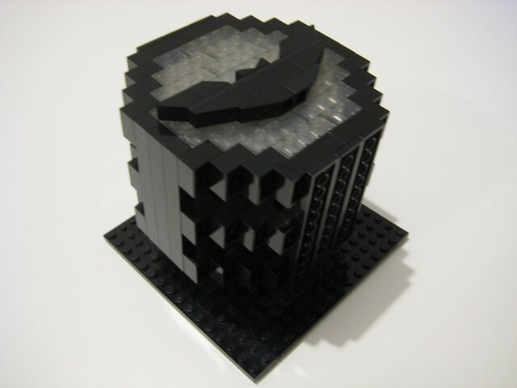](https://www.freelug.org/IMG/jpg/part3_photo3.jpg)

[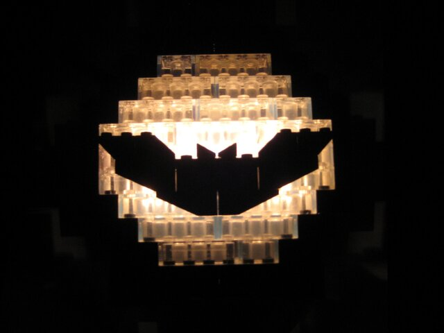](https://www.freelug.org/IMG/jpg/part3_photo4.jpg)

[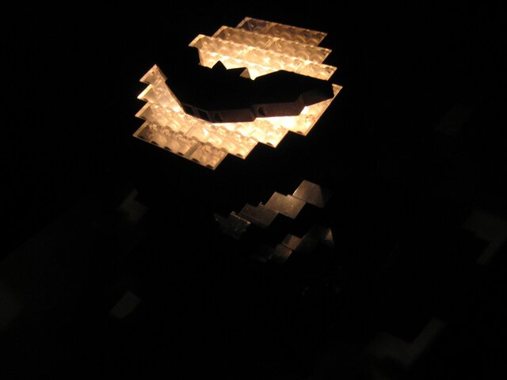](https://www.freelug.org/IMG/jpg/part3_photo5.jpg)

Participation 4 : Nicolas R.

[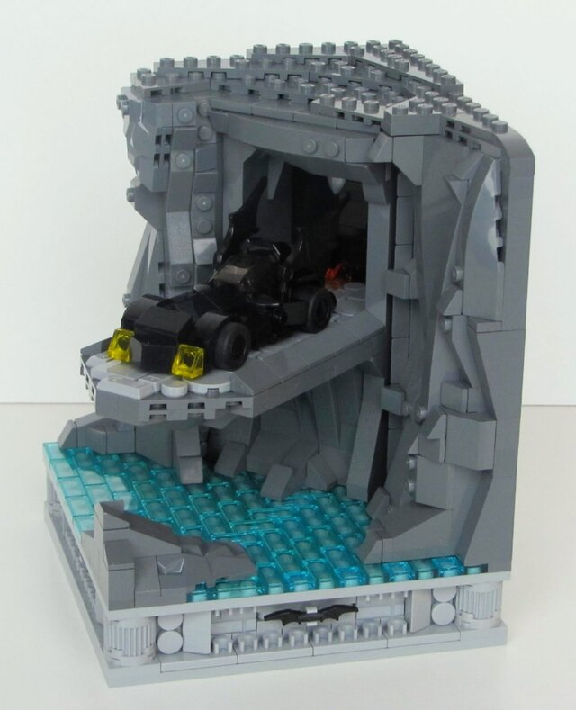](https://www.freelug.org/IMG/jpg/part4_photo1.jpg)

[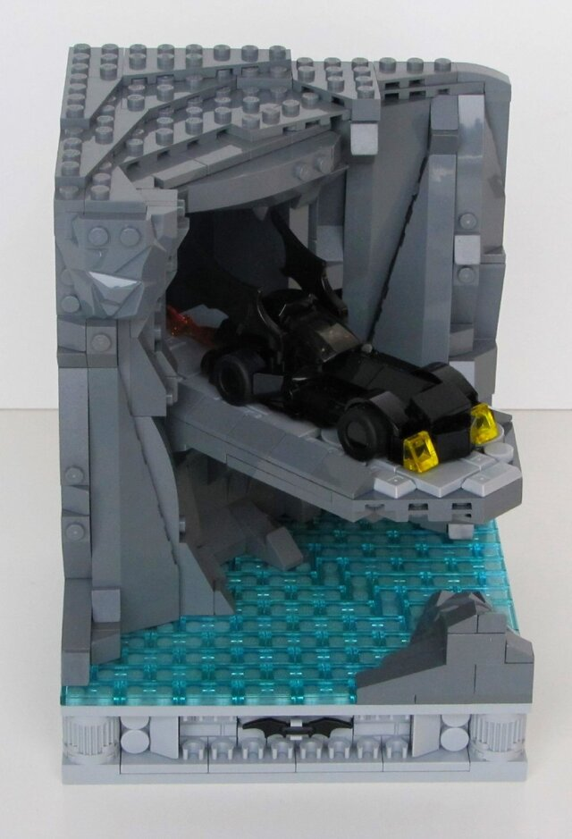](https://www.freelug.org/IMG/jpg/part4_photo2.jpg)

[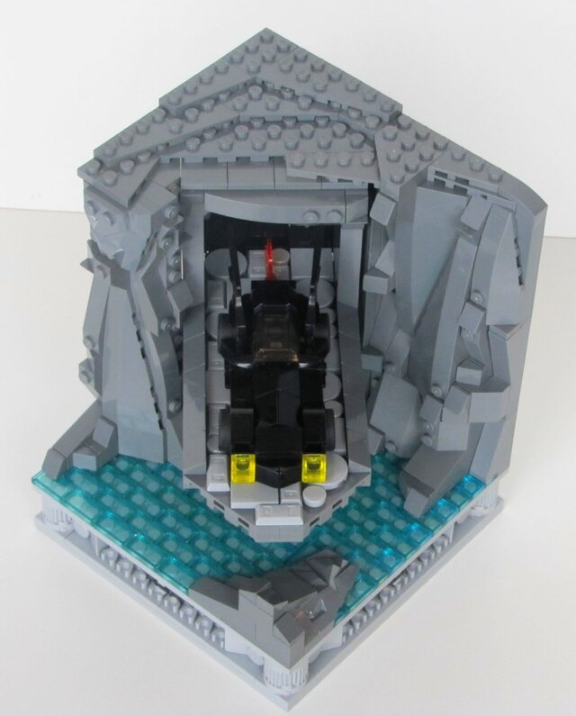](https://www.freelug.org/IMG/jpg/part4_photo3.jpg)

A bientôt pour un nouveau concours !

* * *

**Composition du jury** :

-   BORELLY Xavier
-   CHALAUX Laurent
-   CHARLES Pierre (Membre FAA)
-   LEJUS Rémi (Membre FAA)
-   LEPETIT Lydie (Coordinatrice FAA)
-   TARENTO Loïc (Membre FAA)
-   VANNIER Jérôme
-   WEINGAERTNER Mathieu (Membre FAA)

**Classement** :

1\. Hervé S.  
2\. Nicolas R.  
3\. Nicolas G. et Valentin P.

* * *
