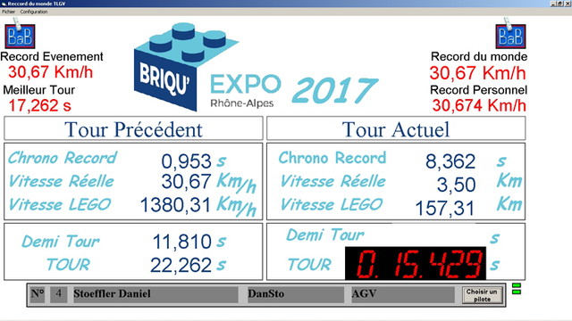
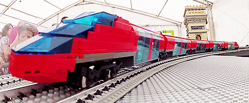
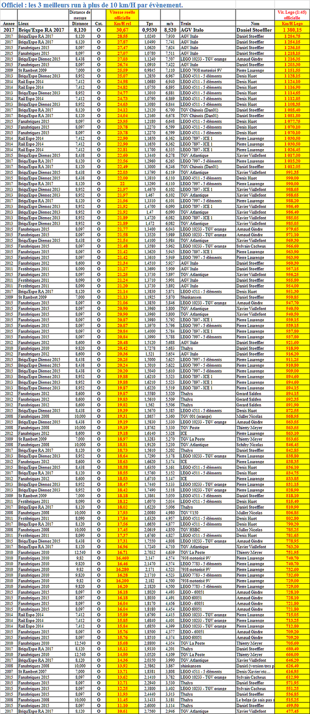
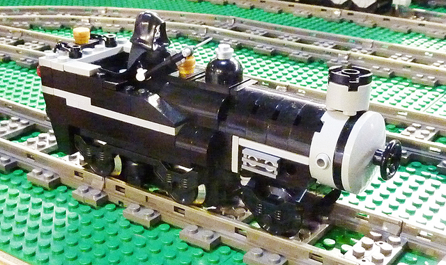
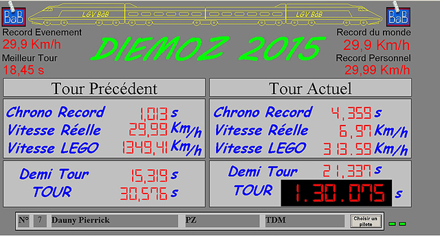
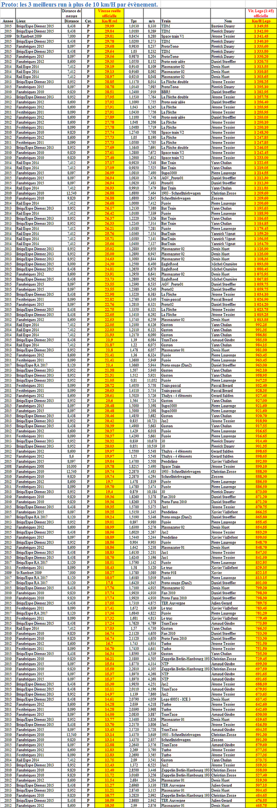
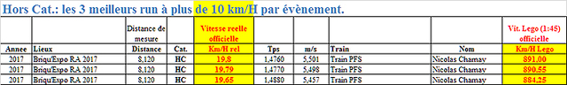

Après la Briqu’Expo Rhône-Alpes 2017 (BERA 2017), voici une remise à jour des résultats officiels des tentatives de record d’un train LEGO sur la LGV.

**Un nouveau record toutes catégories a été établi lors de l’exposition BERA 2017 à 30,67 km/h réel par L’AGV Italo (catégorie officielle) de DanSto.**

La barre ’’mythique’’ des 30 km/h a enfin été franchie : bravo à lui !

**Résultats**

Ces tableaux sont un récapitulatif des vitesses atteintes.  
Pour établir les tableaux de résultats officiels, il a été gardé un maximum de 3 chronos par manifestation/catégorie/train et supérieur à 10 km/h.

Et petite nouveauté, ajout d’une 3ème catégorie : la catégorie "_Hors Catégorie_". Cela pour permettre à tout un chacun d’inscrire sur une tablette la vitesse maximum de son train quel qu’il soit.

**Récapitulatif catégorie "Officielle"**

Record actuel : 30,67 km/h - nouveau record établi lors de BERA 2017 (Briqu’Expo Rhône-Alpes 2017)

**L’AGV Italo - nouveau record à 27,47 Km/h**

**Récapitulatif catégorie "Proto"**

Record actuel : 29,99 km/h - nouveau record établi lors de Briqu’Expo Diémoz 2015

**Récapitulatif catégorie "Hors catégorie"**

\*-\*-\*-  
AZATOR

## Documents joints

-   **[Record\_201709\_Alls3Run\_A03\_Proto.pdf](https://www.freelug.org/IMG/pdf/Record_201709_Alls3Run_A03_Proto.pdf "Télécharger PDF - 19.9 kio")**
    
    20 septembre 2017 \- PDF - 19.9 kio
    
-   **[Record\_201709\_Alls3Run\_A04\_Officiel.pdf](https://www.freelug.org/IMG/pdf/Record_201709_Alls3Run_A04_Officiel.pdf "Télécharger PDF - 19.7 kio")**
    
    20 septembre 2017 \- PDF - 19.7 kio
