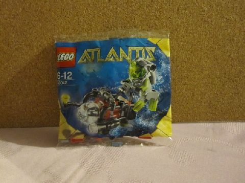
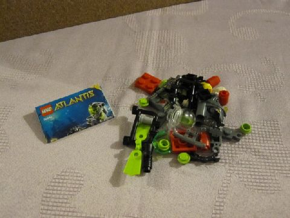
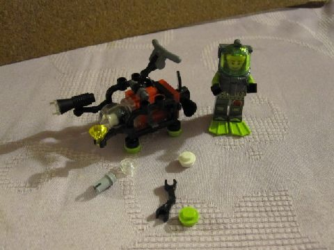
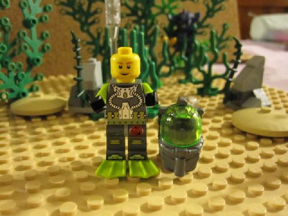
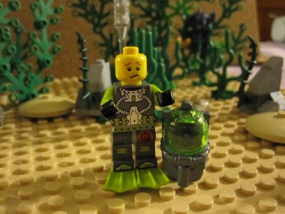
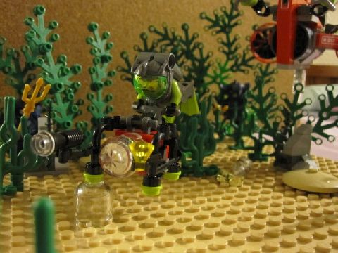
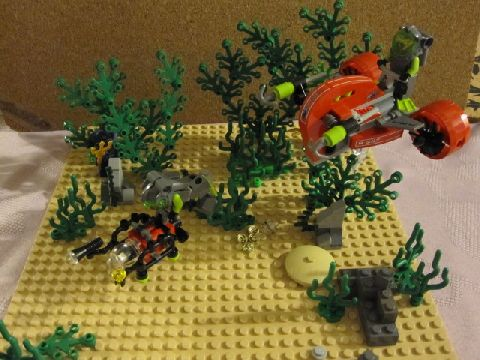

Offert à partir de 15€ d’achats en une seule fois dans les magasins Toys’R’Us, découvrons vite ce sachet promotionnel.

**–** Référence : 30042  
**–** Nom : Le mini sous-marin  
**–** Nombre de pièces : 38  
**–** Prix : Offert à partir de 15€ d’achats dans la limite de 3000 pièces

Alors deux [guerriers Manta](/articles/8073-le-guerrier-manta/), un [scooter](/articles/8057-le-scooter-des-profondeurs/) et voilà 15,97€ d’achats. Direction l’accueil du magasin pour récupérer l’objet de ces achats, le set promotionnel 30042, le mini sous-marin.

**Le sachet promotionnel**

Un rapide coup d’oeil sur bricklink pour l’[inventaire](http://www.bricklink.com/catalogItemInv.asp?SetID=30042-1), bon 38 pièces, la revue va être rapide cette fois.

Dans le sachet en vrac les pièces et la notice.

**Le contenu**

Après un montage éclair, nous voilà en présence d’un mini sous-marin d’exploration fort utile pour visiter les nombreuses épaves et ruines sur la route de l’Atlantis.

**Le set monté**

Ce petit engin d’exploration est plutôt bien reproduit, pour exemple [le sous-marin Victor 6000](http://www.ifremer.fr/flotte/systemes_sm/engins/victor.htm) de L’IFREMER.

Le plongeur de ce set est Lance Spears. Comme les autres plongeurs de la série, il possède une tête double face.

**Première face**

**deuxième face**

Et voilà la revue est terminée, quelques photos en situation pour finir.

