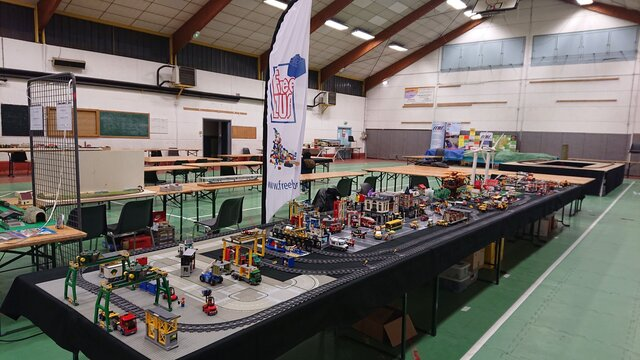
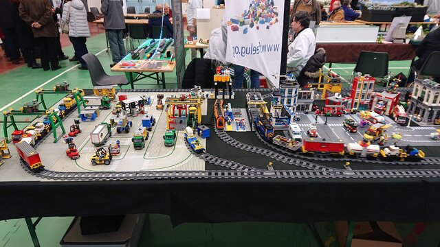
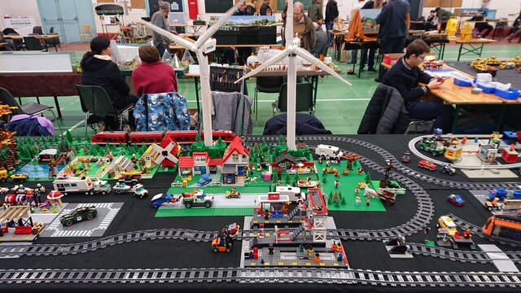
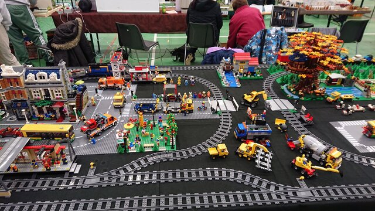
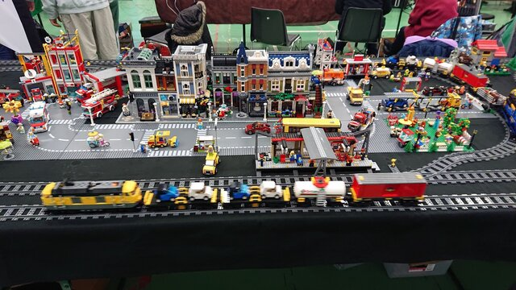
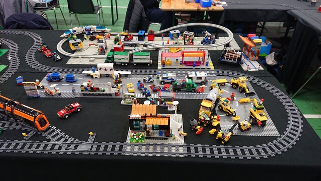
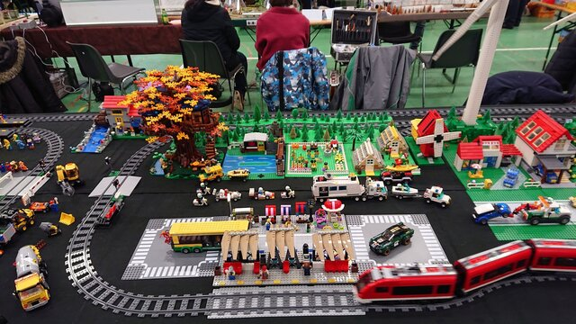
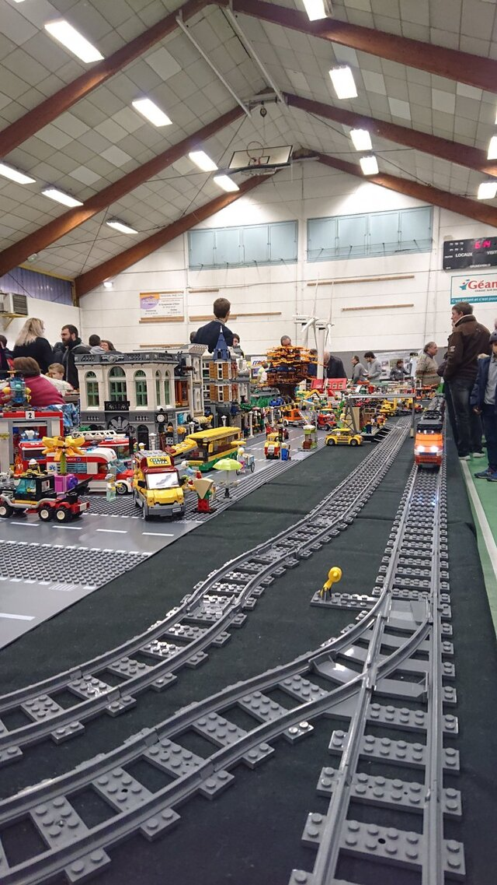

Organisée par l’AMFL ([Association des Modélismes Ferroviaires du Lyonnais](https://www.amfl.fr/)), l’exposition a su ravir les petits et grands fans de trains.

Pour cette exposition qui s’est tenue au gymnase des Brosses à Communay (69), FreeLUG avait été contacté par le président de l’AMFL, Monsieur Charpin, qui souhaitait apporter un peu de dynamisme et de variété grâce à des créations en LEGO.

En tant que tout nouvel adhérent et ravi de pouvoir participer à ma première exposition, j’ai eu la chance de pouvoir former un duo avec Sylvain D. et ainsi, bénéficier de son expérience, de ses conseils logistiques et techniques et de sa bonne humeur pour passer une excellente journée !

Notre objectif a été de construire un joli diorama sur le thèmes City/train. Et comme nous étions optimistes et motivés, nous avions réservés un stand de 8.80m de long sur 1.60m de large, soit finalement le plus grand stand de l’exposition.

Nous avions à la base une idée de plan ferroviaire, mais finalement, nous avons préféré construire notre tracé au gré de nos inspirations et de nos sets, puisque nous ne connaissions pas nos collections respectives.

Au final, après presque 5h d’installation, démontage/remontage, modifications diverses, nous avons réussi à avoir une grande boucle pour les trains à grande vitesse, ainsi que deux petites boucles pour des trains de marchandises et tramways, le tout en trois circuits distincts afin de pouvoir faire tourner trois trains simultanément sans avoir besoin d’un agent de régulation du trafic...

Notre diorama a été découpé en plusieurs zones avec, dans l’ordre :

-   une zone de marchandises/logistique
-   une ville avec des modèles de type modulaire et des petits véhicules
-   une zone plutôt campagne avec un moulin à aubes, des maisons, des serres, et les superbes éoliennes de Sylvain D.
-   une dernière zone avec le fameux monorail ClassicSpace et de très belles gares réalisées par Sylvain D.

Le jour J, nous étions présents à l’aube pour mettre en place les quelques idées nouvelles trouvées pendant la soirée/nuit, et surtout prêts à accueillir le public (avec une certaine fébrilité pour ma part).

Au final, nous avons eu des visiteurs en permanence, des adultes et enfants, s’émerveillant devant tous ces LEGO, les petits détails, la possibilité de "conduire" le train avec la télécommande.  
Nous avons aussi eu le droits aux questions classiques, a priori, d’une exposition (mais nouvelles pour moi), telles que "Combien de temps avez-vous mis pour installer ?", "Est-ce que vous avez une pièces dédiée pour cela chez vous ?", "Est-ce que LEGO vous aide pour avoir tous ces sets ?", etc.

Je retiens également les échanges avec des passionnés sur les techniques de construction, les sets, les évolutions, ou encore d’autres organisateurs de manifestations intéressés pour avoir un stand LEGO sur leur prochain évènement.

La journée est passée à vitesse grand V et, malgré une gestion à flux tendu des piles pour mes trains, tous ont pu circuler et ainsi proposer un diorama animé sur la journée.

Un très grand merci à FreeLUG pour m’avoir permis de faire ma première exposition LEGO, ainsi qu’à l’AMFL pour nous avoir accueillis.  
J’ai a priori attrapé le virus de l’exposition et suis impatient de pouvoir en refaire une. Merci également à Sylvain pour son aide précieuse, ses conseils et ses MOCs superbes, entre autres choses.

