Je me lance cette fois-ci dans un comparatif suite au lancement par LEGO d’un nouveau modèle d’essieu de train en 2019. Après quelques commentaires sur différents sites et [la vidéo de LEGO](https://www.youtube.com/watch?v=ztpGN2whtTs), j’ai voulu me faire ma propre idée. Tous les commentaires de cet article n’engagent que moi. Pour ceux qui me connaissent, je possède des trains longs, avec souvent plus de 40 wagons, c’est pour cela que le test de la vidéo avec si peu de wagons ne m’a pas convaincu et j’ai décidé de faire plusieurs tests.

D’un point de vue purement mécanique, il parait évident qu’un essieu qui présente un contact entre du plastique et une barre en métal aura moins de frottement qu’entre plastique et plastique. Autre désavantage du nouvel essieu, cette surface de contact est bien plus grande.

## Préparation du test

Après une commande sur le briques&pièces (pour l’essieu) et sur pick-a-brick (pour les roues), j’ai donc reçu de quoi faire 30 essieux. Le gros point positif du nouvel essieu est son prix : on tourne autour d’1€ l’essieu contre plus de 2,5€ pour l’ancien. Petit problème à la réception : une des roues présente un défaut, supprimé avec une pince coupante.

[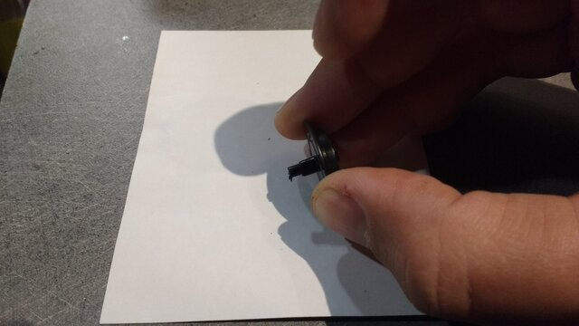](https://www.freelug.org/IMG/jpg/img_20191231_103249340.jpg)

Me voici donc lancé dans la réalisation de 20 wagons identiques, 10 avec l’ancien essieu et 10 avec le nouveau.

[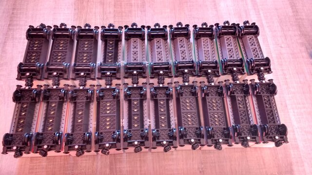](https://www.freelug.org/IMG/jpg/img_20191231_111109359_hdr.jpg)

Petit point négatif : en cas de chute les roues ont tendance a se déclipser.

[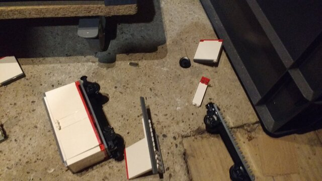](https://www.freelug.org/IMG/jpg/img_20191231_103255664.jpg)

## Test de la rampe

Pour le premier test j’ai voulu faire simplement une rampe et lâcher le wagon pour voir quelle distance il parcours. Voici la rampe et les 10 mètres de rails derrière.

[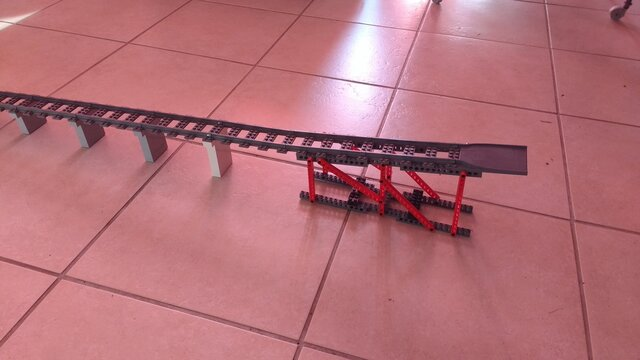](https://www.freelug.org/IMG/jpg/img_20191231_111133758.jpg)

[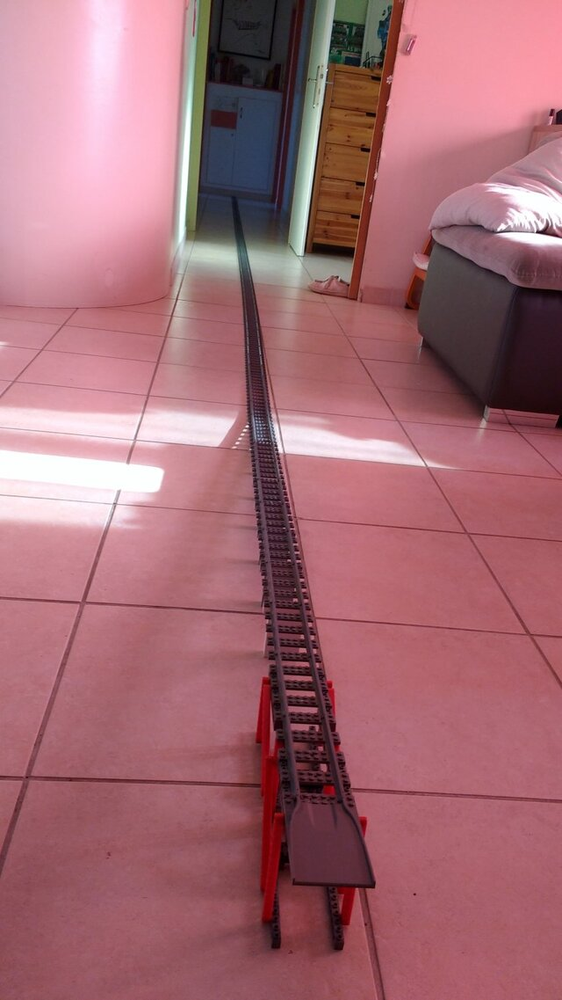](https://www.freelug.org/IMG/jpg/img_20191231_111140027.jpg)

Vu que mes six premiers wagons étaient graissés (avec de la graisse silicone), j’ai donc graissé tous les wagons avant le test et voici le résultat :  
\- premier wagon (le moins loin) avec 3,6m et un ancien essieu

[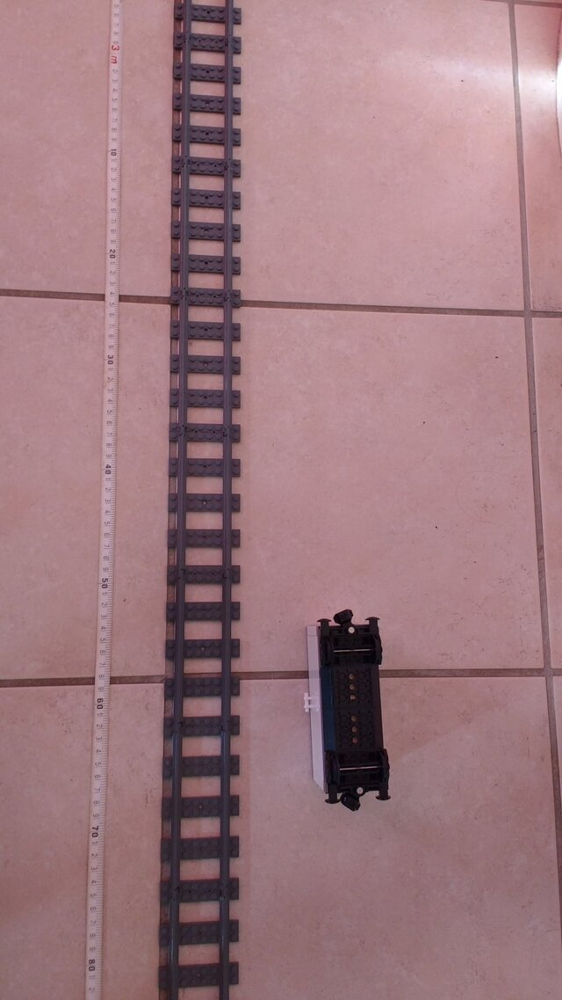](https://www.freelug.org/IMG/jpg/img_20191231_115632920.jpg)

\- après nous avons un tir groupé des nouveaux essieux entre 4,3m et 4,9m

[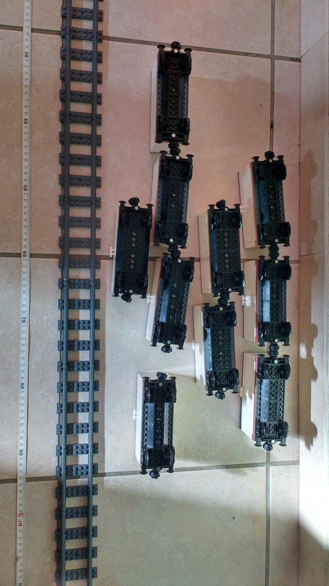](https://www.freelug.org/IMG/jpg/img_20191231_115626967_hdr.jpg)

\- puis tous les autres ancien essieux ; 2 entre 7,5m et 7,7m, 3 entre 8,8m et 9,2m et 4 vers les 10m

[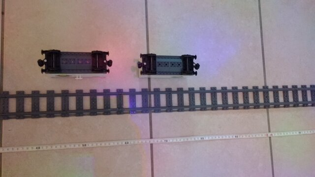](https://www.freelug.org/IMG/jpg/img_20191231_115615207.jpg)

[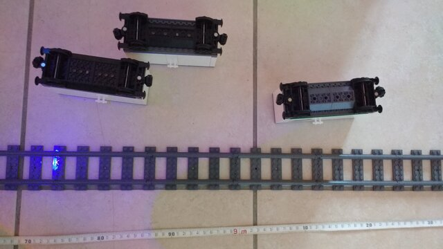](https://www.freelug.org/IMG/jpg/img_20191231_115602674.jpg)

[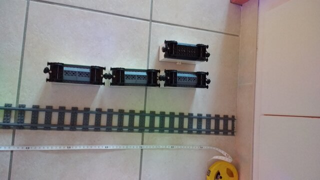](https://www.freelug.org/IMG/jpg/img_20191231_115555340.jpg)

Après vérification, le premier wagon n’était pas graissé et, après graissage, il a atteint les 8m.

## Test d’endurance

Pour le deuxième test, c’est un test grandeur nature en exposition. Au cours de l’exposition d’ArtOfBrick 2020, j’ai fait tourner chaque train pendant deux heures pour voir les performances. Voici le terrain de jeu.

[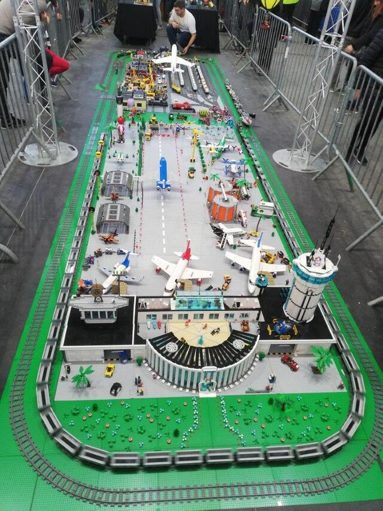](https://www.freelug.org/IMG/jpg/img_20200112_142515.jpg)

Pour le premier jour, j’ai pris une locomotive du set 60098 avec un seul moteur et un boitier de piles (avec des piles neuves à chaque fois provenant du même lot) et c’est parti pour deux heures (temps d’arrêt du boitier de piles) avec dix wagons à chaque fois : une fois avec les anciens essieux et une fois avec les nouveaux, pour voir si il y en a un qui s’arrête avant faute de puissance (piles déchargées).  
Dans les deux cas, les trains ont tourné pendant deux heures. Par contre, il y avait un compteur de tours pour les 30 premières minutes qui, malheureusement, n’a pas bien marché le premier jour…

Voici l’état des essieux à la fin de la première journée. On voit bien que le nouvel essieu a tendance à plus s’encrasser que l’ancien.

[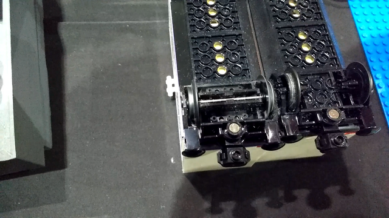](https://www.freelug.org/IMG/png/_tmp.png)

Vu que le compteur n’a pas marché la veille, j’ai réajusté le programme et cette fois, il fonctionne. On repart donc pour un autre test le deuxième jour : 79 tours pour les anciens essieux.

[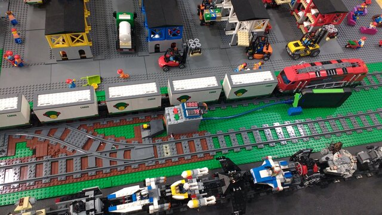](https://www.freelug.org/IMG/jpg/img_20200112_102816647.jpg)

Et au moment de passer aux nouveaux essieux… Le train n’a jamais voulu démarrer, même en le poussant un peu, il patine en continu.

Voulant absolument faire un comparatif, je passe donc sur une locomotive plus puissante, la 7939 avec 2 moteurs et sur batterie. Je charge à fond et c’est parti pour le même test de 30 minutes : 97 tours pour les anciens essieux et 82 pour les nouveaux…

[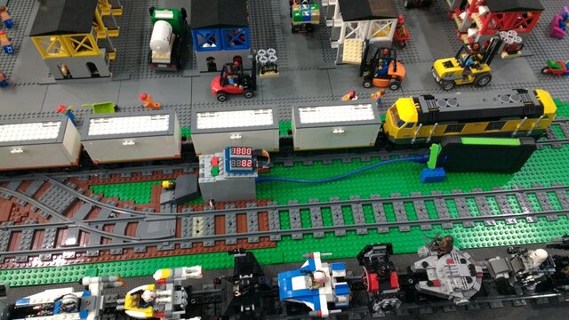](https://www.freelug.org/IMG/jpg/img_20200112_115729454.jpg)

[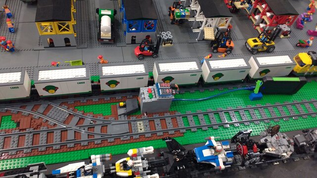](https://www.freelug.org/IMG/jpg/img_20200112_123401828.jpg)

## Test de la rampe après l’exposition

Du coup de retour à la maison, je me suis dit qu’il serait intéressant de refaire le test de la rampe.  
Le résultat est sans appel ! On a toujours un tir groupé des nouveaux essieux, mais cette fois-ci entre 2,2m et 3,2m. Grosse perte de capacité de roulement.

[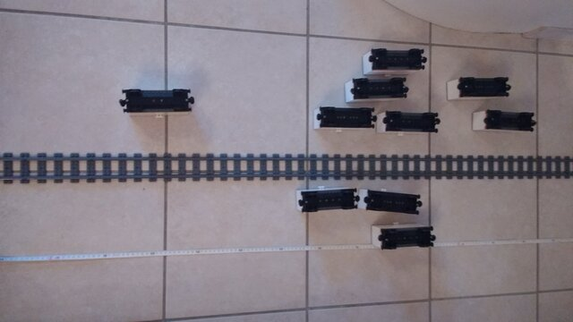](https://www.freelug.org/IMG/jpg/img_20200131_172800957.jpg)

Pour les anciens essieux, on est toujours dans les mêmes valeurs à plus de 6,4m jusqu’à 10m et ce, sans avoir nettoyé les essieux.

[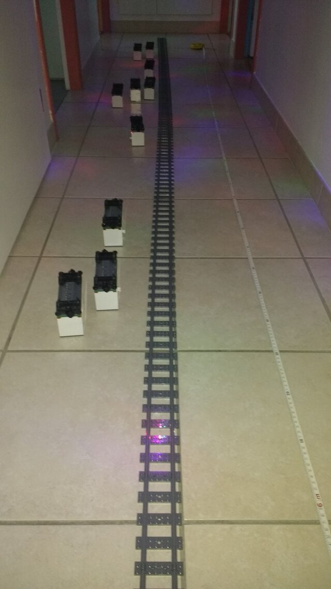](https://www.freelug.org/IMG/jpg/img_20200131_172518222.jpg)

Les nouveaux essieux ont vraiment tendance a beaucoup s’encrasser.

[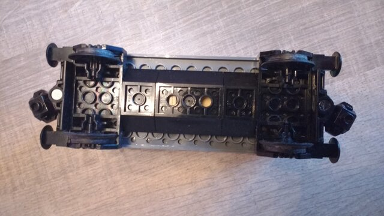](https://www.freelug.org/IMG/jpg/img_20200131_172844324.jpg)

[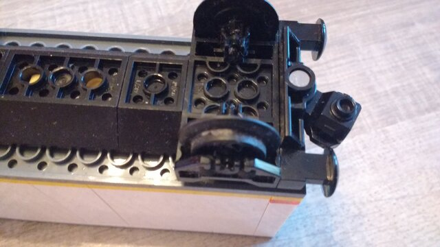](https://www.freelug.org/IMG/jpg/img_20200131_172854713.jpg)

Du coup j’ai pris celui qui a parcouru le moins de distance et j’ai nettoyé les roues ainsi que la partie au niveau du clip. Il parcourt un peu plus, rattrape les autres, mais ne revient pas aux valeurs du premier test.

[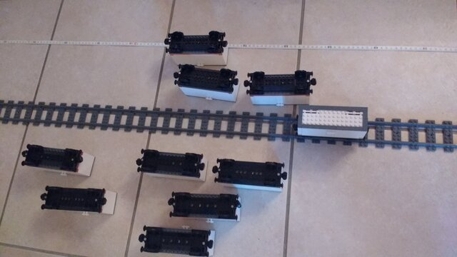](https://www.freelug.org/IMG/jpg/img_20200131_173111239.jpg)

Petit point amusant quand j’ai regroupé les wagons avant de les ranger, ils tiennent tout seul sur une rampe…

[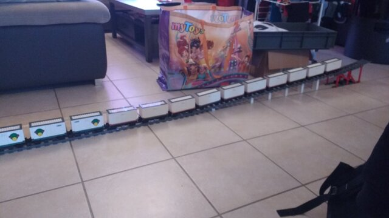](https://www.freelug.org/IMG/jpg/img_20200131_173355809.jpg)

J’avais les dix wagons avec les nouveaux essieux sur la rampe et du coup il tiennent sur place en descente…

## Conclusion

Même si ce nouvel essieu est plus pratique a monter et que son prix est vraiment plus intéressant, il est nettement moins performant que l’ancien essieu avec l’axe métallique. Pour moi c’est vite vu, tous les wagons de marchandises resteront sur l’ancien essieu et pour mes futures acquisitions, j’achèterai des anciens essieux. La prochaine fois, j’essayerai sur les trains de voyageurs pour voir si on sent vraiment la différence.

Pour résumer, si vous ne tractez pas trop de wagons et si vous voulez faire des wagons à moindre coût, pas de problème, mais sinon il vaut mieux acheter des anciens modèles.
