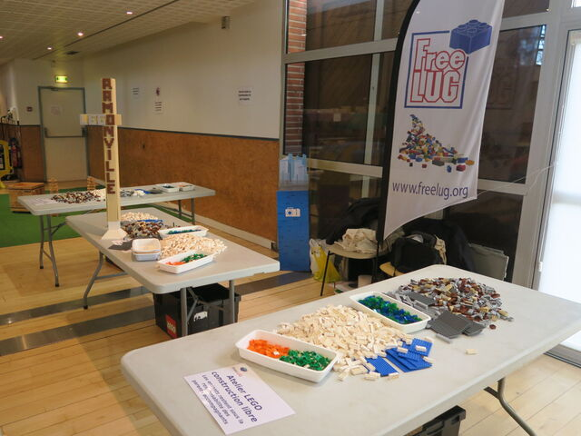
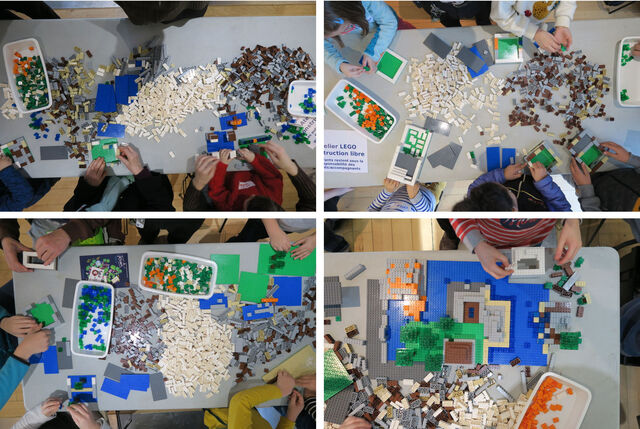
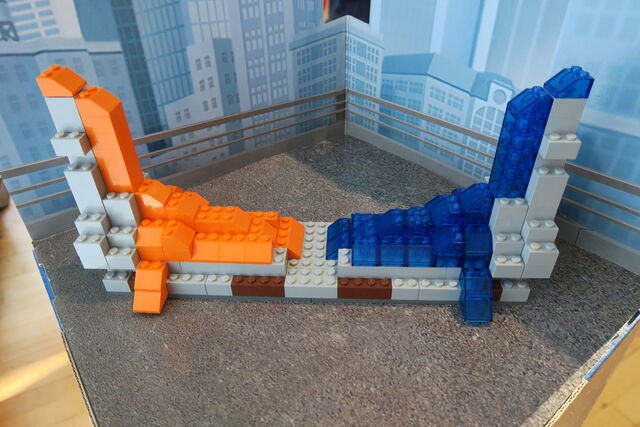
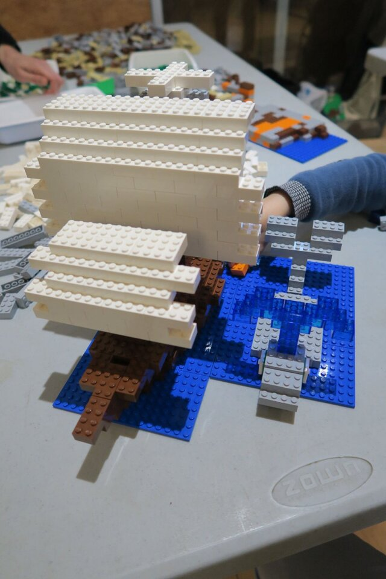
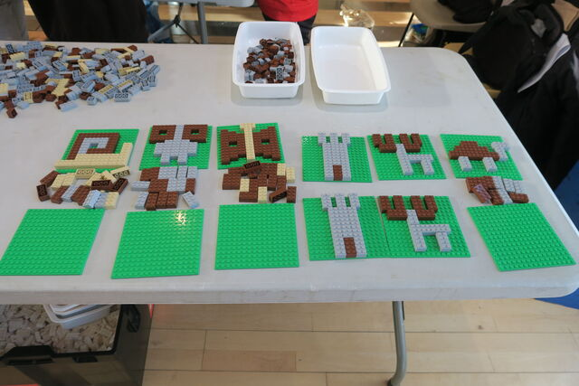

FreeLUG a animé un atelier de construction libre à la fête du jeu de Ramonville le 2 février 2020.

Une disposition classique avec trois tables, un totem rappelant le nom de la ville et le piédestal pour les photos.

Toujours beaucoup de monde à l’atelier. Heureusement que les constructeurs peuvent aussi être les démonteurs.

Mais avant le démontage, il y a la photo.

Evocation de Minecraft

La caravelle et la baleine (thème déjà traité à [Colomiers](/articles/2991/))

Petite nouveauté, à la demande des organisateurs, nous avons créé une des étapes d’un parcours ludique : les enfants devaient reproduire un motif sur une plaque 16x16 à base de briques 2x4 dans un temps limité. Les groupes étaient constitués d’enfants âgés de 5 à 10 ans.  
Nous adaptions les règles en fonction de la composition du groupe.

C’était notre première participation à la fête du jeu de Ramonville.  
Les constructeurs étaient de tous âges : jeune enfant sur des genoux, grand frère et grande sœur, parents et même grand-parents, le résultat d’un travail sur les liens intergénérationnels dans les structures de la commune.  
Les organisateurs nous ont donné rendez-vous pour la prochaine édition.
