Retour sur l’AFOL Day qui s’est déroulé à Lyon le samedi 1er Février 2020.

La journée a commencé à 9h30 au LEGO Store de la Part-Dieu ; l’occasion pour les nombreux adhérents présents de se retrouver pour passer un bon moment en compagnie de l’équipe du Store qui nous accueille toujours aussi agréablement.

[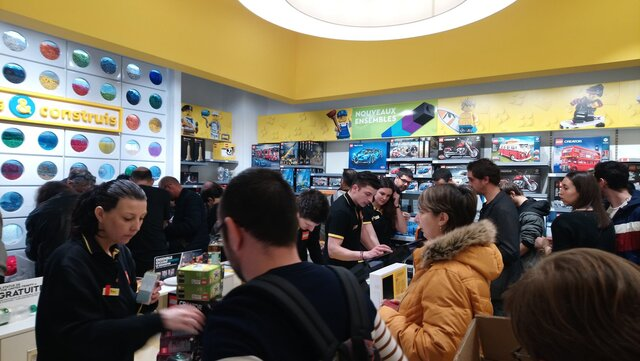](https://www.freelug.org/IMG/jpg/83677932_645903982911069_4115171744422035456_n.jpg)

[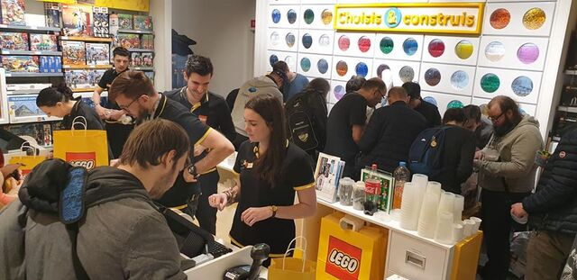](https://www.freelug.org/IMG/jpg/afolday_fev20.jpg)

Nous nous sommes ensuite retrouvés à la Brasserie Deruelle qui a relevé haut la main le défi d’accueillir les 36 adhérents présents pour ce resto LEGO très convivial.

[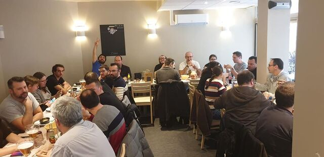](https://www.freelug.org/IMG/jpg/afolday_fev20_2.jpg)

A cette occasion, un concours a été organisé dont le thème était le suivant :  
Sujet libre à construire en 29 pièces (comme le nombre de jours du mois de février en cette année bissextile), ni plus ni moins. La CAO et les photos étaient aussi autorisées pour participer.

Malgré la difficulté du sujet, de nombreux participants se sont prêtés au jeu et ce ne sont pas moins de 14 créations, toutes plus originales les unes que les autres, qui ont été proposées.

[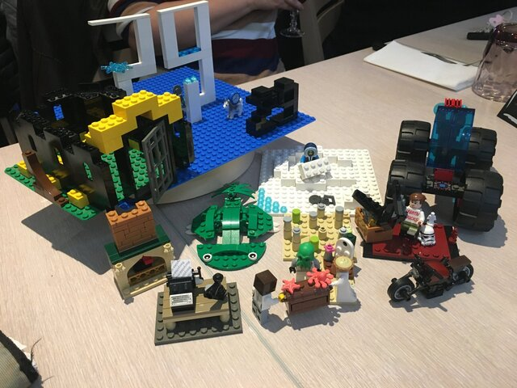](https://www.freelug.org/IMG/jpg/84865594_10222103061987104_935386268672458752_o.jpg)

Après un discours de Pierrick en tant que nouveau responsable du comité régional et en attendant le dessert, les membres du jury ont annoncé les résultats du concours et remis les prix (constitués de sets LEGO) :

Deux enfants ont participé et c’est Olivier qui s’est illustré avec sa création :

1er : Olivier

[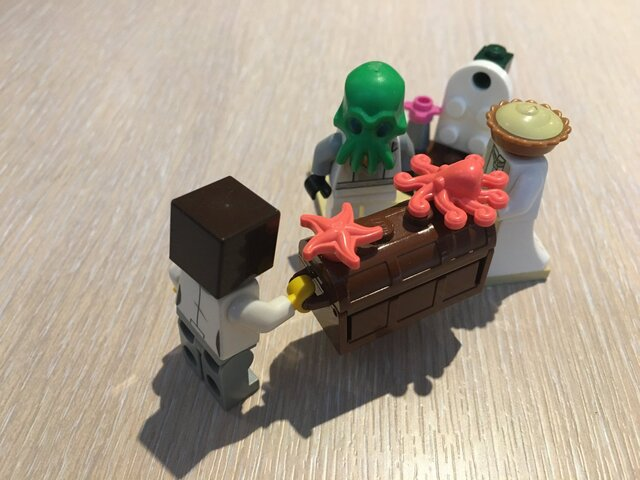](https://www.freelug.org/IMG/jpg/84507780_10222103054786924_3316912898063728640_o.jpg)

[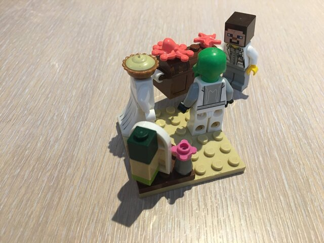](https://www.freelug.org/IMG/jpg/83616733_10222103060067056_7171059808957628416_o.jpg)

2ème : Lucas

[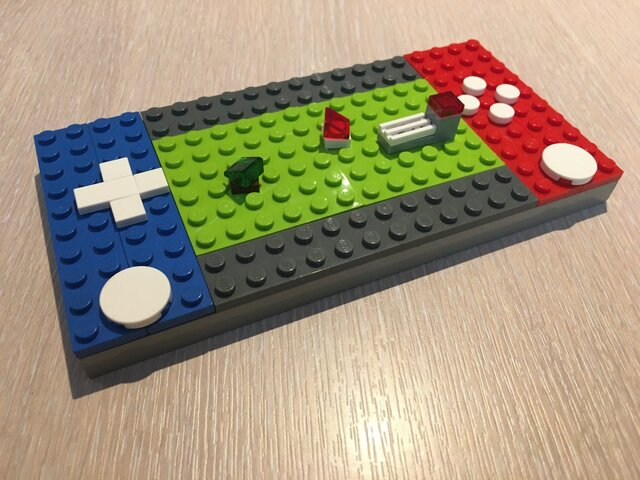](https://www.freelug.org/IMG/jpg/83907816_10222103061467091_4785879734355492864_o.jpg)

Parmi les adultes, c’est Julien qui a remporté le 1er prix :

[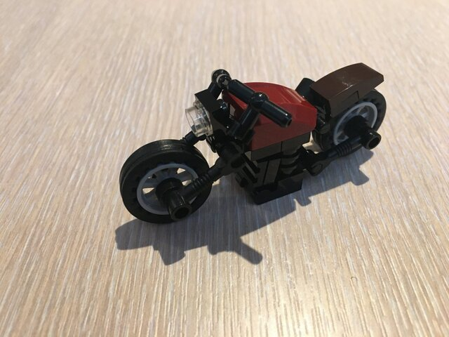](https://www.freelug.org/IMG/jpg/84262308_10222103055946953_6463215732191657984_o.jpg)

2ème : Marie

[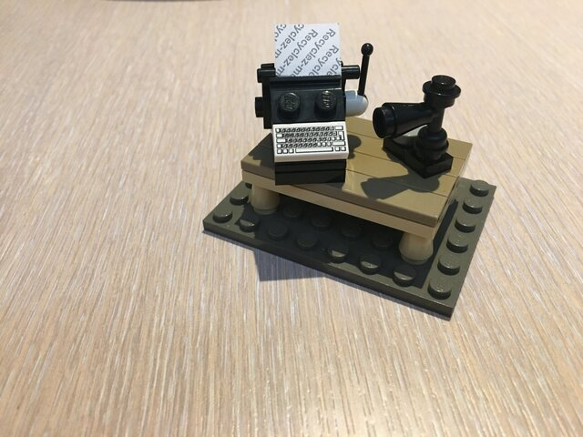](https://www.freelug.org/IMG/jpg/84060022_10222103057226985_6328980016868622336_o.jpg)

3ème : Lydie

[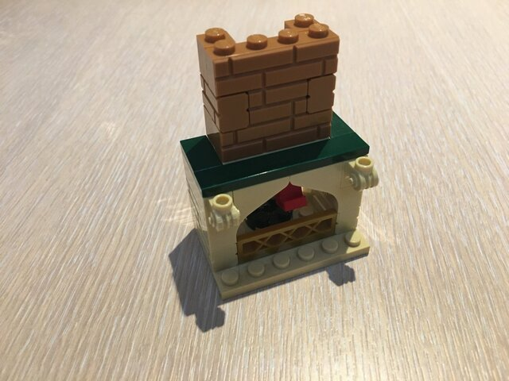](https://www.freelug.org/IMG/jpg/84719520_10222103052586869_1100356383418613760_o.jpg)

voici les autres participations :

[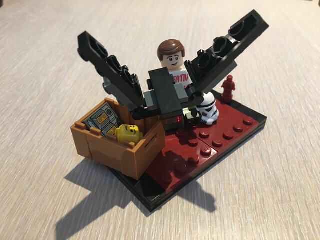](https://www.freelug.org/IMG/jpg/84357692_10222103051346838_9081590459129659392_o.jpg)

[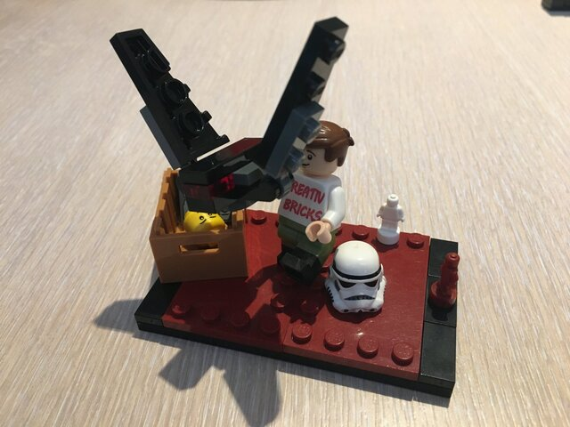](https://www.freelug.org/IMG/jpg/84726206_10222103052466866_1798938925851475968_o.jpg)

[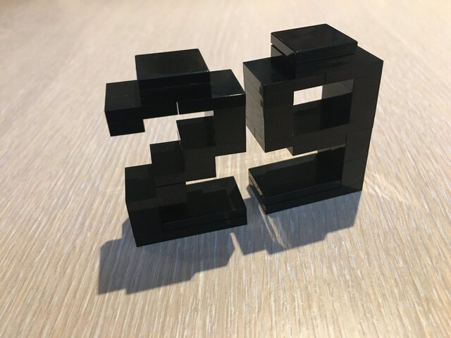](https://www.freelug.org/IMG/jpg/83771756_10222103053906902_5155468847066644480_o.jpg)

[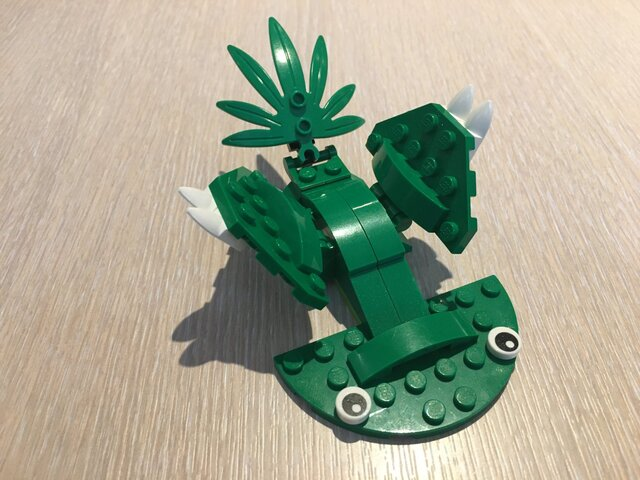](https://www.freelug.org/IMG/jpg/83904856_10222103050386814_5126437475190833152_o.jpg)

[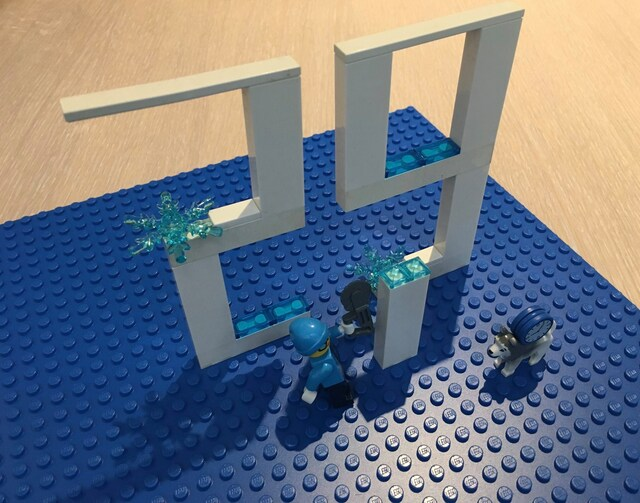](https://www.freelug.org/IMG/jpg/84333709_10222103062387114_8904238683813576704_o.jpg)

[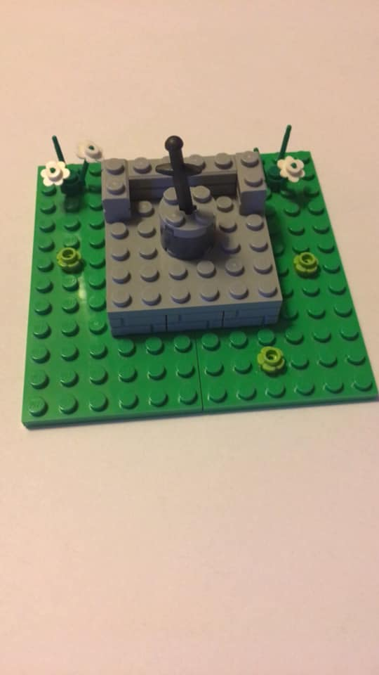](https://www.freelug.org/IMG/jpg/84359393_10157961463049420_3967880492455297024_n.jpg)

[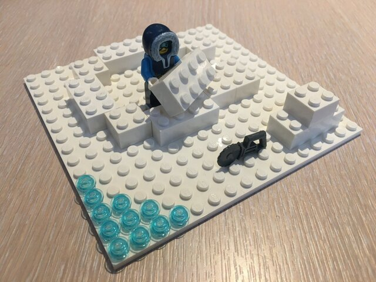](https://www.freelug.org/IMG/jpg/84405887_10222103060587069_940549132894863360_o.jpg)

[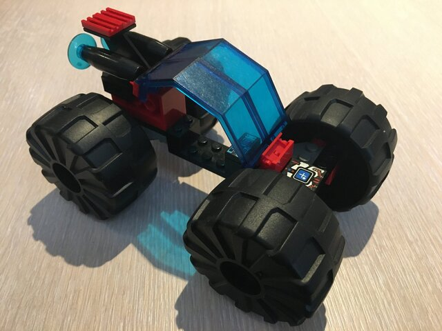](https://www.freelug.org/IMG/jpg/84635594_10222103056666971_7055949037542834176_o.jpg)

[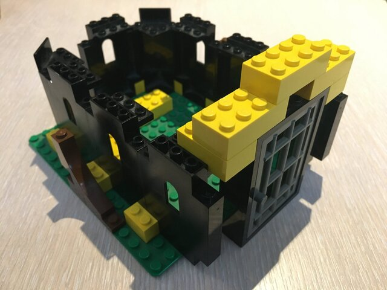](https://www.freelug.org/IMG/jpg/84930480_10222103053466891_8754793664661684224_o.jpg)

La dernière création, celle de Mathieu, était un clin d’œil en 29 pièces à la création très inspirée de Sylvain (microscale des cheminées de fée) lors d’un précédent concours :

[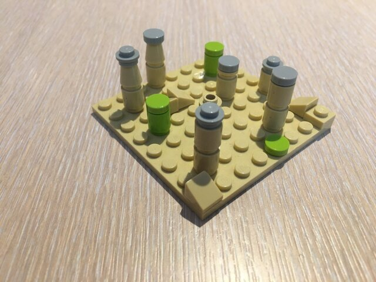](https://www.freelug.org/IMG/jpg/84190817_10222103058387014_8021604440421171200_o.jpg)

Nous tenions enfin à remercier tous les participants car c’est toujours un très grand plaisir de se retrouver.
