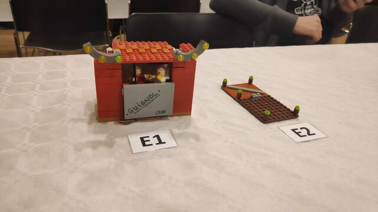
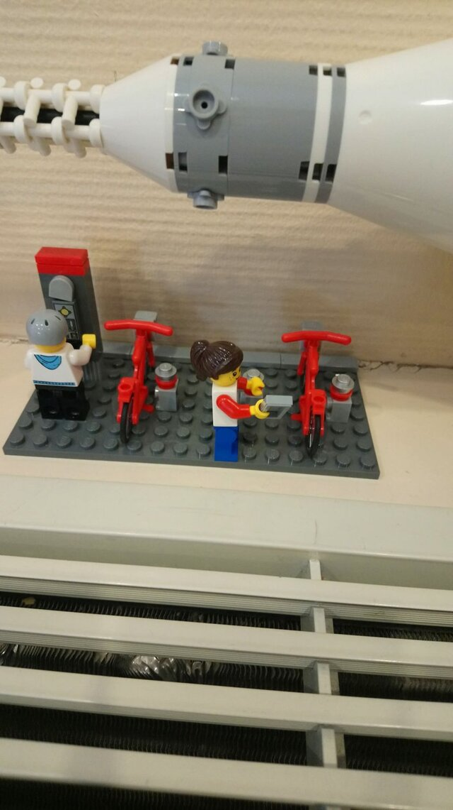
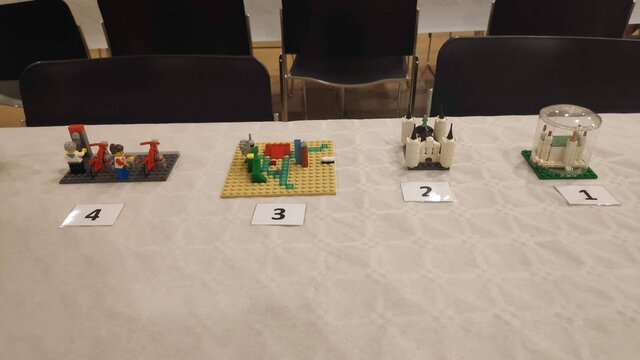
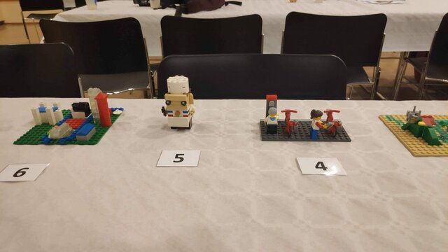
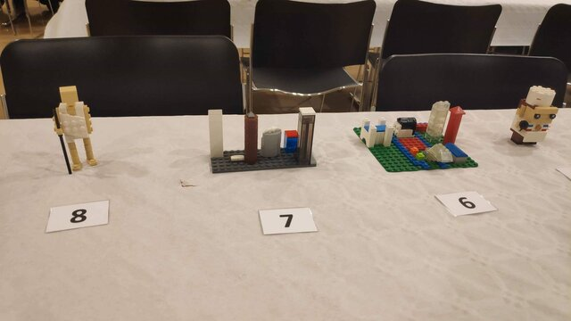

Ils étaient 10 candidat-e-s (8 adultes et 2 enfants) à tenter leur chance au concours de l’AG 2020. Qui a su convaincre le jury ?

A l’occasion de la tenue de l’AG 2020 qui avait lieu à Irigny (69), la FAA a proposé un concours sur le thème de "Lyon". Il s’agissait donc de représenter un symbole Lyonnais...en 50 pièces maximum.

Dix personnes ont relevé ce défi : 8 adultes et 2 enfants.

Voici donc les résultats :

**Catégorie enfant**

En première position, le jury a plébiscité la création de Gabin qui nous a présenté un théâtre de Guignol de toute beauté avec, petit +, des marionnettes animées.  
Il remporte donc le set **LEGO Marvel 76129 : Spiderman et l’attaque d’Hydro-Man**.

En deuxième position, nous avons la place Bellecour en version minimaliste de Jules que nous applaudissons également.  
Il remporte le set **LEGO Creator 31044 : Les animaux du parc**.

**Catégorie adulte**

Chez les adultes, nous retrouvons, en troisième position, la basilique de Fourvière en version boule à neige créée par Fabrice V. - _création 1 sur les photos_  
Il remporte donc le set **LEGO Architecture 21019 : La Tour Eiffel**.

Pour les deux premières places, nous avons eu le droit à une égalité parfaite.  
C’est donc Monsieur le Maire d’Irigny venu nous rendre visite qui nous a fait l’honneur de départager les deux participants.

En deuxième place, nous retrouvons donc la mini basilique de Fourvière (encore une !) réalisée par Julien G. - _création 2 sur les photos_  
Il remporte le set **LEGO Architecture 21031 : Burj Khalifa**.

Et le vainqueur dont la création a été le coup de cœur de Monsieur da Passano se trouve être Jérémie D. qui a su recréer à la perfection une station Vélo’v (pour les non-Lyonnais, il s’agit des vélos en libre-service disponibles dans la métropole de Lyon).  
Il gagne donc le set **LEGO Architecture 21029 : Le Palais de Buckingham**.

_Première place :_

Nous félicitons également Wilfried R. (MoC n°3 sur les photos), Bénédicte G. (MoC n°5), Nicolas G. (MoC n°6), Mathieu C. (MoC n°7) et Didier E. (MoC n°8).

Merci à tous les participants et participantes et aux cinq personnes qui ont été volontaires pour composer le jury.

A bientôt pour un nouveau concours !

* * *

_Composition du jury :_

GOULVESTRE Mavinig  
LEPETIT Lydie (coordinatrice FAA)  
MAGAUD Sébastien  
MOREL Jacques  
RABALLAND Julia  
VANNIER Jérôme

_Classement catégorie enfant :_

1.  Gabin
2.  Jules

_Classement catégorie adulte :_

1.  Jérémie D.
2.  Julien G.
3.  Fabrice V.
4.  Mathieu C.
5.  Wilfried R.
6.  Bénédicte G.
7.  Nicolas G.
8.  Didier E.
