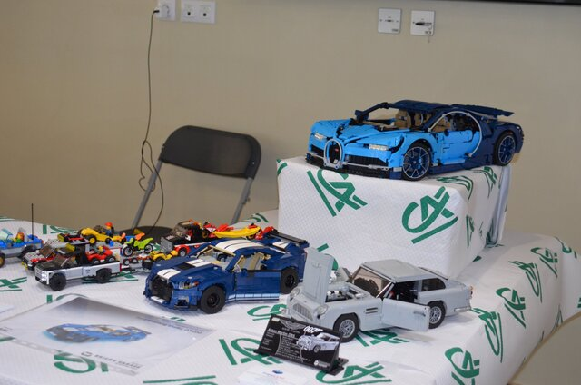
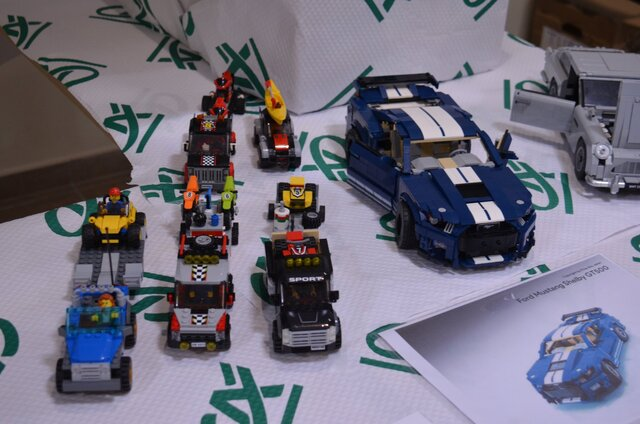
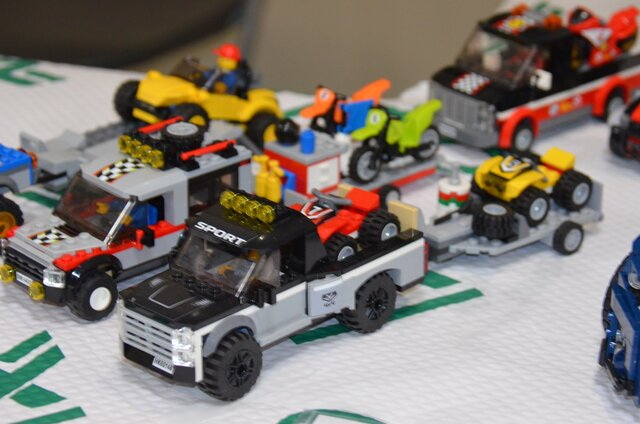

Le dimanche 1er mars à Brignais (69) avait lieu la 50ème édition de la bourse d’échanges de jouets anciens, miniatures et modèles réduits organisée par le MCRA (Miniatures Club Rhône-Alpes). En annexe de cette bourse, le MCRA agrémente cette journée depuis deux ans d’une exposition en accès gratuit.

A cette occasion, lors de l’AG FreeLUG, un adhérent, Jacques Morel, lui même vice-président de la MCRA , nous proposa de présenter des voitures LEGO dans leur salle, au milieu de trains, de Meccano, de modèles réduits, de véhicules radiocommandés...

Du fait du court délai, ce ne fut qu’une petite présentation de modèles. A la vue du succès de cette exposition pluridisciplinaire dans le domaine de la reproduction de véhicules, il est probable que FreeLUG soit l’année prochaine invitée de façon plus officielle à exposer des reproductions de véhicules.

Claudel Xavier / Jacques Morel
