Je vous propose un aperçu rapide du set 40261 lié à Halloween, sorti en 2017 (et oui, ça fait un bail), dénommé « la récolte d’Halloween ».

Ce petit set contient 133 pièces, dont deux figurines, et coûtait 9,99 € à l’époque.

L’avant affiche l’ensemble des éléments présents, à savoir un paysan et une petite fille, un arbre, un mini-champ à épouvantail, un panier à récolte, deux oiseaux, et une charrette.

[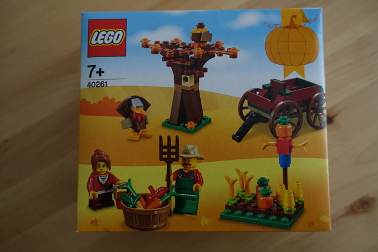](https://www.freelug.org/IMG/jpg/dsc02290.jpg)

Au dos une mini-histoire avec le petit oiseau qui souhaite manger du maïs, et pour cela fait peur au paysan en agitant l’épouvantail.

[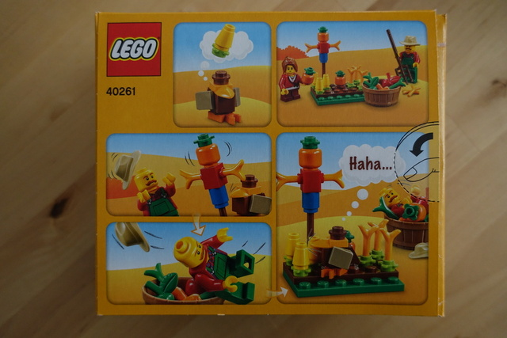](https://www.freelug.org/IMG/jpg/dsc02292.jpg)

* * *

Je ne vais pas présenter l’assemblage, qui est vraiment simplissime (boîte à partir de 7 ans), aussi voici simplement tous les éléments mis en scène.

[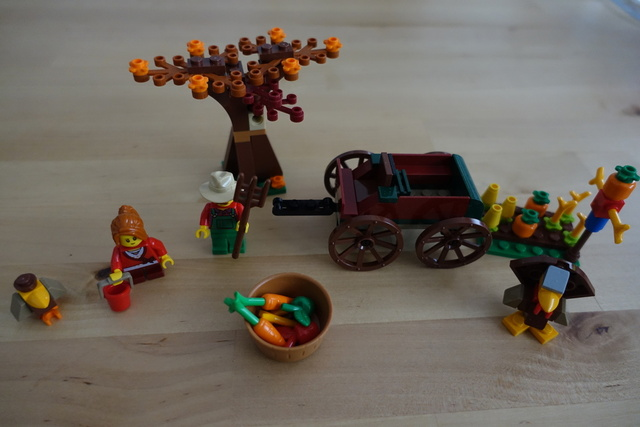](https://www.freelug.org/IMG/jpg/dsc02295.jpg)

[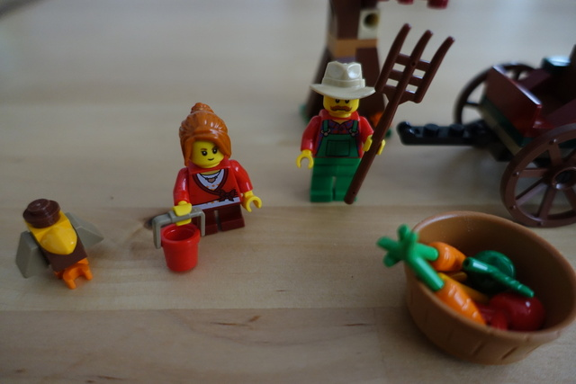](https://www.freelug.org/IMG/jpg/dsc02296.jpg)

[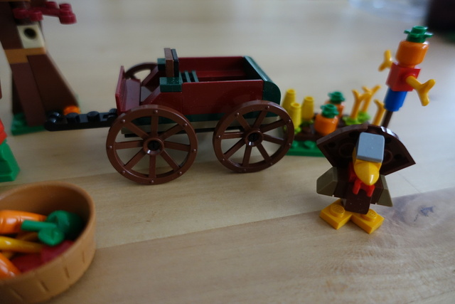](https://www.freelug.org/IMG/jpg/dsc02297.jpg)

Gros plan sur le gros oiseau (un corbeau peut-être ?), avec la queue déployée, les ailes, et les pattes bien jaunes. Je trouve son rendu bien sympathique, bon par contre l’échelle par rapport aux figurines, ça fait oiseau géant d’un film d’horreur !

[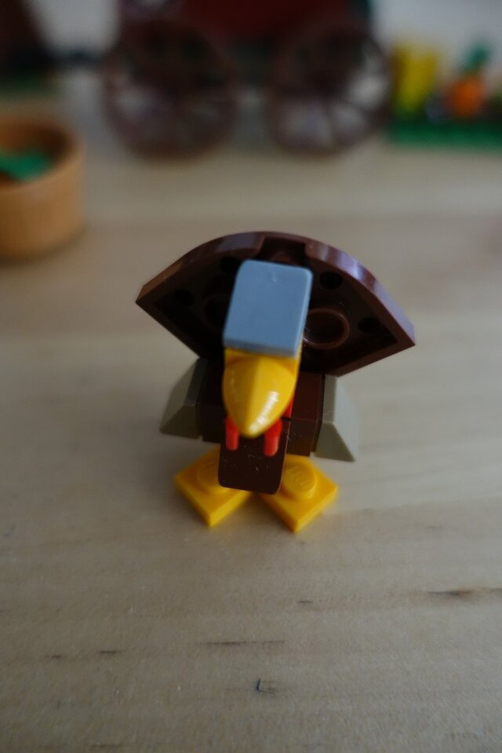](https://www.freelug.org/IMG/jpg/dsc02299-r90.jpg)

Le petit oiseau est également amusant, avec un minimum de pièces ou presque. Par contre il est déjà à une échelle plus raisonnable !

[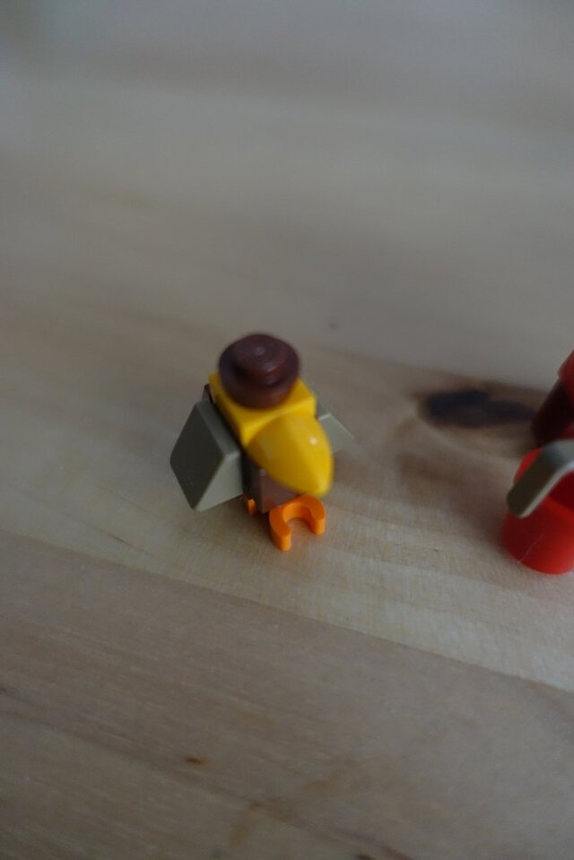](https://www.freelug.org/IMG/jpg/dsc02301-r90.jpg)

Le champ est minimaliste, mais expressif, avec (mon interprétation) maïs, blé et bien sûr citrouille. L’épouvantail est également minimaliste, mais parfaitement reconnaissable. Seul regret, j’aurais trouvé plus amusant que sa tête soit une citrouille avec un visage.

[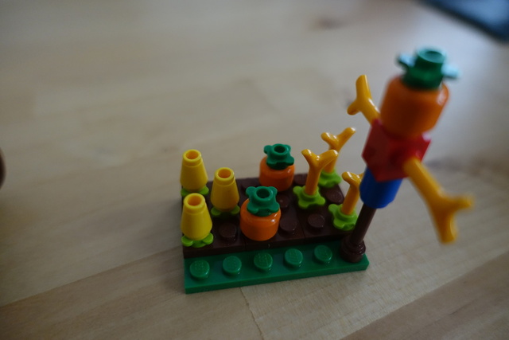](https://www.freelug.org/IMG/jpg/dsc02302.jpg)

La charrette est également simple, aux tonalités rouge et vert foncés, avec quatre roues que je crois avoir vu pour la dernière fois dans le set catapulte hommage aux châteaux-forts il y a quelques années. La bride permettrait de fixer un cheval pour tirer la charrette, si besoin.

[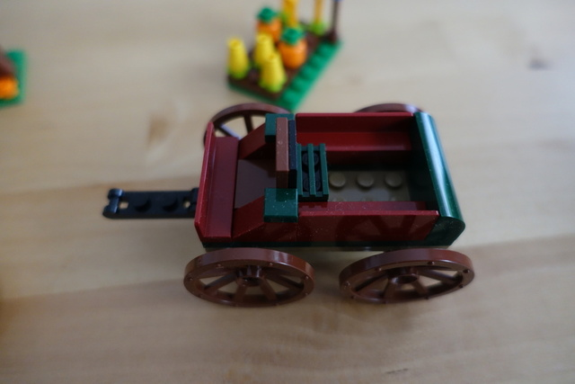](https://www.freelug.org/IMG/jpg/dsc02304.jpg)

Puisqu’il s’agit d’une récolte, il faut bien avoir récolté quelque chose ! Deux pommes (de couleur différente), deux carottes (il n’y en a plus dans le champ), et un brin de blé. De quoi faire quelque plat ou dessert.

[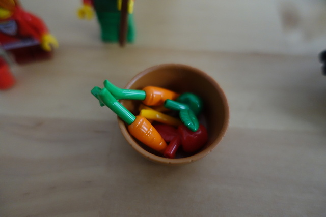](https://www.freelug.org/IMG/jpg/dsc02305.jpg)

L’arbre est constitué de pièces marron foncé ou clair, avec un feuillage plutôt pâle, et des fleurs orange. Quelques pentes représentent le pied, c’est un arbre assez basique.

[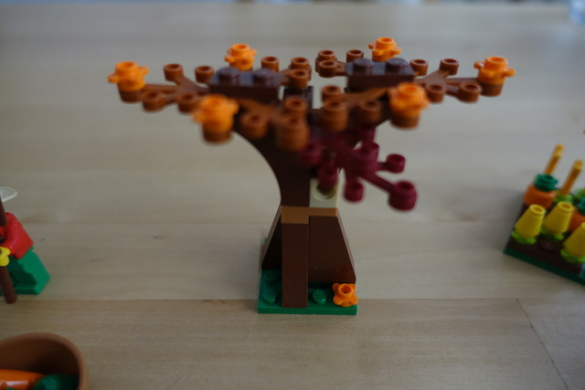](https://www.freelug.org/IMG/jpg/dsc02306.jpg)

[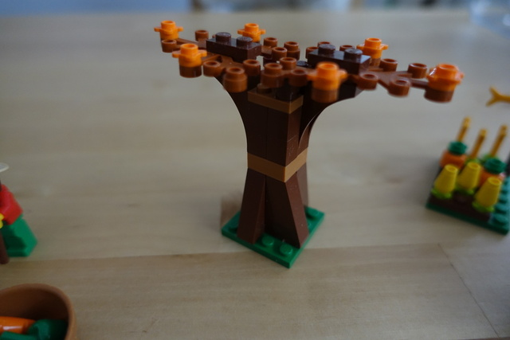](https://www.freelug.org/IMG/jpg/dsc02307.jpg)

Enfin voici les figurines présentes. La petite fille, qui tient un seau, porte une espèce de veste avec un nœud sur un t-shirt à fleurs, et a un pendentif. Au dos deux petites bandes continuent le ruban marron et le t-shirt.

Le paysan est presque caricatural, avec sa salopette sur un t-shirt à carreaux, la grosse moustache, le chapeau de soleil et la fourche.

[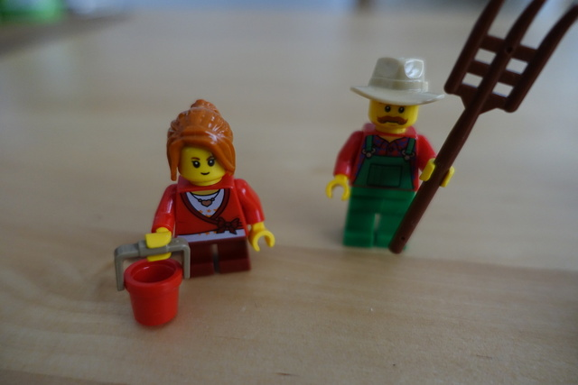](https://www.freelug.org/IMG/jpg/dsc02308.jpg)

[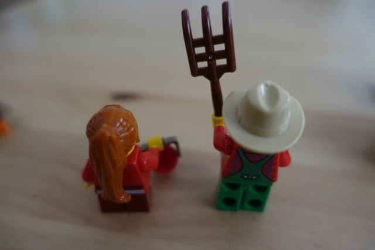](https://www.freelug.org/IMG/jpg/dsc02311.jpg)

Pour finir voici les pièces bonus de l’ensemble, une collection sympathique.

[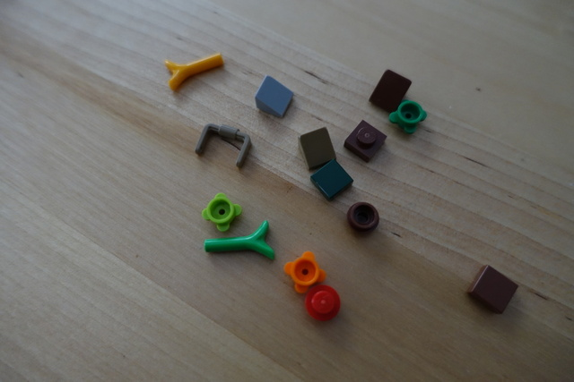](https://www.freelug.org/IMG/jpg/dsc02313.jpg)

* * *

**Avis :** sans être indispensable, ce petit set apporte quelques éléments que je reprendrai bien volontiers dans un diorama, comme les oiseaux ou le champ (quitte à l’agrandir) et l’épouvantail.

Je me suis bien amusé à le monter en tout cas !
