En juin 2006, avec Alban Nanty nous avions écrit un [article sur la façon de fabriquer un feu bicolore de signalisation de train](/articles/512/). Deux leds, une résistance et un peu de cutter et soudure et le tour était joué.

Les commentaires de cet article montraient la volonté de certains (dont moi) de faire des feux tricolores pour les carrefours des villes ou une gare avec une signalisation plus réaliste. Pendant longtemps j’ai cherché le moyen de faire ces feux mais le passage de 2 à 3 leds multiplie les contraintes et les différents résultats ne me satisfaisaient pas. Trop gros, commande trop compliquée, câblage difficile, rendu très moyen... A la faveur du confinement actuel et avec l’évolution de l’offre de l’électronique grand public (14 ans depuis le dernier article, ça change ! ) j’ai repris le projet et voici le résultat. Il est sûrement encore perfectible dans le design mais assez satisfaisant à mon gout pour faire cet article.

Prenons les problèmes dans l’ordre !

## Les Leds

Pour un feu tricolore, il y a... 3 couleurs :-) ; du rouge, du vert et du orange. On a donc le choix de prendre trois leds de couleur différente ou des leds RVB pouvant faire 16 millions de couleurs différentes.

[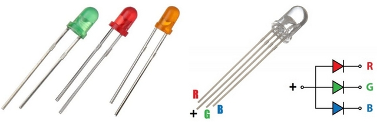](https://www.freelug.org/IMG/jpg/led_5mm_2types.jpg)

Du type de leds choisi va dépendre la commande à mettre en place. Ce choix est donc important car le design du feu peut être assez impacté.

Pour les leds classiques (photos de gauche) la commande se fera via 4 fils. Un pour chaque couleur et un pour la masse.

Pour les leds RVB il y a de nouveau un choix à faire. En effet le web regorge de vendeur de leds multicolores mais il en existe principalement deux types.

-   Les leds contenant en fait 3 leds : une rouge , une vert et une bleu. Sans rentrer trop dans les détails, on commande la valeur de l’intensité lumineuse de chaque composante de couleur (rouge, vert, bleu) afin de choisir sa couleur (photo de droite ci-dessus).  
    Chaque led possède donc 4 fils, 3 pour les couleurs et 1 pour le commun (anode ou cathode selon les modèles). Pour 3 leds, il faudra donc 3x3 = 9 fils pour les couleurs et 1 fils de commun. Soit 10 fils à faire passer dans le pied du feu !  
    On peut réduire ce nombre de fils à 4 fils de commande et 1 fils de commun car une led ne fera que du rouge (1 fil), une led ne fera que du vert (1 fil) et une led fera du orange (mélange de vert et rouge : 2 fils). Ce qui fait au minimum 5 fils de commande... toujours à passer dans le pied du feu. Cela devient possible mais dur dur !

-   Les leds dites "adressables" : La valeur de l’intensité lumineuse de chaque couleur, pour chaque led, est envoyée sur un fil. L’information circule de led en led sous forme "série". Le programme de commande est un peu plus compliqué mais le câblage est beaucoup plus simple car il n’utilise que 3 fils : 1 fil de 5V pour l’alimentation, 1 fil de masse et 1 fil d’adresse pour choisir la couleur !

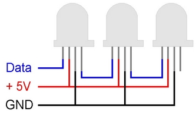

Schéma de câblage des leds adressables

Vous avez deviné c’est ce type de leds que j’ai utilisé !

## Câblage vs Design

Ces leds existent en version CMS, 5mm et 8mm. On oublie le 8mm car ces leds sont trop grosses. Avec les autres j’ai fait trois essais et j’ai vite abandonné la version CMS (celle de gauche) car vraiment délicate à réaliser. Les deux autres câblages sont identiques avec une version "free" (à droite) et une version circuit imprimé (au milieu). C’est cette dernière version légèrement modifiée qui servira pour la version finale du feu.

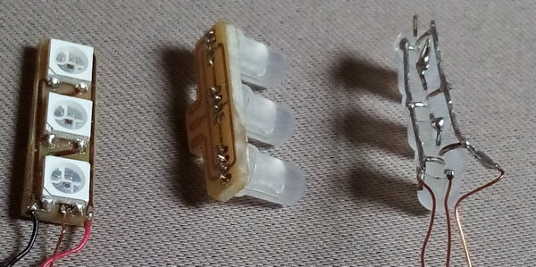

Câblages des leds

Pour le design, c’est très subjectif selon les personnes. Voici quelques premiers essais :

[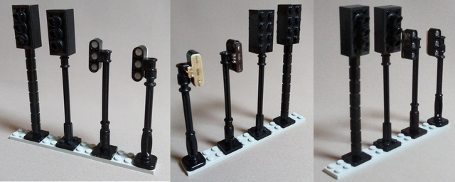](https://www.freelug.org/IMG/jpg/refuok.jpg)

Quelques différentes versions des feux

Ils ont tous été rejetés pour différentes raisons. En vrac :

-   trop moche ;
-   trop petit ;
-   trop profond au niveau de la tête ;
-   trop de déchet dans le perçage des axes Technic ;
-   trop de fils visibles ;
-   peinture noire sur le circuit imprimé trop voyante ;
-   fixation tête-support pas assez solide ;
-   et j’en oublie forcement...

[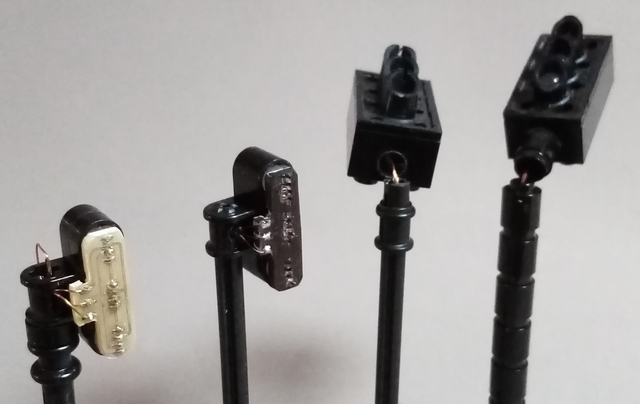](https://www.freelug.org/IMG/jpg/refu01.jpg)

## La version retenue

Après tous ces essais, et bien d’autres, j’ai retenu la version ci-dessous pour mes feux.

[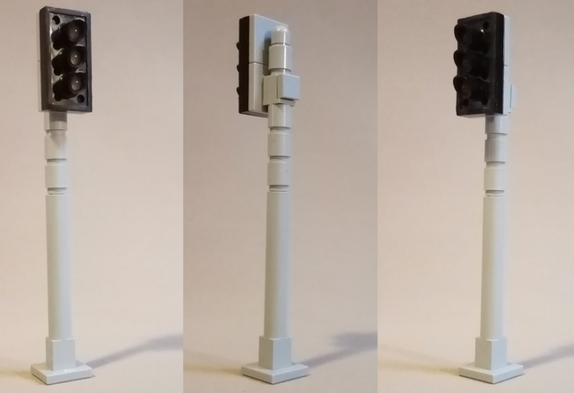](https://www.freelug.org/IMG/jpg/rendu01.jpg)

Coté fonctionnel : Leds 5mm ; Mini circuit imprimé pour l’alimentation et la mise en série des datas ; Taille de l’ensemble assez modeste (taille d’une plate 1\*3 et c’est important pour la suite).

Coté design : Profondeur de la tête du feu équivalente à 1 brique ; Hauteur du feu facilement réglable avec les briques rondes 1\*1 ; Toute la partie support est déjà percée.

Pour l’avant du feu j’ai utilisé exactement la même technique que pour le feu de signalisation pour train.  
J’ai pris une [brique 2\*4 sans renfort latéraux](https://www.bricklink.com/v2/catalog/catalogitem.page?P=3001old#T=C&C=5) afin d’avoir un rendu final meilleur. J’ai coupé le tour à l’aide d’un cutter en me guidant avec le même assemblage qu’en 2006 (je l’ai refait... je n’avais pas gardé l’ancien :-) ). Après le perçage des tubes à 5mm, je les ai biseautés "à l’instinct" et le tour était joué !

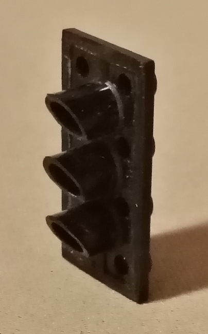

Les leds rentrent maintenant parfaitement dans les tubes qui servent de support.

Pour gagner l’épaisseur du circuit imprimé, j’ai coupé l’intérieur d’une [plate 2\*4 Technic](https://www.bricklink.com/v2/catalog/catalogitem.page?P=3709b#T=C) en me guidant avec une plate 1\*3 (la taille de mon circuit imprimé vous vous souvenez ?)

[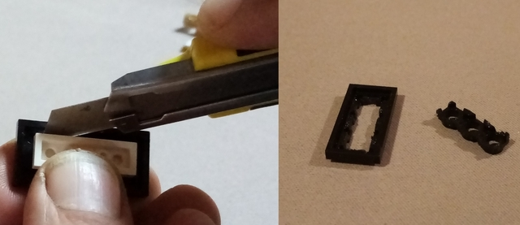](https://www.freelug.org/IMG/jpg/decoupe03.jpg)

Pour la fixation avec le support j’ai utilisé une [machine à laver](https://www.freelug.org/IMG/pdf/DicoFranglaisAFOL.pdf) et une [Plate, Modified 2 x 2 with Groove and 1 Stud in Center](https://www.bricklink.com/v2/catalog/catalogitem.page?P=87580#T=C) percée au centre du tenon pour faire passer le fils.

[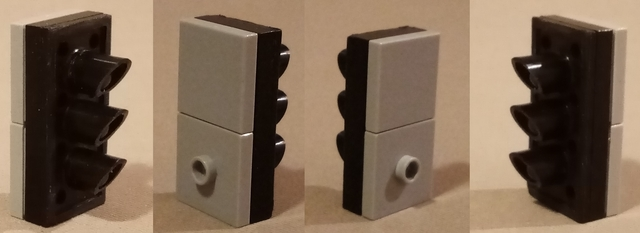](https://www.freelug.org/IMG/jpg/tete02.jpg)

Une fois l’assemblage terminé, il reste à allumer les leds de la bonne couleur et dans le bon ordre.

## La Commande

Pour réaliser l’adressage des leds correctement, j’ai utilisé un microcontrôleur Arduino Uno pour faire la mise au point du programme et j’ai ensuite miniaturisé le tout avec un Attiny 85 (il reste encore un peu du boulot mais le confinement actuel ne me permet pas l’accès à certaines machines :-( )

[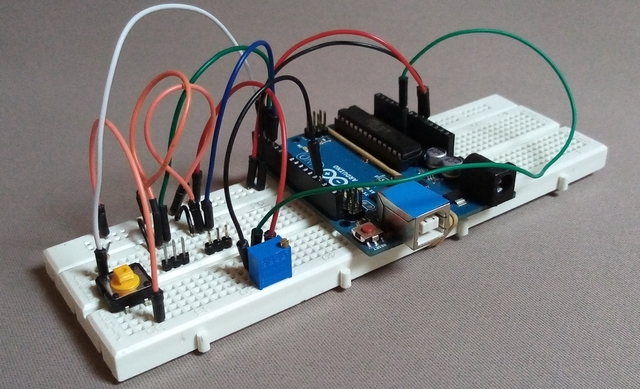](https://www.freelug.org/IMG/jpg/arduino01.jpg)

platine de prototypage arduino UNO

[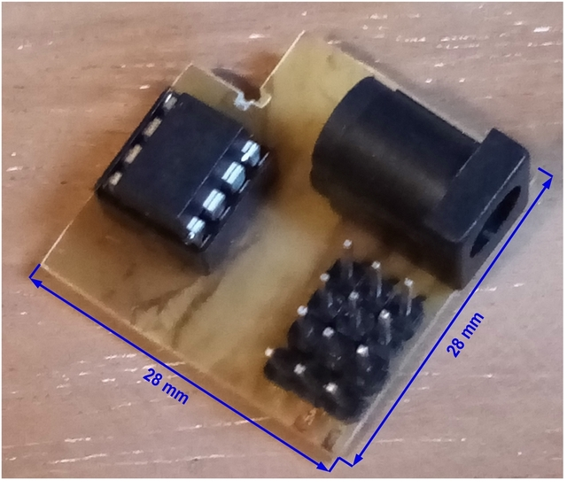](https://www.freelug.org/IMG/jpg/ci02.jpg)

En programmant j’étais accompagné par ma fille aînée qui s’entraînait au code sur l’ordinateur à coté du mien et elle ne se gêne pas pour me faire une réflexion quand je lui demande son avis, je cite :  
\- « Mais papa ! Les feux ! Au carrefour ! Ils peuvent avoir 2 modes de fonctionnements. Soit normal soit orange clignotant ! »  
\- « C’est pas faux »

Et me voila à modifier mon programme, ajouter un bouton pour passer d’un mode à l’autre et au passage mettre un réglage pour le temps de "feu rouge - feu vert" avec une résistance variable (j’ai le droit d’avoir des idées aussi !).

## Enfin ...

Lorsque tout est validé on passe à la phase de mise en place. J’ai mes 4 feux, il faut juste réaliser un carrefour (en [snot](https://www.freelug.org/IMG/pdf/DicoFranglaisAFOL.pdf) c’est plus joli)

[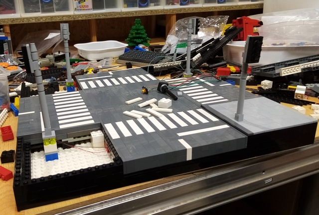](https://www.freelug.org/IMG/jpg/carefour01.jpg)

[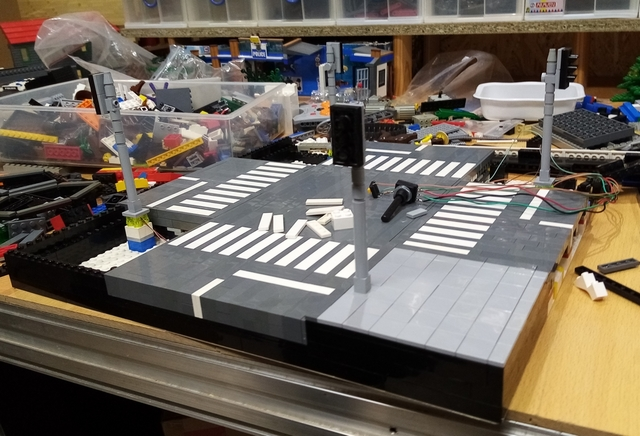](https://www.freelug.org/IMG/jpg/carefour02.jpg)

et le résultat final !

[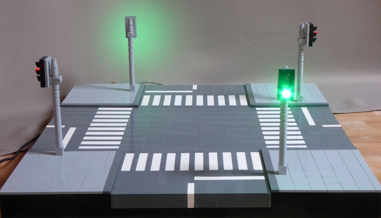](https://www.freelug.org/IMG/jpg/final01.jpg)

[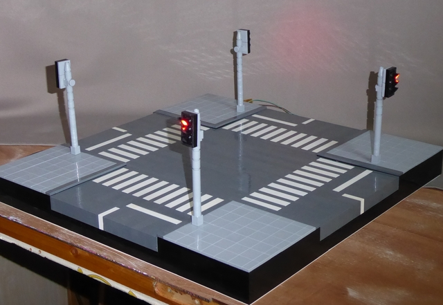](https://www.freelug.org/IMG/jpg/final02.jpg)

[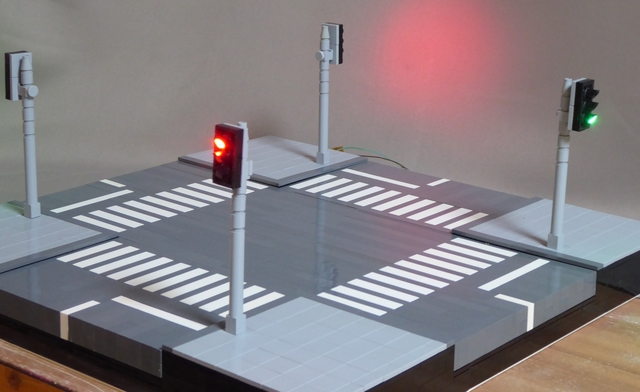](https://www.freelug.org/IMG/jpg/final03.jpg)

Pour finir rien de mieux qu’un petit film pour vraiment apprécier le résultat.

Video Player

[Vidéo de la publication d’origine](https://www.freelug.org/IMG/mp4/feux.mp4)

En espérant que cela vous aura intéressé.

Brikolego ! Du LEGO et du briko !
