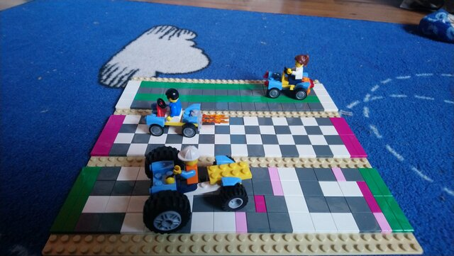
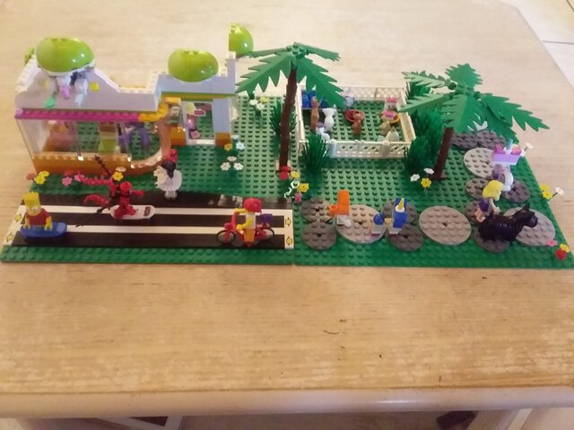
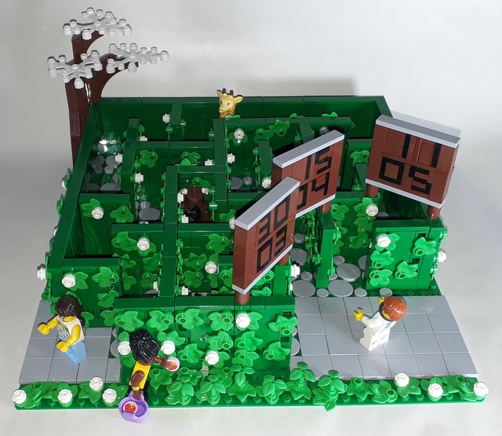
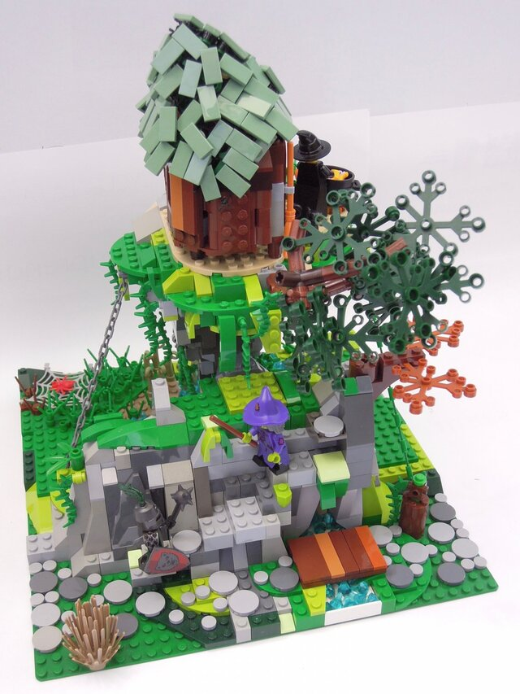
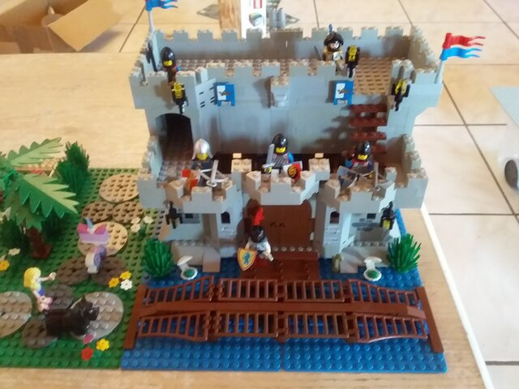

Ils étaient 14 adultes et 2 enfants à s’affronter ; qui a gagné ?

Il est temps de découvrir les résultats du concours sur la Frise du Confinement.

Tout d’abord, nous tenons à remercier les 16 participants et participantes qui nous ont proposé de très belles réalisations.

Côté enfants, deux participantes, Camille L. et Lenais C. Les membres du GFC ont décidé de récompenser les deux :

\- Camille remporte le set : Réf 60107 - Fire Ladder Truck

\- Lenais remporte le set : Réf 41145 - Ariel and the Magical Spell

Côté adultes, 14 participants se sont affrontés. Au vu du nombre de participants, les membres du GFC ont décidé de désigner 2 gagnants coup de cœur et bien sur de conserver le gagnant tirage au sort.

**Gagnants coup de cœur :**

\- Erik A. qui remporte le set : Réf 41094 - Heartlake Lighthouse

\- Julien F. qui remporte le set : Réf 41075 - The Elves Treetop Hideaway

**Gagnant tirage au sort :**

\- Xavier C. qui remporte le set : Réf 41093 - Heartlake Hair Salon

Nous les félicitons tous les cinq, mais également les onze autres participants, à savoir, Stéphane B, Rémi L, Wilfried R, Julia R, Lydie L, Dérek D, Sylvain J, Stéphane R, Christophe L, Jean-Yves B et Nicolas G.

Vous pouvez retrouver toutes les photos des créations dans l’article [Projet collaboratif/concours : la frise du confinement FreeLUG](/articles/3036/)
