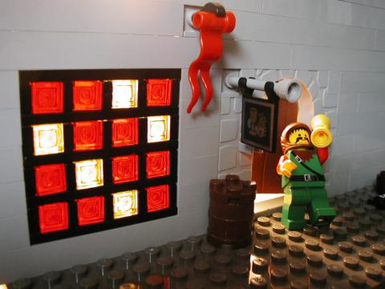
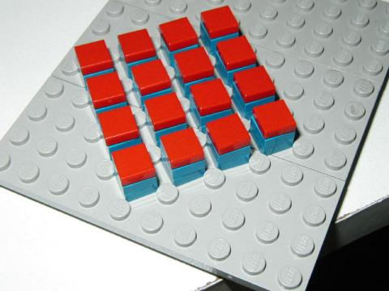
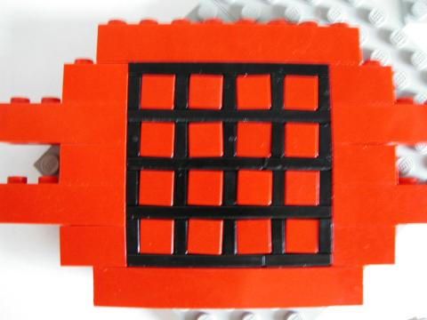

Les techniques de construction telles que le SNOT, l’AZMEP, le TOPLESS ou encore le SNIR permettent de réaliser de nombreuses choses, et souvent de donner davantage de réalisme aux constructions. A partir d’un constat sur le SNIR, voici un exemple d’application pour réaliser une fenêtre à petits carreaux.

Quel fan de Moyen Age n’a jamais rêvé d’avoir une belle fenêtre avec des petits carreaux colorés pour une taverne ?

Et bien, c’est possible :

**Fenêtre en SNIR**

Voici une belle fenêtre pour une taverne en SNIR et SNOT

Et voici l’astuce qui permet de réaliser une telle fenêtre.

En plaçant 2 pièces 1x1 en diagonale et tournées d’un angle de 45° (les 2 pièces sont alors parallèles), l’ecart qui apparaît entre les 2 pièces est exactement l’épaisseur d’un tile (plate sans tenon). Le fait de tourner des briques est la technique SNIR [^1]

**Vue des pièces 1x1**

On peut voir ici l’emplacement des pièces 1x1 tournées de 45°

Ainsi, un tile couché sur le côté peut se glisser entre ces 2 pièces. En se rappelant du rapport 5:2 (5 plates - 2 tenons), pour pouvoir encadrer notre fenêtre d’un mur, il faut 5 tiles et donc 4 carreaux sur la largeur. En hauteur, il faut un multiple de 2 carreaux (2 tenons en vertical).

**Vue finale**

Aspect final une fois les tiles mis en place et le tout encadré de briques

Pour obtenir une fenêtre, il suffit d’utiliser des plates et tiles transparents et mettre toute la structure à la verticale (attention à ne pas la renverser...).

Et voila, vous diposez d’une nouvelle technique de construction. Et je vous fais confiance pour trouver d’autres applications (un mur de briques avec un tile vertical sur 2 de la même couleur que le reste par exemple...).

Enfin, une autre petite astuce qui n’a rien à voir : regardez comment est fixé le drapeau rouge. Il tient grâce à une clé [4006](http://www.peeron.com/inv/parts/4006). Ceci permet d’obtenir un drapeau qui pend parallèlement au mur, et non perpendiculairement comme ça a toujours été.

Pour les Anglophones, je vous reporte à un [article blague](http://www.brickshelf.com/cgi-bin/gallery.cgi?f=98445) à caractère scientifique, écrit par Didier "SixStuds" Enjary sur cette technique que je lui avais présenté.

[^1]: Reinhard "Ben" Beneke, [Studs Not In Row](http://www.brickshelf.com/cgi-bin/gallery.cgi?f=69760)
