Partons à la découverte de cette boite avec de mignons bébés dinosaures !

[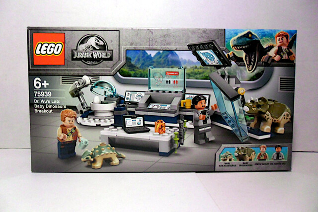](https://www.freelug.org/IMG/jpg/sam_3049.jpg)

Le set comprend 164 pièces avec deux personnages, deux bébés dinosaures et un mini laboratoire. Pour un prix de 19,99€ soit un rapport prix/pièces de 0,12Euros, c’est correct pour un set sous licence.

Une petite vue arrière donne une idée de la jouabilité du set :

[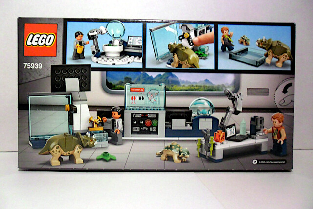](https://www.freelug.org/IMG/jpg/sam_3050.jpg)

Venons au principal : le contenu de la boite :

[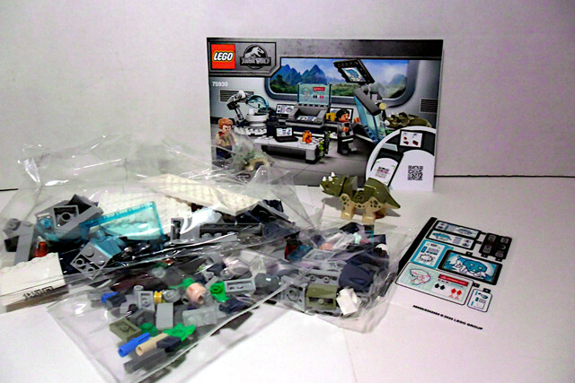](https://www.freelug.org/IMG/jpg/sam_3051.jpg)

soit 3 sachets de pièces, une petite planche de stickers et deux dinosaures

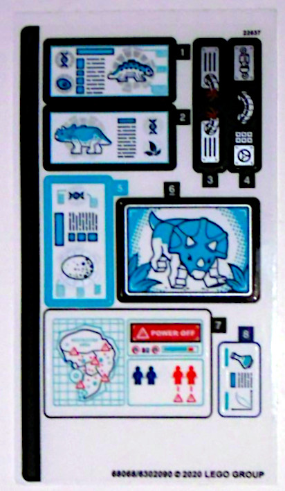

Le premier bébé dino : le tricératops

[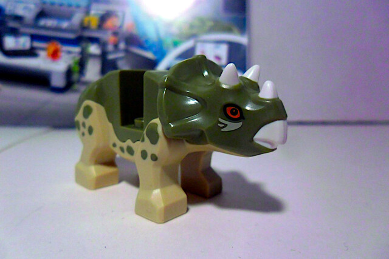](https://www.freelug.org/IMG/jpg/sam_3054.jpg)

le deuxième : l’ankylosaure

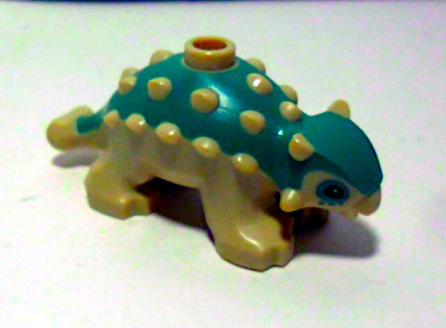

Nous avons aussi deux personnages Owen Et le docteur Wu

[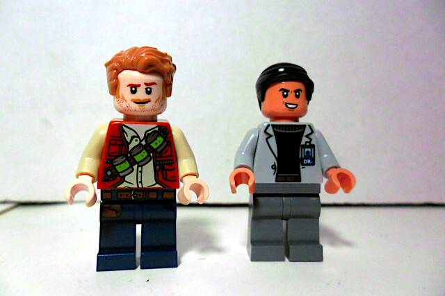](https://www.freelug.org/IMG/jpg/sam_3058.jpg)

[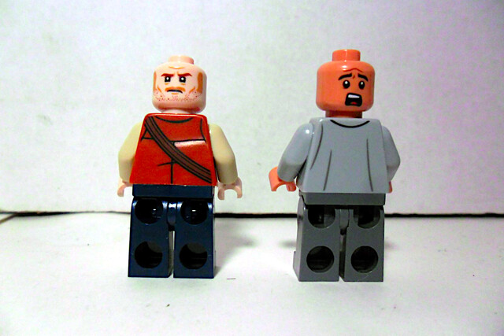](https://www.freelug.org/IMG/jpg/sam_3059.jpg)

Et une pièce très sympa : un morceau d’ambre avec le moustique

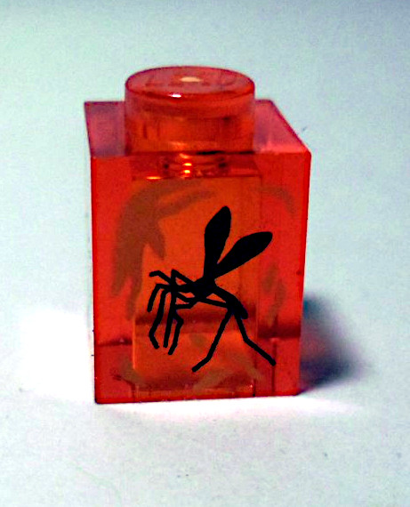

Pour la petite histoire, ce n’est pas le premier morceau d’ambre de l’histoire de la gamme, avant c’était un [cristal de la gamme Monster Fighter avec un aussi un moustique](https://www.bricklink.com/v2/catalog/catalogitem.page?P=10178pb08#T=C&C=98)… Là c’est largement mieux !

Passons au montage du petit laboratoire :

[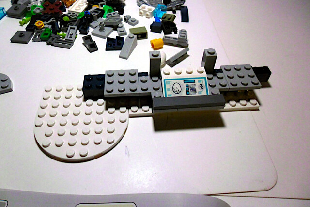](https://www.freelug.org/IMG/jpg/sam_3064.jpg)

On rajoute des écrans :

[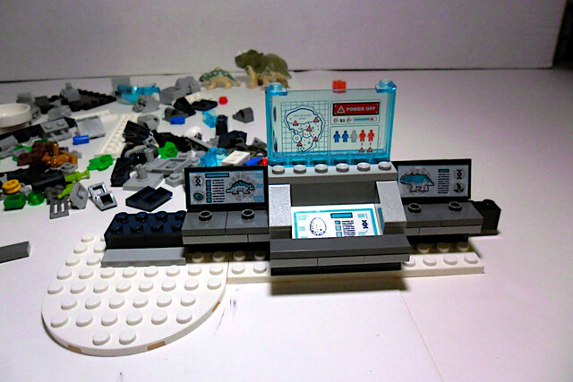](https://www.freelug.org/IMG/jpg/sam_3065.jpg)

Un système robotisé avec une couveuse : (et des œufs de dinosaures !)

[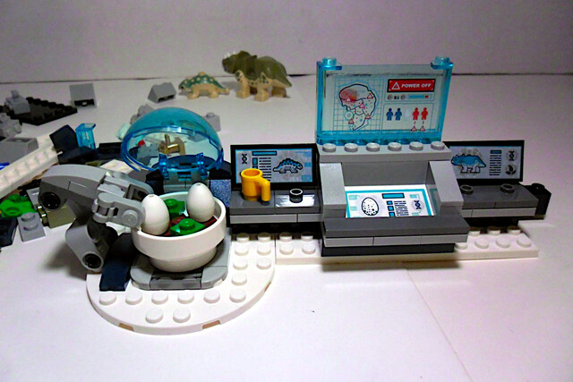](https://www.freelug.org/IMG/jpg/sam_3067.jpg)

Un petit bout d’enclos avec un abreuvoir :

[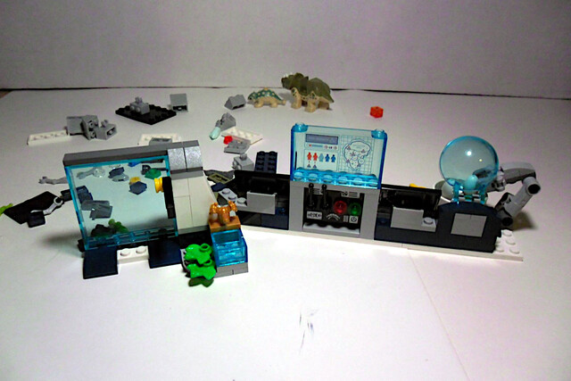](https://www.freelug.org/IMG/jpg/sam_3068.jpg)

Et on fini avec une table de recherche (avec le morceau d’ambre et un microscope !)

[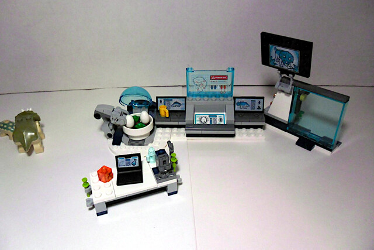](https://www.freelug.org/IMG/jpg/sam_3069.jpg)

Voilà fini, une petite photo de famille !

[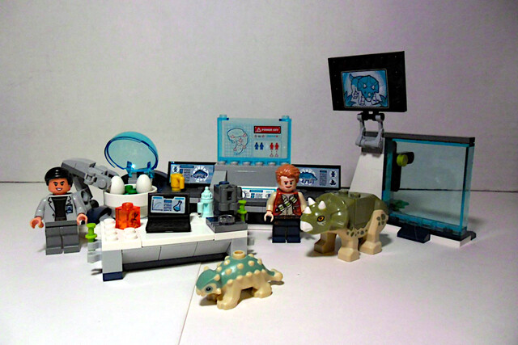](https://www.freelug.org/IMG/jpg/sam_3071.jpg)

Et pour terminer les extra parts :

[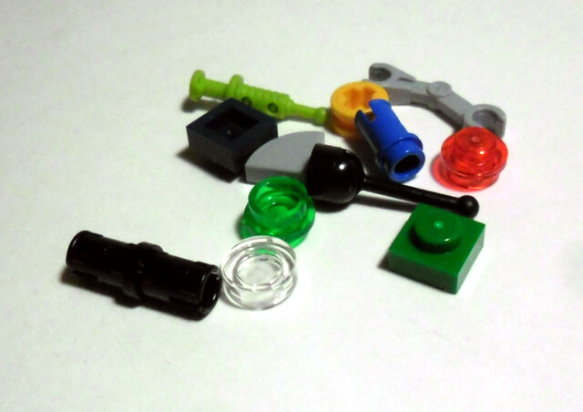](https://www.freelug.org/IMG/jpg/sam_3072.jpg)

**Conclusion**

Alors achat ou pas ? Pour moi oui achat, avec deux bébés dinosaures inédits ! (Je dirais même enfin) Le Tricératops, ses parents sont sortis quelques années avant et l’ankylosaure dans la même vague (Review dès que je le trouve…)  
Le petit labo est réussi avec une couveuse très réussie.

Donc un petit set pas si cher que ça !
