Partons à la découverte de cette boite avec deux gros dinosaures !

[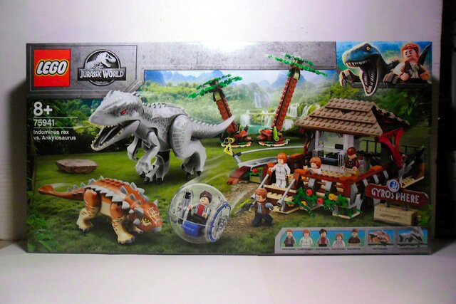](https://www.freelug.org/IMG/jpg/sam_3185.jpg)

Le set comprend 537 pièces avec cinq personnages, deux gros dinosaures et la station de départ de la gyrosphère. Pour un prix de 109,99 € soit un rapport prix/pièces de 0,205 euros, c’est à priori cher, mais est-ce que le fait d’avoir deux gros dinosaures rattrape le tout ? Nous allons voir.  
Une petite vue arrière donne une idée de la jouabilité du set :

[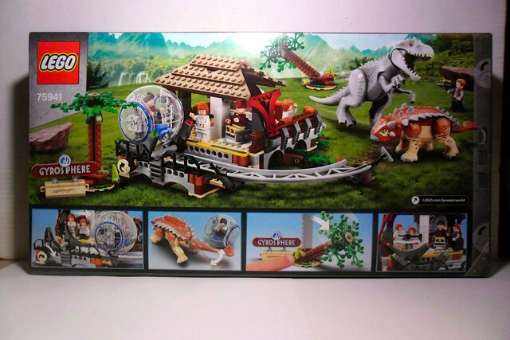](https://www.freelug.org/IMG/jpg/sam_3188.jpg)

Une petite planche de sticker :

[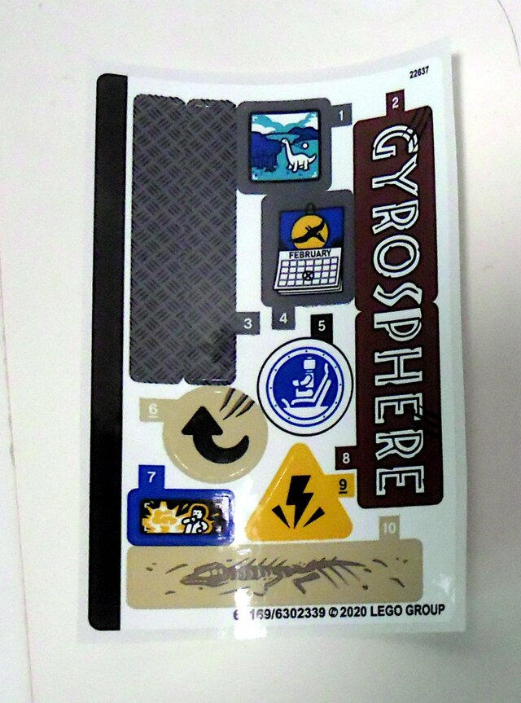](https://www.freelug.org/IMG/jpg/sam_3195.jpg)

Venons au principal : les dinosaures :  
Commençons avec le nouvel Indominus Rex :

[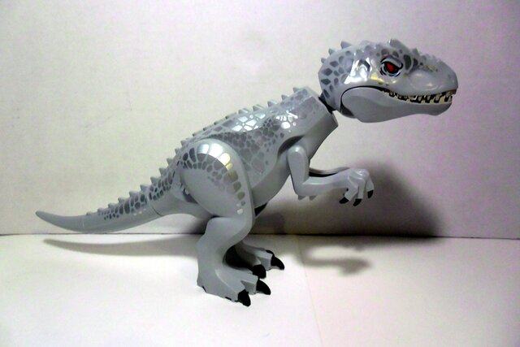](https://www.freelug.org/IMG/jpg/sam_3191.jpg)

Il est légèrement différent du modèle précédent, couleur et de nouveaux avant-bras…

[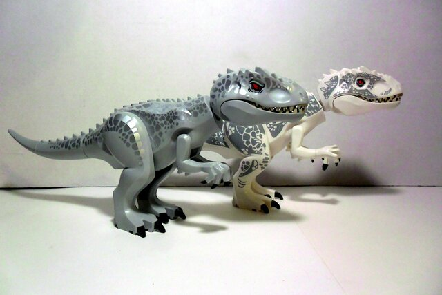](https://www.freelug.org/IMG/jpg/sam_3194.jpg)

Passons à la vrai nouveauté de cette année : l’ankylosaure :

[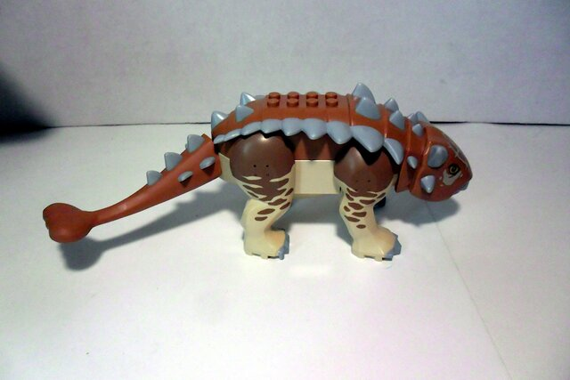](https://www.freelug.org/IMG/jpg/sam_3202.jpg)

[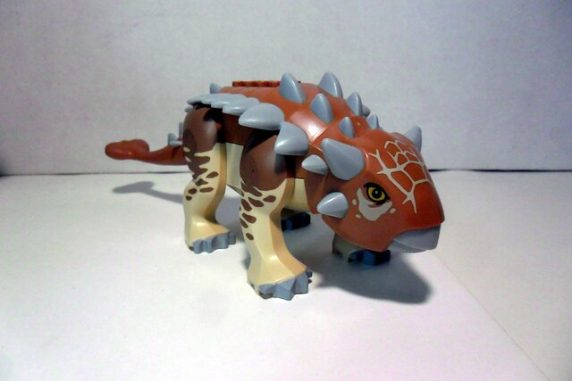](https://www.freelug.org/IMG/jpg/sam_3203.jpg)

Il complète très bien le set [75939](/articles/3050/) qui a le bébé ankylosaure.

Par contre, il y a un gros soucis :

[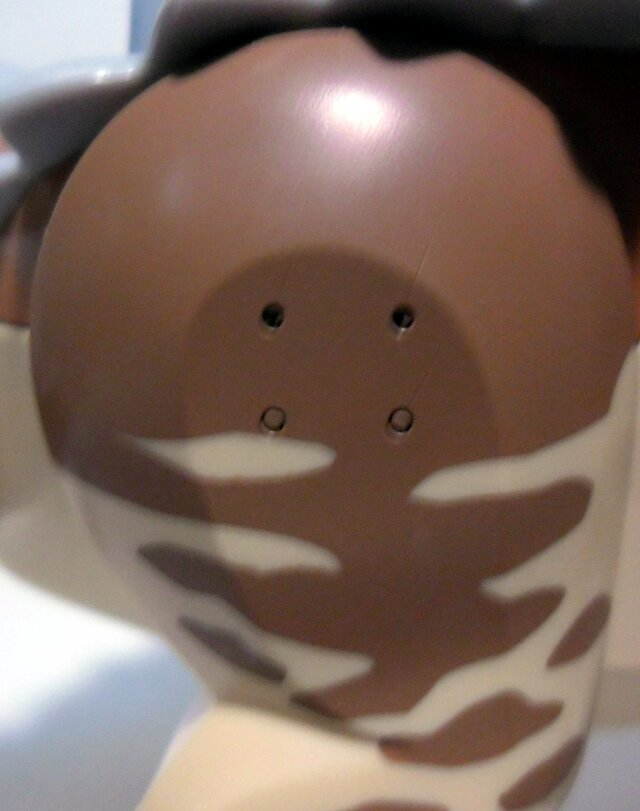](https://www.freelug.org/IMG/jpg/sam_3204.jpg)

C’est quoi cette horreur ? Le pin moulé dans la masse noire n’est pas complètement rempli avec la bi-injection… Vérification faite sur le triceratops qui date de quelques années, même moule, mais là c’est bien moins visible. Je pense que le moule prend de l’age. Mais c’est vraiment très très moche…

Passons aux personnages (avec une erreur entre Zach et Grey…)  
Nous avons pour commencer Claire et Grey :

[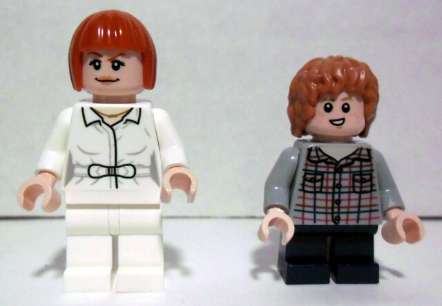](https://www.freelug.org/IMG/jpg/sam_3206.jpg)

[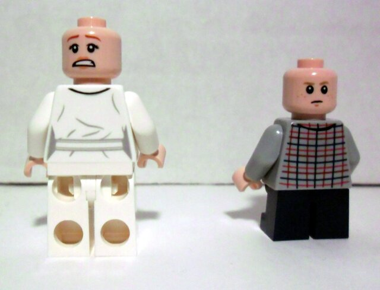](https://www.freelug.org/IMG/jpg/sam_3207.jpg)

Puis le seul, l’unique (enfin dans beaucoup de boîtes ^⁾) : OWEN !

[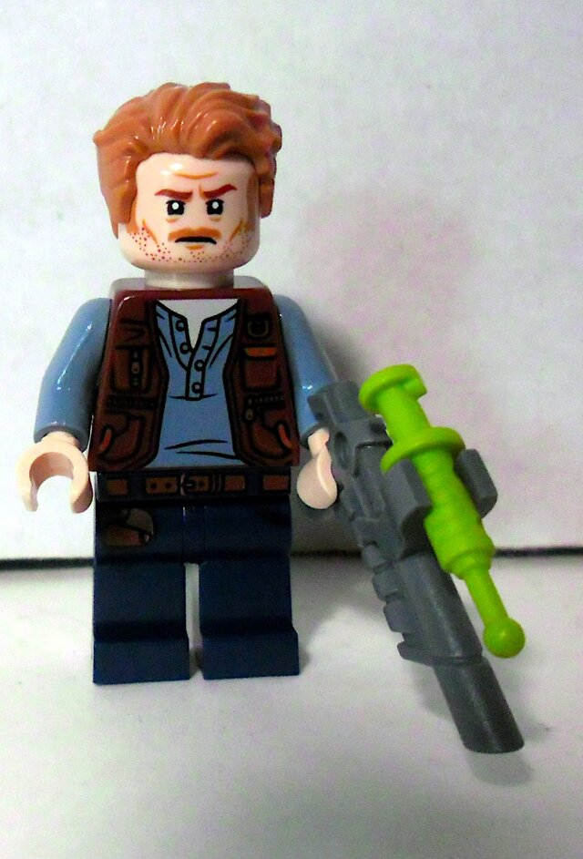](https://www.freelug.org/IMG/jpg/sam_3216.jpg)

[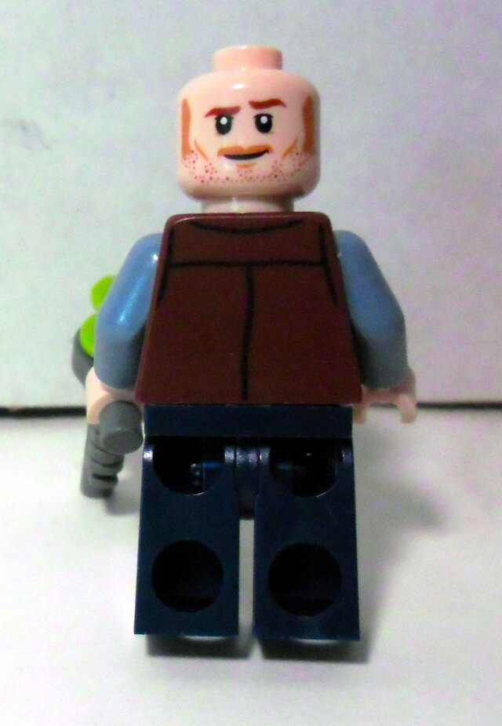](https://www.freelug.org/IMG/jpg/sam_3217.jpg)

Le grand frère de Grey (qui est en GRIS) : Zach

[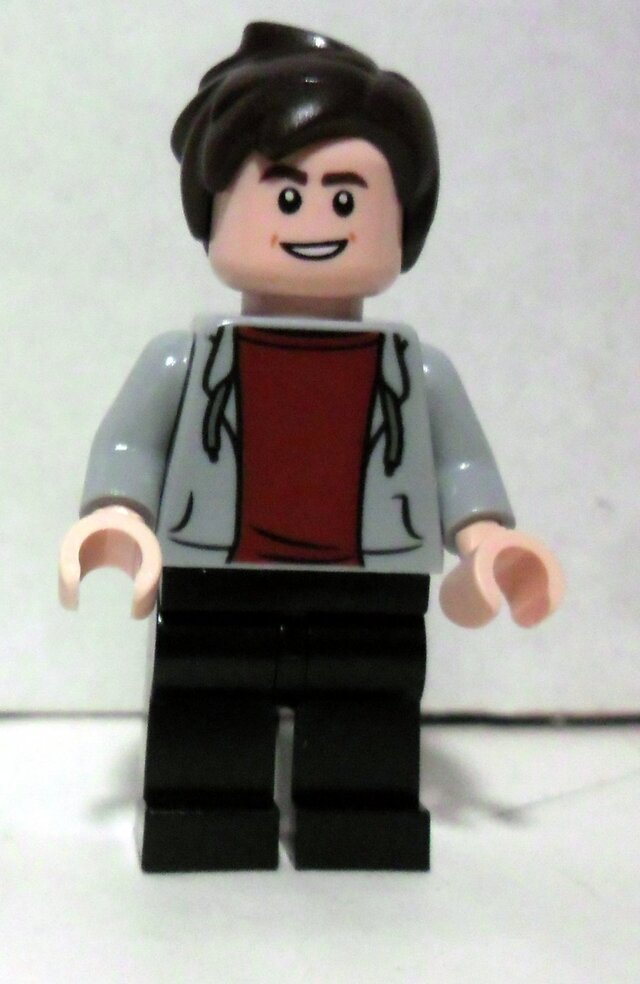](https://www.freelug.org/IMG/jpg/sam_3227.jpg)

[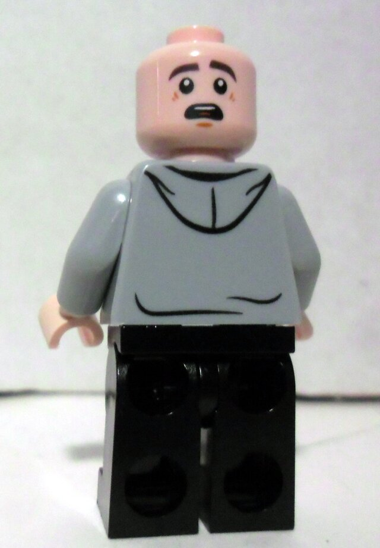](https://www.freelug.org/IMG/jpg/sam_3228.jpg)

Et terminons avec un gardien du « zoo » :

[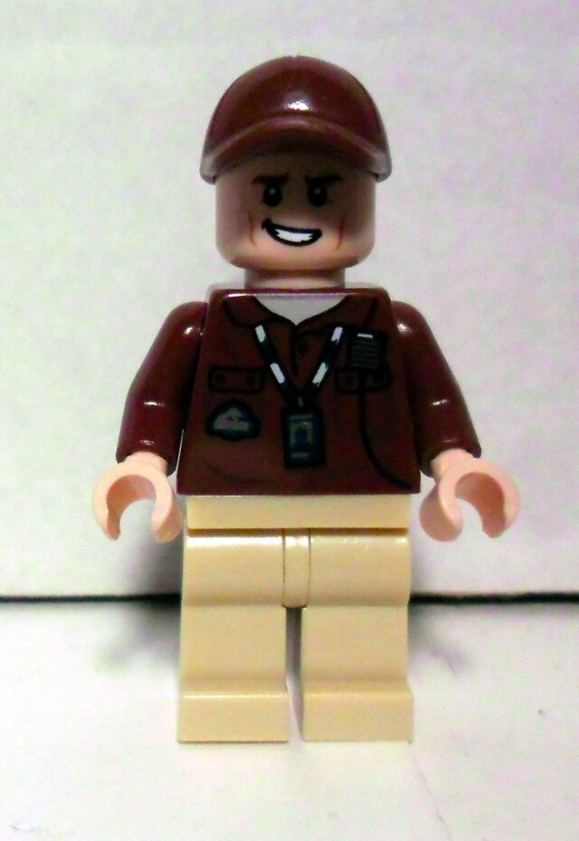](https://www.freelug.org/IMG/jpg/sam_3222.jpg)

[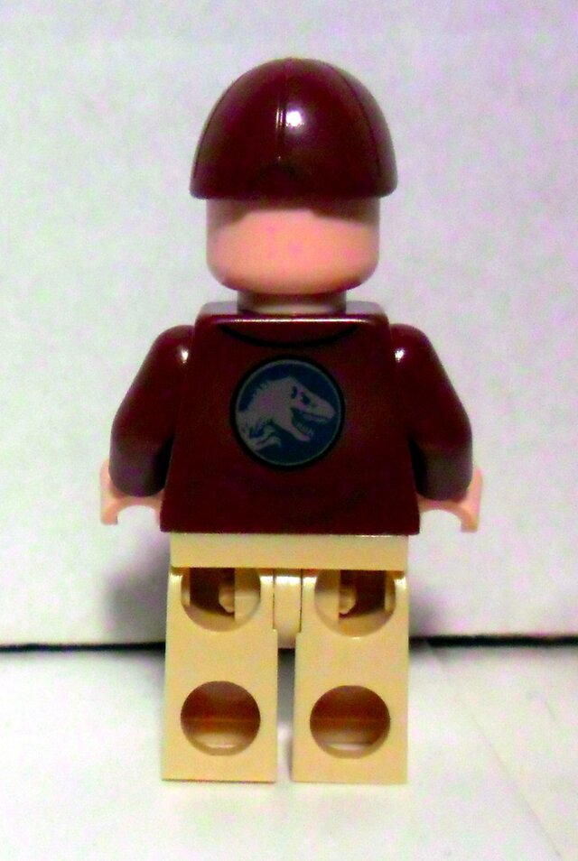](https://www.freelug.org/IMG/jpg/sam_3223.jpg)

C’est pas tout, mais il y a bien une construction avec ça :  
le panneau indicateur de l’attraction avec deux arbres que les dinosaures peuvent faire tomber :

[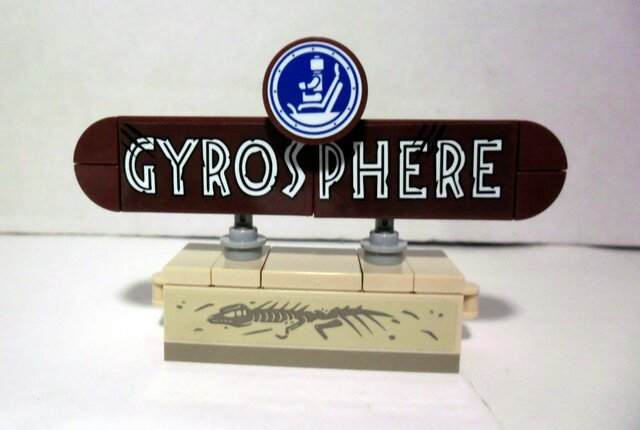](https://www.freelug.org/IMG/jpg/sam_3208.jpg)

[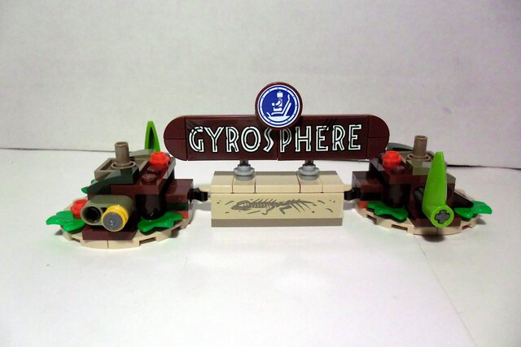](https://www.freelug.org/IMG/jpg/sam_3210.jpg)

[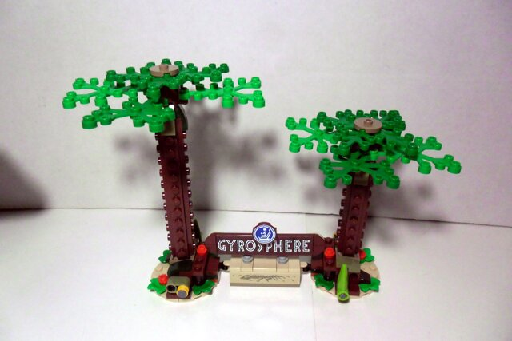](https://www.freelug.org/IMG/jpg/sam_3213.jpg)

On remarquera un très beau sticker d’illustration d’un fossile.

Et maintenant voici la fameuse station :

[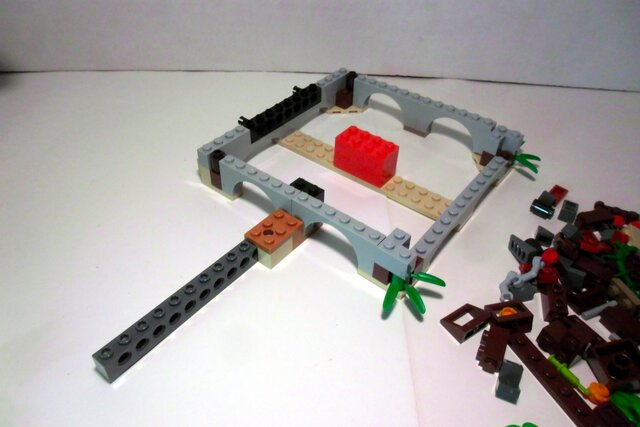](https://www.freelug.org/IMG/jpg/sam_3219.jpg)

[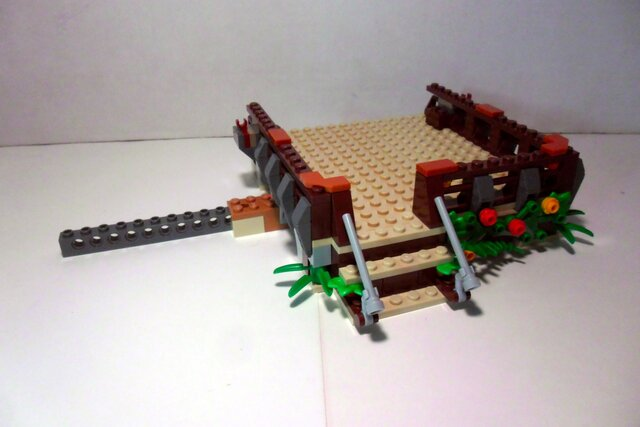](https://www.freelug.org/IMG/jpg/sam_3220.jpg)

[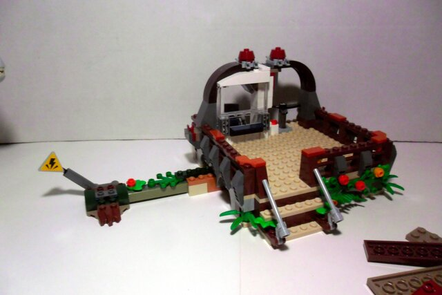](https://www.freelug.org/IMG/jpg/sam_3224.jpg)

[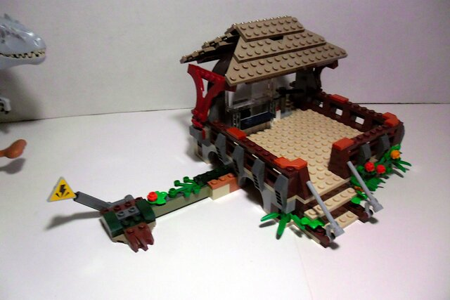](https://www.freelug.org/IMG/jpg/sam_3225.jpg)

[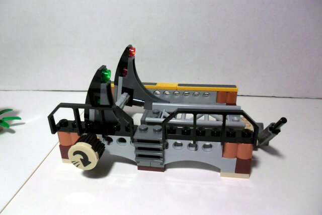](https://www.freelug.org/IMG/jpg/sam_3229.jpg)

[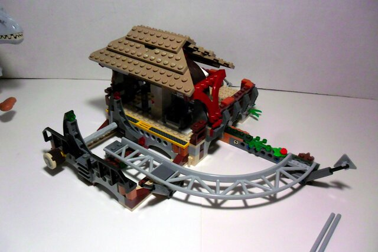](https://www.freelug.org/IMG/jpg/sam_3231.jpg)

[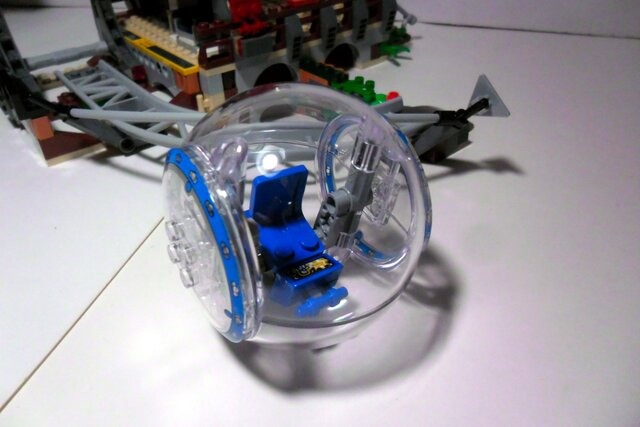](https://www.freelug.org/IMG/jpg/sam_3232.jpg)

Voilà fini, une petite photo de famille !

[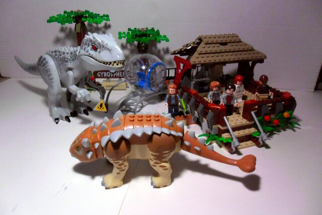](https://www.freelug.org/IMG/jpg/sam_3235.jpg)

Et pour terminer les extra parts :

[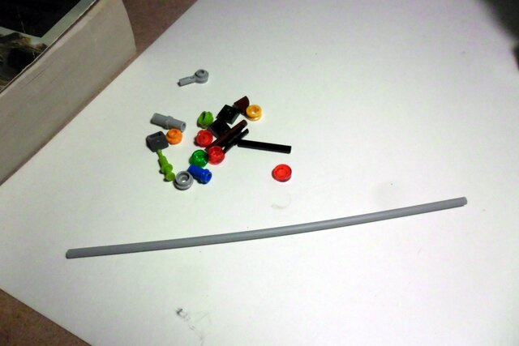](https://www.freelug.org/IMG/jpg/sam_3236.jpg)

**Conclusion**

Alors achat ou pas ? Pour moi oui mais…  
Les deux gros dinosaures, dont un vrai inédit, c’est bien. Même si ce souci de moulage est regrettable. Une petite station très réussie, avec la possibilité de lancer la gyrosphère, c’est très sympa. Mais on se retrouve avec encore les mêmes personnages du premier Jurassic World (le set de la station 75929 de JW2 était plus intéressant)  
Et cette grossière erreur de nom sur la boite… On va dire que le service qualité s’est fait manger par l’Indominus…
