11 participants toutes catégories confondus, 12 trains, qui va convaincre le jury ?

Il est temps de découvrir les participations du concours sur les trains.

Tout d’abord, nous tenons à remercier les 11 participants qui nous ont proposé de très belles réalisations.

Les participations sont présentées dans l’ordre de réception.

Au vu du nombre de participations, le GFC a décidé de récompenser les 2 premiers dans la catégorie train réel. Vu qu’il y a eu ex æquo pour la deuxième place, nous offrons un lot de consolation au troisième. Chaque votant devait donner 2 votes par ordre de préférence, le premier vote valait 2 points et le second 1 point. Pour départager les 2 ex æquo, nous avons privilégier le candidat qui avait le plus de voix en premier vote.

## Concours Train Réel :

**1\. Jérome T. - Locomotive puissante en PFS qui pousse un wagon chasse neige à fraise**

[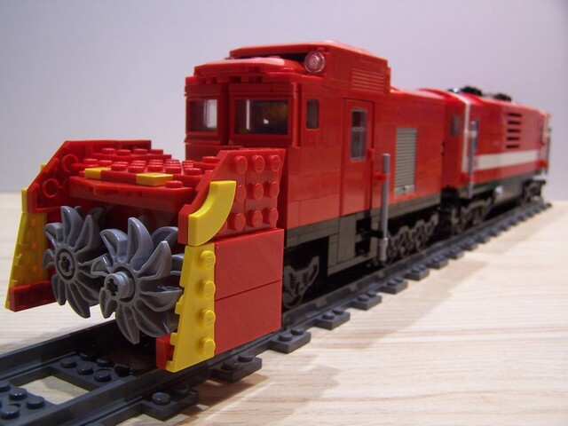](https://www.freelug.org/IMG/jpg/jt01-2.jpg)

[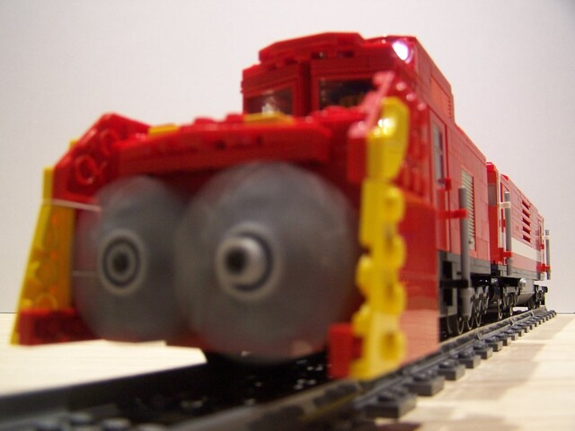](https://www.freelug.org/IMG/jpg/jt02-2.jpg)

[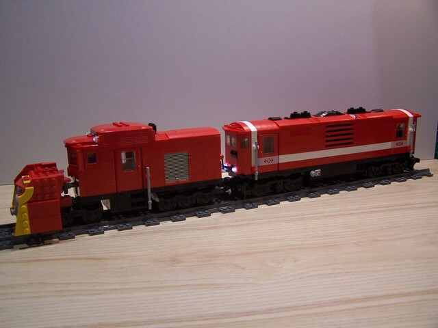](https://www.freelug.org/IMG/jpg/jt03-2.jpg)

[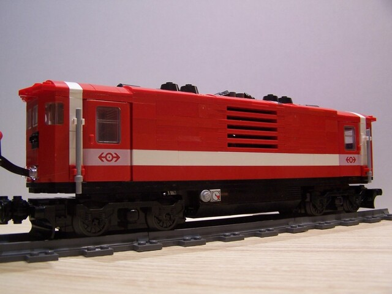](https://www.freelug.org/IMG/jpg/jt04-2.jpg)

[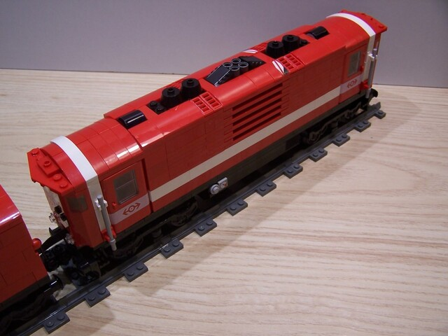](https://www.freelug.org/IMG/jpg/jt05-2.jpg)

Video Player

[Vidéo de la publication d’origine](https://www.freelug.org/IMG/mp4/jt-video.mp4)

**2\. Stéphane B. - Train pompier**

[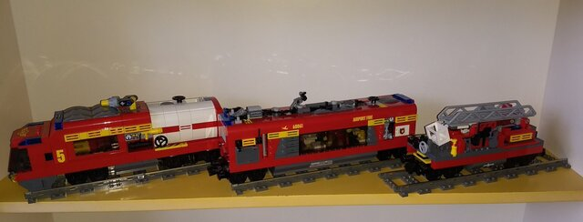](https://www.freelug.org/IMG/jpg/sb01.jpg)

[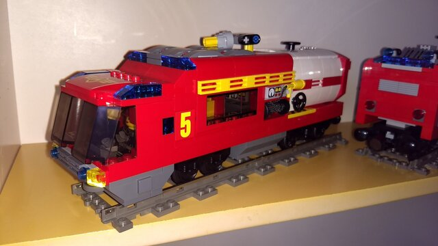](https://www.freelug.org/IMG/jpg/sb02.jpg)

[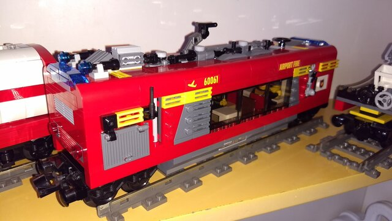](https://www.freelug.org/IMG/jpg/sb03.jpg)

[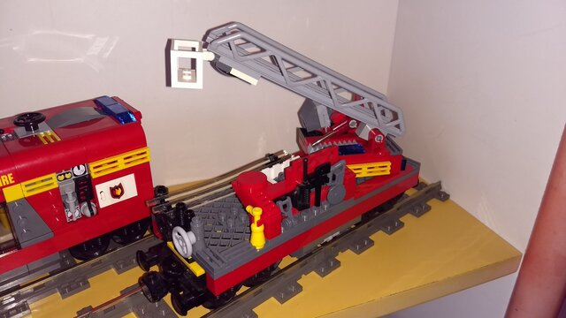](https://www.freelug.org/IMG/jpg/sb04.jpg)

[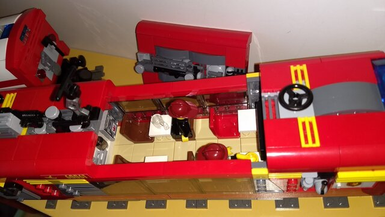](https://www.freelug.org/IMG/jpg/sb05.jpg)

Video Player

[Vidéo de la publication d’origine](https://www.freelug.org/IMG/mp4/sb-video.mp4)

**3\. Yoann G. - Train Noir & Jaune**

[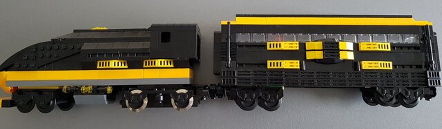](https://www.freelug.org/IMG/jpg/yg01.jpg)

[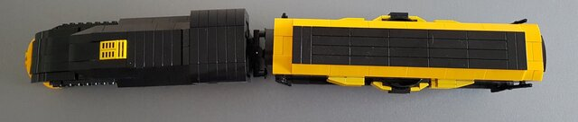](https://www.freelug.org/IMG/jpg/yg02.jpg)

[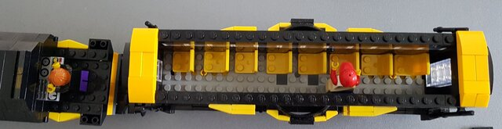](https://www.freelug.org/IMG/jpg/yg03.jpg)

[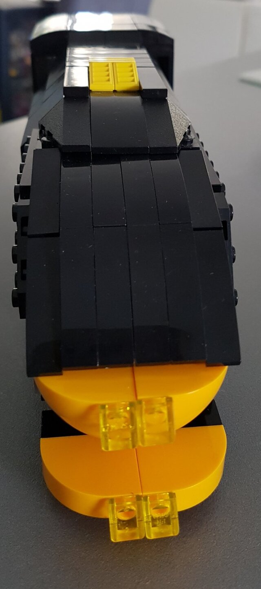](https://www.freelug.org/IMG/jpg/yg04.jpg)

[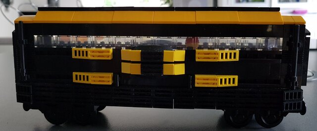](https://www.freelug.org/IMG/jpg/yg05.jpg)

Video Player

[Vidéo de la publication d’origine](https://www.freelug.org/IMG/mp4/yg-video.mp4)

**4\. Frank S. - Du Brisquet,** un hommage à la 031-130T conçue par Gaston du Bousquet. Livrée maison vaguement, mais alors très vaguement, inspirée par une livrée EST.

[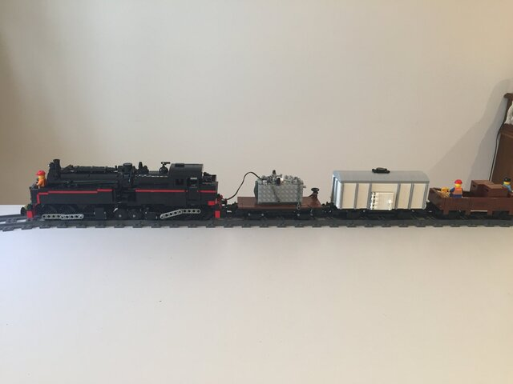](https://www.freelug.org/IMG/jpg/fs01.jpg)

[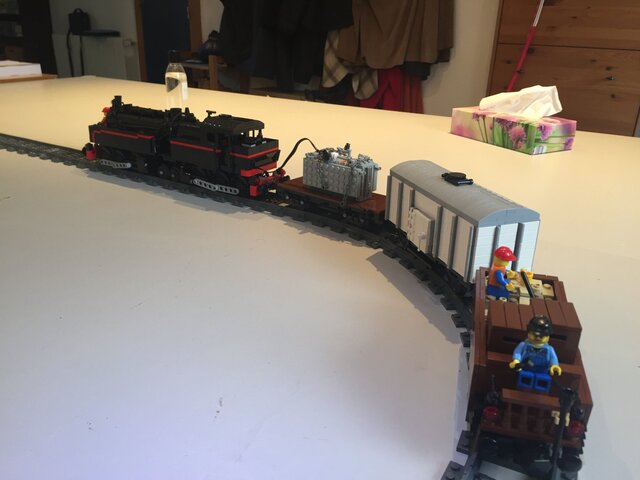](https://www.freelug.org/IMG/jpg/fs02.jpg)

[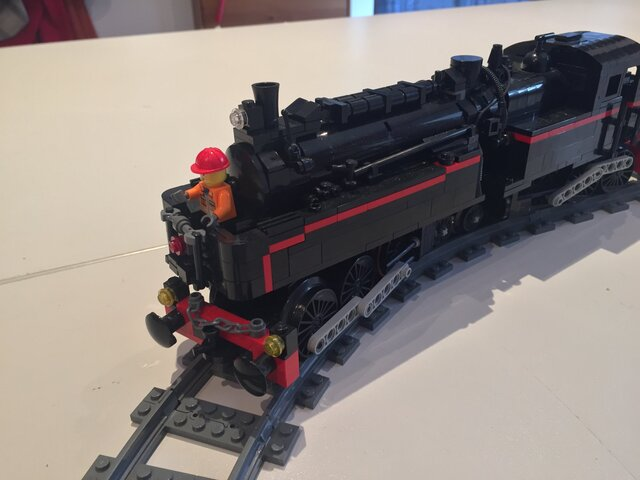](https://www.freelug.org/IMG/jpg/fs03.jpg)

[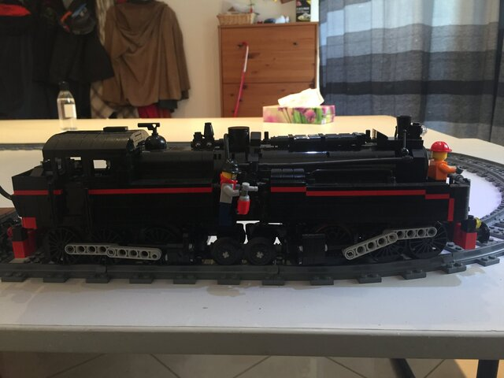](https://www.freelug.org/IMG/jpg/fs04.jpg)

[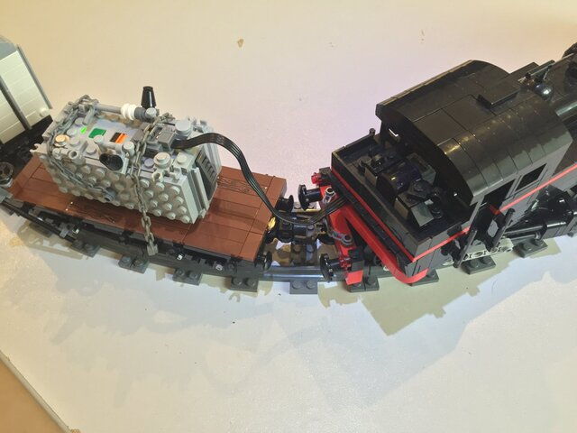](https://www.freelug.org/IMG/jpg/fs05.jpg)

Video Player

[Vidéo de la publication d’origine](https://www.freelug.org/IMG/mp4/fs-video.mp4)

**5\. Caty et Pierre (Ecrou Papillon) - Projet refusé : "Yellow Train"**  
Ensemble composé d’une locomotive avec compartiment voyageurs suivie de son wagon voyageurs. Les plate round 2x2 red représentent des fenêtres rondes et étanches. Ce MOC est d’inspiration psychédélique mais il ne faut pas fumer des substances illicites pour l’apprécier.

[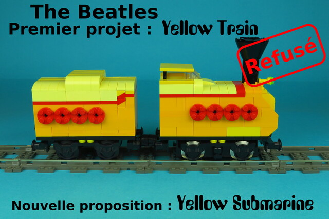](https://www.freelug.org/IMG/jpg/cp01.jpg)

[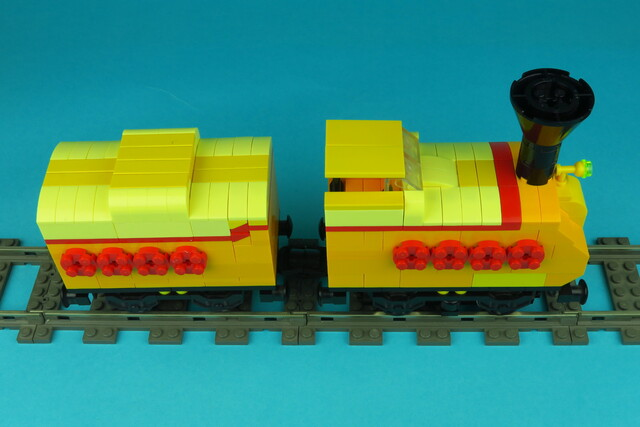](https://www.freelug.org/IMG/jpg/cp02.jpg)

[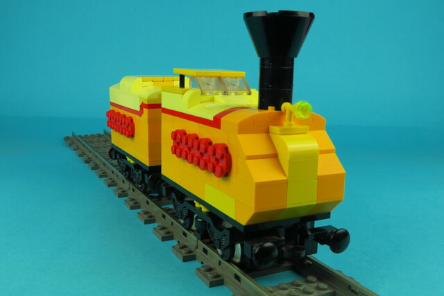](https://www.freelug.org/IMG/jpg/cp03.jpg)

[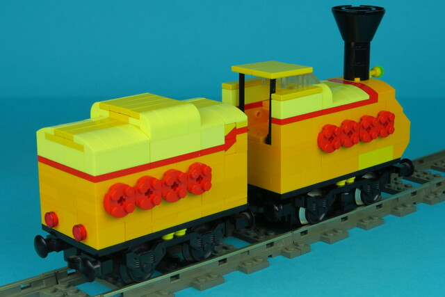](https://www.freelug.org/IMG/jpg/cp04.jpg)

[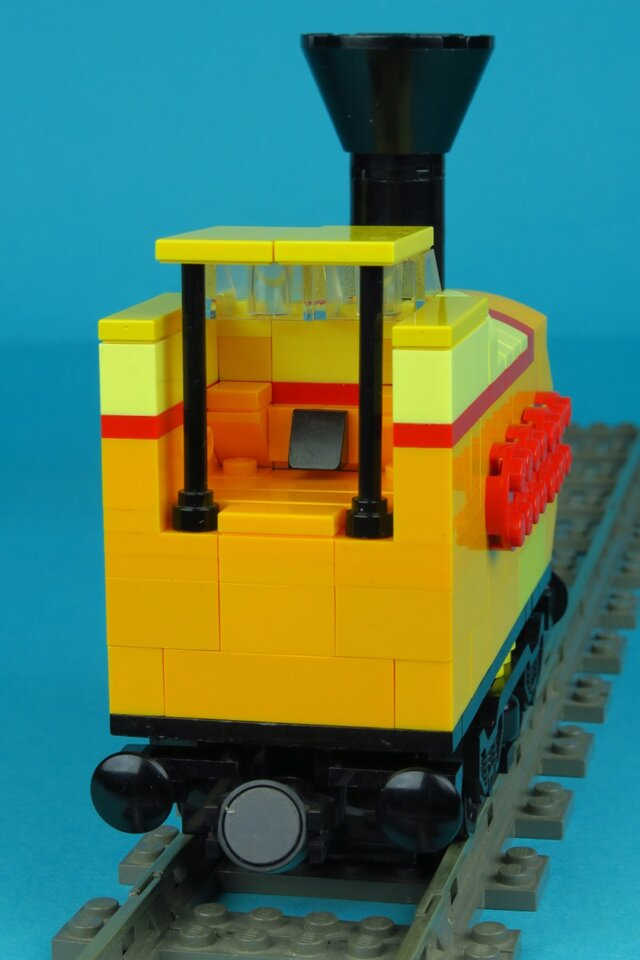](https://www.freelug.org/IMG/jpg/cp05.jpg)

Video Player

[Vidéo de la publication d’origine](https://www.freelug.org/IMG/mp4/cp-video.mp4)

**6\. Rémi L. - Santa Fé Friends** sur la base du Ice Passenger de 2006. Il rend hommage au Santa Fé et au Metro Liner, anciens trains officiel de la gamme Lego. Les toits des wagons sont amovibles, les portes s’ouvrent.

[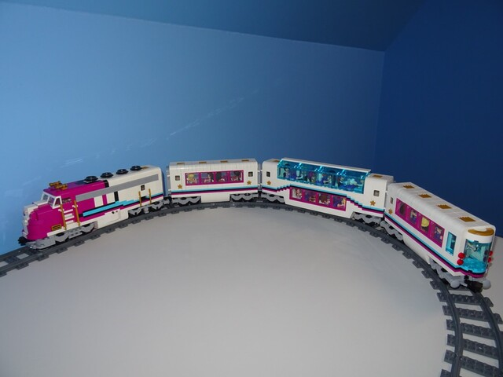](https://www.freelug.org/IMG/jpg/rl01-2.jpg)

[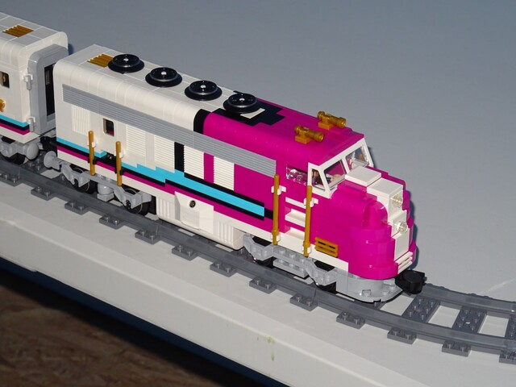](https://www.freelug.org/IMG/jpg/rl02-2.jpg)

[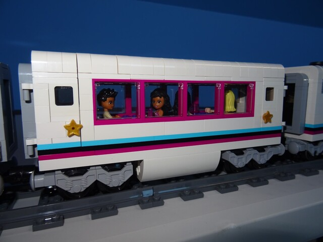](https://www.freelug.org/IMG/jpg/rl03-2.jpg)

[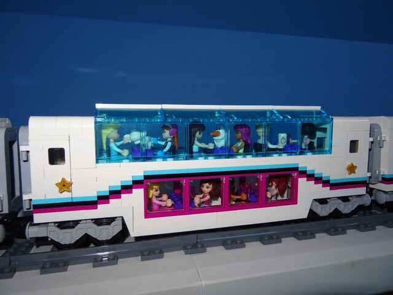](https://www.freelug.org/IMG/jpg/rl04-2.jpg)

[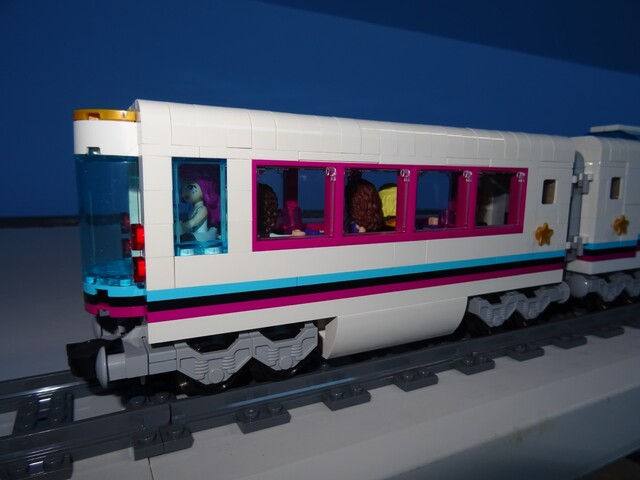](https://www.freelug.org/IMG/jpg/rl05-2.jpg)

Video Player

[Vidéo de la publication d’origine](https://www.freelug.org/IMG/mp4/rl-video.mp4)

**7\. Nicolas C. - Petit train rouge avec ses deux wagons**

[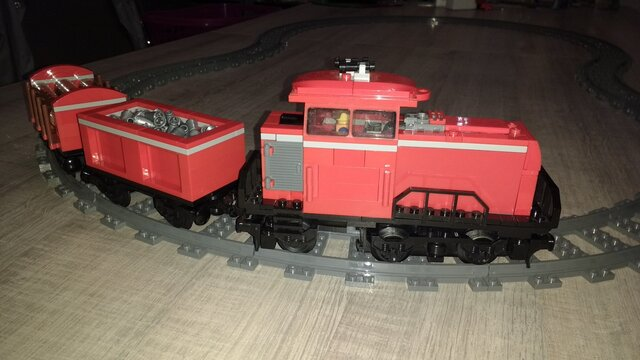](https://www.freelug.org/IMG/jpg/nc01.jpg)

[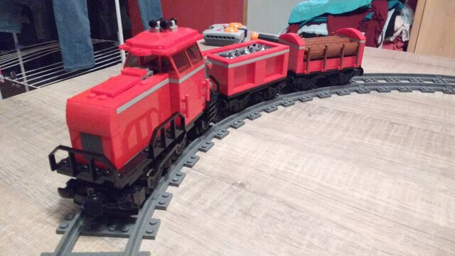](https://www.freelug.org/IMG/jpg/nc02.jpg)

[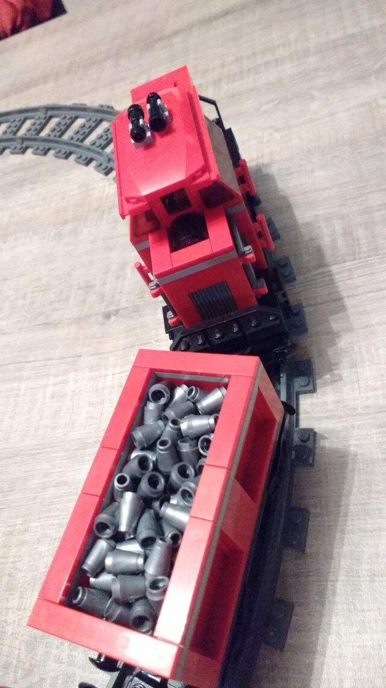](https://www.freelug.org/IMG/jpg/nc03.jpg)

[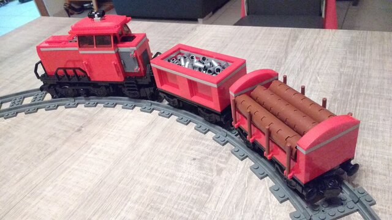](https://www.freelug.org/IMG/jpg/nc04.jpg)

[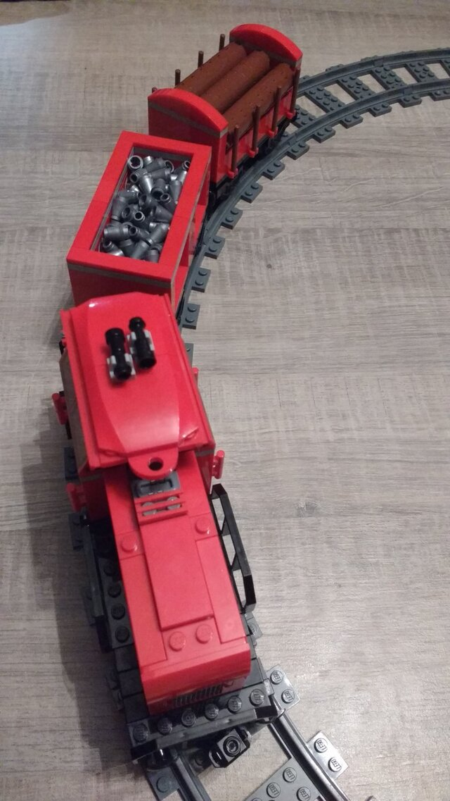](https://www.freelug.org/IMG/jpg/nc05.jpg)

Video Player

[Vidéo de la publication d’origine](https://www.freelug.org/IMG/mp4/nc-video.mp4)

**8\. Nicolas G. - Train Space Police équipé d’un moteur 4,5V**

[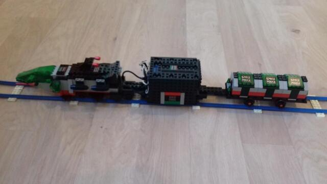](https://www.freelug.org/IMG/jpg/ng01-2.jpg)

[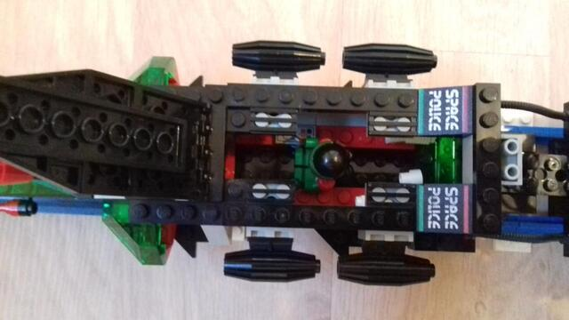](https://www.freelug.org/IMG/jpg/ng02-2.jpg)

[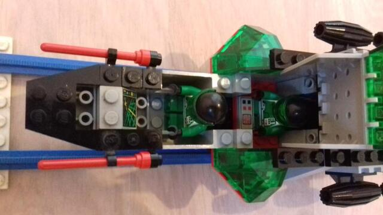](https://www.freelug.org/IMG/jpg/ng03-2.jpg)

[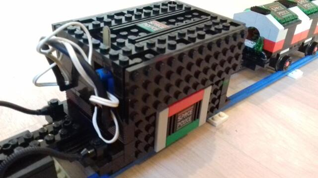](https://www.freelug.org/IMG/jpg/ng04-2.jpg)

[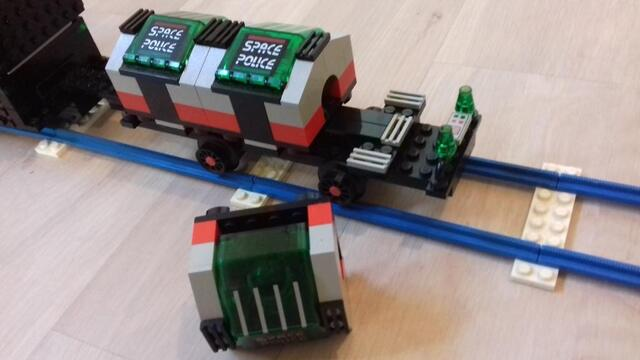](https://www.freelug.org/IMG/jpg/ng05-2.jpg)

Video Player

[Vidéo de la publication d’origine](https://www.freelug.org/IMG/mp4/ng-video.mp4)

**9\. Emmanuel B. - Locomotive électrique Marron avec Wagon "combi".**

Le design de la locomotive est inspiré de plusieurs types de locomotives électriques milieu XXe siècle, avec des grandes roues centrales et des roues normales devant et derrière, motorisation Powered Up.  
Construite en 7 de large pour venir exprès déborder sur les grandes roues centrales,  
les bissels sont doublement articulés pour bien fonctionner dans les virages et lumières LED avant et arrière.

**–** Pour les wagons l’idée était de transposer le combi VW 10220 sous forme de wagon, en reprenant les mêmes couleurs rouge/noir/blanc avec les mêmes rideaux aux fenêtres, un wagon normal, un wagon porte-bagage sur le toit et un wagon panoramique. Tous les toits et toutes les portes s’ouvrent.

[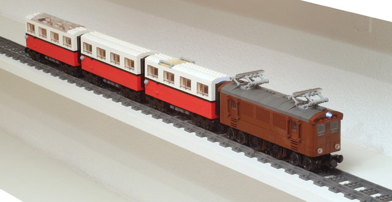](https://www.freelug.org/IMG/jpg/eb01.jpg)

[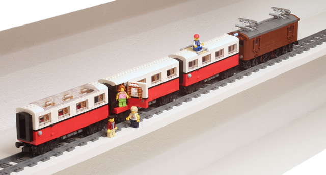](https://www.freelug.org/IMG/jpg/eb02.jpg)

[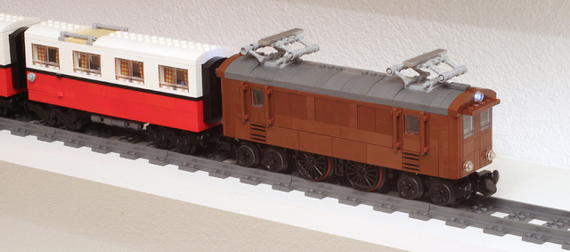](https://www.freelug.org/IMG/jpg/eb03.jpg)

[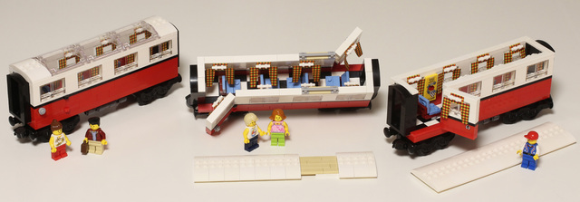](https://www.freelug.org/IMG/jpg/eb04.jpg)

[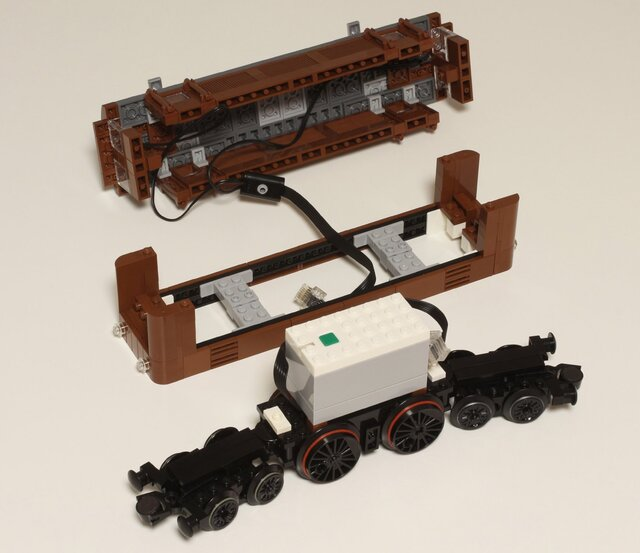](https://www.freelug.org/IMG/jpg/eb05.jpg)

Video Player

[Vidéo de la publication d’origine](https://www.freelug.org/IMG/mp4/eb-video.mp4)

**Les heureux gagnants de ce concours sont :  
1\. Emmanuel B. - Locomotive électrique Marron avec Wagon "combi"** qui remporte les sets LEGO 7848 : Toys’r’us Truck et le set LEGO City People Pack 60134 : Fun in the Park.  
**2\. Rémi L. - Santa Fé Friends** qui remporte le set LEGO 31076 : Daredevil Stunt Plane  
**3\. Stéphane B. - Train pompier** qui remporte le set Lego 31054 : Blue Express

* * *

Composition du jury :  
Loïc T. (GFC)  
Mathieu W. (GFC)  
Pierre C. (Tribolego) (GFC)  
Xavier B.  
Philippe H. (Philo)  
Julien P.  
Laurent C.  
Sylvain J.  
Didier E.

Classement :  
1\. Emmanuel B. (7 points)  
2\. Rémi L. (6 points)  
3\. Stéphane B. (6 points)  
4\. Jérome T. (3 points)  
5\. Frank S. & Nicolas G. (2 points)  
6\. Caty et Pierre (Ecrou Papillon) (1 point)  
7\. Yoann G. et Nicolas C (0 point)

* * *

* * *

* * *

## Concours Train Virtuel :

**1\. - Pierre C. (Tribolego) - Train transport de fonte en fusion** composé d’une locomotive BB12000 en livrée SNCF et de 3 wagons torpédo transportant la fonte en fusion. Le train est fonctionnel, même les wagons torpédo et leurs nombreux essieux.

[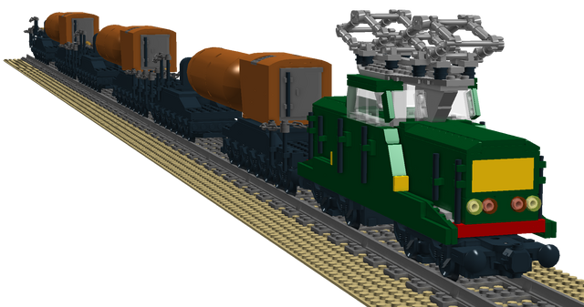](https://www.freelug.org/IMG/png/pc01.png)

[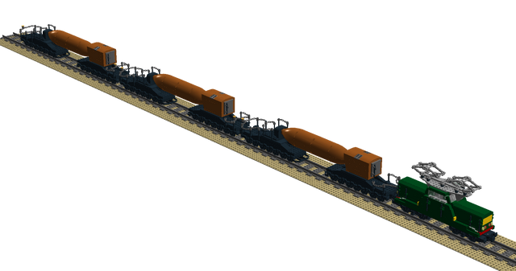](https://www.freelug.org/IMG/png/pc02.png)

[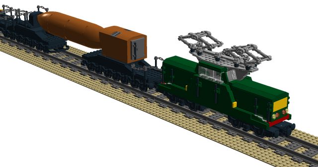](https://www.freelug.org/IMG/png/pc03.png)

[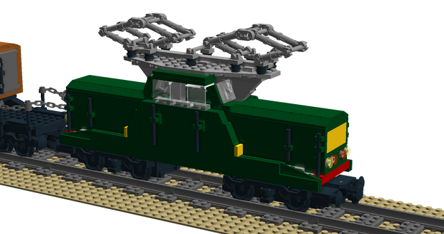](https://www.freelug.org/IMG/png/pc04.png)

[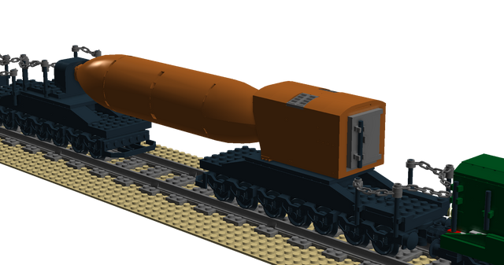](https://www.freelug.org/IMG/png/pc05.png)

**2\. Rémi L. - Train Harry Potter** sur la base du dernier sorti. Locomotive allongée pour coller au plus proche de la réalité. Motorisation dans le tender (boitier pile, récepteur et moteur). Voitures voyageurs allongées avec portes qui s’ouvrent. Le wagon de Hagrid est purement inventé et n’apparait dans aucun film. Il permet de transporter la moto Side-car d’Hagrid ainsi que Buck, son Hippogriffe.

**3\. - Richard L. - 141R avec son tender 30R et 3 wagons époque III** : un fourgon et 2 voitures voyageurs. 1 image montre le détail de la motorisation pour répondre à la règle d’un train motorisé et une autre l’intérieur des wagons avec les toilettes aux extrémités.

**L’heureux gagnant de ce concours est Richard L. - 141R avec son tender 30R et 3 wagons époque III** qui remporte les sets LEGO 60101 : Airport Cargo Plane et le set LEGO 60134 : Fun in the Park.

* * *

Composition du jury :  
Loïc T. (GFC)  
Mathieu W. (GFC)

Xavier B.  
Yoann G.  
Philippe H. (Philo)  
Julien P.  
Laurent C.  
Sylvain J.

Classement :  
1\. Richard L. (8 points)  
2\. Pierre C. (Tribolego) - Rémi L. (0 point)

**Merci à toutes et tous et à bientôt pour un nouveau concours !**
